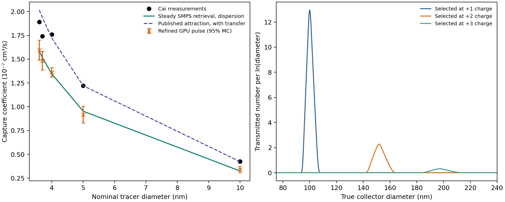

# Can charge explain nanoparticle scavenging in a NaCl chamber?

Cai et al. measured how fast nominally 100 nm NaCl particles captured 3.6–10 nm NaCl particles. Capture was 1.84–2.14 times faster than Particula’s neutral Brownian hard-sphere prediction. At 4 nm, our calculation of electrostatic attraction adds only 2.7% at the expected neutralizer outlet charge distribution. A larger effect arises because doubly and triply charged collectors can pass the upstream classifier at larger physical diameters. Under the reference source spectrum, the combined effect of finite classifier widths and multiple charges raises the dispersion calculation by 16% at 4 nm. [Cai et al. (2022)](https://doi.org/10.5194/acp-22-11529-2022) · [Runlong Cai’s archived figure data, CC BY 4.0](https://doi.org/10.5281/zenodo.6982767)

## What charge reached the chamber?

Cai et al. identify a 90 MBq ⁶³Ni neutralizer on the chamber inlet, **after** mobility selection. Bipolar ion attachment establishes a distribution of signed charges. The authors describe electrostatic loss of charged sub-10 nm particles in the Teflon inlet. The sampling SMPS has a separate charger and classifier. Its charge distribution determines the probability of detection at each mobility setting. The total-count CPC monitoring collector abundance counts each particle once. [Experiment layout and methods, Fig. 1 and §2.1](https://acp.copernicus.org/articles/22/11529/2022/)

| Population and location | Ion pair production (cm⁻³ s⁻¹) | Negative | Neutral | Positive |
| --- | ---: | ---: | ---: | ---: |
| 4 nm, ideal bipolar outlet | — | 1.72% | 96.81% | 1.47% |
| 100 nm, ideal bipolar outlet | — | 33.51% | 42.07% | 24.42% |
| Nominal 4 nm, chamber | 2 | 0.24% | 99.57% | 0.19% |
| Nominal 4 nm, chamber | 100 | 1.00% | 98.27% | 0.74% |
| Nominal 100 nm, chamber | 2 | 34.69% | 40.02% | 25.30% |
| Nominal 100 nm, chamber | 100 | 34.86% | 39.59% | 25.55% |

The outlet values are normalized estimates at individual diameters. The chamber estimates integrate the transmitted true sizes at steady state with 10,000 collectors/cm³, relative charged-tracer inlet transmission of 0.1, and either natural-background or elevated ion production. The experiment reported neither the chamber ion concentrations nor the charge-resolved inlet counts. The scenario spread therefore measures sensitivity to those assumptions. [Outlet fractions](https://github.com/uncscode/particula/blob/main/docs/data/nacl-scavenging/charge-fractions.csv) · [Chamber scenarios](https://github.com/uncscode/particula/blob/main/docs/data/nacl-scavenging/steady.csv)

The [worked example](../../../examples/processes/coagulation/charge/nacl_scavenging.py) evaluates `par.particles.get_bipolar_charge_probability(diameter_m, charge)`. It uses the Wiedensohler polynomial $f_z=10^{\sum_{i=0}^{5} a_i(z)[\log_{10}(d/\mathrm{nm})]^i}$ for the neutral and singly charged states at 1–1000 nm and the doubly charged states at 20–1000 nm. The independent fits give a raw neutral fraction of 0.4259 at 100 nm. For population sampling we add the higher-charge tails and normalize, giving 0.4207. At sufficiently large diameters the study uses the asymmetric Gaussian with an ion mobility ratio of 0.875 for higher states. It uses ion-attachment flux ratios for rare, small multiply charged particles. A separate ⁶³Ni experiment measured the positive singly charged fraction for 100 nm PSL. Transfer of that result to nanometer salt requires assumptions about ion exposure and residence time. [Wiedensohler (1988)](https://doi.org/10.1016/0021-8502(88)90278-9) · [Coefficient table A7](https://doi.org/10.5194/amt-5-657-2012) · [TSI manual, Appendix B](https://cires1.colorado.edu/jimenez-group/Manuals/SMPS_3080_manual.pdf) · [Funato et al.](https://doi.org/10.11203/jar.40.253)

## What did the size classifiers transmit?

The classifier passes a band of electrical mobilities proportional to $|z|C_c(d)/d$. For a nominal 100 nm setting, particle diameters of **100, 152 and 197 nm** share the central mobility at charges +1, +2 and +3. The inlet neutralizer changes their subsequent charge while preserving their physical size. In the reference run, those branches supplied 82.2%, 15.5% and 2.3% of the incoming collectors. The +2 branch supplied only 0.022% of the nominal 4 nm tracers. The deposited chamber scans do not characterize the upstream collector size spectrum, so the transmitted branch weights are model estimates. [DMA transfer theory](https://doi.org/10.1080/02786820802157823)

We assumed lognormal source number spectra centered at the nominal diameters with geometric standard deviation 1.6. Balanced-flow triangular transfer functions use the reported 3.5/10 aerosol-to-sheath flow ratio for the small classifier and an assumed 0.10 for the collector and the original single-channel sampling calculation. Additional Gaussian broadening in relative mobility has standard deviation 0.03 for the small classifier and sampling SMPS, and 0.01 for the collector classifier. The sampling calculation sums the three positive branches with unit CPC efficiency. Sensitivity runs vary polarity, charge distribution, source spectrum, transmission width, charge tails and counting efficiency. [Study inputs](https://github.com/uncscode/particula/blob/main/scripts/nacl_scavenging/instrument.py)

### Check against the recorded 4 nm SMPS scan

The authors’ later deposit preserves the original figure archive and adds chamber SMPS, CPC and flow time series. The July 29 4 nm file identifies a TSI 3085 DMA and a 3776 high-flow CPC. It exports raw counts at seven nominal diameters from 3.59 to 4.45 nm, with multiple-charge and diffusion corrections switched off. The recorded aerosol and sheath settings are 1.5 and 5 L/min, giving a flow ratio of **0.30**. All 103 scans carry an inlet flow rate error flag. Those entries establish the configured flows. Actual flow and size-dependent transmission remain uncertain. [Cai’s updated archive, `metadata/timeseries/SMPSchamber20210729_4nm.txt`](https://doi.org/10.5281/zenodo.13291658)

We summed the seven modeled channels with equal dwell time, including singly, doubly and triply charged particles in each. Keeping the original collector spectrum, wall model and flat CPC efficiency gives **1.31 × 10⁻⁷ cm³/s** for Particula plus dispersion and **1.67 × 10⁻⁷ cm³/s** on the authors’ attraction baseline, 5.0% below the measured 1.76. This is a forward calculation with recorded scan settings. Recovering an experimental coefficient directly from those time series also requires matching the blank, loaded periods and source-flow corrections. [Results with the recorded 4 nm settings](https://github.com/uncscode/particula/blob/main/docs/data/nacl-scavenging/archived-4nm-scan.csv)

## Compare the same observable as the experiment

For each size we fitted the blank decay to obtain the total first-order loss rate. At 4 nm this gives 7.07 h⁻¹, including 0.60 h⁻¹ of dilution and 6.47 h⁻¹ of wall loss. We interpolate six wall-loss fits in log diameter and log rate, holding endpoint rates constant outside 3–100 nm. The steady chamber calculation balances continuous injection, both polarities of ion attachment, wall loss, dilution and collector capture. From the simulated blank and loaded SMPS signals $S_0$ and $S_N$, we retrieve $\beta_{\mathrm{app}}=\lambda_{\mathrm{blank}}(S_0/S_N-1)/N$. The steady calculation holds the collector abundance at its CPC value. [Six blank decay fits](https://github.com/uncscode/particula/blob/main/docs/data/nacl-scavenging/wall-fits.csv)

| Tracer (nm) | Measured | Charged hard spheres with transfer | Particula + dispersion with transfer | Published attraction at nominal sizes | Published attraction with transfer |
| ---: | ---: | ---: | ---: | ---: | ---: |
| 3.6 | 1.89 | 1.13 | 1.58 | 1.73 | 2.02 |
| 3.7 | 1.74 | 1.08 | 1.52 | 1.66 | 1.94 |
| 4.0 | 1.76 | 0.953 | 1.34 | 1.48 | 1.72 |
| 5.0 | 1.22 | 0.668 | 0.953 | 1.06 | 1.22 |
| 10.0 | 0.425 | 0.221 | 0.325 | 0.378 | 0.424 |

All rates are in 10⁻⁷ cm³/s. The last column anchors the absolute rate for a 100 nm collector to the authors’ van der Waals curve and uses the simulation for the relative size and charge dependence. Changing the assumed collector source geometric mean from 70 to 160 nm moves its 4 nm prediction from 1.60 to 2.01. The reference agrees within 2.3% at 4, 5 and 10 nm and overshoots at 3.6 and 3.7 nm by 6.6% and 11.2%. A downstream size scan spanning 100–200 nm would constrain the collector spectrum and distinguish this explanation from a change in collision physics. [Coefficient comparison](https://github.com/uncscode/particula/blob/main/docs/data/nacl-scavenging/comparison.csv) · [Authors’ model, Eqs. S4–S11](https://doi.org/10.5194/acp-22-11529-2022-supplement)



For a tracer growing from 3.6 to 10 nm at a prescribed 3 nm/h, the concentration of 100 nm collectors giving 50% survival is 2,096/cm³ using neutral Particula rates and 1,010/cm³ using log-log interpolation of the five measurements. Linear interpolation gives 916/cm³. This calculation integrates coagulation loss alone and shows how the unmeasured 5–10 nm interval affects inferred survival. [Survival calculations](https://github.com/uncscode/particula/blob/main/docs/data/nacl-scavenging/survival.csv)

## What did the particle-resolved runs check?

The CUDA calculation follows 300 s source-off pulses. Each independent volume initially contains one tagged tracer and zero or eight collectors. Two salt mass inventories distinguish the cohorts after collisions. We track wall deposition, dilution, charge exchanged with a prescribed ion bath, collector depletion and the capture exposure experienced by live tracers. The ensembles check number, mass and signed charge at each output. The chamber uses the conductive-particle ion-attachment rates at their tabulated 298.15 K, with pair collisions calculated at 293.15 K. The assumed ion balance includes recombination, dilution and initial collector uptake. [Attachment model](https://doi.org/10.1080/02786826.2013.783684) · [Ion recombination](https://doi.org/10.5194/acp-15-7203-2015)

At 4 nm the dispersion pulse gave **1.36 ± 0.05 × 10⁻⁷ cm³/s** at a 2.5 s step, compared with 1.46 ± 0.14 at 5 s. Intervals are 95% Student-t intervals over four seeds and quantify Monte Carlo variation. After five minutes, 37.9% of tracers remained, 34.1% reached the walls, 3.6% left by dilution, and 24.4% coagulated. The steady retrieval uses a separate continuous-source model. Refining its size quadrature and kernel grid changed the reference results by less than 0.1%. [GPU pulse ensembles](https://github.com/uncscode/particula/blob/main/docs/data/nacl-scavenging/gpu-summary.csv)

The GPU dispersion calculation adds $(E_{\mathrm{vdW}}-1)K_0$ to the native charge-dependent hard-sphere kernel, using the neutral rate $K_0$ at the actual pair sizes and a Hamaker constant of $8.9\times10^{-20}$ J. Joint electrostatic and dispersion forces are approximated this way. A separate monodisperse calculation sums the conducting-sphere electrostatic and Hamaker potentials before evaluating capture. It includes induced polarization of neutral partners and gives a 2.4–5.4% charge-only enhancement across the five sizes. Surface charge redistribution on dry salt is a material assumption. [Conducting spheres](https://doi.org/10.1098/rspa.2012.0133) · [Monodisperse results](https://github.com/uncscode/particula/blob/main/docs/data/nacl-scavenging/charge-scenarios.csv)

## Reproduce the calculations

Run these commands from the repository root with Particula’s scientific Python environment active and Warp installed. The campaign requires a CUDA device. The other calculations run on the CPU. Results are written to `.artifacts/nacl-scavenging/`. Set `PARTICULA_SCAVENGING_OUTPUT` to choose a different destination.

```bash
export PYTHONPATH=.
study=scripts/nacl_scavenging
python "$study/study.py"
python "$study/charge_study.py"
python "$study/campaign.py"
OPENBLAS_NUM_THREADS=1 python "$study/steady.py"
python "$study/summarize.py"
```

The archived campaign used Particula 0.3.2 at revision `2303121c90`, Warp 1.11.1 and an RTX 5060. Eight scenarios, four seeds, five sizes, paired loadings and 2,048 boxes per condition gave 655,360 box histories. The raw figure archive is redistributed unchanged under CC BY 4.0. The worked example recalculates outlet charge fractions and equivalent mobility diameters and plots the saved steady results. [Original run record](https://github.com/uncscode/particula/blob/main/docs/data/nacl-scavenging/run.json) · [Reproduction scripts](https://github.com/uncscode/particula/tree/main/scripts/nacl_scavenging) · [Source data](https://doi.org/10.5281/zenodo.6982767)
