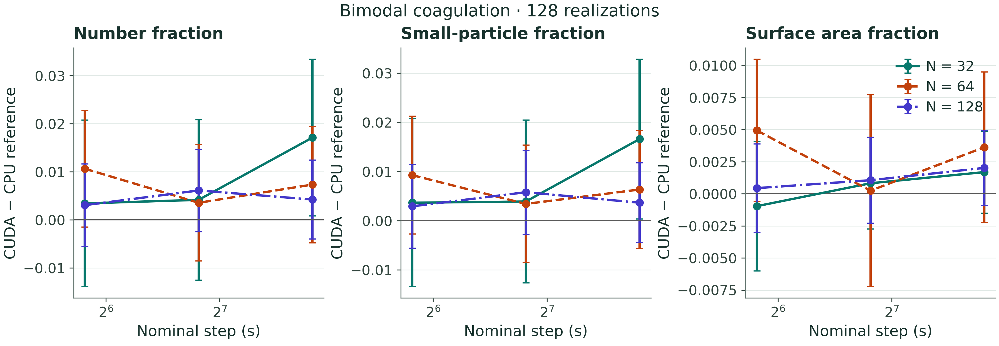

# Scientific correctness reference baseline

Status: validation in progress on the Stage 1 branch based on `894f60350`.
Measurements below use Python 3.12, float64 CPU calculations; CUDA checks use
an NVIDIA RTX 5060 with driver 615.78.08. They verify implementation and
numerical limits, not agreement with independent laboratory measurements.

## Findings and decisions

| Finding | Classification and disposition |
| --- | --- |
| Mixture density inconsistent with additive-volume radius | Confirmed defect. Equal material volumes at 1000 and 2000 kg/m³ gave 1666.67 instead of 1500 kg/m³. CPU density now uses total mass/total material volume, matching existing GPU physics. Single-material results are unchanged. |
| Negative coagulation births in sparse tails | Confirmed interpolation defect. Cubic interpolation of positive collision densities produced negative values; decreasing dt from 2000 to 0.002 s did not resolve negative updates. Both PMF-converted and PDF gain quadratures now constrain interpolated births to nonnegative values. Time-step rejection remains intact. |
| Subfreezing water vapor pressure | Phase-model boundary. Buck selects ice below 273.15 K and liquid above it; it is not a supercooled-liquid or freezing model. The condensation guide now states this boundary. |
| Inventory-limited condensation | Numerical-resolution limit. Positive state and species closure do not establish trajectory accuracy. The independent growth reference below measures time refinement. |
| Fixed-composition binned coagulation | Representation limitation. Variable material fractions across sizes retain individual-species defects even as total mass converges. Use resolved particles for the selected coupled species-budget claim. |
| First tutorial's 100 kg/m³ vapor | Already explicitly labeled exaggerated, not calibrated. It is not a research reference; no atmospheric accuracy claim is made for it. |
| Import logging | Confirmed reproducibility defect. Import previously created package-local files and changed application logging. Import now adds a NullHandler only; explicit legacy setup remains opt-in. |
| Version alignment | Source is 0.3.1; stale AGENTS wording corrected. No release or version bump is implied. |
| CPU installation | Retain the declared Warp dependency. CPU execution needs no CUDA device, but this delivery does not offer a Warp-free package. |

## Independent reference definitions

Exact dilution uses the solution `c(t)=c(0) exp(-Qt/V)` in
`particula/dynamics/tests/dilution_test.py`, including distinct gas and particle
updates and preserved per-particle properties.

Condensation uses a monodisperse 1 µm sphere of density 1000 kg/m³, vapor
1e-5 kg/m³, number density 1e9 m⁻³, temperature 298.15 K, pressure 101325 Pa,
diffusivity 2e-5 m²/s and prescribed viscosity 1.8e-5 Pa s. Zero surface vapor
pressure isolates transport. Integrating `dt/dr` independently gives the time
to radius 1.2 µm. In the closed box, gas depletion is determined by species
conservation. With common dilution hazard k, replace elapsed time in the
undiluted solution by `(1-exp(-kt))/k`. Production rate helpers are not used
by this quadrature oracle.

| Case | Duration (s) | Radius error, 16 steps | 32 steps | 64 steps |
| --- | ---: | ---: | ---: | ---: |
| Fixed reservoir | 1.16232227 | 0.00110597 | 0.000553773 | 0.000277082 |
| Closed box | 1.37856539 | 0.000808400 | 0.000405070 | 0.000202747 |
| Dilution before growth | 1.53808988 | 0.000276841 | 0.000134724 | 0.000066437 |
| Dilution after growth | 1.53808988 | 0.00186326 | 0.000929738 | 0.000464395 |

Errors are absolute errors in r/r0. The predeclared finest-grid bound is 0.002;
each halving must reduce error by a factor below 0.6. Closed/diluted material
budgets use rtol 2e-14. Different process orders converge to the same solution;
these cases do not establish accuracy in stiff equilibrium regimes.

For constant-kernel coagulation, initial mass density is exponential,
`n(m,0)=N0/m0 exp(-m/m0)`. The exact solution is
`n(m,t)=N0/[m0(1+tau)^2] exp[-m/(m0(1+tau))]`, with `tau=K*N0*t/2`.
Transform to radius density with the mass/radius Jacobian. Inputs are
N0=1e9 m⁻³, K=1e-15 m³/s, characteristic radius 100 nm, radius domain
1 nm–1 µm, density 1000 kg/m³, duration 2e5 s and 100 time steps.

| Radius nodes | Relative number error | Relative mass error | Integrated spectrum error/N0 |
| ---: | ---: | ---: | ---: |
| 128 | 0.000318886 | 0.000089594 | 0.000163057 |
| 256 | 0.000013571 | 0.000021436 | 0.000124353 |
| 512 | 0.000062065 | 0.000004905 | 0.000117116 |

All finest-grid errors must be below 0.002. The number error is not monotonic:
spatial refinement alone cannot remove time error. Separate existing PMF/PDF
refinement tests check uniform-composition mass quadrature and characterize
persistent variable-composition species defects without relaxing tolerances.

Removal sampling separately varies 128/512 represented slots and 16/64 seeds
at fixed physical population. With hazard 0.7 s⁻¹, the independent survival
probability is exp(-0.7); variance of the ensemble-mean fraction is
p(1-p)/(slots*samples). Five-standard-error mean bounds, predeclared variance
bounds and per-material removed-plus-retained budgets pass all four cases.
This qualifies removal sampling, not arbitrary coagulation sampling workloads.

The existing resolved coagulation pair test uses 4000 trials for each of
interpolated, radius-callable and index-callable kernels. The independent
probability is K*dt/V=0.2 and the mean must lie within five binomial standard
errors. This resolves the earlier same-bin self-pair concern for that regime.
The sampler caps trials at ten times the larger bin population and allows each
donor only one collision per step. Its endpoint estimate is not a proven upper
bound for arbitrary non-monotone custom kernels. Large timesteps, capped
probabilities above one and such unqualified kernels are excluded from this
baseline's kinetic accuracy claim; reduce timestep and establish ensemble
convergence for a chosen workload. These limitations do not invalidate the
separate resolved species conservation tests.

## Reproduction and remaining gates

Run the reference modules with the selected checkout's Python:

```bash
python -m pytest particula/integration_tests/condensation_reference_test.py \
  particula/integration_tests/coagulation_reference_test.py \
  particula/integration_tests/sampling_reference_test.py \
  --no-cov -q -Werror -o junit_family=legacy --junitxml=reference-results.xml
```

Ten cases passed. JUnit properties retain convergence errors and durations.
The mixture regression independently checks total mass equals density times
spherical volume, including an empty slot. Existing mapped-species integration
checks cover inert lanes, resolved representative volumes and PDF quadrature.

## Final validation

The unfiltered package run with warnings treated as errors passed 10583 tests,
with 20 skips and one expected failure. Coverage was 91.34%, above the unchanged
80% gate. The source/example/tooling commands are those in the repository
validation reference, using the existing Python 3.12 environment. The full run
includes available CUDA tests; skipped capabilities remain outside the claim.
Explicit concrete wall-loss checks were also included in the focused CPU run.

| Gate | Observed result |
| --- | --- |
| Focused CPU density/consumer tests | 1611 passed |
| Warp properties and wall-loss checks | 103 passed with RTX 5060 access |
| Independent growth/coagulation/sampling references | 10 passed |
| Installed wheel CPU release selection | 5086 passed, 25 skipped, 1130 deselected |
| Example regressions | 241 passed, one skipped |
| Tooling/publication tests | 319 passed |
| Ruff and formatting | Passed |
| Mypy | No issues in 645 source files |
| Documentation build | 533 generated pages; rendered structural check passed |

The installed runner deliberately excludes GPU-heavy selections and is not a
replacement for the full source suite. Its isolated environment validates
installed package identity and dependency consistency. Wheel/sdist bundle
checks also verified source hashes, separate installs and offline rebuilding;
those artifacts are verification outputs, not an approved release.

Affected CPU coagulation, wall-loss and organic-partitioning examples were
executed in full. Refreshed output bundles retain their input/revision metadata;
changed plots were visually inspected. Import-log removal changed three
wall-loss tutorial figure filenames; manifests and files were refreshed together.

Publication previously tested documentation bundles on a release event without
rerunning source suites for that event. The release workflow now requires source,
example and tooling tests before build/upload, retaining exact bundle validation.
No release was published by this work.

Independent experimental validation, stiff/adaptive solver design, unrestricted
custom-kernel sampling and new thermodynamics remain outside this baseline.
Their absence does not support a claim of accuracy beyond the cases above.

## Scalable native coagulation: issue 1661

This separate validation uses the issue-1661 implementation based on
`eea5699f770c4c9a10a132fd7784a1d1ef75f699`, Python 3.12, Warp 1.11.1 and native
CUDA on an RTX 5060 (driver 615.78.08). The executable study is
`scripts/gpu_studies/coagulation_convergence.py`. Run it from the checkout with
`python scripts/gpu_studies/coagulation_convergence.py --device cuda:0 --ensembles 128 --output docs/data/gpu/coagulation-convergence-1661.json`.

The population has unit represented counts, density 1000 kg/m³, number density
10¹⁰ m⁻³, and an exactly resolved 7:1 ratio of 100 nm particles to 4 µm
collectors. Brownian motion, SP2016 differential settling and ST1956 turbulent
shear are summed at 298.15 K, 101325 Pa, dissipation 10⁻³ m²/s³ and fluid density
1.2 kg/m³. Varying particle count changes representative volume at fixed number
density. Each size uses 128 independent realizations over 1800.808 s.

The CPU reference is a continuous-time Gillespie chain that recomputes the CPU
strategy matrix after each merger. It independently selects exponentially timed
and rate-weighted pairs; it does not call the device sampler. Nominal GPU steps
are 225.101, 112.551 and 56.275 s, with explicit resource-bound checks in the
study driver. The library itself does not subcycle. Both paths check mass and
charge inventories; device steps also check number loss against accepted events.

The error bars span two combined standard errors about each CUDA minus CPU
difference. Redraw these panels from the published JSON with
`python -m scripts.gpu_studies.coagulation_convergence_figure`.



| Particles | CPU events | CUDA events at finest step | Largest finest-step discrepancy / combined standard error |
| ---: | ---: | ---: | ---: |
| 32 | 857 | 843 | 0.43 |
| 64 | 1685 | 1598 | 1.78 |
| 128 | 3362 | 3312 | 0.71 |

The three observables are remaining number fraction, remaining small-particle
fraction (radius below 0.5 µm, normalized by initial total count), and surface
area relative to its initial value. All finest results satisfy the predeclared
criterion of five combined standard errors plus one event per ensemble
population. The [saved numerical data](https://github.com/uncscode/particula/blob/main/docs/data/gpu/coagulation-convergence-1661.json)
contain means, standard errors, actual steps and events for every refinement.

This establishes finite-ensemble agreement for this resolved bimodal case.
It does not demonstrate a formal convergence order, monotonic errors, physical
kernel accuracy against measurements, throughput, or adequate sampling of a
10⁶:1 rare minority. Removing a population cap does not solve rare-event
representation. Resource-admitted timesteps still require accuracy studies.

### CUDA population boundaries and resource scaling

The full scalable example also ran on the same RTX 5060 across both former
limits, with conservation and exact count-loss assertions. These are example
workloads, not maximum supported sizes. The time column measures preflight
wall time, including host setup and possible compilation during concurrent
validation; it is not a throughput benchmark. Storage excludes particle arrays.

| Active particles | Workspace/output bytes | Preflight seconds | Attempted trials | Accepted collisions |
| ---: | ---: | ---: | ---: | ---: |
| 255 | 31660 | 0.0273 | 64 | 1 |
| 256 | 31844 | 0.0021 | 64 | 3 |
| 257 | 32036 | 0.0015 | 64 | 0 |
| 2000 | 152868 | 0.0100 | 128 | 4 |
| 5000 | 332868 | 0.0420 | 128 | 6 |
| 10000 | 632868 | 0.1427 | 128 | 4 |
| 16383 | 1015844 | 0.4324 | 128 | 2 |
| 16384 | 1015908 | 0.4433 | 128 | 1 |
| 16385 | 1015964 | 0.3575 | 128 | 4 |
| 32768 | 1998948 | 1.4998 | 128 | 1 |

The 257-particle realization attempted 64 trials and accepted none; this is a
valid stochastic outcome. [Complete settings and results](https://github.com/uncscode/particula/blob/main/docs/data/gpu/coagulation-scaling-1661.json)
retain the exact timesteps and demand. Reproduce by calling `simulate` in
`docs/examples/gpu/direct/scalable_coagulation.py` with `device="cuda:0"` and
`sizes=(255, 256, 257, 2000, 5000, 10000, 16383, 16384, 16385, 32768)`.
