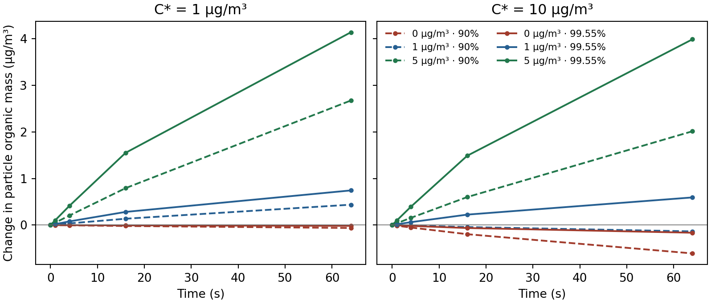

# How seed chemistry and organic vapor change Π Chamber predictions

The fresh-water and salt-water experiments of Prabhakaran et al. both used nearly monodisperse **130 nm dry sodium chloride** particles. The salt water was on the chamber floor. The measurements anchor the NaCl case. A separate Particula mixture study changed particle composition, while treating all dry constituents as nonvolatile. Here we compare two dissolved salts at fixed dry diameter and let a semivolatile organic exchange with the gas. These are predictions for follow-up experiments. [Original experiment, Table 1](https://doi.org/10.1073/pnas.2006426117) · [Chamber comparison](pi-chamber.md)

## What was in the earlier mixtures?

The hygroscopicity parameter κ controls how dissolved material lowers water activity. In the earlier scenarios, internal mixtures contained each component in every particle. External mixtures placed the same inventory into separate particle types at each dry size. Intermediate mixtures placed half the dry volume in the external endmember and half in the internal blend.

| Dry component | κ used | Density (kg/m³) | Marine-like dry volume | Continental-like dry volume |
|---|---:|---:|---:|---:|
| Sodium chloride | 1.28 | 2,160 | 50% | 0% |
| Ammonium sulfate proxy | 0.61 | 1,770 | 10% | 35% |
| Organic proxy | 0.10 | 1,400 | 40% | 55% |
| Weakly wettable carbonaceous proxy | 0.01 | 1,800 | 0% | 10% |

Volume-weighting these κ values gives **0.741** for the internally mixed marine-like seed and **0.270** (rounded) for the continental-like seed. Separate external particles span the endmember values. Thus two populations with identical total constituent volumes can activate differently. The organic proxy represents a prescribed water affinity. It contains no molecular identity, pure vapor pressure or gas-phase inventory. For a named organic, the [citric-acid comparison](citric-acid-comparison.md) shows how BAT water activity can be checked against laboratory data. [κ mixing rule](https://doi.org/10.5194/acp-7-1961-2007)

## What changes if the 130 nm seed is ammonium sulfate?

The following single-particle calculations use the full κ–Köhler curve at 293.15 K, a water surface tension of 0.072 N/m and a dissolved liquid particle. The shared 99.55% RH was inferred in the earlier chamber fit. Crystallization and deliquescence histories are outside this calculation.

| Salt | Equilibrium wet diameter at 99.55% RH | Critical wet diameter | Critical supersaturation |
|---|---:|---:|---:|
| Sodium chloride | 723 nm | 1.99 µm | 0.0713% |
| Ammonium sulfate proxy | 544 nm | 1.38 µm | 0.1033% |

At this RH, the sodium chloride haze particle lies above the instrument’s 0.6 µm lower limit. The sulfate haze particle lies below it. Sulfate also requires a larger supersaturation fluctuation to activate. The paper’s approximately 1.8 µm optical split can still be applied to count particles consistently across experiments. The physical critical size changes with the seed. These roots describe equilibrated particles, while the turbulent chamber samples a range of humidity histories.

## Can the same organic vapor make one particle evaporate and another grow?

We used Binary Activity Thermodynamics (BAT) for a homogeneous water–organic liquid. The organic has molar mass 200 g/mol, O:C = 0.5 and density 1,243.5 kg/m³, following the miscible Figure 9 reference composition. We assigned two illustrative pure-component saturation mass concentrations, **C\* = 1 or 10 µg/m³** at 293.15 K. This holds the water affinity fixed while changing volatility. Each closed box starts with 2,000 particles/cm³, 130 nm organic dry diameter and 2.861 µg/m³ of particle organic. Water first equilibrates at the specified initial RH. The gas then starts with 0, 1 or 5 µg/m³ organic vapor, and both water and organic can move between gas and particles. [Gorkowski, Preston and Zuend (2019)](https://doi.org/10.5194/acp-19-13383-2019) · [Particula BAT reference checks](bat-activity.md)

For **C\* = 10 µg/m³ and initial vapor = 1 µg/m³**, the organic flux changes sign between the two humidities. In the model the equilibrium vapor at the particle surface equals C\* times the organic activity and its Kelvin curvature factor. The wetter particle contains more water, has lower organic activity, and presents a lower equilibrium vapor concentration to the same gas.

| Initial RH | Initial BAT wet diameter | Initial equilibrium organic vapor | Change in particulate organic at 64 s, BAT | Same change, ideal solution |
|---|---:|---:|---:|---:|
| 90% | 153 nm | 1.28 µg/m³ | −0.135 µg/m³ | −0.152 µg/m³ |
| 99.55% | 271 nm | 0.222 µg/m³ | +0.594 µg/m³ | +0.677 µg/m³ |

The ideal-molar control also predicts the sign change. BAT reduces the predicted uptake at 99.55% RH by about 12% relative to the ideal control. Each control equilibrates its starting water content under its own activity law. The difference therefore includes both initial water uptake and subsequent exchange. Under BAT the final particle diameters were 150 and 294 nm, respectively. Both are below the chamber counter’s lower limit. A vapor measurement would still distinguish the two cases because the modeled gas ends at 1.135 and 0.407 µg/m³, respectively.



The 64 s trajectories describe finite closed reservoirs at constant temperature with no additional injection, turbulence or deposition. They isolate local transfer. The two-region chamber calculation separately addresses transport and removal. Homogeneous binary BAT covers water and one organic here. A salt core with an organic coating introduces ion–organic interactions, possible phase separation and surface composition effects. A quantitative prediction for such a particle would need constraints on those interactions. One discriminating experiment would measure dry mobility size, particle organic mass and gas-phase organic concentration along with the wet optical spectrum after a vapor step.

## Reproduce the comparisons

The script solves the salt curves on CPU and integrates the organic cases with Particula’s native particle-resolved CUDA ROS3 solver. One weighted slot per box represents the monodisperse population. Water and organic share a homogeneous liquid surface with surface tension 0.072 N/m and Kelvin density 1,000 kg/m³. Gas diffusivities are 2.4 × 10⁻⁵ and 7 × 10⁻⁶ m²/s, with accommodation coefficients of 0.2 and 1 for water and organic, respectively. RH denotes the initial condition. The finite water reservoir evolves thereafter.

Across the 12 BAT cases on an NVIDIA GeForce RTX 5060, tightening the relative solver tolerance from 10⁻⁴ to 10⁻⁶ changed sampled diameters by less than 0.00014% and particulate organic mass by less than 0.000006%. Including the 12 ideal controls, maximum gas-plus-particle budget residuals were 5.2 × 10⁻¹⁷ kg/m³ for water and 9.1 × 10⁻²⁴ kg/m³ for organic. Those are numerical checks. The paper supplies no organic vapor doses or transfer measurements for comparison. [Simulation script](https://github.com/uncscode/particula/blob/main/scripts/pi_chamber/species.py) · [Time series and conservation checks](https://github.com/uncscode/particula/blob/main/docs/data/pi-chamber/organic-vapor.csv)

```bash
python -m scripts.pi_chamber.species
```
