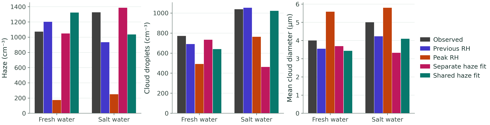
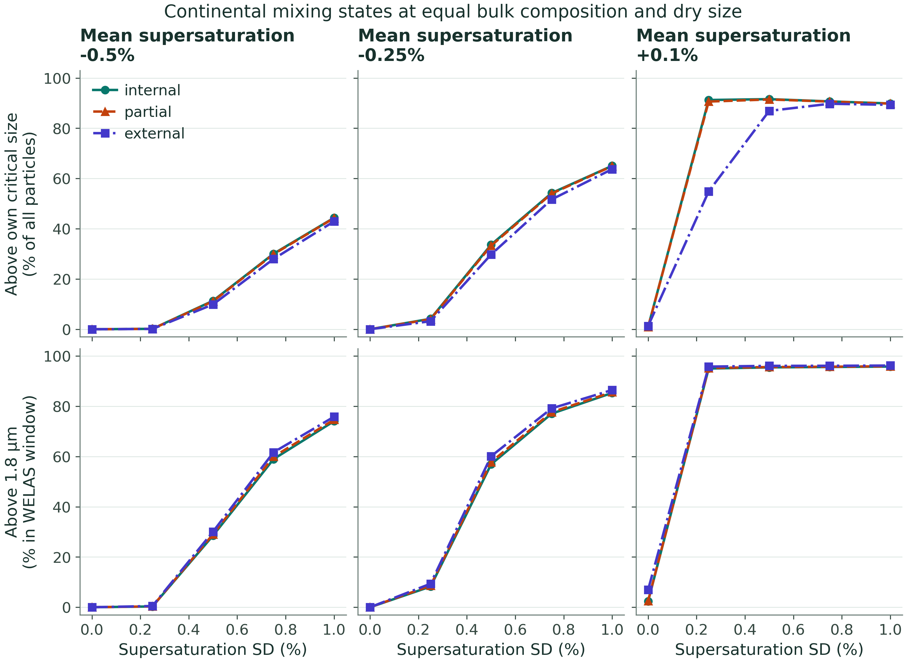

# Haze and cloud partitioning in the Π Chamber

Prabhakaran and colleagues measured haze and cloud droplets from nearly monodisperse 130 nm NaCl seeds injected into the Michigan Tech Π Chamber. Replacing the fresh-water lower boundary with salt water and raising the plate temperature difference from 6 to 7 K increased both haze and cloud number at the same aerosol injection rate. An independent Particula analysis tested whether size-dependent removal and a haze-constrained humidity could sustain those changes. The accompanying CUDA example follows the full size distribution from two initial states. [Experiment, Table 1 and Figure 2C](https://doi.org/10.1073/pnas.2006426117) · [Time-resolved example](../../../examples/simulations/pi_chamber_spectra.py)

## Which steady-state observations can the chamber model sustain?

Both cases injected 33 particles cm⁻³ min⁻¹ at approximately 20 °C. Fresh and salt water refer to the chamber floor. The authors counted wet particles in the 0.6–40 µm optical window and classified those above approximately 1.8 µm as cloud droplets. The original well-mixed model produced fewer droplets as their mean size increased. In a two-region chamber, evaporating droplets slow their descent and can return to the sampled interior. We fitted interior relative humidity (RH) using haze. Cloud counts and cloud size moments were held out of this humidity fit. Earlier work used the same experiments to select the chamber geometry and forcing scenarios.

| Observable, fresh water → salt water | Observed | Original uniform box | Two regions, shared RH | Two regions, separate RH |
|---|---:|---:|---:|---:|
| Mean interior RH (%) | Unmeasured | 99.75 → 99.75 | 99.55 → 99.55 | 99.65 → 99.05 |
| Haze (cm⁻³) | 1,073 → 1,327 | 240 → 88 | 1,323 → 1,035 | 1,048 → 1,386 |
| Cloud (cm⁻³) | 771 → 1,038 | 384 → 260 | 639 → 1,022 | 734 → 462 |
| Cloud mean diameter (µm) | 4 → 5 | 5.49 → 6.99 | 3.43 → 4.09 | 3.69 → 3.33 |
| Cloud diameter SD (µm) | 2 → 3 | 2.71 → 3.59 | 1.40 → 1.86 | 1.57 → 1.37 |

The separate RH fit came within 5% of both haze counts and reversed the observed cloud response. In both experiments about 40% of the observed 0.8–1.8 µm haze occupied the 1.0–1.3 µm interval. The largest modeled fraction was 29.3% across the 14 humidity settings. This concentration near 1 µm gives a size-resolved target for testing other humidity and residence-time distributions. The evidence for its shape comes from digitized, partially overlapping traces. The cloud diameter SD in the table describes droplet variability within a sample. [Humidity comparison](https://github.com/uncscode/particula/blob/main/docs/data/pi-chamber/humidity-fits.csv) · [Authors’ spectra, slide 3](https://asr.science.energy.gov/meetings/stm/presentations/2020/1064.pdf#page=3)



## Which processes change the sign of the cloud response?

A uniform 1 m chamber converts the measured cloud second diameter moments to Stokes settling losses of approximately 27.8 and 63.5 cm⁻³ min⁻¹ in fresh and salt water. The latter exceeds the measured input of 33 even before including haze and other losses. This calculation assumes that the floor receives the same size distribution as the instrument.

An exploratory 568-case CUDA series varied particle exchange, floor humidity, background loss, five humidity fluctuation laws, and four seed distributions. At fixed interior forcing, a homogeneous chamber predicted 59 fewer droplets per cm³ in salt water. A drier salt-water floor scenario predicted 362 more. Making that floor slightly supersaturated predicted 379 fewer. At fixed floor forcing, a 130 nm source, two lognormal sources and a source with a 10% tail at 200 nm all gave increases from 361 to 363 cm⁻³. The local near-floor RH histories were assumed. Measurements of the near-floor wet spectrum and size-resolved settling flux could distinguish these scenarios. [Paired CUDA contrasts and Monte Carlo half-widths](https://github.com/uncscode/particula/blob/main/docs/data/pi-chamber/process-effects.csv) · [Chamber simulations of spatially varying growth](https://doi.org/10.1103/PhysRevFluids.7.020501)

## How long does the initial size distribution matter?

The [worked example](../../../examples/simulations/pi_chamber_spectra.py) tracks the wet diameter of individual residents and incoming seeds at 16 sampled times over 16,384 s. In each boundary condition, both initial populations have the measured total detected number. The dry population places all of that number at 130 nm. The wet restart samples inferred haze and cloud sizes. We assign each region the same initial local number concentration and size distribution. The measurements leave the initial lower-region spectrum and the number below the detection limit unresolved.

For each condition and start, eight independent groups each represent 1,024 initial particles and 2,048 stratified arrival times. Each arriving particle represents a physical number set by the constant injection rate and the simulation duration. Removal ends its trajectory. This yields instantaneous interior concentrations under a specified input, including during startup. The same incoming trajectories and matched random draws across starts isolate differences due to the initial resident water. The paper measured steady state. The temporal plots are predictions.

The summed absolute bin differences divided by the combined interior number first fell below 5% at the **8 s fresh-water** and **16 s salt-water** samples. Both fell below 1% at the 32 s sample. The 0.0625 s run and the independent 0.03125 s refinement agreed on those sampled times. Differences at 8 s were 4.8–4.9% for fresh water and 6.8–7.5% for salt water. Sampling times bracket the crossing. Common particle histories make this a controlled comparison of starts.

The chamber continued to evolve after the two starts agreed. On the finer timestep, the wet-start cloud concentration increased from 479 to 611 cm⁻³ in fresh water and from 905 to 970 cm⁻³ in salt water between 32 and 16,384 s. The spectrum can lose most of its dependence on initial droplet size well before ongoing injection and removal bring the absolute counts close to steady state.

## Would the same optical cutoff resolve a mixing-state effect?

A separate synthetic experiment held dry constituent volumes fixed at each size and varied which constituents occupied each particle. A continental-like mixture contained 35% sulfate, 55% organic material and 10% weakly wettable carbonaceous material by dry volume. At +0.10% mean supersaturation and a fluctuation SD of 0.25 percentage points, 91.3% of internally mixed residents and 54.6% of externally mixed residents exceeded their particle-specific critical size. The difference was 36.7 ± 0.4 percentage points (paired 95% Monte Carlo half-width). Using only detected particles and the fixed NaCl cutoff gave 95.0% and 95.8%. The externally mixed population placed many more particles below 0.6 µm. Simultaneous measurements below that limit would help test this prediction. At fluctuation SDs of 0.5 and 1.0 percentage points, the particle-specific differences fell to 4.7 and 0.5 points. [Mixing-state contrasts](https://github.com/uncscode/particula/blob/main/docs/data/pi-chamber/mixing-state.csv)



The [continental mixing-state figure data](../../../data/pi-chamber/continental-spectra-summary.csv) contain the 45 reference campaign rows used for both panels at each mean supersaturation. Redraw the chamber study figures from the saved tables with `python -m scripts.pi_chamber.figures`.


The [species and organic vapor companion](pi-chamber-species.md) compares NaCl and ammonium sulfate at 130 nm and tests semivolatile organic uptake and evaporation with BAT.

## Inputs, uncertainties and reproduction

The steady-state process and mixture calculations used Particula revision `c76cfb5993`. The subsequent 68-case inverse study used `4d6fcba740`, including the differentiable inversion work in PR #1676. The original adjoint recovery control reproduced the synthetic initial radii within 0.61 nm. The chamber fit differentiated a piecewise-linear interpolation of log observations from the aqueous particle model. Each of its intervals has a bounded quadratic minimum, which the downloadable example recomputes from the archived grid. Haze number and two log ratios of haze bins receive equal weight. There is no experimental covariance estimate for this objective. [Inversion qualification](../numerics/initial-size-inversion.md) · [Optical grid](https://github.com/uncscode/particula/blob/main/docs/data/pi-chamber/haze-grid.csv)

The temporal example uses the shared fitted RH of 99.55%, a 15% lower region, 4 s exchange, and Gaussian humidity renewals with a 1 s mean waiting time. Interior RH standard deviations are 0.75 and 1.0 percentage points. Assumed lower-region means are 99.75% and 98.50% with one-quarter of the interior fluctuation amplitude. Background removal has a 7,200 s lifetime. Growth uses κ–Köhler equilibrium with κ = 1.28, transition-corrected vapor transfer and latent heat at fixed temperature. The model prescribes the humidity seen by a particle. It omits two-way vapor feedback and spatially resolved turbulent flow.

The wet initialization uses 128 equal-number representative diameters per optical class from our reconstructed population. The reconstruction used the shape in the authors’ presentation and adjusted the cloud weights to match the published mean and SD. This parameterization and the included plots are independent model products. The original experimental archive is available from Michigan Tech with its reuse statement. [Experimental data and attribution](https://digitalcommons.mtu.edu/data-files/3/) · [Restart parameters](https://github.com/uncscode/particula/blob/main/docs/data/pi-chamber/restart.json)

The published example requires CUDA for a fresh calculation. Its bundle records the execution device, library revision and exact inputs. Redrawing saved spectra uses the captured concentrations.

```bash
python scripts/docs_examples.py refresh pi-chamber-spectra
python scripts/docs_examples.py replot pi-chamber-spectra
```
