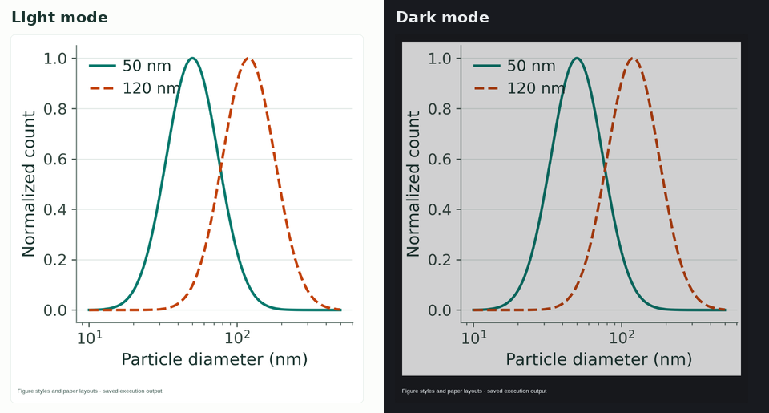

# Figure styles for papers and the web

Use Particula's Matplotlib style to give a size distribution, time series, or
contour map the same type sizes and color conventions. The
[executable gallery](../../studies/tutorials/figure_styles.py) includes
five rendered examples and a downloadable Python script. The curves and fields
in that gallery are illustrative.

For examples with scientific data, compare the [neutralizer and chamber measurements](../../studies/literature/nacl-scavenging/nacl_scavenging.py), the [GPU convergence panels](../../studies/validation/material-properties/process-references/qualification.md), and the [CCN retrieval contour maps](../processes/ccn-retrieval.md).

## Start with a paper-sized panel

Install the plotting extra with `pip install 'particula[plot]'` from a version
that includes these presets. Apply the style to a block of ordinary plotting
code. A script that should use the defaults throughout can call
`plt.style.use("particula.default")` once.

```python
import matplotlib.pyplot as plt
from particula import plotting

with plt.style.context("particula.default"):
    fig, ax = plotting.subplots(size="square")
    ax.plot([0, 1, 2], [100, 122, 138], label="Model")
    ax.set(xlabel="Time (min)", ylabel="Particle diameter (nm)")
    plotting.legend(ax)
    plotting.fit(fig)
    print("Finished width and height (inches)", fig.get_size_inches())
    fig.savefig("growth.png", dpi=300)
    fig.savefig("growth.pdf")
```

| Preset | Data axes | Typical use |
| --- | --- | --- |
| `square` (default) | 3 × 3 in | Compact comparisons, spectra and image panels |
| `wide` | 5 × 3.5 in | Time series, broad distributions and multiple curves |

Both sizes describe the rectangle inside the axes. For a grid,
`plotting.subplots(2, 2)` gives each panel the chosen dimensions. Call
`plotting.fit(fig)` after adding labels, legends and colorbars, and again after
changing them. The canvas expands to fit. Read its finished width before
selecting a journal column. Scaling the entire figure in a manuscript scales
the printed type as well. Use full-canvas export to preserve the dimensions.

## Lines, legends and fields

The line cycle pairs teal, rust, indigo and berry with solid, dashed,
dash-dot and dotted strokes. Use `plotting.COLORS["teal"]` to match a marker or
uncertainty band to a curve. Explicit line colors and dashes work as usual.
Ticks and legends use 12 pt, axis and colorbar labels 13 pt, and titles 14 pt.

`plotting.legend(ax)` measures the label block. A legend that fits within 40%
of panel width and 35% of panel height stays inside. A larger legend moves to
the right, with extra columns for a tall list. Use `placement="inside"` or
`placement="right"` to choose explicitly, for instance when points occupy the
default legend position.

| Quantity | Matplotlib recipe |
| --- | --- |
| Nonnegative amount | Pass `cmap=plotting.colormap("magnitude")` to `imshow`, `pcolormesh` or `contourf`. Light mint represents small values and deep teal represents large ones. Use `LogNorm` when equal ratios should span equal color intervals. |
| Signed deviation | Use `cmap=plotting.colormap("difference")` with `TwoSlopeNorm(vmin=-limit, vcenter=0, vmax=limit)`. The two sides progress from rust through neutral to teal. For a ratio, use a reference of one and choose meaningful bounds on both sides. |

Turn off the grid with `ax.grid(False)` for filled fields, label the colorbar
with the physical units, and set `aspect="auto"` on images when the panel
shape and the data aspect are independent. An equal data aspect imposes an
additional geometric constraint and must agree with the requested panel shape.

The gallery's full-brightness PNGs double as publication downloads. On the
website, switch between light and dark mode to compare the same file at full
and 80% opacity. The PDF recipe above retains vector lines and text.


