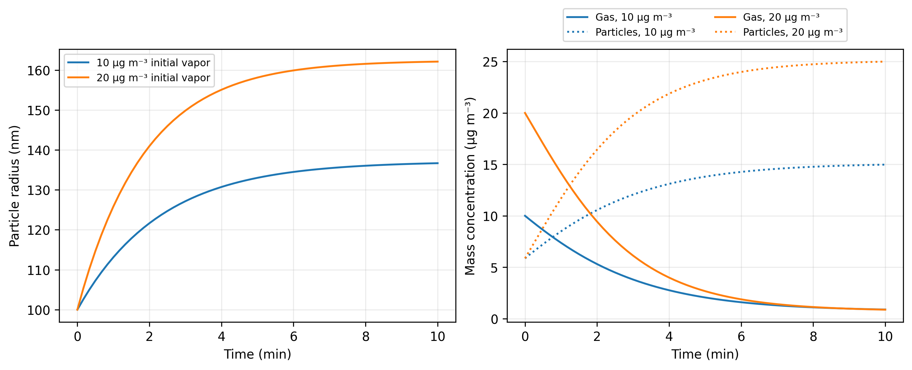

# First CPU simulation

Follow a finite vapor reservoir as it grows 100 nm organic particles over ten
minutes. The [complete executable example](../../studies/tutorials/first_cpu_workflow.py)
creates native state, records a time series, saves and reloads results, and
checks an exact restart at five minutes. Its published page includes the plots.

## Run and save the experiment

Start with Python 3.12 or newer and an active virtual environment. On the
[worked example page](../../studies/tutorials/first_cpu_workflow.py), download
the Python script and save it as `first_cpu_workflow.py`. From the directory
where you saved it, install Particula and run the example:

```bash
python -m pip install "particula>=0.3.5"
python first_cpu_workflow.py
```

If you are working from a repository checkout, run its matching package and
example together from the repository root:

```bash
python -m pip install -e .
python docs/studies/tutorials/first_cpu_workflow.py
```

The script creates `first-cpu-results/` with an analysis file and a restart file for each
initial vapor concentration. If Matplotlib is installed, the script also saves
`growth.png`. To add the graph to a run, install the plotting extra with
`python -m pip install "particula[plot]>=0.3.5"` and rerun the script.
The publication pipeline uses temporary storage and retains only compact plot
data, never the full restart files.

The first case has 1000 particles cm⁻³, 10 µg m⁻³ initial organic vapor,
298.15 K and 101325 Pa. One representative carries 1000 particles in a volume
of 1 cm³: native resolved `concentration` is a count, while `number_density`
is m⁻³. The second case doubles only initial vapor to 20 µg m⁻³. Both are
illustrative single-material organic calculations with explicit constant
properties, ideal activity and Kelvin curvature. They exclude dilution,
coagulation, wall loss, heat feedback and external forcing.

The adaptive RK3(2) method advances particle and gas mass together. The script
sets `rtol=1e-5`, per-particle `particle_atol=1e-27` kg and
`gas_atol=1e-15` kg m⁻³. It records every ten seconds by landing on those times.
This can shorten a proposed step. These are local numerical controls, not
experimental uncertainty or a guaranteed global error bound.

## Reload and inspect results

Run this from the directory containing `first-cpu-results/`:

```python
import numpy as np
from particula.execution.analysis_io import load_analysis

result = load_analysis("first-cpu-results/organic-10.analysis")
time_s = result.arrays["time"]
gas = result.arrays["gas_concentration"][:, 0, 0]
particle = result.arrays["particle_mass_density"][:, 0, 0]
np.testing.assert_allclose(gas + particle, gas[0] + particle[0], rtol=2e-13)
print(result.metadata["configuration"])
print("Final gas concentration:", gas[-1] * 1e9, "µg m^-3")
```

Analysis output includes units, named axes, ordered gas species, population
measure, volume, physical configuration, numerical settings and source/package
identity. Histories contain selected diagnostics; full particle arrays are
opt-in and storage is bounded. Analysis files cannot be used as exact restarts.
The files use ZIP, JSON and numeric arrays and never require pickle to load.



The saved calculation reaches radii of about 136.69 nm and 162.13 nm for the
10 and 20 µg m⁻³ cases. Remaining vapor is about 0.89 and 0.87 µg m⁻³.
More initial vapor supplies more particle material; growth slows as the vapor
approaches its curvature-dependent equilibrium. Number remains constant and
gas plus particle mass closes to floating-point precision. Conservation and
successful restart verify bookkeeping; they do not establish agreement with a
real organic aerosol or an independent numerical reference.

## Resume the five-minute checkpoint

Start Python in the directory containing both the downloaded script and
`first-cpu-results/`. For the checkout route, start Python from the repository
root with `PYTHONPATH=docs/studies/tutorials python` (Bash). The example
supplies the same physical configuration used to write the checkpoint.
Load the saved analysis to compare the gas history from 300 to 600 seconds:

```python
import numpy as np
from particula.execution.analysis_io import load_analysis
from first_cpu_workflow import build_case
from particula.execution.cpu_restart import load_cpu_checkpoint, resume_condensation
from particula.execution.recording import Recorder, run_until

result = load_analysis("first-cpu-results/organic-10.analysis")
_, strategy = build_case(10.0)
saved = load_cpu_checkpoint("first-cpu-results/organic-10.restart")
resumed = resume_condensation(saved, strategy)
history = Recorder()
run_until(
    resumed, 600.0,
    output_times=np.linspace(300.0, 600.0, 31),
    recorder=history,
)
np.testing.assert_array_equal(
    history.arrays()["gas_concentration"],
    result.arrays["gas_concentration"][30:],
)
```

The checkpoint retains accepted time, scaled native state, tolerances, the
proposed next step and solver work counters. A different physics configuration
or incompatible schema/runtime rejects. For this deterministic workflow, the
same subsequent boundaries give exact continuation. Arbitrary callable forcing
has no supported disk identity. Passive recording does not alter physics, but
choosing different output boundaries can alter the numerical trajectory.

## Adapt one scientific input

The example already runs the controlled 10 versus 20 µg m⁻³ comparison. Change
`CONFIGURATION["saturation_vapor_pressure_Pa"]` to investigate volatility next,
then rerun and compare both remaining vapor and radius. Select a new output
directory to preserve earlier files. Before interpreting a named compound,
justify its material properties and compare with independent measurements.

## Walk through the simulation script

Follow these excerpts in order in the [complete script](../../studies/tutorials/first_cpu_workflow.py).
They share the variables defined inside its functions.

### Represent a population with one particle size

Inside `build_case`, `c` is a short local name for `CONFIGURATION`, the
dictionary of physical inputs defined near the top of the script. For example,
`c["radius_m"]` reads the starting particle radius in meters (100 nm, or
1 × 10⁻⁷ m). The next lines use that radius and the material density to compute
the mass of one spherical particle.

```python
c = CONFIGURATION
density = c["material_density_kg_m3"]
mass = 4 * np.pi * density * c["radius_m"] ** 3 / 3
particles = par.particles.create_resolved_particle_data(
    masses=[mass],
    density=density,
    concentration=[c["number_density_m-3"] * c["volume_m3"]],
    volume=c["volume_m3"],
)
```

Here, `mass` is kilograms **per particle**. Multiplying the number density
(10⁹ m⁻³) by the box volume (10⁻⁶ m³) gives 1,000 particles in the box.
Storing that count alongside one mass lets all 1,000 identical particles grow
together. For other population types, see [constructing native particle data](../data-model/construction.md).

### Put the available vapor in the gas reservoir

The gas concentration is a mass per volume. One microgram is 10⁻⁹ kg, so the
conversion below puts either 10 or 20 µg m⁻³ into Particula's native units.

```python
gas = par.gas.GasData(
    name=["organic"],
    molar_mass=np.array([c["molar_mass_kg_mol"]]),
    concentration=np.array([[vapor_ug_m3 * 1e-9]]),
    partitioning=np.array([True]),
)
```

The two array dimensions of `concentration` identify the box and gas species.
The partitioning flag makes the organic species available for exchange.
Later in `build_case`, the condensation strategy pairs it with particle
component zero. Its constant vapor pressure and curvature model set the
equilibrium vapor concentration at the particle surface. Vapor above that
concentration drives growth. See [condensation physics](../processes/condensation.md).

### Run both cases to the same checkpoint

In `simulate`, each pass through the loop builds fresh particle and gas state.
Only the initial vapor supply changes. The solver advances that state while
the recorder samples it on the requested time grid.

```python
for vapor in (10.0, 20.0):
    initial, strategy = build_case(vapor)
    owner = CondensationODE(initial, strategy, **NUMERICS)
    recorder = Recorder()
    run_until(owner, 300.0, output_times=times[:31], recorder=recorder)
```

The first 31 samples span 0 through 300 seconds at ten-second intervals.
Between samples the solver can take smaller steps to meet its error tolerances.
At 300 seconds the script saves the state and controller so it can compare
two continuations from exactly the same instant. See [recording and restart](recording-restart.md).

### Check that resuming gives the same answer

One solver stays in memory. The other starts from the checkpoint on disk and
uses the same condensation strategy. Both advance to 600 seconds, landing on
the same remaining sample times.

```python
resumed = resume_condensation(load_cpu_checkpoint(restart), strategy)
# Compare future physics using identical requested output boundaries.
run_until(owner, 600.0, output_times=times[30:])
run_until(resumed, 600.0, output_times=times, recorder=recorder)
np.testing.assert_array_equal(owner.solver.state, resumed.solver.state)
```

The original solver provides the comparison. Only the resumed solver appends
to the recorder, which already contains the first five minutes. After checking
the final state, the script also compares the proposed next step. This tests
whether saving and loading preserved the adaptive controller.

### Turn recorded mass into the growth graph

The analysis file stores particle mass per volume and particle number per
volume. Dividing the former by the latter gives mass per particle. The script
uses material density to convert that mass to volume, then inverts the sphere
volume formula to recover radius.

```python
radius = np.cbrt(
    3
    * particle
    / (4 * np.pi * CONFIGURATION["material_density_kg_m3"] * number)
)
```

This gives the radius of each particle because the population has a single
size. For a mixture of sizes, the same calculation gives the radius of a
sphere with the **mean particle volume**. The upper panel plots the two radius
histories in nanometers. In the lower panel, the falling gas curve and rising
particle curve for each case add to a constant mass concentration at every
sample. To reuse the panel layout, colors and legend placement in your own
figure, see [Particula figure styles](figure-styles.md).
