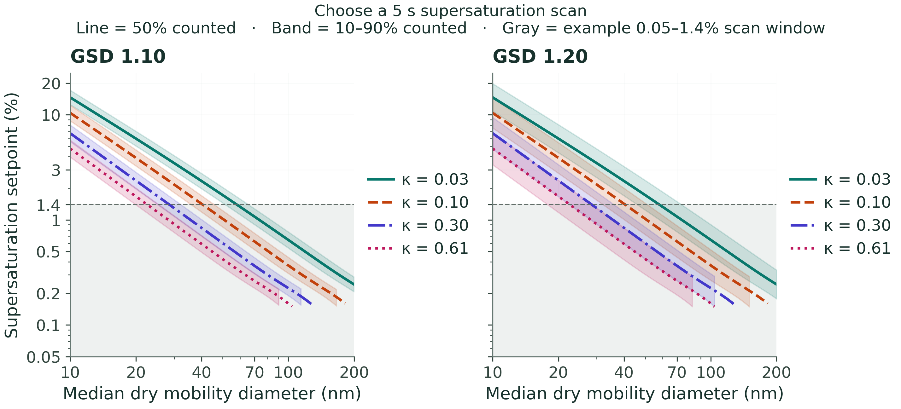
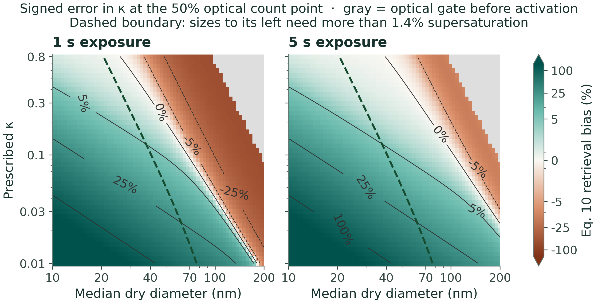
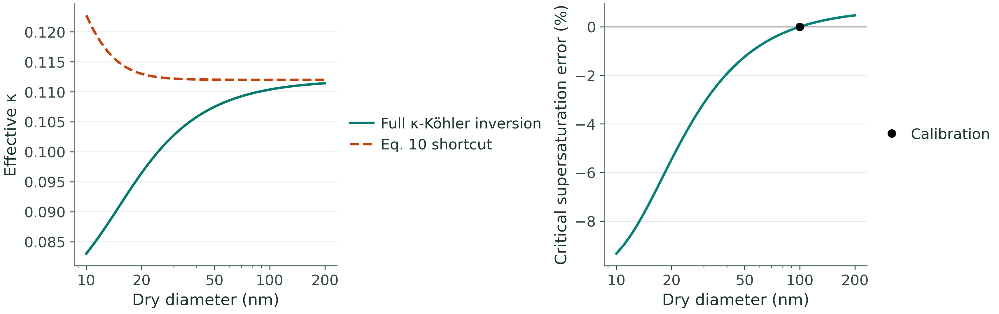
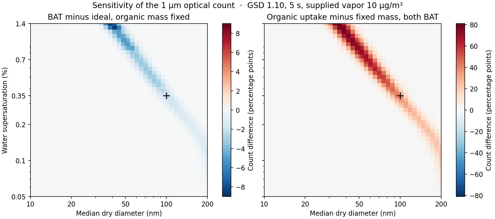
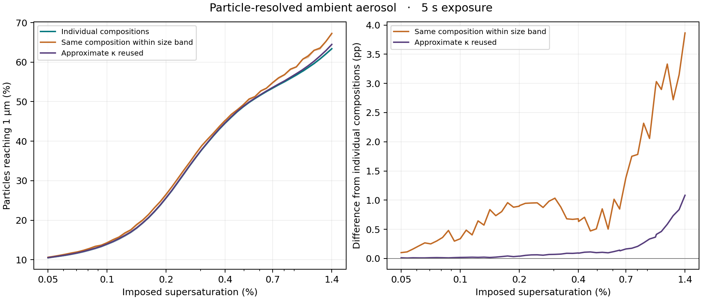

# Designing a size-resolved CCN experiment

Suppose a differential mobility analyzer selects 100 nm particles and a cloud condensation nuclei (CCN) counter counts half of them. What have you learned about the material? Petters and Kreidenweis showed how a dry diameter and a **critical water supersaturation** can be expressed as a hygroscopicity parameter, κ. In the lab, the directly observed quantities are particle counts. A particle has a finite time to grow, the classifier transmits a band of sizes, and organic vapor can join the particle after size selection. Each affects the inference from counts to κ. [Petters and Kreidenweis (2007), sections 2–3](https://doi.org/10.5194/acp-7-1961-2007)

This technical note follows a synthetic 100 nm selection from scan design to an independent test of the fitted κ. The numerical reference extends from 10 to 200 nm. It assumes spherical, singly charged particles initially equilibrated at 95% relative humidity (RH), followed by a step to prescribed water supersaturation at 298.15 K. Count a particle when its wet diameter reaches 1 µm. The actual instrument's calibrated supersaturation, optical response and residence history belong in an experimental analysis. [Model specification and reproducibility](../../studies/literature/particle-water-uptake/ccn-retrieval/index.md)

## Choose a scan that can see the transition

Start with the dry **number** distribution transmitted by the differential mobility analyzer (DMA), the classifier used in a scanning mobility particle sizer (SMPS). Record its median mobility diameter and geometric standard deviation (GSD). Check the transmitted distribution and possible contributions from larger, multiply charged particles. For a size-selected CCN measurement, pair counts from the CCN counter with total condensation nuclei (CN) counts for the same selection. Align sampling intervals and account for flow, dilution and transmission differences before taking their ratio. Salt calibration measurements by Rose and colleagues illustrate how uncertainty in size selection and effective supersaturation enters this ratio. [Rose et al. (2008)](https://doi.org/10.5194/acp-8-1153-2008)

Choose an expected κ and read the line at your selected dry diameter in the figure. It gives the supersaturation at which half the particles reach the optical threshold in 5 s. The band spans 10% to 90% counted. For weakly hygroscopic particles with κ = 0.030 and a 100 nm median, begin with the following model setpoints. Include settings on each side of the rise and resolve its midpoint with additional measurements.

| Width of the transmitted band | 10% counted | 50% counted | 90% counted |
| --- | ---: | ---: | ---: |
| GSD 1.10 | 0.540% | 0.644% | 0.768% |
| GSD 1.20 | 0.460% | 0.644% | 0.901% |

All three columns give **water supersaturation**. A wider selection broadens the transition because the larger particles grow to the counting threshold at lower supersaturation. In this single-composition calculation the median particle still sets the halfway point. At 50 nm the same material needs 1.72% for half to count, and at 10 nm it needs an estimated 14.6%. If the counter is calibrated only to 1.4%, report the unbracketed midpoint or choose a larger dry diameter. [Download setpoints for six exposure times](https://raw.githubusercontent.com/uncscode/particula/main/docs/data/thermodynamics/ccn-retrieval/lab-setpoints.csv)

## Decide what the counter observed

At each setting compute the counted number fraction, $N_{\rm CCN}/N_{\rm CN}$. Estimate $s_{50}$, the supersaturation where the fraction reaches 0.5, from a bracketed scan. Retain the neighboring settings, repeat-scan variability, dry-size uncertainty and supersaturation calibration uncertainty. A single counted fraction at one supersaturation cannot establish the midpoint on its own.

An early calculation in this study used a narrower selection (GSD 1.05). At 0.65% supersaturation, 54.5% had crossed their individual critical wet diameter after 1 s, while **46.0% had grown to 1 µm**. After 5 s, 55.1% reached 1 µm. The 46% describes the fraction of particles counted. To get an error in κ we need a separate inversion and a reference value. A residence-time comparison at matched, calibrated water forcing can show whether slow growth moves the optical midpoint. Raatikainen and colleagues describe how heat and vapor transport, chamber profiles and detection enter such a comparison. [Raatikainen et al. (2012)](https://doi.org/10.5194/acp-12-4227-2012)

For this plot the input κ is known. The color is $100(\kappa_{\rm retrieved}/\kappa_{\rm input}-1)$. The dashed boundary marks a modeled midpoint of 1.4% supersaturation. At large dry sizes and high κ, a particle can reach 1 µm *before* it crosses its Köhler maximum. In the gray region an optical count alone cannot identify that maximum.

## Fit κ and test it at another size

Write supersaturation in percent as $s_c=100(S_c-1)$, where $S_c$ is a saturation **ratio**. The full fit chooses the κ for which the maximum of the κ-Köhler curve matches $S_c$ at the measured dry diameter $D_d$. Its curvature coefficient in diameter form is $A=4\sigma M_w/(RT\rho_w)$. The simpler inversion in Petters and Kreidenweis Eq. 10 is

$$
\kappa_{10} = \frac{4 A^3}{27 D_d^3 [\ln S_c]^2}.
$$

Use the natural log of the saturation ratio. For example, 0.35% supersaturation means $S_c=1.0035$. The authors suggest Eq. 10 for κ above 0.2. Testing the shortcut on less hygroscopic material is an extrapolation. For experimental uncertainty, repeat the inversion over the uncertainties of dry size and calibrated supersaturation together and report how wide the resulting κ interval is. [Petters and Kreidenweis (2007), Eqs. 6 and 10](https://doi.org/10.5194/acp-7-1961-2007)

Return to the 100 nm laboratory scan with known input κ = 0.030. At 5 s the optical midpoint is 0.64424%. The full fit returns 0.02998 (−0.08%), while Eq. 10 returns 0.03294 (+9.79%). At 1 s the midpoint moves to 0.65417% and the full fit drops to 0.02895 (−3.50%). Shorter residence time and the shortcut shift κ in opposite directions here. Agreement at one residence time could therefore conceal both effects. [Optical midpoints and both inversions](https://raw.githubusercontent.com/uncscode/particula/main/docs/data/thermodynamics/ccn-retrieval/dynamic-lab-inversion.csv)

A second experiment in the model gives us an independent reference. Gorkowski, Preston and Zuend's Binary Activity Thermodynamics (BAT) model provides water activity as the water fraction changes. We used their miscible Figure 9 organic (200 g/mol, O:C = 0.50), held its dry mass fixed, and computed its equilibrium activation threshold. At 100 nm BAT gives **0.34885% supersaturation**. The full fit gives **κ = 0.11037** and the shortcut **0.11200**, a 1.47% difference in the retrieved coefficient. At 50 nm the difference is 4.21%, at 200 nm it is 0.52%, and at 10 nm it is 47.87%. A nearly constant shortcut estimate can conceal the size dependence of the full fit. [BAT paper](https://doi.org/10.5194/acp-19-13383-2019) · [Run the retrieval and plot the residuals](../../studies/literature/particle-water-uptake/ccn-retrieval/ccn_kappa_retrieval.py)

The practical test is to withhold other sizes. Using only the full fit at 100 nm, the predicted critical supersaturations at the other 150 integer diameters from 50 to 200 nm differed from BAT by **−1.24% to +0.47% relative**, with 0.43% relative RMS error. The largest absolute difference was 0.0123 percentage points of supersaturation. Here a constant κ is useful for predicting activation over that size range. Its success at activation says less about how much water the particle takes up before reaching saturation. At 95% RH the same fit predicts a wet diameter of 137.6 nm where BAT gives 127.7 nm, an overestimate of 7.8% in wet diameter and **48.5% in condensed water volume** after subtracting dry volume. A paired subsaturated growth measurement tests this difference directly. [Equilibrium thresholds and held-out predictions](https://raw.githubusercontent.com/uncscode/particula/main/docs/data/thermodynamics/ccn-retrieval/bat-kappa-equilibrium.csv)

## Check whether the dry material changed after selection

Keep the initial size, residence time and water forcing fixed, and vary the organic vapor downstream of the DMA. In the modeled test, both water and one organic can exchange with the gas. As water condenses, the organic activity changes. Incoming organic material can then increase particle volume and alter subsequent water uptake. The assumed pure-organic saturation concentration is 10 µg/m³. The BAT paper supplies the thermodynamic descriptors, while the vapor concentration and volatility are choices for this sensitivity experiment. [Gorkowski et al. (2019)](https://doi.org/10.5194/acp-19-13383-2019)

| 100 nm median, GSD 1.10, 5 s | Counted at 0.35% water supersaturation | Water supersaturation for 50% count | Apparent κ, Eq. 10 |
| --- | ---: | ---: | ---: |
| Ideal solution, organic mass fixed | 50.7% | 0.349% | 0.112 |
| BAT, organic mass fixed | 48.8% | 0.352% | 0.110 |
| Ideal solution, 10 µg/m³ organic vapor maintained | 87.2% | 0.308% | 0.144 |
| BAT, 10 µg/m³ organic vapor maintained | 85.1% | 0.311% | 0.141 |

At the marked point below, changing the liquid thermodynamics shifts the fixed-mass count by about **2 percentage points**. Supplying organic vapor increases the BAT count by **36 percentage points** and raises the condensed organic mass to 3.61 times its starting value. Reusing the original dry diameter then gives an apparent κ about **28% above** the fixed-mass equilibrium reference. Applying the full inversion to the same vapor-fed midpoint still gives a **27% increase**. Measuring the organic vapor and particle organic mass alongside the count would distinguish acquisition of new material from a change attributed to the original material's hygroscopicity. [Refined midpoint calculations](https://raw.githubusercontent.com/uncscode/particula/main/docs/data/thermodynamics/ccn-retrieval/bat-kappa-midpoint-check.csv)

## Interpret an ambient sample one assumption at a time

For a broad size distribution, several combinations of size and composition can produce the same total count. In an idealized 100 nm, GSD 1.55 population at 0.40% supersaturation and 5 s, **44%** reached 1 µm when organic-like and sulfate-like material occupied separate particles. Putting the same material fractions inside every particle raised the count to **75%**. Size-resolved measurements near Guangzhou identified a weakly CCN-active population, illustrating why a bulk composition alone can leave this question open. [Rose et al. (2011)](https://doi.org/10.5194/acp-11-2817-2011)

How much mixing information is actually lost in a less extreme case? We repeated the scan with 131,072 individually composed synthetic particles across three overlapping size modes. At 0.40% and 5 s, the count was **44.57%**. Assigning the volume-averaged composition within each narrow dry-size band gave **45.25%**. That operation preserves both the size distribution and the amount of each component per band. At 1.0% the shift increased to **3.03 percentage points**. The difference between these two experiments depends on how much composition varies *within a size band*. A measurement of the weakly hygroscopic fraction in those bands would constrain the interpretation. [Particle-resolved scan results](https://raw.githubusercontent.com/uncscode/particula/main/docs/data/thermodynamics/ccn-retrieval/ambient-cuda-summary.csv)

A separate binary BAT test asks whether the vapor supply can sustain growth. For a 95 nm organic-rich mode at 0.35% supersaturation, with an initial organic vapor concentration of 10 µg/m³, 1,000 particles/cm³ left 8.48 µg/m³ in the gas after 5 s. At 10,000 particles/cm³ just 1.96 µg/m³ remained. Relative particle organic mass gain fell from 131% to 69%. Water supersaturation was prescribed in both cases. Extending this result to cloud droplet number would also require a parcel history and a water budget. [Finite-reservoir results](https://raw.githubusercontent.com/uncscode/particula/main/docs/data/thermodynamics/ccn-retrieval/bat-finite-ambient.csv)

Report the observable with the fitted κ: dry mobility distribution, calibrated supersaturation bracket, residence history, optical criterion, inversion equation, fitted sizes and held-out sizes. For volatile or mixed aerosol, add what was measured about vapor availability and size-resolved composition. Those details let the next researcher decide whether the coefficient can predict their activation curve, their subsaturated growth, or both. [Methods, numerical checks and reproduction commands](../../studies/literature/particle-water-uptake/ccn-retrieval/index.md)
