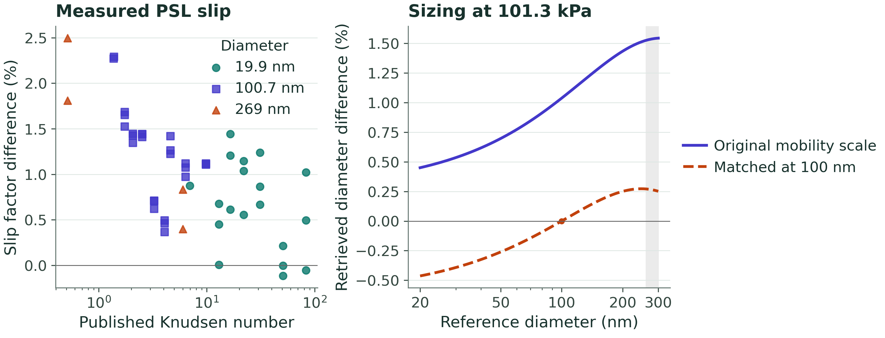

# The choice of slip correction can shift the inferred dry diameter by about 1% near 100 nm

Kim, Mulholland, Kukuck and Pui measured the electrical mobility of dry polystyrene latex (PSL) spheres over a wide range of pressures. Their Tables 7a–c give the slip correction inferred from each mobility measurement and the Knudsen number used to interpret it. Our comparison tests how the choice of slip equation affects the diameter assigned to a sphere of known size. This is an automated independent Particula analysis. The measurements and experimental calibration belong to Kim and colleagues. [Primary paper, pp. 42–43](https://nvlpubs.nist.gov/nistpubs/jres/110/1/j110-1kim.pdf)

## A dry PSL standard checks the diameter assigned by a mobility analyzer

A differential mobility analyzer selects electrical mobility. To assign a diameter to that selection, the inversion assumes a charge, a gas viscosity and a slip correction. The particle Knudsen number, Kn = 2λ/D, compares the gas mean free path λ with the particle radius D/2. In the first near-atmospheric 100.7 nm run the measured slip factor was 2.897, so the sphere was nearly three times as mobile as the no-slip Stokes expression predicts at the same diameter and charge. Slip increases as the gas mean free path becomes large relative to the particle radius, for example at smaller size or lower pressure. Two slip laws can nevertheless give similar diameters in this regime. In that same run Particula's law gave 102.02 nm for the 100.7 nm reference at matched gas properties, a +1.31% diameter shift. A large slip factor by itself does not imply a large disagreement between slip laws. [Kim et al., Table 7a](https://nvlpubs.nist.gov/nistpubs/jres/110/1/j110-1kim.pdf)

The [runnable example](../../studies/literature/dry-psl-mobility/psl_mobility.py) reconstructs the mobility of each published sphere and solves for its diameter.

## Particula assigned 102 nm to a 100.7 nm reference near atmospheric pressure

We evaluated Particula at each of the 49 published Knudsen numbers, spanning 0.515–82.934. The signed slip difference is 100 × (Particula / measured − 1). For the size inversion, we held the reported gas convention, charge and mobility fixed and solved for the diameter. The last column is the difference from the paper's assigned diameter. Each measurement row has equal weight within its group.

| Assigned diameter | Rows | Mean slip difference (range) | Mean retrieved diameter difference (range) |
| --- | ---: | ---: | ---: |
| 19.90 nm | 19 | +0.65% (−0.12 to +1.44%) | +0.33% (−0.06 to +0.73%) |
| 100.7 nm | 26 | +1.22% (+0.37 to +2.29%) | +0.66% (+0.19 to +1.32%) |
| 269.0 nm | 4 | +1.38% (+0.40 to +2.49%) | +0.91% (+0.21 to +1.74%) |

The two near-atmospheric 100.7 nm runs illustrate the scale directly. The default slip law assigns diameters of 102.02 and 102.03 nm to those mobilities. Stronger slip at a fixed size implies faster motion, so matching the measured mobility requires a larger sphere. Both slip residuals, +2.27% and +2.29%, slightly exceed the authors' approximate 2% expanded relative uncertainty for this size. The other 47 rows fall within their respective approximate uncertainty magnitudes (3% for 19.90 nm and 2.5% for 269 nm). Shared calibration and diameter uncertainties and repeated pressure settings preclude a formal coverage test from this count. The 19.90 nm size assignment itself used mobility information. [Kim et al., sections 4, 7 and 8](https://doi.org/10.6028/jres.110.005)

## A 100 nm calibration left a −0.46% diameter shift at 20 nm in the synthetic scan

For this separate prediction we set air to 296.15 K and 101.3 kPa, used the authors' fitted slip law to generate synthetic mobilities, then inverted them with Particula at the same viscosity and mean free path. A single fitted multiplier on the Particula mobility scale (0.98237) makes the 100 nm particle come out at 100 nm. Smaller and larger spheres test how far that calibration transfers.

| Reference diameter | Diameter shift before calibration | Diameter shift after 100 nm calibration |
| --- | ---: | ---: |
| 20 nm | +0.45% | −0.46% |
| 50 nm | +0.70% | −0.26% |
| 100 nm | +1.04% | 0.00% |
| 200 nm | +1.43% | +0.25% |

The gray region above 261 nm extends beyond the measured Knudsen-number range. For a scan targeting sub-percent diameter accuracy, check a second independently sized PSL standard near the end of the working range at the actual sample pressure. Jung and colleagues used a 60.39 nm reference for a related test. [Jung et al. (2012)](https://doi.org/10.1016/j.jaerosci.2012.04.005)

## Gas viscosity and mean free path can change the sign of the mean sizing difference

The primary result isolates the slip law by using λ = Kn × D/2 from the table and the paper's temperature-dependent air viscosity. Using Particula's default air viscosity and mean free path evaluated from pressure and temperature answers a different practical question. Across the 26 pressure-consistent 100.7 nm rows, the average diameter shift changes from +0.66% to −0.17%. Across the 19 small-sphere rows it changes from +0.33% to −0.55%. A laboratory comparing two software packages should record the gas model together with the slip law. A small net difference can arise from cancellation.

Two of the four 269 nm rows have inconsistent pressure and Knudsen number entries. The [validation record](../../studies/literature/dry-psl-mobility/index.md) shows how excluding them changes the comparison and identifies the inputs needed to reproduce each result.
