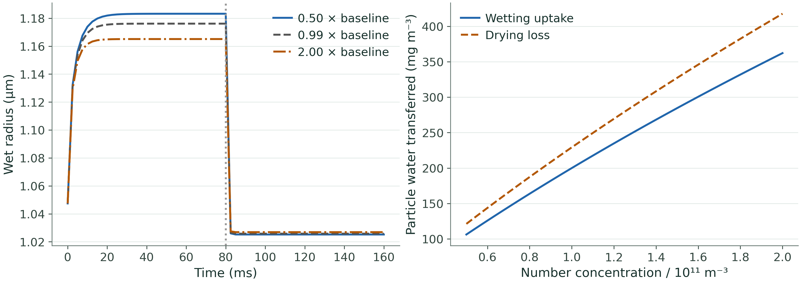
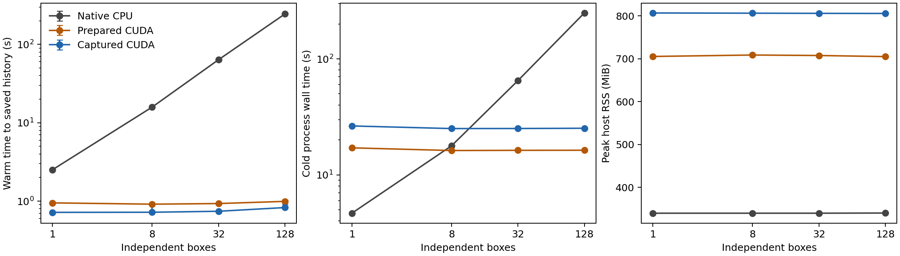

# BAT humidity-pulse ensemble on CPU and CUDA

At fixed initial humidity, increasing the number of droplets increases the
total water taken from the finite reservoir while reducing the amount available
to each droplet. The 128-box sweep resolves this effect over 5 × 10¹⁰ to
2 × 10¹¹ droplets m⁻³. Each box contains one computational slot representing
identical droplets. The other batches contain 1, 8 and 32 independent
conditions. The single box uses 10¹¹ m⁻³. Every batch retains the same water
and organic properties, duration, step convention and forcing as the [one-box pilot](../../validation/material-properties/binary-bat.md#one-box-humidity-pulse-timing-and-refinement).



Across the two concentration extremes, uptake over the wet leg rose from
106.23 to 362.16 mg m⁻³ while the wet-end radius fell from 1.18320 to
1.16509 µm. Drying released 121.24 to 417.71 mg m⁻³. The initial aerosol
already contained water, and the final 35% RH reset allowed each group to
release more water than it acquired in the wet leg. Every closed-leg
water balance was checked per box. The largest absolute residual in the
fixed-step prepared histories was 6.14 × 10⁻¹⁷ kg m⁻³ or smaller.
The reset changes the external vapor inventory instantaneously while
preserving the suspended water and dry organic mass.

## Numerical accuracy

At each of the 66 observations, compare wet radius with a refined, single-box
direct-BAT CPU calculation at the same concentration. Divide each radius
difference by the reference radius. For water transfer, subtract each leg’s
initial value separately for gas and particle water (kg m⁻³). Divide the
largest absolute discrepancy by the peak absolute reference particle-water
transfer on that leg. These scales resolve small transfers even when a large
vapor reservoir dominates the total inventory.

The limits for each box are 0.1% for radius and 0.5% for transfer on each
leg. Reference refinement uses one tenth of those limits and requires all
three metrics to converge. Across 165 distinct concentrations, 130 reference
histories qualified at 128 steps per observation and 35 at 256. The largest
changes at the last halving across the sweep were 0.00539% for radius,
0.04997% for wetting and 0.01548% for drying. This assesses numerical
accuracy under the shared kinetic model. The BAT descriptors come from
the miscible Figure 9 case. [Gorkowski et al. (2019)](https://doi.org/10.5194/acp-19-13383-2019)

## Restart and capture

At 16 outer steps per 2.5 ms sample, compare ordinary and captured CUDA
stepping, each with uninterrupted and checkpoint-resumed runs. For the latter,
take the checkpoint on the wet side at 80 ms, close the owner, resume on the
same device, reapply capture when requested, then replace vapor exactly once.
Compare the canonical payload bytes, continuation counters, RNG metadata,
process configuration and auxiliary state immediately before the reset,
immediately after it and at 160 ms. Require exact equality of all 66
observation rows. All four paths agreed at every size on the RTX 5060. The separate strict
CUDA regression ran the binary BAT capture/restart case (one pass, zero skips)
and the table-knot Jacobian and near-equilibrium flux tests (two passes, zero
skips). The restart checks ran at revision `83fb27e4f`. Subsequent changes
before timing affected output-file handling and the location of compiler
caches. The timing revision is `ccf972aaf`.

## Time to a saved history

The AMD Ryzen AI 9 HX 370 and RTX 5060 (8,151 MiB, driver 615.78.08)
ran identical physical inputs and observation schedules. At eight outer steps
per sample, all 12 configurations missed the wetting-transfer limit although
all met the radius limit. At 16 steps all 12 passed. The worst errors were
0.0397% in radius, 0.390% in wetting transfer and 0.107% in drying transfer,
rounded upward. Timings below use the fastest qualifying setting tested for
each workflow. Warm times are medians of seven fresh histories.

| Boxes | Native CPU (s) | Prepared CUDA (s) | Captured CUDA (s) | CPU / captured |
| ---: | ---: | ---: | ---: | ---: |
| 1 | 2.515 | 0.950 | 0.719 | 3.50 |
| 8 | 15.838 | 0.914 | 0.721 | 21.98 |
| 32 | 63.796 | 0.931 | 0.742 | 85.98 |
| 128 | 244.917 | 0.992 | 0.827 | 296.02 |

| Boxes | Cold CPU (s) | Cold prepared (s) | Cold captured (s) | Cached fresh captured (s) | Captured pool peak (KiB) |
| ---: | ---: | ---: | ---: | ---: | ---: |
| 1 | 4.67 | 17.09 | 26.40 | 3.90 | 83.7 |
| 8 | 17.79 | 16.21 | 25.06 | 3.68 | 98.2 |
| 32 | 64.92 | 16.27 | 25.09 | 3.74 | 148.1 |
| 128 | 248.75 | 16.30 | 25.22 | 3.82 | 347.6 |



Both CUDA workflows were faster than native CPU from the first measured box
in a warm process. For a single cold invocation, prepared CUDA first beat CPU
at eight boxes and captured CUDA at 32. Cold measurements have one sample per
configuration. At 128 boxes, captured stepping after first replay took 0.775 s,
observations including downloads took 0.033 s, and preparation plus upload took
0.013 s (separate medians). Cold compiled-module loads totaled 21.18 s.
Device pool high-water values exclude CUDA context and driver allocations.
The native CPU path evaluates direct BAT in its per-box loop, while CUDA
uses a resident activity table. These results apply to this implementation,
hardware and deterministic study.

The separate Nsight Systems 2026.3.2 trace of one captured 128-box run
reported 1,024 graph launches. It recorded 811 device-to-host copies
(0.652 MB, 0.319 ms of device copy time) and 24 host-to-device copies
(0.020 MB, 0.0068 ms). Per-call host latency, synchronization and constructing
snapshots also contribute to the observation time. On this workload, the
steady stepping interval and first-use compilation deserve separate attention.
The measurements support retaining ordinary preparation for cold jobs and
capture for warmed repeated work. The kernel ranking inside captured graphs
would require finer tracing.

Individual repetitions, first-use costs, peak memory, reference refinements
and error metrics are available in the
[campaign data](https://github.com/uncscode/particula/blob/main/docs/data/gpu/bat-pulse-campaign.json).

## Reproduction

Use the development Python environment at the campaign revision with an actual
CUDA device. The reference jobs run independent direct-CPU boxes and may be
parallelized. Run the timing matrix alone on the measurement host. Each
accepted cell saves three warmups and seven timed repetitions. Each first-use
pair starts separate processes with initially empty and subsequently populated
Warp and CUDA caches. The matrix records elapsed wall time through process
exit for that pair. Warm-process timing includes constructing an aerosol,
preparation, capture, synchronized stepping, snapshots, physical checks,
closing the owner and flushing the NumPy history to the local output filesystem. This host
used tmpfs, so these measurements exclude persistent-storage latency. The CPU baseline
uses the native batched process and one BLAS/OpenMP thread. Captured CUDA
uses a precomputed activity table. The ratio measures the workflows together
with their respective activity evaluators.

```bash
export OPENBLAS_NUM_THREADS=1 OMP_NUM_THREADS=1
python -m scripts.gpu_studies.humidity_references .artifacts/stage4/refs --workers 12
python -m scripts.gpu_studies.humidity_restart .artifacts/stage4/restart
python -m scripts.gpu_studies.humidity_matrix .artifacts/stage4
python -m scripts.gpu_studies.humidity_report .artifacts/stage4 docs/data/gpu/bat-pulse-campaign.json
python -m scripts.gpu_studies.humidity_figures docs/data/gpu/bat-pulse-campaign.json
```

To reproduce the separate transfer profile after timing, use Nsight Systems on
the CUDA host. Its API totals include host-side calls, and its device-copy
totals include only time spent moving data.

```bash
nsys profile --sample=none --cpuctxsw=none --trace=cuda,nvtx \
  --output=.artifacts/stage4/bat-pulse-profile \
  python -m scripts.gpu_studies.humidity_campaign captured 128 16 .artifacts/stage4/profile-run
nsys stats --report cuda_gpu_mem_time_sum,cuda_gpu_mem_size_sum,cuda_api_sum \
  .artifacts/stage4/bat-pulse-profile.nsys-rep
```
