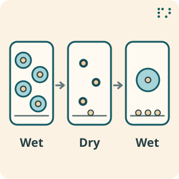
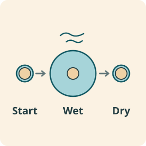
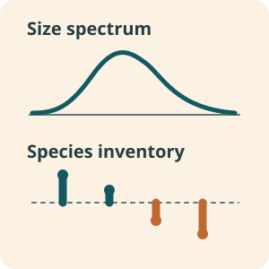
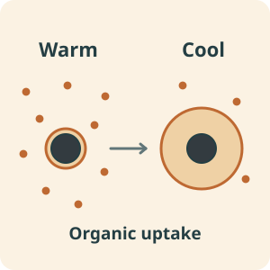
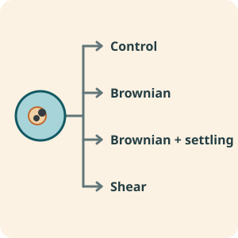
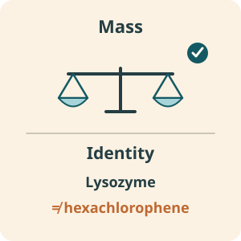
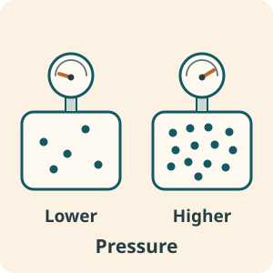

# Coupled populations

These worked simulations combine population construction, thermodynamic inputs,
time evolution, and diagnostics. Choose a question, then inspect the example's
assumptions and validation boundary before adapting its parameters. A successful
run or an attractive size distribution alone does not establish a reliable
material model.

\
[Separate water cycling from seed loss in a chamber](chambers/cloud_chamber_multi_cycle.py)

\
[Follow droplets through one wet–dry chamber cycle](chambers/cloud_chamber_single_cycle.py)

\
[When a size-distribution plot hides a composition error](emissions/organic_partitioning_and_coagulation.py)

\
[Follow organic uptake onto seeds during imposed cooling](emissions/soot_formation_in_flames.py)

\
[How do collision models change a water-grown mixed aerosol?](emissions/biomass_burning_cloud_interactions.py)

\
[Audit a respiratory-droplet illustration before using its predictions](emissions/cough_droplets_partitioning.py)

\
[Dry charged aerosols: ground level, mesopause and pressurized chambers](environment/gpu_dry_environment_sweep.py)

<!-- STUDY_LIST_START -->
- [Chamber cycles](chambers/index.md)
- [Charged aerosols and ensembles](charged-aerosols/index.md)
- [Dry aerosols and humid air with ions](environment/index.md)
- [Emissions and partitioning](emissions/index.md)
- [Forcing and heterogeneous boxes](forcing/index.md)
<!-- STUDY_LIST_END -->
