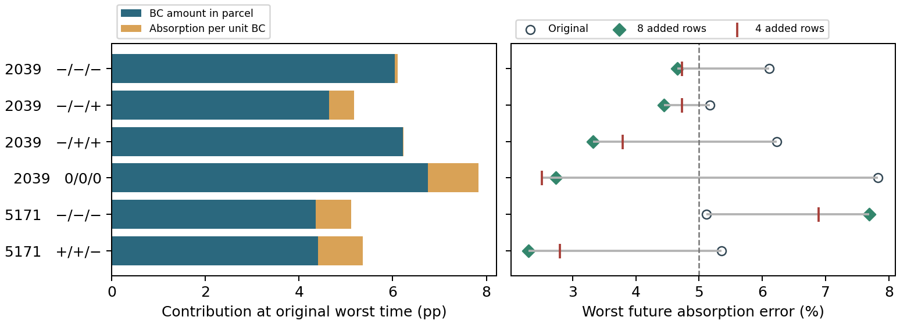

# Which black-carbon particles explain the six absorption misses?

In the [stage-two boreal experiment](stage-two.md), 16 representatives per occupied dry-size bin recovered dry 550 nm absorption in every saved parcel. After restart, six of 27 histories missed the 5% tolerance in at least one parcel. In all six, the largest individual error in the size-and-coating distribution was an **excess of moderately coated black-carbon particles**. The error in *total* parcel absorption had a second cause: the stochastic replay sent a different amount of black carbon into each parcel. These two findings point to different requirements for a compact checkpoint.

**Four additional rows per parcel were the most economical tested improvement.** They restored the absorption tolerance in five of the six original failures, while two previously passing histories crossed it. Across all 27 original histories, the number passing rose from **21 to 24**. A transferable minimum for an individual stochastic forecast remains unresolved.

## Where the distribution changed

We replayed the two restarts (hours one and three) and recovered all ten previously reported failing parcel/time comparisons. For every BC-bearing particle we recorded dry outer diameter, the diameter of the equivalent spherical BC core and their ratio. A ratio of 1.25–1.50 means that the dry outer diameter is 25–50% larger than the core diameter. Radial coating thickness is half the difference between the diameters. After a merger the optical model puts the combined BC into one equivalent core and all other dry material in a concentric shell. Water stays separate.

| Original history | Worst restart → observation, parcel | Dry diameter with largest net contribution (nm) | Outer / core diameters of worst joint cell (nm) | Original total error | From parcel BC inventory | From absorption per unit BC |
| --- | --- | ---: | --- | ---: | ---: | ---: |
| 2039 −/−/− | 1 → 4 h, A | 214–269 | 135–170 / 80–120 | +6.11% | +6.05 pp | +0.06 pp |
| 2039 −/−/+ | 1 → 3 h, A | 170–214 | 170–214 / 120–180 | +5.17% | +4.64 pp | +0.53 pp |
| 2039 −/+/+ | 1 → 6 h, B | 214–269 | 135–170 / 80–120 | +6.23% | +6.21 pp | +0.02 pp |
| 2039 0/0/0 | 1 → 3 h, A | 170–214 | 170–214 / 120–180 | +7.83% | +6.75 pp | +1.08 pp |
| 5171 −/−/− | 3 → 4 h, A | 135–170 | 135–170 / 80–120 | +5.12% | +4.36 pp | +0.76 pp |
| 5171 +/+/− | 3 → 6 h, B | 170–214 | 170–214 / 120–180 | +5.36% | +4.40 pp | +0.96 pp |

Signs in the history label give the sulfuric-acid, exchange and ascent perturbations. “Worst” is the maximum absolute error across both restarts, parcels and saved future times. The net dry-bin ranking sums signed contributions across all its cores and coatings first. Individual cells can have a larger error because neighboring cells compensate. Every worst joint cell had an outer/core diameter ratio of **1.25–1.50**. Its reference mean radial coating thickness ranged from **20.9 to 25.7 nm** across the six histories.

The center case shows what averaging removes. At hour one, the resolved 170–214 nm bin in parcel A contained **79 thinly coated particles** (ratio below 1.25), **107 moderately coated** (1.25–1.50), and **7 thicker** (1.50–2.00). Expanding the representative rows put **all 193** in the middle class. Nevertheless, whole-parcel absorption was accurate to 0.94%. By hour three the middle class contained **491 particles versus 322** in the reference, and the 1.50–2.00 class contained **5 versus 60**. The middle class alone contributed +10.07 percentage points to the optical error. A single average coating, or a correct integrated absorption measurement at the checkpoint, can hide substantial differences in which particles carry the absorbing material.

## Why the absorption error grew during exchange

Write a parcel's absorption as its BC mass times its absorption per unit BC mass. To express both contributions in percentage points of the reference absorption, we first change the mass while holding the reference absorption per unit mass fixed. We then change the absorption per unit mass at the reconstructed mass. The two terms add exactly to the signed error. The residual includes all core-size and optical-efficiency changes under the assumed morphology.

Compression conserved each parcel's BC inventory at restart. Subsequent chemistry adds no BC and coagulation conserves BC, so **exchange is the only way for the BC inventory in either parcel to change**. Changes to the particle sizes, stochastic collision partners and draws can affect which carriers are subsequently exchanged. The attribution identifies the net BC transport difference. It cannot identify a particular collision as its cause. In the six worst observations this inventory term accounted for 4.36–6.75 percentage points. Combining both equal-volume parcels at those same times reduced the absorption error to **0.73–0.97%**. A regionally integrated observation would have hidden the individual-parcel error. As a diagnostic, rescaling the predicted absorption using the *observed-time* reference BC inventory leaves only **0.02–1.01%** error at those six peaks. That calculation uses future information. It shows what a simultaneous parcel-specific BC mass measurement could constrain, while a free-running checkpoint still has to predict the exchange.

## Can a few additional representatives repair it?

We chose target bins using the four failures from seed 2039. At the worst observation of each history, we summed the signed optical contribution over core sizes in each dry-size and coating class, took its absolute value and averaged the four histories equally. We selected three dry bins and two coating classes within each. The selected outer/core ratios were **1.25–1.50 and 1.50–2.00** at 135–170 and 170–214 nm, and **below 1.25 and 1.25–1.50** at 214–269 nm. This is retrospective calibration. The two failures from seed 5171 did not enter the selection.

The first rule spends up to four or eight extra rows **per parcel in total**. Within existing groups overlapping the selected classes, it splits by core diameter or outer/core ratio, choosing the split that best resolves differences in BC volume and BC-volume-weighted log diameter ratio. Parent groups keep their original dry-size, water and lineage memberships. A second rule explicitly splits at coating-class boundaries to keep BC mass in the measured classes. Each child stores its exact count, mean eight-species dry inventory and mean liquid-water volume. Under the earlier 80-byte row layout, four or eight additional rows cost 320 or 640 uncompressed bytes per parcel, in addition to the existing slot and lineage information.

| History | Original | +4 local rows | +8 local rows | +16 local rows | +8 rows outside the three bins | Every targeted particle stored individually |
| --- | ---: | ---: | ---: | ---: | ---: | ---: |
| 2039 −/−/− | 6.11 | 4.73 | 4.66 | 8.04 | 5.40 | 3.62 |
| 2039 −/−/+ | 5.17 | 4.73 | 4.45 | 11.10 | 5.64 | 2.01 |
| 2039 −/+/+ | 6.23 | 3.79 | 3.32 | 5.23 | 4.91 | 3.09 |
| 2039 0/0/0 | 7.83 | 2.51 | 2.74 | 2.80 | 3.26 | 5.73 |
| 5171 −/−/− | 5.12 | 6.89 | 7.69 | 8.03 | 5.74 | 4.54 |
| 5171 +/+/− | 5.36 | 2.80 | 2.30 | 2.49 | 2.99 | 4.59 |

Values are the worst absolute future dry-absorption errors (%) for each new run. The worst time can change. Four or eight local rows brought **five of the original six** below 5%, including one of the two failures from the second seed. The eight-row outside-bin control brought three below 5%. Sixteen local rows brought only two below 5%. Even retaining every targeted particle individually left a 5.73% miss in the center case. A fixed stochastic trajectory need not get closer as the local checkpoint resolution increases.

*Left, the two terms at each original worst observation. Right, errors with the original, four-extra-row and eight-extra-row checkpoints, each maximized across future times and both parcels. The dashed line marks the 5% gate.*

## What transferred to the other histories and properties?

| Rule across all 27 histories | Histories passing dry absorption | Worst saved dry absorption error | Worst future dry absorption error | Worst pooled future absorption error |
| --- | ---: | ---: | ---: | ---: |
| Original 16 per occupied bin | 21/27 | 3.42% | 7.83% | 1.49% |
| Four extra local core-and-coating rows | **24/27** | 1.85% | 6.89% | 1.03% |
| Eight extra local core-and-coating rows | 22/27 | **1.48%** | 7.69% | **0.87%** |
| Up to eight explicit coating-class splits | 22/27 | 2.66% | **6.53%** | 1.15% |

The improvement in pass count was concentrated in the calibration seed. Across the **18 histories from the other two seeds**, the original and four-row rules each passed **16/18**. Their failures occurred in different histories. The eight-row and explicit coating-class rules each passed **15/18**.

The four-row rule spent exactly four extra rows at each of the 108 primary parcel checkpoints. Its two new misses were 6.47% in 2039 +/−/− and 5.04% in 5171 +/+/+. The explicit coating-class rule directly improved the observable it was designed around. Across the 24 starting parcels of the six failed cases, the median fraction of BC inventory misplaced among coating classes in the three target dry bins fell from **25.19% to 7.52%**. We measured this as half the sum of absolute changes in the dry-bin-by-coating-class BC mass histogram divided by its reference mass. This rule brought three of the original six absorption forecasts below 5%. Reproducing measured coating classes and forecasting a parcel's future integrated absorption are distinct tests.

| Worst future error over 27 histories | Original | Four extra local rows | Eight extra local rows |
| --- | ---: | ---: | ---: |
| Activation-curve RMSE / maximum (percentage points) | 0.98 / 3.02 | 0.83 / 2.94 | 0.99 / 2.95 |
| Condensed organic inventory, worst of three volatility classes (%) | 4.00 | 3.61 | 3.88 |
| Gas-phase organic discrepancy, relative to that class's reference gas + particle inventory (pp) | 0.184 | 0.177 | 0.129 |
| Dry / ambient wet 550 nm absorption (%) | 7.83 / 7.90 | 6.89 / 7.31 | 7.69 / 7.69 |
| Additional births (%) / survival to 10 nm (pp) | 1.69 / 0.38 | 1.69 / 0.26 | 1.82 / 0.30 |
| Remaining peak droplets / liquid-water content (%) | 12.50 / 1.77 | 12.50 / 2.19 | 12.50 / 1.58 |

The four-row rule retained the original activation, formation and survival tolerances. Cloud onset remained uncertain. In the weak-cloud case 5171 +/+/− the explicit coating-class rule gave 0.20 versus 0.32 droplets cm⁻³, a 37.5% miss. The organic scores test the gas and condensed inventories predicted by this α-pinene oxidation and uptake example. Chemical identity within volatility classes and independent reaction mechanisms remain untested.

## Does the result depend on the stochastic realization?

For each of the six original failures, we drew three new random streams at each saved restart. We advanced the full-resolution, four-extra-row and eight-extra-row populations on the same new stream. We also compared each full-resolution repeat with the original full-resolution trajectory to measure variability from replacing only the random draws. Each history/stream was scored by its worst future error across both restart times and both parcels.

| Comparison over 18 history/stream pairs | Pairs exceeding 5% | Median worst error | Largest error |
| --- | ---: | ---: | ---: |
| Full resolution, new stream versus original stream | 6/18 | 4.32% | 8.30% |
| Four extra rows versus full resolution on the same new stream | 11/18 | 5.36% | 8.89% |
| Eight extra rows versus full resolution on the same new stream | 6/18 | 4.26% | 7.02% |

Thus the four-row rule's advantage on the original trajectories did not carry over to the new streams. There is a more encouraging result for a checkpoint intended to predict **mean absorption**. At each parcel and time we averaged the three reduced absorption cross sections and the three corresponding full-resolution values before comparing them. With eight extra rows the largest difference in these means was **3.92%** across all six histories. With four extra rows it was **5.30%**, with five of the six histories passing. Three streams on six preselected failures are a preliminary ensemble check. They provide no population-wide confidence bound.

Across the five numerical-control forcing cells retained from stage two, both rules passed dry absorption on all five 30 s step checks and all five 100,000-particle-per-parcel checks. The largest errors were 4.25% and 3.35% respectively for four rows, and 4.31% and 2.64% for eight. At the nominal 75 s step on the alternate full-history stream, two of five cells failed with four rows and one of five failed with eight. These checks change the reference and the paired restart together.

## What to store, and what an instrument can constrain

An effective checkpoint is a set of weighted representative particles that reproduces specified responses over a stated forecast interval. Dry χ remains a useful description of diversity. Many distributions of core size, shell composition and water can produce the same χ. The choice of additional state therefore starts with the properties the checkpoint must predict.

| If the intended prediction is… | Information to preserve or measure |
| --- | --- |
| Dry absorption in one parcel | Number and BC inventory **per parcel**, then the joint distribution of dry outer diameter and refractory BC core mass. Record BC-free counts separately. In the accumulation mode, retain thin, middle and thick coating classes and the condensed species inventories in them. One bulk absorption value constrains their sum. |
| Absorption as air masses mix | Each source parcel's BC loading, carrier numbers and core-size distribution, plus exchange or dilution constraints. Validate both per-parcel and pooled absorption. Repeat the stochastic forecast to quantify how finely a single parcel realization can be predicted. |
| Activation and cloud evolution | Dry size and hygroscopic species together on each row, plus haze/growing-droplet membership and water on that row. Test size-resolved CCN activation and cloud peaks independently of absorption. |
| Chemical growth and partitioning | Condensed species or volatility classes on the same particles, corresponding gas reservoirs, precursor supply and thermodynamic forcing. Our chemistry check measures the modeled organic inventories and gas partitioning. Coating thickness alone leaves shell chemical identity open. |
| New-particle production and survival | Number-size distribution of the new-only population, precursor gases, and birth, crossing and capture counters. For a model restart, retain unresolved lineage multiplicities. For an atmospheric observation, ancestry remains a model inference. [Stage-two nucleation comparison](stage-two.md) |

For a measurement-constrained reconstruction, a single-particle soot photometer can supply refractory BC mass per detected particle via incandescence. Its scattering signal can constrain outer size and coating thickness under assumed density, refractive index and morphology. A size distribution and independent absorption observation can constrain counts and test the integrated optics. Detection limits for thin coatings and small cores need to enter the comparison explicitly. These measurements would constrain the joint size–core distribution identified here. They would still leave multiple plausible shell compositions and population histories. [SP2 optical-size and coating retrieval](https://doi.org/10.1029/2018JD028810) · [Laboratory comparison for α-pinene coatings](https://amt.copernicus.org/articles/5/3077/2012/)

In practice, generate several weighted populations consistent with the available joint measurements and their uncertainties. Fit the measured channels, reserve an independent observable or later time for prediction, and carry the spread between admissible checkpoints into the forecast. For example, a checkpoint constructed from size, BC mass and scattering could be tested against held-out absorption and CCN activation. A single absorption measurement used to construct the checkpoint cannot also establish its predictive power. This study tests the compression step with synthetic particles and known forcing. A field inversion and its instrument response would be a separate validation.

The [random-redraw qualification](redraw-qualification.md) tests this checkpoint idea with new particle populations and scores all four endpoint families together.

[Download the figure data (CSV bundle)](../../../../website/public/study-data/boreal/figure-data.zip) · [Replot or regenerate the simulations](../../../../studies/parcel-composition/README.md)
