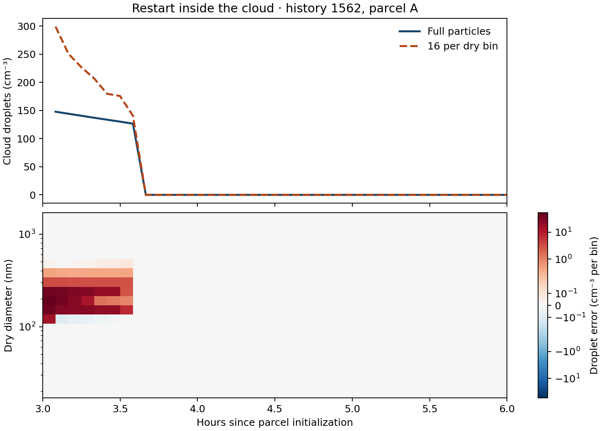

# Do 16 representatives and six χ knots survive a boreal cloud cycle?

A cloudy checkpoint can conserve every species, including liquid water, and still double the number of droplets on restart. In held-out history 1562, the full parcel produced a remaining peak of **147.68 droplets cm⁻³** after the hour-three checkpoint. Sixteen representatives per dry-size bin produced **298.91 cm⁻³**. Both populations reached a peak liquid-water content of **0.830 g m⁻³** over the same interval. Water had been spread over too many particles.

We tested the [earlier four-species result](six-hour-aging.md) in twelve synthetic six-hour outflows, each starting with 100,000 equal-count particles in each of two equal-volume parcels. The first eight histories fixed the budgets. Four other histories tested how well those choices transferred. A saved snapshot asks what we can infer *now*. A restart asks whether the information saved about individual particles is sufficient to follow their subsequent evolution.

## How much information did each regime need?

The table uses **10 bins per dry-size decade**, separating BC carriers first and newly formed particles second. Snapshot caps are the smallest integers passing all calibration snapshots. Forecast caps are selected independently by restarting at hours 1, 3 and 5, checking each smaller integer until a calibration history rejects it. All ten selected snapshot caps passed the four held-out histories. Two forecast caps failed on held-out air. The knot column gives **intervals** per decade for a uniform linear spline. Six intervals per decade across three decades require 19 shared knot heights.

| Regime | Snapshot reps/bin | Restart reps/bin | χ intervals/decade | First observable to fail |
| --- | ---: | --- | ---: | --- |
| Chemistry only | 17 | 17 | 6 | Activation maximum |
| Chemistry + nucleation | 14 | 7 failed held-out | 6 | Activation maximum at hour 4 |
| Chemistry + coagulation | 17 | 17 | 6 | Activation maximum |
| Chemistry + coagulation + nucleation | 14 | 7 failed held-out | 6 | Activation maximum at hour 4 |
| Chemistry + cloud | 17 | All 1–256 failed | 6 | Remaining peak droplet number |
| Chemistry + cloud + nucleation | 14 | All 1–256 failed | 6 | Remaining peak droplet number |
| Chemistry + cloud + coagulation | 20 | All 1–256 failed | 6 | Remaining peak droplet number |
| Chemistry + cloud + coagulation + nucleation | 14 | All 1–256 failed | 6 | Remaining peak droplet number |
| Chemistry off, exchange only | 15 | 12 | 6 | Activation maximum |
| Chemistry off, cloud + coagulation + nucleation | 16 | All 1–256 failed | 6 | Remaining peak droplet number |

On the saved particles, the preceding integer below **every** selected snapshot cap first exceeded the 5-point activation-curve maximum. The test also required RMSE ≤2 percentage points across 31 logarithmic settings and dry coated absorption within 5%. The maximum checks both sides of jumps and the two endpoints across 0.07–1.2% supersaturation. Forecasts used their own evolving number denominators. The physical gates required peak droplet number, peak liquid water and additional formation through hour six within 10%, and the fraction of tagged births reaching 10 nm before capture within 5 percentage points. Peaks cover the remaining forecast interval, so an earlier resolved peak cannot hide a restart error.

The failed clear-air forecasts both started at hour three in held-out history 1320, parcel B. At hour four, around 0.363% supersaturation, the seven-row cap missed activation by **5.59 points** without coagulation and **6.32 points** with it. The 85–107 nm interval contributed the largest signed excess in each case. Both failures recurred with an independent pair of random streams. Doubling the population gave 5.48 and 6.36 points, and reducing the time step to 75 seconds gave 6.32 and 7.04. Sixteen per bin passed the future-observable gates in both clear-air nucleation regimes on held-out runs. Seven remains the failed calibration choice in the table.

## Why the cloudy restart failed

The upper panel follows parcel A in history 1562 with cloud cycling, chemistry and coagulation. The lower panel shows the reconstructed minus resolved droplet concentration per dry-size bin. An activated droplet stays in its dry-composition bin as it takes up water. The reference and reconstruction start with the same thermodynamics, vapor inventories, forcing, cohort counts and random-generator state.

We tested the cause by independently averaging dry composition and particle water at the same hour-three boundary. Averaging **only dry species** gave 147.68 cm⁻³. Averaging **only water** gave 298.93 cm⁻³. Turning on nucleation in the matched history gave 149.67 and 301.95 cm⁻³ for these two treatments. One group can contain both haze particles and activated droplets with very similar dry composition. Assigning its mean water to every member changes which particles keep growing on the next step.

In calibration history 594, the first step following the cloudy restart already exceeded 110% of the reference peak over the *entire remaining three hours*. This held for **every integer cap from 1 to 256** on the 10-bin-per-decade grid with the BC-and-new-particle split in all five cloudy regimes. In the held-out 1562 cloud-and-coagulation case shown above, the remaining-peak error was 102.4% at baseline, 101.1% on the second stream, 102.0% with twice the population and 103.6% at a 15-second step. At 3 h 5 min, the 170–214 nm dry bin alone supplied 52.41 excess droplets cm⁻³. The experiment identifies a missing coordinate for this grouping. This result establishes a failure of the saved state in this model. The atmospheric magnitude of the effect depends on the cloud treatment and its time resolution.

### How much water information does a cloudy restart need?

We replayed the hour-three checkpoint in the four previously tested outflows, with cloud and coagulation, each with and without nucleation. In each dry-size bin we first separated haze particles from particles already on the model’s droplet-growth branch. Each occupied class received at least one of the 16 available rows, with the rest allocated by count. We grouped dry compositions within each class as before. This preserves which dry particles carry the cloud water, while keeping the same row count and conserving every bin’s species and liquid water.

| Water assigned on restart | Remaining peak droplets in history 1562 without nucleation (cm⁻³) |
| --- | ---: |
| Full particles | 147.68 |
| One mean water amount per dry-size bin | 437.47 |
| Mean water on each original dry-composition representative | 298.91 |
| Separate counts and mean water for haze and growing droplets in each bin | 147.77 |
| Mean water on each representative within those two classes | 147.77 |

Across all eight replays at the five-minute step, both class-based representations recovered remaining peak droplet number to within 0.061% and peak liquid water to within 0.001%. At a 15-second step in history 1562, keeping mean water on each representative within its class gave peak droplet errors of 0.00% without nucleation and 0.00% with nucleation. For these cloud peaks the compact description is the **fraction on the droplet-growth branch and water per member of each class**, linked to the dry representatives. Dry χ still describes chemical mixing. The test concerns checkpoints already inside a cloud; it leaves accuracy for a subsequent activation cycle and the wet optical spectrum open.

## Where extra dry-size resolution paid off

On the original 12-bin grid, the calibration minima ranged from 12 to 20 carrier-aware representatives. The corresponding ranges for the full 1.7–1,700 nm grid were **30–43 at 4 bins/decade, 15–24 at 8, 14–20 at 10, 12–18 at 12 and 9–16 at 16**. The original outer bins fold in their tails. The wider challenge grid has explicit underflow and overflow bins. Both were empty on these held-out histories. At 16 bins per decade, **16 carrier-aware representatives passed the snapshot gates in every regime**, with a worst held-out continuous activation error of 3.98 points and dry absorption error of 1.13%. Generic grouping at the same resolution missed by 6.25 points and 5.05%, respectively.

At 10 bins per decade, generic grouping needed 59 representatives per bin on calibration in every regime. The BC-first and BC-plus-new rules both needed 14–20. In held-out history 1320 at hour two, the chemistry-only parcel A had an activation RMSE of 0.97 points and dry absorption error of 0.78% at cap 16. Yet at 0.4052% supersaturation the curve missed by **5.08 points**, including 3.72 points from 85–107 nm particles. This particular 5.08-point failure is **borderline**: the same boundary gave 4.53 on a second stream, 4.49 at double population and 4.40 at a 75-second step. The calibrated 17-row choice passed the held-out snapshots and the independent-stream check.

We started adaptive allocation at four rows per occupied bin and granted four additional rows per bin to one decade at a time. Each decision used the reduction in worst calibration error divided by the additional mean bytes. The frozen allocation was **4, 20 and 8 representatives per bin**, ordered from smallest to largest decade. It passed on held-out histories with worst activation RMSE 1.37 points, continuous maximum 4.79 points and dry absorption error 1.55%. Uniform allocation using **exactly the same number of serialized 80-byte records in each snapshot** missed the continuous limit at 5.08 points. We also restarted all four held-out histories with both allocations. Worst future activation maxima were 3.88 points for adaptive and 4.69 for equal-byte uniform, and dry absorption errors were 3.47% and 2.93%. Peak droplet errors still reached 135.6% and 102.4%. Extra dry-size resolution helped the activation curve while leaving the cloudy water-allocation failure intact.

| Dry diameter | Held-out particles per parcel | Fraction of BC mass | Adaptive rows actually stored | Record bytes |
| --- | ---: | ---: | ---: | ---: |
| 1.7–17 nm | 0–187,190 | 0% | 0–33 | 0–2,640 |
| 17–170 nm | 67,170–255,741 | 16.5–54.7% | 100–200 | 8,000–16,000 |
| 170–1,700 nm | 4,022–32,830 | 45.3–83.5% | 32–49 | 2,560–3,920 |

These are ranges across individual parcel snapshots. Restart files also need lineage and a way to assign the expanded rows to the same stochastic slots. In the distributed checkpoint, the middle decade of parcel A used 8,960 representative bytes and 456,835 bytes for slot indices and lineage before file compression. The upper decade used 6,560 and 146,643 bytes respectively. Counting only representative rows would substantially understate the cost of this paired-replay design.

**Absorption leaves the new-particle size distribution unconstrained.** At the burst peak in history 1562 (40 minutes), parcel A contained 14,204 newly formed particles with no BC. Collapsing a BC-free cohort to a single mean can change its size spectrum while conserving dry absorption. We initially reported a 53.71-point cumulative discrepancy near 2.279 nm for the 16-per-bin reconstruction, with a 0.69% change in whole-parcel absorption. Rechecking that specific discrepancy gives a mean diameter displacement of only 1.95 × 10⁻¹⁵ nm. Rounding the diameters to eight decimal places in nm removes the discrepancy entirely. A batch of equal-size particles had moved across a numerical threshold. [Stage two tests the cohort distribution at physical diameters and checks subsequent survival.](stage-two.md)

## How well do six heights describe χ?

We computed Riemer–West χ independently from dry species masses in 48 bins, using Particula’s corrected helper. Empty and single-species bins retain an undefined flag. We fitted piecewise-linear splines in log dry diameter and weighted errors by particle number. The gates were RMSE ≤0.02 overall and ≤0.05 within each decade containing at least 200 particles with defined χ. The reference grid stays fixed as the number of fitted knots changes.

| Encoding | Float64 values per profile | Worst held-out overall RMSE | Worst held-out decade RMSE |
| --- | ---: | ---: | ---: |
| Mean | 1 | 0.209 | 0.495 |
| Mean and SD, with a shared calibrated shape | 2 | 0.198 | 0.216 |
| Signed quadratic | 3 | 0.084 | 0.173 |
| Six fixed heights on the original size span | 6 | 0.030 | 0.237 |
| Six fixed heights across all three decades | 6 | 0.058 | 0.073 |
| Six knots placed by weighted residual | 10 | 0.053 | 0.295 |
| Six heights with refined interior positions (post hoc) | 10 | 0.014 | 0.022 |
| Uniform 2 / 4 / 6 / 8 intervals per decade | 7 / 13 / 19 / 25 | 0.059 / 0.030 / 0.015 / 0.007 | 0.080 / 0.036 / 0.017 / 0.015 |
| Adaptive 1 / 6 / 1 intervals in consecutive decades | **9** | **0.016** | **0.017** |
| Uniform intervals at the same nine-height storage cost | 9 | 0.048 | 0.056 |

**Six fixed knots did not transfer.** The original movable-knot rule added a point at the largest number-weighted squared residual. It also failed. After inspecting these results we tried a second placement algorithm. It passed on the four previously scored histories, but its worst calibration RMSE was 0.02046, just above the overall gate. At the limiting calibration boundary (history 826 at 0.5 h), an independent stream gave 0.01674, doubling the population gave 0.01043, and reducing the step to 75 seconds gave 0.01979. The classification of the refined six-knot fit is **unresolved at the 0.02 boundary**. The refinement optimized positions per snapshot by two coordinate sweeps, with fixed endpoints and four stored interior positions. The nine-height adaptive profile passed both splits using fixed, shared positions. It spends 72 bytes per profile on heights, compared with 80 bytes for six movable heights and four float64 positions. All 920 held-out nine-height profiles can be decoded from `held-out-chi.npz`. The common size grid, undefined-bin mask and count spectrum accompany the profiles. The mean-plus-SD method additionally uses one 48-value template shared by all snapshots.

In history 1320, parcel A at hour two with nucleation, six full-span fixed knots gave an overall RMSE of **0.0183**. The upper decade nevertheless missed the local gate at **0.0543**. Its 8,659 particles were 4.5% of all particles but carried **68.9% of BC mass**. The fit underestimated χ by 0.273 near 375 nm. Conversely, even the passing adaptive profile missed χ by 0.563 near 578 nm in one held-out snapshot with only **one particle in that bin**. Its single-particle χ was exactly one. Bin occupancy is essential when interpreting the largest local residual. The largest single-bin miss for six full-span fixed knots was 0.473 near 28 nm in history 1441, parcel B at initialization (57 particles).

## Which results survive numerical refinement?

The 120 main reference histories yielded 2,760 distinct parcel snapshots, including 920 held out, after deduplicating coincident hourly and event checkpoints. The reference histories passed the combined gas-plus-dry-species inventory checks after prescribed inputs, water closure at each step, particle number against births minus mergers, and newborn lineage closure against reached, captured and pending counts. Dark, cloud-free and formation-off controls separate pre-existing vapor from new chemical production. Formation-off cases had **zero births**. Cloud-free cases had **zero activated droplets cm⁻³**, while hygroscopic haze still carried water. The 100,000-particle four-species control reproduced the earlier history 1199 reference fields and cap-16 results. Full-resolution restarts at hours 1, 3 and 5 in the fully coupled control reproduced both the particle arrays and generator state exactly on continuation.

Scattnlay 2.4 matched Particula’s homogeneous-sphere limits and an independent interface-continuity solution for the published five-layer n-mie example. At outer size parameters 1, 2 and 10 the absorption efficiencies were 0.993822, 1.467739 and 1.064005. In a direct comparison on 1,605 BC-containing particles sampled at peak liquid water, the tabulated and direct integrated dry absorption differed by at most 0.060% per parcel. The largest integrated wet difference was 0.147%, though one wet particle differed by 12.7%. In fully coupled history 1199, parcel A at hour three absorbed **2.555 Mm⁻¹ dry coated**, **2.565 Mm⁻¹ dry homogeneous** and **3.304 Mm⁻¹ wet coated**. [Published five-layer solver example](https://github.com/ovidiopr/scattnlay/blob/master/tests/python/test01.py)

Across all four held-out seeds and ten regimes, the largest full-resolution differences between independent stochastic streams were 0.69 points in continuous activation, 3.21% in dry absorption, 0.95% in peak droplet number, 0.68% in formation count and 0.20 points in cohort survival. Repeating the fully coupled histories with 200,000 particles per parcel changed peak droplet number by at most 0.11% and formation per unit volume by 0.35%. The frozen snapshot caps and the nine-height χ fit passed on the second streams, the doubled fully coupled runs and the two 15-second histories. Decades with fewer than 200 particles remain unranked. In eligible decades the largest resolved χ difference was 0.024 between streams and 0.021 after doubling, both in the largest decade. The tables retain the count in bins that were defined on only one side.

**The coarse model’s absolute cloud peak and birth count are time-step sensitive.** In fully coupled history 1562, the reference gave the following values. Births are concentrations integrated over the burst, averaged over the two equal volumes.

| Step (s) | Peak droplets (cm⁻³) | Peak liquid water (g m⁻³) | Births (cm⁻³) | New cohort reaching 10 nm |
| ---: | ---: | ---: | ---: | ---: |
| 300 | 169.24 | 0.896 | 993.77 | 64.52% |
| 150 | 1,464.71 | 0.880 | 790.05 | 65.20% |
| 75 | 260.47 | 0.870 | 674.82 | 65.80% |
| 30 | 396.68 | 0.866 | 601.93 | 66.34% |
| 15 | 303.44 | 0.864 | 578.70 | 66.37% |
| 5 | 316.56 | 0.863 | 561.12 | 66.50% |

The 15-to-5-second differences of 4.3% in cloud number and 3.0% in births are within the process tolerances in this history. The change from 300 to 150 seconds exceeded them. Finite-step activation and the order of precursor supply, formation and condensation affect these references. Running the actual 16-per-bin restarts at 15 seconds still missed remaining peak droplets by **96.2%** in history 1562 and **126.9%** in history 1441. The doubled-population restart also failed. This supports the diagnosis of lost particle water. A converged atmospheric minimum for the cloudy restart remains **unresolved**. The all-cap exclusion is specific to the declared five-minute benchmark and its dry-coordinate grouping.

## What the synthetic histories represent

- **Transport and composition.** Each parcel initially represents 100 cm³ at 1,000 particles cm⁻³. Source fractions, modal diameters, exchange, precursor supply and ascent vary by history. Independent draws exchange whole particles between equal-volume boxes. Gases and total water mix by the corresponding expected exchange fraction. One parcel is rich in aged boreal organics and background salt, the other in transported combustion aerosol. Dry species are sulfuric acid, ammonia-derived ammonium equivalent, background sulfate salt, BC, primary organic matter and three organic volatility classes. Water is a separate inventory. The ammonium equivalent is a bookkeeping surrogate for taken-up ammonia. Ionic equilibrium and detailed acid–base neutralization remain outside the model.
- **Oxidation and growth.** Explicit loss of α-pinene to 40 ppbv ozone produces 0.18 semivolatile, 0.035 low-volatility and 0.0015 non-nitrate highly oxygenated dimer molecules per reacted precursor molecule. The illustrative yields leave other products in an untracked reservoir. The constant bimolecular coefficient, 8.7 × 10⁻¹⁷ cm³ molecule⁻¹ s⁻¹, is a room-temperature measurement used here across the prescribed history. Each tracked vapor has a finite pool and a species-specific uptake timescale. The particle uptake weights scale as diameter squared divided by (1 + diameter/120 nm). Thus oxidation and condensation change size and composition together. The dark controls turn off this production and uptake. They retain prescribed acid/ammonia supply and any formation supported by pre-existing dimer vapor. [Atkinson, Hasegawa and Aschmann](https://hero.epa.gov/reference/5239217/)
- **New-particle formation.** During the clear-air pulse from 0.5 to 1.5 h, we use the neutral CLOUD fit at a formation diameter of 1.7 nm. The rate in cm⁻³ s⁻¹ is 7.4 × 10⁻²³ [H₂SO₄]² [NH₃] [HOM dimer], with molecules cm⁻³ for the acid and dimer, and pptv for ammonia. Chemistry is restricted to the formation fit's acid, ammonia and monoterpene ranges when evaluating this rate. The pulse uses 278 K, nominal 38% RH, 40 ppbv ozone and a 1.2 ppbv NOₓ background. Each Poisson birth debits a 1.7 nm dry embryo containing 28%, 7% and 65% by volume of acid, ammonium equivalent and dimer respectively. Those fractions are an assumed embryo composition. An integer lineage count follows each birth until it first reaches 10 nm or is captured by a particle containing pre-existing aerosol. Two new particles that merge carry both unresolved lineages. [Lehtipalo et al., Eq. 1 and Fig. 4](https://pmc.ncbi.nlm.nih.gov/articles/PMC6291317/)
- **Clouds and collisions.** Parcel A humidifies, ascends through a prescribed 310–590 m excursion and descends into drier air. A prescribed moist lapse rate sets temperature. Supersaturation is solved implicitly against finite vapor and shared diffusional water growth. Subsaturated particles relax to a hygroscopic haze solution. The droplet diagnostic requires wet diameter above 1 µm plus water above the haze branch. The model prescribes the temperature and humidity forcing, keeps box volume fixed, and exchanges air with the subsaturated second parcel. It does not prognose latent heating or precipitation. The Brownian collision kernel uses wet diameter, 278 K and effective density 1,400 kg m⁻³. A Poisson pair step admits at most one collision per particle per step. Each successful merger removes one particle and adds all species and water volumes.
- **Optics.** At 550 nm the BC refractive index is 1.95 + 0.79i. In the coated calculation, all BC volume forms one concentric spherical core, also after a merger. A transparent shell contains other dry species (index 1.50) and, for the ambient diagnostic, water (1.333) mixed by shell volume. A separate calculation uses the volume-averaged dry refractive index for homogeneous spheres. Dry coated absorption supplies the gate, and both other operators are reported independently. These diagnostics assume compact spheres and a nonabsorbing organic shell. [Peña and Pal, multilayer Mie solver](https://github.com/ovidiopr/scattnlay)

## Reproduce the challenge

The [runner and replay instructions](https://github.com/uncscode/particula/tree/main/studies/parcel-composition/boreal) describe the pinned optical dependency, the calibration search, each numerical table and the compact checkpoint. The source directory is `studies/parcel-composition/boreal/`. The runner generates `cloudy-restart.npz`, which is 243,040 bytes for both parcels, including water, forcing, gas, thermodynamic state, random-generator state, cohort multiplicities and the original slot order. The decoder expands counts exactly and the encoder checks every decoded field against the in-memory reconstruction. The forecasts run at the full particle count.

[Download the figure data (CSV bundle)](../../../../website/public/study-data/boreal/figure-data.zip) · [Replot or regenerate the simulations](../../../../studies/parcel-composition/README.md)
