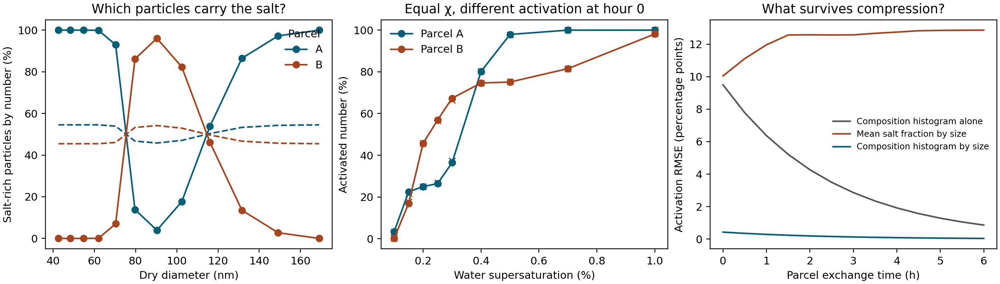

# Which particles carry the salt when two aerosols have the same χ?

If you handed another scientist a particle-resolved simulation, how little could you tell them about its composition and still let them predict what activates? A dry size spectrum, bulk species masses and a mixing-state index are a natural starting point. One case from Pallas lets us ask what those summaries leave open. A controlled six-hour parcel exchange lets us try a more informative description and see when its extra detail earns its cost.

## A field comparison with an unmeasured size

In the 16 September Pallas fit, two salt allocations conserved the dry inventory of each composition class, gave the same mass-weighted Riemer–West index (χ = 0.31683), and reproduced exactly the same predictions at the sampled sizes. Between channels, their salt-volume fractions at 112.2 nm differed by 19.9 percentage points. At that diameter and 0.2% water supersaturation the two allocations predicted 75.2% and 68.9% activation. An additional size channel could test that difference if its precision suffices. Both predictions come from fitted populations. The field record leaves the allocation at that size open. [Pallas analysis and measurement sources](../../literature/pallas-activation/index.md)

The index asks how much dry species diversity individual particles contain relative to the population. It weights by dry mass. Activation counts particles and depends on which sizes carry the hygroscopic material. Ching and colleagues already examined how χ relates to CCN errors in particle-resolved aging simulations. Our question is narrower. Given the same χ, size spectrum and ingredient inventory, what else should we communicate about a particular population? [Riemer and West (2013)](https://doi.org/10.5194/acp-13-11423-2013) · [Ching et al. (2017)](https://doi.org/10.5194/acp-17-7445-2017)

## Two parcels with the same composition histogram

We constructed 100,000 equal-number particles per parcel. Half are salt-rich (90% dry salt) and half salt-lean (10%). Parcel A puts salt-rich particles in the small and large modes. Parcel B puts them in the middle mode. For every pair of outer diameters, 60 and 120 nm before scaling, we use two middle particles whose individual dry volumes equal the mean of the two outer volumes. All four diameters receive the same lognormal scale factor (geometric standard deviation 1.12). This construction matches the number spectrum, both bulk species masses, and even the full composition histogram weighted by either number or dry mass.

The two equal-volume parcels exchange particles at a prescribed rate of 0.20 per hour in each direction. The contrast decays as exp(−0.40 t), with t in hours. We propagate each particle's number weight with the exact exchange solution. Particles keep their composition when they change parcels. This isolates transport from condensation, coagulation and chemistry. The dry species have equal assumed densities; their volume-weighted κ values use 0.60 for salt and 0.05 for organic material. We diagnose equilibrium activation at 298.15 K using the analytical κ-Köhler critical supersaturation with water surface tension 0.072 N/m. All inputs here are illustrative. [Petters and Kreidenweis (2007)](https://doi.org/10.5194/acp-7-1961-2007)

*Left: number fraction of salt-rich particles within 12 dry-size intervals at hour zero (solid) and hour six (dashed). Middle: particle-resolved activation at hour zero (circles) and its reconstruction from those intervals (crosses). Right: activation errors across both parcels and nine supersaturations from 0.1% to 1.0%, equally weighted. Every reconstruction receives the same full dry size spectrum.*

Both parcels have χ = 0.38415 throughout. Yet at hour zero and 0.30% supersaturation, **36.4% of A activates versus 67.3% of B**. At 0.50% their order reverses, with 97.9% of A and 75.1% of B activating. Ranking the parcels by a single activation setting would miss that reversal.

| Information supplied with the size spectrum | Hour 0 RMSE (pp) | Hour 3 | Hour 6 |
| --- | ---: | ---: | ---: |
| Population-wide composition histogram, applied at every size | 9.50 | 2.86 | 0.86 |
| Mean salt fraction in each of 12 sizes, assigned to every particle in that interval | 10.05 | 12.58 | 12.87 |
| Salt-rich and salt-lean number fractions in each of 12 sizes | 0.43 | 0.13 | 0.04 |

Parcel exchange makes size and composition less dependent, so the population-wide histogram becomes more useful. Averaging every particle's composition within a size interval does poorly as exchange brings rich and lean particles together. This distinction matters when interpreting the table. With two known endmembers, **one number per interval suffices for either reconstruction**. A scientist who knows the endmember compositions can convert the mean salt fraction to the rich-particle share exactly. The large error arises when the mean is assigned to every particle. A continuously varying multispecies population would be a harder compression test.

## A profile to communicate state, a distance to compare states

For this case, report the **fraction of particles in each composition class by dry size**, alongside the dry number spectrum, class compositions and χ. This gives the next reader a way to reconstruct the activation spectrum and to choose a diameter for a discriminating measurement. The bin width matters. At hour zero, 3, 6, 12 and 24 log-spaced diameter intervals give activation errors of 2.51, 1.40, 0.43 and 0.12 percentage points, respectively. These are ideal, fully sampled populations. Finer bins in a field instrument also mean fewer counts per bin.

To summarize the *difference* between two populations, we tried a one-dimensional Wasserstein distance, also called earth mover's distance. Within each size interval it is the minimum average change in salt fraction needed to match the composition distributions. Here it equals 0.8 times the absolute difference in salt-rich particle share. Weighting intervals by their share of the common number spectrum gives 0.546 at hour zero and 0.050 at hour six (salt-fraction units, 12 intervals). This scalar tracks convergence. The signed size profile shows where the salt went. Comparing populations with different size spectra would require declaring a common weighting or including size in the transport cost. [Rubner, Tomasi and Guibas (2000)](https://ai.stanford.edu/~rubner/papers/rubnerIjcv00.pdf)

The [comparison of mathematical population metrics](population-metrics.md) splits the chemical variation into differences between dry sizes and differences among particles in each size range. It also tests which distances give independent information during the exchange.

The CPU reproduction is in `studies/parcel-composition/exchange.py` with the full table in `exchange.csv` beside it. From the checkout, run `PYTHONPATH=. python studies/parcel-composition/exchange.py`. The calculation uses deterministic lognormal quantiles, verifies both parcels' dry inventories and their combined activated number, and uses the natural-log entropy definition of χ used in the Pallas analysis. Halving the particle count changed reference activation by at most 0.003 percentage points across all times and supersaturations (12-bin check). The six-hour result is a controlled transport calculation. Observational discrimination remains open.

**Reproducing χ.** The pilot uses Particula’s corrected public helper. Two equal-mass particles with salt mass fractions 0.1 and 0.9 give χ = 0.384145. The earlier implementation at revision `2db6a77323` gave 0.431698 for this pair. The corrected version takes the natural exponential after mass-averaging the Shannon entropies, consistent with the Pallas analysis.

For the subsequent chemistry, cloud, optical and restart tests, continue with the [checkpoint exploration](index.md).

[Download the figure data (CSV bundle)](../../../../website/public/study-data/boreal/figure-data.zip) · [Replot or regenerate the simulations](../../../../studies/parcel-composition/README.md)
