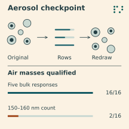
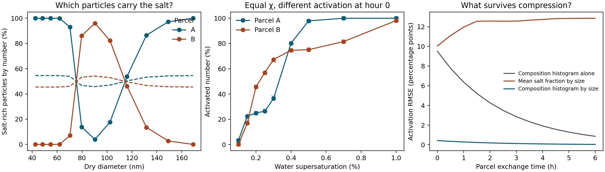
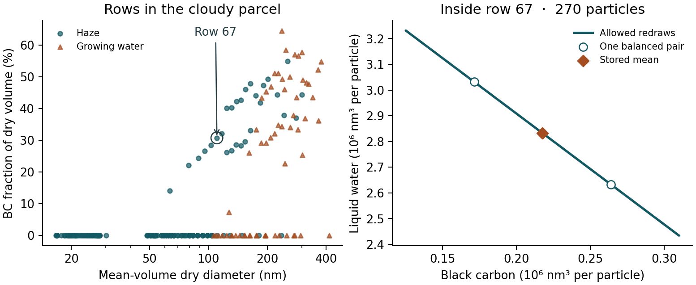
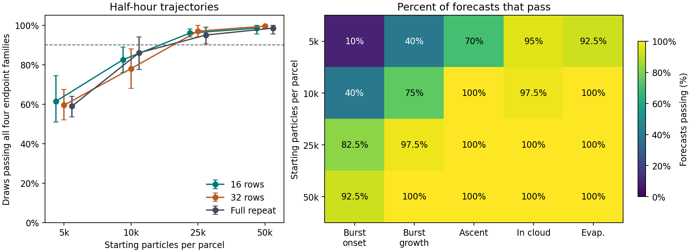
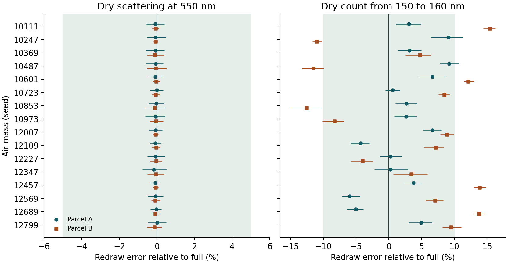

# Regenerating a particle-resolved aerosol from a compact checkpoint

What must a researcher save about an air mass so a colleague can regenerate its particles and predict how they will behave? We found that two simulated aerosols with the same mixing-state index could activate very differently. We built a checkpoint that records which dry materials and how much water occur together on particles of each size, along with the surrounding parcel state. At 50,000 starting particles per parcel, the median two-parcel archive shrank from **6.68 MB to 64.9 kB** across five checkpoints in one synthetic boreal history. Redrawn particles recovered cloud, chemical and optical responses in short forecasts, while a counter measuring only 150–160 nm particles exposed a need for finer size resolution. [Archive-size comparison](redraw-qualification.md#storage-and-working-memory)

## Why the same mixing state can give different clouds

Riemer and West defined the mixing-state index χ by comparing the diversity of chemical species within individual particles with the diversity of the whole population. Ching and colleagues used χ to study how averaging particle compositions changes predictions of cloud condensation nuclei. [Riemer and West (2013)](https://doi.org/10.5194/acp-13-11423-2013) · [Ching et al. (2017)](https://doi.org/10.5194/acp-17-7445-2017)

We constructed two parcels with the same χ (0.38415), dry size spectrum, salt inventory and fraction of salt-rich particles. We placed the salt-rich particles at the small and large sizes in one parcel and at the middle sizes in the other. At 0.30% water supersaturation, **36.4% of one parcel activated and 67.3% of the other did**. Knowing which sizes carried the salt was enough to recover that difference. [Two-parcel exchange experiment](exchange.md#two-parcels-with-the-same-composition-histogram)

**Figure 1:** *The middle panel shows the consequence of moving salt between sizes. Crosses reconstructed from composition within each size interval follow the resolved activation curves (circles). The right panel follows the errors as the parcels exchange particles. Activation was calculated from dry diameter and hygroscopicity using κ-Köhler theory.* [Petters and Kreidenweis (2007)](https://doi.org/10.5194/acp-7-1961-2007)

The question arose when we fitted two salt distributions to the size-resolved activation measurements that Backman and colleagues collected at Pallas. Our fits agreed at the measured sizes and diverged between them. [Backman et al. (2025), Pallas measurements](https://essd.copernicus.org/preprints/essd-2025-284/) · [Our comparison of the two fits](exchange.md#a-field-comparison-with-an-unmeasured-size)

We also tested mathematical distances for tracking exchange. A distance can quantify how far apart the parcels are, while a table of particle counts and compositions by size gives a recipient something to sample. [Mathematical comparison of population metrics](population-metrics.md)

## What goes into the final checkpoint?

In a four-species aging experiment, we constructed alternative populations that matched χ even within each dry-size bin, along with the size spectrum and species inventories. They missed at least one activation or absorption criterion in all 56 held-out snapshots. Separating black-carbon carriers from other particles reduced the number of representatives needed to reproduce activation and absorption from 80 to 16 per dry-size interval. [Six-hour aging and size-dependent χ](six-hour-aging.md)

Cloud processing exposed a missing variable. In one restart, two populations reached the same peak liquid water, 0.830 g m⁻³, yet peaked at **148 and 299 droplets cm⁻³**. Averaging water had spread it over too many particles. Growing droplets and haze therefore get separate rows. [Cloud restart and water competition](boreal-challenge.md)

The final recipe uses ten logarithmic dry-size bins per decade from 1.7 to 1,700 nm, with separate underflow and overflow. Each occupied bin has a base allowance of 16 rows. Each row stores an integer count, dry-size bin, water-growth class, black-carbon presence and ancestry, including how many newly formed lineages it still carries toward 10 nm. It also stores **nine mean amounts and nine signed deviations** for eight dry components and liquid water. The parcel supplies the gas inventories, thermodynamics, forcing, event counters and random-generator state needed to resume the simulation. [Checkpoint specification](redraw-qualification.md#the-checkpoint-specification)

**Figure 2:** *The circled row represents 270 particles. One random number moves all nine amounts together along the row’s fitted direction. A partner takes the opposite deviations. An odd last particle takes the mean. This preserves the row’s count and material inventories while allowing fresh particle compositions on each redraw.*

Perturbing acid supply, ascent and exchange showed why ancestry and coatings matter. New particles can grow to 10 nm or be captured by older aerosol. Interpreting a size histogram in terms of survival requires accounting for growth and loss. [Tuovinen et al. (2022)](https://acp.copernicus.org/articles/22/15071/2022/)

For absorption, up to four extra rows per parcel for black-carbon coatings at 135–269 nm raised the number of passing restart histories from 21 to 24 of 27. [Water, lineage and χ-profile perturbations](stage-two.md) · [The six coating failures and local refinements](black-carbon-restarts.md)

## What survives a half-hour forecast?

We restarted four independent six-hour histories during burst onset, burst growth, ascent, in-cloud processing and evaporation. All saved-state comparisons passed at each tested population. Forecasts were harder. At 50,000 starting particles per parcel, **197 of 200** redraws stayed within the chemistry, activation and cloud, nucleation, and absorption tolerances at every forecast time. All three misses began at burst onset. Two missed absorption. The third formed 508 particles in 75 seconds against 453 in the original forecast, a 12.14% difference against a 10% tolerance. [Independent forecast comparison](redraw-qualification.md#independent-qualification-and-scaling)

**Figure 3:** *Each heat-map cell is the percentage of 40 forecasts that passed at 75 seconds and at 10, 20 and 30 minutes. At 50,000 particles, 37 of 40 passed at burst onset and all 160 passed across the other four windows. The full-resolution repeats at left show how much even the original particles can diverge with a new event stream.* [Failure counts and error magnitudes across the whole matrix](redraw-qualification.md#which-properties-failed-and-by-how-much)

Eight additional burst histories put that success rate in perspective. At 50,000 particles, **66 of 80** redraws reproduced the original trajectory within tolerance. **78 of 80** agreed with a full-resolution repeat using the same new event stream. When we asked about the *distribution* of birth counts over the first 75 seconds, all 16 tested air masses met the five-percentage-point tolerance across count thresholds on a five-second time grid. [Burst replication](redraw-qualification.md#does-the-burst-result-repeat) · [Birth-count distributions within each air mass](redraw-qualification.md#qualification-within-each-air-mass)

## What would a different instrument see?

At the hour-one and hour-three snapshots and 75 seconds later, all 16 air masses qualified jointly for activation, cloud droplet number and water, chemistry, absorption and scattering. Adding new-particle behavior to that test left two air masses unresolved during burst growth. Counting just the particles from **150 to 160 nm** exposed a different loss. Both instrument cutoffs fall inside one storage bin. A redraw can conserve that bin’s total number while moving particles across either cutoff. [Qualification by air mass and measurement](redraw-qualification.md#conditional-results-at-the-saved-state-and-the-next-step)

**Figure 4:** *In parcel B of history 10111, median dry scattering was 3.939 Mm⁻¹ in the full forecasts and 3.936 in the redraws. The same populations gave 36.44 and 42.06 particles cm⁻³ in the narrow channel. The shaded bands mark each instrument’s tolerance.* [Paired measurements and uncertainty](redraw-qualification.md#can-one-checkpoint-serve-different-measurements)

Placing bin edges at 150 and 160 nm raised short-window counter qualification from **2 of 16 air masses to all 16** for a median 1.59% increase in archive size on the fixed grid. After half an hour, 20 of 96 redraws still missed the count tolerance as particles crossed the boundaries. [Fixed and moving bin experiments](redraw-qualification.md#should-dry-size-bin-edges-follow-the-particle-distribution)

## Replay a cloudy checkpoint

The example contains both parcels at hour three. Draw a fresh population, apply the saved forcing, and compare its snapshot with the next half hour of simulated cloud evolution. [Download the plotted values (CSV bundle)](../../../../website/public/study-data/boreal/figure-data.zip) · [Download the checkpoint](../../../../website/public/study-data/boreal/redraw-cloud-16.npz) · [Replay instructions](redraw-qualification.md#replay-a-cloudy-checkpoint)

## Conclusions and future exploration

A single value of χ can describe many populations with different cloud responses. In these synthetic air masses, a compact checkpoint became useful for prediction when it preserved which materials and how much water shared a particle at a given dry size. Redrawing from that checkpoint recovered activation, cloud water and droplet number, chemistry, absorption and scattering together in all 16 air masses over the tested 75-second windows. The narrow particle counter exposed a limit because its reading depended on where particles sat *within* a storage bin. Aligning the bin edges with the counter recovered its short-window response, but forecasting half an hour ahead also required knowing which particles would grow across those edges. [Qualification by measurement](redraw-qualification.md#conditional-results-at-the-saved-state-and-the-next-step) · [Bin-edge experiment](redraw-qualification.md#should-dry-size-bin-edges-follow-the-particle-distribution)

The next exploration would start with what instruments can observe. For the same air mass, we would fit a set of plausible checkpoints using a dry size spectrum, size-resolved single-particle chemistry and paired dry and wet sizes. We would withhold the activation curve, redraw particles from each fit, and compare their predicted activated fractions with the withheld measurements across supersaturations. Repeating the fit first with the size spectrum alone and then with each additional measurement would show which observation narrows the prediction and whether the remaining spread accounts for the measured curve within its uncertainty. [What instruments can constrain](black-carbon-restarts.md#what-to-store-and-what-an-instrument-can-constrain)
