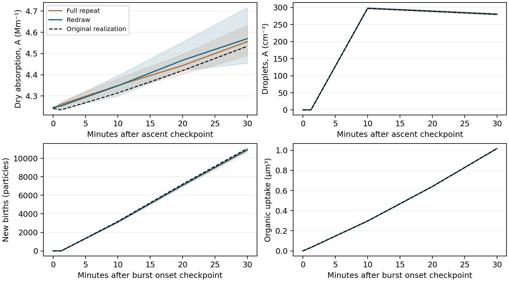
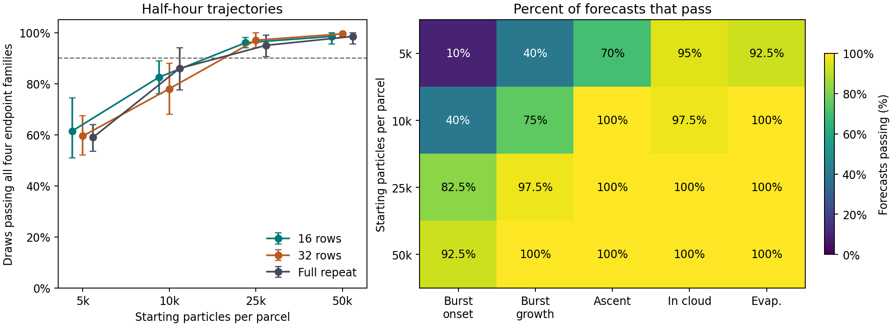
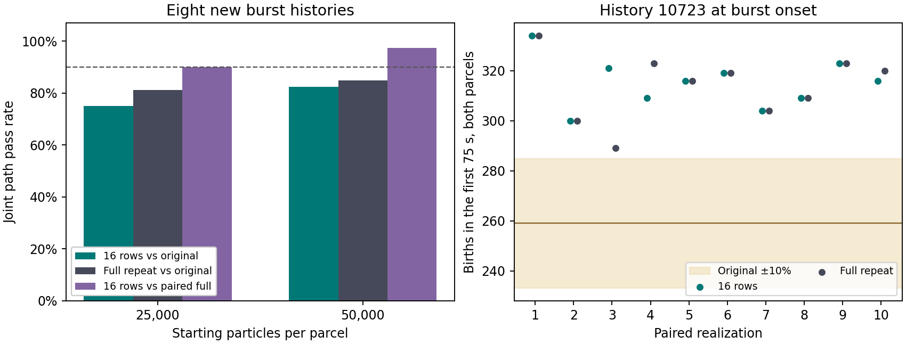
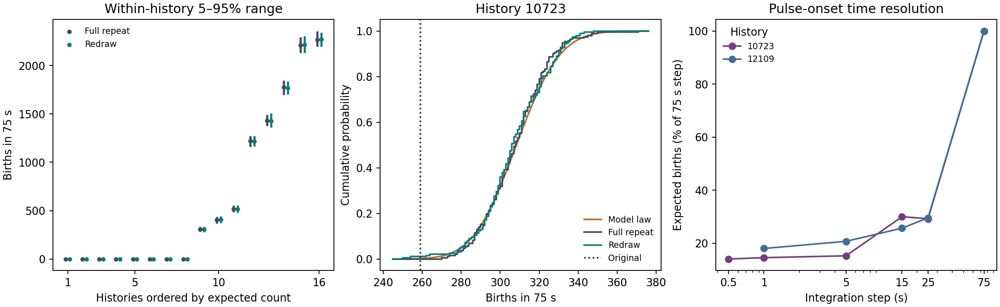
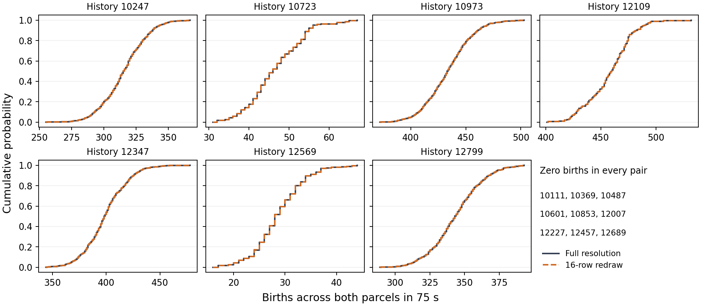
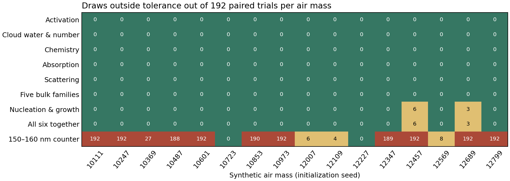
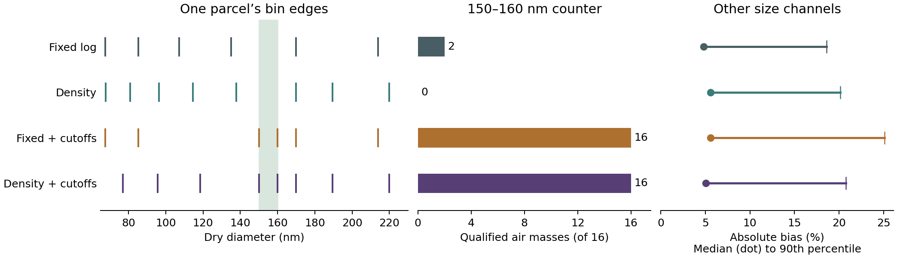
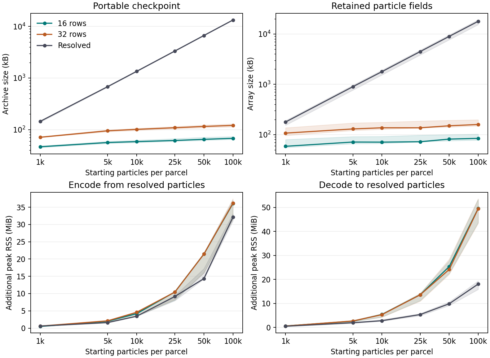

# How much aerosol state survives a random redraw?

The study uses **16 representative rows per occupied dry-size bin** as its default. For nucleation, it qualifies the distribution of the total number formed during the first 75 seconds separately for each air mass. Across the two later short forecast windows, the same checkpoint also qualified jointly for cloud activation, droplet number and liquid water, chemistry, absorption and scattering in all 16 air masses. A 150–160 nm number channel exposed information lost inside a dry-size bin. [Birth-count qualification](#qualification-within-each-air-mass) · [Multi-observable qualification](#can-one-checkpoint-serve-different-measurements)

In the first held-out comparison, with **10,000 starting particles per parcel**, the original 32-row calibration choice recreated the four measured endpoint families at the saved time in **200 of 200 redraws**. It predicted the original air mass within all tolerances in **195/200** draws at the next 75 s step, **183/200** at the half-hour endpoint and **176/200** throughout the sampled half-hour trajectory. An uncompressed repeat using a new random stream passed the trajectory test in **174/200**. At 5,000 starting particles the corresponding trajectory counts were **140/200** and **145/200**. A percentage for “recreating the air mass” needs a particle count, a forecast horizon, a perturbation and a definition of success.

The [independent qualification and scaling test](#independent-qualification-and-scaling) below follows the 16-row checkpoint through fresh histories and measures the memory required to recover a resolved population.

## The checkpoint specification

A recipient needs a **joint distribution of dry size, chemical composition and liquid water**, plus counts and the state of the air around the particles. The stored rows describe that distribution without retaining a list of the original members. The [mixing-state comparison](exchange.md), [cloud and new-particle experiment](stage-two.md) and [BC coating tests](black-carbon-restarts.md) established why these variables need to stay associated on the same particles.

### What one representative row stores

A row represents a group of particles in one parcel. The default groups particles into ten logarithmic dry-size bins per decade from 1.7 nm to 1.7 µm, with separate underflow and overflow bins. Within each occupied bin it reserves rows for distinct physical classes and uses a base budget of 16 rows. Up to four extra rows per parcel resolve black-carbon (BC) core and coating differences in the 135–269 nm range. Every row stores four fields.

| Field | Contents | Physical meaning |
| --- | --- | --- |
| `count` | One integer | Number of individual particles to regenerate from this row. |
| `label` | Five integers in order | Dry-size bin index, haze or growing-water branch, presence of pre-existing aerosol ancestry, number of newly formed lineages per particle still being followed to 10 nm, and presence of BC. A merger can leave several pending lineages on one particle. |
| `mean` | Nine mean amounts **per particle** | In archive order, these are sulfuric acid, ammonia-derived ammonium equivalent, background sulfate salt, BC, primary organic material, semivolatile organic material, low-volatility organic material, highly oxygenated organic dimer, and liquid water. |
| `delta` | Nine signed changes in the same order and units as `mean` | One fitted pattern of how those amounts vary together among particles in this row. Each row has its own pattern. |

The archive expresses each amount as six divided by π times its physical volume in nm³. Multiply an entry by π/6 to get physical volume in nm³. In archive units, the cube root of the sum of the first eight entries gives dry diameter in nm. Including the ninth gives wet diameter. Size, composition fractions and BC core size can therefore be calculated for each redrawn particle.

### How the nine amounts vary together

For each pair of particles in a row, draw **one random number** `u` uniformly between −1 and +1. The first particle gets `mean + u × delta` and its partner gets `mean − u × delta`. The same `u` multiplies all nine entries. Entries with the same sign in `delta` rise together. Entries with opposite signs move in opposite ways. Each pair has exactly twice the row mean for every species and for water. An odd last particle takes the mean, and the final particle list is shuffled.

For example, row 67 (zero-based) of parcel A in the saved cloud checkpoint represents 270 BC-bearing particles. Its mean particle contains about **218,000 nm³ of BC** and **2,832,000 nm³ of water**. If `u = 0.5`, the first particle gets about **46,000 nm³ more BC and 199,000 nm³ less water** than the mean. Its partner gets the reverse. The seven other dry-species amounts each change by half of their own signed entry. The inverse BC–water relationship in this example belongs to this particular fitted row. [Download the cloud checkpoint used in this example](../../../../website/public/study-data/boreal/redraw-cloud-16.npz)

To fit `delta`, the encoder finds the feature with the greatest variance in the row among log dry diameter measured in bin widths and the eight dry-species volume fractions. It estimates how each of the nine amounts changes with that feature, then shortens the vector as needed to keep particles physically admissible and inside their assigned class. With this **one direction**, all the possible particles from a row lie along a single line through its mean in the space of dry composition and water. A separate spread in water at fixed dry composition, for example, can survive through different rows, but a single row whose dry composition changes along that line cannot also vary water independently. The narrow-counter test below shows one consequence of losing within-row detail.

### What travels with the particle rows

The archive header stores the format version, experiment settings, elapsed seconds, binning and redraw recipe, saved random-generator state, and forcing for the two parcels (physical volume, exchange, lift, and sulfuric-acid and ammonia supply). Each parcel also carries its gas inventories, α-pinene reservoir, temperature and total water. The separate parcel total lets the cloud solver balance vapor against the liquid water carried by the particles. The remaining parcel fields record cumulative births, lineages reaching 10 nm, captures and mergers, the latest formation rate, droplet concentration and liquid-water content, and the historical peaks of droplet concentration and liquid-water content. A restart uses these fields together with the redrawn particles.

The frozen training choice allowed **32 rows per occupied dry bin** before the four local additions. Ten well-populated bins therefore have a base budget of **320 rows per decade**. Sparse bins use fewer. The rule reserves all occupied physical classes even if they alone would exceed the base cap. The highest observed final bin occupancy in rows was 36. A row uses 168 uncompressed bytes: six 32-bit integers and eighteen 64-bit floats. The table below gives the sizes of the actual compressed archives, including both parcels and metadata. The resolved comparison uses the same lossless file format.

| Initial particles per parcel | Median particle slots at checkpoint, both parcels | Median representative rows | Median checkpoint size | Median per-checkpoint size reduction |
| --- | ---: | ---: | ---: | ---: |
| 5,000 | 15,052.5 | 717.5 | 89.8 kB | 7.93× |
| 10,000 | 30,061 | 765.5 | 96.7 kB | 14.75× |

Nucleation and coagulation change the particle count after initialization. A half-integer median averages two integer counts. The actual archive sizes ranged from 78.0–101.4 kB and 81.9–109.5 kB, respectively. We checked independent draws for each held-out checkpoint against the original count and dry-species and water inventories within **every occupied joint class**. The archive contains no original slot map. If dry mixing-state diversity itself is a deliverable, the earlier study supports saving the resolved χ profile separately using nine heights and its occupancy/defined-bin information. The tests here score effective properties directly.

## How the qualification works

Each six-hour synthetic history couples two exchanging parcels with α-pinene oxidation, condensation, Brownian coagulation, formation of 1.7 nm particles, cloud ascent and evaporation. Starting number concentration stays at 1,000 cm⁻³ per parcel at both resolutions. Four calibration seeds and four fresh held-out seeds each cover the four specified combinations of acid supply, exchange and ascent, one forcing combination per seed within a split. The two population sizes use the same forcing for a given seed. We used four separate pilot histories to check the scoring implementation before the final held-out run. These experiments assess this prescribed model course. They do not estimate an atmospheric frequency of success. [Process assumptions and optical qualification](boreal-challenge.md)

We saved checkpoints at **0.5, 1, 2.5, 3 and 4 hours**, during burst onset, burst growth, ascent, in-cloud processing and evaporation. From each one, ten independently seeded draws ran for another half hour. We evaluated the saved state, 75 s, 10 min, 20 min and 30 min. For the trajectory score, all four positive leads must pass; the cloud peak includes every integration step since restart. A full-resolution repeat starts from the exact original particles and uses the same new future event stream as its paired redraw. Both are compared with the original full-resolution continuation. The joint score requires **both parcels** to satisfy every applicable gate.

| Endpoint family | Passing tolerances |
| --- | --- |
| Chemistry | Each of three condensed organic inventories within 5% in each parcel. Gas discrepancy for each evolving gas species ≤1 percentage point of its reference gas-plus-particle inventory. Cumulative net gas-to-particle transfer of each organic class across the two parcels within 10%, including precursor incorporated in embryos. |
| Cloud activation | Equilibrium CCN curve RMSE ≤2 percentage points on 31 channels and maximum error ≤5 points anywhere from 0.07% to 1.2% supersaturation. Peak activated droplet number and peak liquid-water content in the ascending parcel each within 10%. At the checkpoint, diagnose droplet count from wet size and water and compute liquid mass directly. |
| Nucleation | Additional births across both parcels and surviving new-only count in each parcel within 10%. The fraction of the at-risk lineages reaching 10 nm within the window, and new-only cumulative size fractions at 2, 3, 5 and 10 nm, each within 5 percentage points. At-risk lineages include those pending at restart and births since restart. |
| Absorption | Dry **and ambient wet** coated-BC absorption at 550 nm within 5% in each parcel. |

An unexpected event against a zero reference fails the relative gate. Two zero counts agree. An empty new-only population has zero cumulative counts at all four diameter thresholds; a missing population is also checked by its count. At zero lead, birth and transfer increments are zero by construction. The snapshot qualification tests the starting distributions, CCN, droplets, liquid water, optical response and chemical inventories. Forecasts test how formation, growth and transfer resume.

We tested 4, 10 and 16 bins per decade with row caps of 8, 16 or 32 in six specific combinations. The selection target was **90% joint trajectory success in every training event at both particle counts**. No candidate met it. Among candidates that generate new within-row properties, we froze the highest worst-event pass rate, with average pass rate and then file size as tie-breakers. The selected recipe passed only **32.5%** in its weakest training cell (13/40); the uncompressed repeat also had a weakest cell of 32.5%. The point-mass control reached 35% in its own weakest cell, but regenerates identical copies within each row. This experiment establishes a measured operating range and leaves the universal minimum open.

## Probability of recovering the original future

| Starting particles per parcel and representation | Saved state | Next step | Half-hour endpoint | All four forecast leads |
| --- | ---: | ---: | ---: | ---: |
| 5,000, redrawn | 100% | 95.0% | 82.0% | **70.0%** |
| 5,000, full repeat | 100% | 94.5% | 83.0% | 72.5% |
| 10,000, redrawn | 100% | 97.5% | 91.5% | **88.0%** |
| 10,000, full repeat | 100% | 97.5% | 91.0% | 87.0% |

Each row represents 200 trials: four histories × five event windows × ten draws. The independently initialized histories are the replication units for generalizing across air masses. Individual history trajectory rates ranged from **56–84%** at 5,000 and **80–92%** at 10,000. A descriptive bootstrap resampling the four whole histories gave 95% intervals of **60–80%** and **82.5–91.5%**. Four initialization/forcing combinations limit what those intervals can establish. Comparing each redraw with its full-resolution repeat on the *same new stream* gave 79.5% and 91.5% joint path success. Changing a sampled particle population can still alter the subsequent sequence of event partners.

| Half-hour trajectory, redrawn checkpoint | 5,000 | 10,000 |
| --- | ---: | ---: |
| Chemistry passes at every lead | 94.5% | 99.5% |
| CCN and cloud pass at every lead | 99.5% | 100% |
| Births, new-only size and survival pass at every lead | 94.5% | 97.5% |
| Dry and wet absorption pass at every lead | 77.5% | 90.0% |

Absorption most often set the limit. In seed 8467 at 5,000 particles, one burst-onset draw gave 0.998 Mm⁻¹ in parcel A after 30 min against 1.128 Mm⁻¹ in the original, an 11.52% miss. Depending on event, the joint path rate was **47.5%, 47.5%, 80%, 80% and 95%** at 5,000, in chronological order. At 10,000 it was **72.5%, 67.5%, 100%, 100% and 100%**. Each event percentage uses 40 trials. A pooled score alone hides the difficulty around the formation pulse.



*One held-out history at 10,000 initial particles per parcel. Lines show ensemble means, bands span the ten realizations, and dashes show the original continuation. The two cloud panels share the ascent checkpoint; the formation and organic-transfer panels start at burst onset.*

## What resolution earns its storage?

| Grid and row representation | Median size at 5,000 / 10,000 | Joint path success at 5,000 / 10,000 |
| --- | ---: | ---: |
| 4 bins/decade, 8 rows and a spread vector | 20.2 / 20.9 kB | 62.0 / 79.5% |
| 10 bins/decade, 8 rows and a spread vector | 32.7 / 34.1 kB | 68.5 / 87.5% |
| 10 bins/decade, 16 rows, fixed centers | 32.0 / 33.3 kB | 61.0 / 86.5% |
| 10 bins/decade, 16 rows and a spread vector | 53.2 / 56.7 kB | **71.5 / 92.0%** |
| 10 bins/decade, 32 rows and a spread vector, frozen choice | 89.8 / 96.7 kB | 70.0 / 88.0% |

All budgets include the same four targeted additions per parcel. The fixed-center rule randomly permutes the particles but cannot regenerate within-row variability. For a compact distribution that another model can sample, **10 bins per decade and 16 rows with joint spread** is the practical candidate from this comparison. It takes about 57 kB for the two parcels at 10,000 starting particles each. The 92% is a comparison on the same held-out histories, not an independently selected 90% guarantee. For that 10,000-particle comparison, 197/200 draws passed the next step, 188/200 passed the half-hour endpoint and 184/200 passed every scored lead. More rows did not consistently improve a particular stochastic realization. [Replayable 16-row checkpoint](../../../../website/public/study-data/boreal/redraw-cloud-16.npz)

For predicting the **mean of possible futures**, we compared the ten-redraw mean with the corresponding ten-full-repeat mean at each event and lead, weighting each realization equally when averaging its activation curve. The frozen 32-row recipe passed every trajectory gate in **19/20 windows at 5,000 and 20/20 at 10,000**. Comparing those same redraw means with the *one original continuation* gave 17/20 and 19/20. The ensemble failure was a threshold event in seed 8599: one draw produced 208 new particles by the end of the window, while the other nine draws and all ten full repeats produced zero. The physical discrepancy was 20.8 births on average across the two parcels.

Repeating the first held-out forcing history with 25 s integration steps and keeping the same physical evaluation times changed the redrawn path rate from **84% to 82%** at 5,000 and from **90% to 90%** at 10,000 (50 draws per setting). This is one time-step sensitivity check. The course tests synthetic particle-resolved air masses with known gas and water state; an instrument-constrained checkpoint would also need uncertainty on the quantities inferred from observations.

## Independent qualification and scaling

For a portable checkpoint, use **10 bins per dry-size decade, a base of 16 joint representative rows per occupied bin, and one bounded spread vector per row** as the smaller tested operating point. This gives a nominal 160 rows per fully occupied decade per parcel. Occupied physical classes take precedence and the algorithm spends up to four extra rows per parcel on BC cores and coatings. A recipient can draw a fresh list of particles at the stored integer counts from these rows and the parcel state in the specification above. The effective properties that this achieves depend strongly on the population being sampled and on when the forecast begins.

We froze the earlier 16- and 32-row recipes before running four new six-hour histories. Each history used the same forcing across its particle-count runs, held the starting concentration at 1,000 cm⁻³ per parcel and sampled the five event checkpoints independently of forecast performance. The 50,000-particle run followed the initial 5,000–25,000 sweep after burst onset fell below the 90% target. Each method at each particle count has 200 trials across four histories, five windows and ten draws. We scored chemistry, cloud activation, nucleation and dry/wet absorption using the same gates and original resolved continuation as above.

| Starting particles per parcel | Median 16-row archive, both parcels | Saved state | Next 75 s | Half-hour endpoint | All leads, 16 rows | All leads, 32 rows | All leads, full repeat |
| ---: | ---: | ---: | ---: | ---: | ---: | ---: | ---: |
| 5,000 | 55.8 kB | 200/200 | 172/200 | 157/200 | 61.5% | 59.5% | 59.0% |
| 10,000 | 58.3 kB | 200/200 | 184/200 | 190/200 | 82.5% | 78.0% | 86.0% |
| 25,000 | 62.0 kB | 200/200 | 194/200 | 199/200 | 96.0% | 97.0% | 95.0% |
| 50,000 | 63.7 kB | 200/200 | 199/200 | 199/200 | 98.5% | 99.5% | 98.5% |

The three count columns use the 16-row archive. Increasing the resolved population from 10,000 to 25,000 raised its joint path pass rate by 13.5 percentage points for an additional 3.7 kB in the median two-parcel checkpoint. Doubling the row cap at 10,000 gave a lower observed pass rate. The full repeat estimates how frequently the original particles, given a different random event stream, follow their original trajectory within tolerance. A pair can pass at 30 minutes after disagreeing at an earlier lead.



*The dashed line marks 90%. Intervals resample the four whole histories with replacement. Each heat-map cell gives the **percent of forecasts that pass** out of 40 redraws, ten per history. A pass requires every applicable tolerance in both parcels at 75 s, 10 min, 20 min and 30 min. For example, 92.5% means 37 of 40 passed.*

### Which properties failed, and by how much?

The second figure uses the same five restart windows and four starting particle counts. For each redraw and property, we take the largest absolute error over the four forecast times relative to the original resolved continuation. A redraw counts once in every property panel where it crossed the tolerance. Several properties can fail on the same draw.


*The top number counts forecasts outside tolerance out of 40. The bottom number gives the largest absolute error among them. A dash means all 40 passed that property. Color shows the largest error divided by its tolerance, so twice the tolerance has the same color across measurements. The new-particle size distribution uses percentage points (pp). The other panels use relative percent error. The seven remaining measurements, including the activation curve, peak droplet number and peak liquid water, passed in every cell.* [Failure counts, tolerances, median and worst errors for all 13 properties in all 20 cells](../../../../website/public/study-data/boreal/redraw-failure-matrix.csv)

At burst onset with 10,000 particles per parcel, **10 of 40** forecasts exceeded the 10% birth-count tolerance. Among those ten, the median error was **13.81%** and the largest was **34.18%**. Ascent showed a different pattern. At 5,000 particles per parcel, all nucleation measurements passed during ascent, but **12 of 40** forecasts exceeded the 5% wet-absorption tolerance. Among those twelve, the median error was **5.96%** and the largest was **10.28%**. These errors include variability from comparing with one original future. The independent full-resolution repeats above provide the corresponding pass-rate comparison.

At 25,000, the 16-row recipe passed **33/40** burst-onset trajectories even though its pooled rate was 96%. At 50,000 it passed **37/40** at onset and **160/160** across the other four windows. The three onset misses all belonged to history 9341. Two redraws exceeded the 5% absorption gate, with the largest dry and wet errors reaching 7.07% and 7.08%. A third gave **508 births against 453** in the original next 75 s, a 12.14% discrepancy against the 10% tolerance. That same redraw also missed the surviving new-only count by 12.05%. Across all 200 forecasts at 50,000, chemistry and cloud activation each passed 200 times, nucleation 199 and absorption 198. The 32-row archive cost 113.1 kB at the median and passed two more trajectories. The four-history bootstrap interval for 16 rows at onset spans 77.5–100%.

### Does the burst result repeat?

We selected burst onset for replication after inspecting the five-window course. Eight further seeds, two per forcing pattern, each supplied ten redraws and ten paired full repeats at 25,000 and 50,000 particles per parcel. The recipes, gates and comparison times stayed fixed. These additional histories change the interpretation of the 98.5% course-wide result.

| Burst-onset half-hour trajectory | 25,000 per parcel | 50,000 per parcel |
| --- | ---: | ---: |
| 16 rows versus the original continuation | 60/80 (75.0%) | **66/80 (82.5%)** |
| 32 rows versus the original continuation | 59/80 (73.75%) | 67/80 (83.75%) |
| Full repeat versus the original continuation | 65/80 (81.25%) | 68/80 (85.0%) |
| 16 rows versus a full repeat on the same new event stream | 72/80 (90.0%) | **78/80 (97.5%)** |

At 50,000, every 16-row redraw passed chemistry, activation and absorption at every lead. All 14 path failures involved nucleation in the first 75 s. By the half-hour endpoint **80/80** passed all four families. History 10723 accounted for ten failures. Its original first step formed 259 particles, while the full repeats formed 289–334 and the compact redraws formed 300–334. Saving the complete particle population still missed the original burst on all ten repeats of that history. The 95% interval obtained by resampling the eight whole histories spans 57.5–98.75% for 16 rows against the original trajectory. [Replayable 16-row checkpoint for history 10723](../../../../website/public/study-data/boreal/redraw-burst-16.npz)



For a recipient asking whether the checkpoint preserves the **modeled response to a given forcing and event stream**, the 78/80 comparison directly tests the effect of replacing the original particles. For a recipient asking whether it predicts **one particular future burst**, 66/80 is the relevant score. The 90% target in every perturbation remains unqualified. A measurement-based application would also need uncertainties on the joint size–BC, composition–water and new-particle distributions and on vapor supply. These runs start from simulated observations of all those quantities. [Measurement constraints for each endpoint](black-carbon-restarts.md#what-to-store-and-what-an-instrument-can-constrain)

### What changes in the first 75 seconds of nucleation?

The 16-row checkpoint preserved the **probability distribution of first-step birth counts** in the production model. The strongest evidence comes from the formation rate itself. For all 3,072 paired restarts, the expected count in each parcel was identical at full resolution and after redraw. An individual realized count could still change. A separate test also found that the original 75 s step is too coarse to resolve the onset in two active histories.

We revisited the eight burst-replication histories and added eight new seeds covering the same four forcing patterns. Each parcel started with 50,000 particles in 50 cm³. At pulse onset, 30 minutes into each history, we ran 192 trials with fresh random streams. Every trial included a full-resolution continuation, a 16-row redraw starting with the same event generator state, and a second full-resolution continuation with an independent stream. We also replayed the saved original stream. Counts below are births at 1.7 nm summed over both parcels during the next 75 s. They precede any assessment of whether the new particles survive or reach 10 nm.

**Why the first-step rate survives.** The model exchanges gas, adds precursors, evaluates the gas-dependent formation rate and draws a Poisson count in each eligible parcel. Condensational uptake follows that draw. The checkpoint retains gas inventories, the α-pinene reservoir, water, temperature, parcel volume and forcing. At this lead both representations met the same eligibility conditions and supplied the same Poisson mean, λ = J × volume × step duration. The total count for a particular history therefore has a Poisson distribution with mean λₐ + λᵦ. Across histories the reference distribution is an equally weighted mixture of those laws. Eight histories had zero expected births. In the eight active histories, expected totals ranged from 309 to 2,266. Applying one Poisson law with the pooled mean would lose that variation.

| Comparison on the eight active histories | First-step result |
| --- | ---: |
| Mean births per window from the model law | 1,265.68 |
| Mean births from redraws / independent full repeats | 1,266.86 / 1,266.96 |
| RMS count difference between a redraw and its same-stream full repeat | 20.9 births |
| RMS count difference between independent full repeats | 50.3 births |
| Independent full counts inside the redraw's per-history 5th–95th percentile interval | 90.6% |

The paired difference measures the loss of *realization-level* agreement under the production event ordering. Parcel A's active birth draws saw the same generator state in 960/960 trials. Coagulation in A can consume different random numbers after particle regrouping, before parcel B's chemistry runs. B's active birth draws saw a different generator state in 554/1,344 trials. In a control for history 10723 we gave formation its own shared generator. Its full and redrawn counts then agreed in **192/192** trials.

**Does the full distribution agree?** We compared the empirical cumulative distribution of the redraws with the exact model law at every integer count. Across all 16 histories, the largest difference in the mixture CDF was **0.78 percentage points**. Among individual histories the largest difference was **10.54 points**. To put those numbers in context, we simulated 1,999 ensembles from the model law, each with exactly 192 draws per history. The corresponding 95th percentiles for sampling variability were **0.81** and **11.70 points**. Repeating the mixture check using only the eight new histories gave 1.07 points against a 1.40-point reference. The empirical discrepancies fall within the spread expected from finite ensembles. The per-history check prevents opposing errors from cancelling in the mixture. These results apply to the sampled synthetic histories and their given gas inventories.



*Left, means and 5th–95th percentile intervals from independent full repeats and redraws. Center, history 10723's original 259 births against the two ensembles and its model law. Right, the expected number formed in the same 75-second window as the integration step is shortened, relative to each history's single-step prediction.*

**Why the original 259 was difficult to reproduce.** On the 75 s grid, history 10723 has an expected count of 309.0 with a standard deviation of 17.6. The probability of 259 or fewer is **0.195%** under that history's law. The 5th–95th percentiles were 280–335 from redraws and 282–333 from independent full repeats. We selected this history because its original trajectory had already produced unusually large discrepancies. Its tail probability describes that case.

**Time resolution changes the scientific interpretation.** We held the resolved starting checkpoint and 75 s forecast horizon fixed while subdividing the integration step. In history 10723 the coarse step applied a formation rate to the whole interval. On the 1 s grid, the first nonzero rate was in the step ending at 61 s. History 12109 also activated partway through the window. The third history, 12007, produced zero births at every tested resolution.

| Full-resolution mean expected births in the 75 s window | One 75 s step | 25 s steps | 5 s steps | 1 s steps | 0.5 s steps |
| --- | ---: | ---: | ---: | ---: | ---: |
| History 10723 | 309.00 | 90.22 | 47.06 | 44.89 | 43.33 |
| History 12109 | 2,213.05 | 653.29 | 457.80 | 397.92 | — |

Each entry averages eight runs. The dash marks an untested step. At finer resolution, intervening condensational uptake allows particle properties to influence subsequent gas concentrations and birth rates. Across the matched eight-run sensitivity tests the largest full-versus-redraw change in integrated expected births was **0.030 particle**. In 192 additional three-step comparisons for 10723, the largest such change was 0.011 particle when rounded up. The single-step and subdivided calculations agree on the small contribution from checkpoint compression. Their absolute predictions of burst onset differ substantially. A physical claim about onset timing or absolute production needs a time-resolved precursor history and a time-step convergence check.

**Does distribution recovery survive the shorter step?** We repeated the full 75-second window in fifteen 5 s steps for all 16 histories, with 32 new draws per history. Seven histories formed particles and nine produced zero births throughout. History 10369, active on the coarse grid, had zero births in both representations on the finer grid. In the seven active histories, mean realized births were **289.53** for redraws and **289.45** for the independent full repeats. The largest paired change in integrated expected births across all 512 trials was **0.044 particle**. For realized counts in active histories, paired RMS disagreement was 17.1 births versus 22.9 between independent full repeats.

For this subdivided calculation the gases evolve within the window, so we used the independent full repeats as the distribution reference. The maximum mixture CDF difference was **1.95 percentage points**. Randomly permuting the method labels within each history 1,999 times gave a 95th percentile of **2.93 points** under equal distributions. Across individual histories the largest discrepancy was 25.0 points against a 37.5-point reference. Restricting the mixture to the seven active histories gave 4.46 against 6.70 points. This comparison supports recovery of the count distribution at five-second resolution. With 32 draws per history it has limited sensitivity to small differences in the tails. The eight versus seven active histories reflect the model's rule that formation switches off outside the fitted precursor range. The times when that rule switches on are numerical predictions in these synthetic parcels.

### Qualification within each air mass

The default checkpoint uses 10 dry-size bins per decade, a base allowance of 16 joint rows per occupied bin and one within-row spread vector. We qualified it for the number of 1.7 nm particles formed across both parcels during the first 75 seconds of the precursor pulse. Each of the 16 histories supplies one fixed particle-resolved starting air mass with its own gases and forcing, initialized with 50,000 particles per parcel. The redraw is sampled from that air mass's compressed archive. We used fifteen 5 s steps because the production 75 s step had overestimated onset counts in two active histories.

**Decision rule.** Within each air mass, the probability of forming at most a specified number of particles must agree to within **five percentage points** at every count threshold. We chose that margin before these new runs as a practical tolerance on probabilities. The same absolute tolerance applies to the chance of zero births. Rare-tail probabilities can still have large relative errors within this absolute margin. An air mass qualifies when its upper confidence bound is at or below five points.

**How we measured it.** Each trial uses a new checkpoint redraw and paired continuations. We feed the two formation samplers common uniform variates, which each transforms into a Poisson count at its own current rate. Other physical events start on a separate shared stream. This preserves each model's marginal count law and makes the comparison sensitive to changes in the compressed state. For any count threshold, the paired outcomes can fall on opposite sides only if their counts differ. Thus the probability of unequal counts bounds the largest possible difference between the two cumulative distributions. The earlier independent full repeats measure the variability between separately drawn futures.

We used an exact one-sided binomial upper bound on the unequal-count probability. Every history received 192 fresh pairs. Histories still unresolved at that look continued to a fixed total of 576. Allocating a total error probability of 0.05 over 16 histories and two looks gives at least 95% simultaneous confidence in the reported bounds. This accounts for the decision to continue sampling selected histories. [Clopper and Pearson's binomial limits](https://doi.org/10.1093/biomet/26.4.404)

**16 of 16 air masses qualified.** The experiment used 4,608 fresh paired restarts, with 4 histories continuing to 576 trials. The largest upper bound was 4.98 percentage points. Bounds describe the marginal birth-count distributions under the five-second model for these fixed air masses. The largest *observed* CDF gap was 0.52 percentage points. History 10973 had the least margin against the decision rule. Its totals differed in 14 of 576 paired trials and its upper bound was 4.976 points. In the previously troublesome history 10723, all 192 paired totals agreed and both ensembles had a 5th–95th percentile range of 36–56 births.

We also checked the full-resolution arm against 32 independent production-stream continuations per history from the earlier five-second experiment. We used the first 192 pairs uniformly for this check. The smallest per-history two-sample permutation p-value was 0.149. This checks the use of a dedicated formation stream against the ordinary simulator. The qualification bounds come from the paired experiment. The table reports the empirical 5th and 95th percentiles for each air mass.

| Air mass | Full count interval | Redraw count interval | Unequal pairs / trials | Upper bound (points) | Result |
| ---: | ---: | ---: | ---: | ---: | --- |
| 10111 | 0–0 | 0–0 | 0/192 | 3.31 | Qualified |
| 10247 | 288–344 | 288–344 | 3/576 | 2.15 | Qualified |
| 10369 | 0–0 | 0–0 | 0/192 | 3.31 | Qualified |
| 10487 | 0–0 | 0–0 | 0/192 | 3.31 | Qualified |
| 10601 | 0–0 | 0–0 | 0/192 | 3.31 | Qualified |
| 10723 | 36–56 | 36–56 | 0/192 | 3.31 | Qualified |
| 10853 | 0–0 | 0–0 | 0/192 | 3.31 | Qualified |
| 10973 | 401–469 | 401–469 | 14/576 | 4.98 | Qualified |
| 12007 | 0–0 | 0–0 | 0/192 | 3.31 | Qualified |
| 12109 | 423–490 | 423–490 | 1/192 | 4.46 | Qualified |
| 12227 | 0–0 | 0–0 | 0/192 | 3.31 | Qualified |
| 12347 | 368–432 | 368–432 | 7/576 | 3.26 | Qualified |
| 12457 | 0–0 | 0–0 | 0/192 | 3.31 | Qualified |
| 12569 | 21–37 | 21–37 | 1/192 | 4.46 | Qualified |
| 12689 | 0–0 | 0–0 | 0/192 | 3.31 | Qualified |
| 12799 | 314–374 | 314–374 | 12/576 | 4.50 | Qualified |



Each panel has its own count axis. Nearly coincident curves show agreement within that air mass even when the characteristic number formed differs sharply between air masses. Zero events in a finite sample still give a positive upper confidence bound.

## Can one checkpoint serve different measurements?

We froze the same 16-row recipe used for the burst-count test, then changed what we measured from each redraw. A useful checkpoint should recover several properties **of the same sampled air mass at once**. Passing separate tests with a different particle population drawn for each measurement would say less about that goal.

The archive preserves the dry-size distribution at ten bins per decade. Within each occupied bin it stores counts in classes distinguished by water-growth branch, black-carbon presence, and new-particle ancestry and survival status. Each row stores the means of eight dry-species volumes and liquid water, plus one bounded direction of correlated variation across those nine quantities. The archive also contains the parcel thermodynamics, gas inventory, forcing and stochastic state. The base allocation is 16 rows per occupied bin, with up to four additional coating rows per parcel. The measurement operator acts on the redrawn particles. Neither scattering nor the narrow counter below added fields to the checkpoint.

We used the 16 fixed synthetic air masses from the onset experiment, each initialized with 50,000 particles in each of two 50 cm³ parcels. For each air mass, 192 independent trials paired a decoded redraw with its full-resolution counterpart on the same downstream random stream. Each trial covers two saved states, one hour into the history during burst growth and three hours in cloud, and the next 75 s after each restart. A trial exceeds tolerance if either window, either sampled time, or either measured parcel exceeds it. Each pair uses independent redraw and event seeds. Twelve additional full-resolution runs per window use independent event streams to gauge how much disagreement occurs even with every particle retained.

| Measurement | Tolerance applied to an individual pair |
| --- | --- |
| Equilibrium cloud activation | CCN curve RMSE ≤2 percentage points over 31 settings. Worst error ≤5 points anywhere from 0.07% through 1.2% supersaturation. |
| Cloud droplets and liquid water | Activated droplet concentration and liquid-water content within 10% in the lifted parcel, at the evaluation time and at their respective peaks across integration steps. |
| Chemistry | Each condensed organic class within 5%, active gas inventories within 1 percentage point of gas-plus-particle inventory, net transfer of each organic class within 10%. |
| Absorption and scattering | Each coefficient within 5% at 550 nm, dry and ambient separately in both parcels. Scattering includes particles with and without BC. |
| Nucleation and growth | Birth and new-particle counts within 10%. Fraction of at-risk lineages reaching 10 nm and new-only cumulative fractions at 2, 3, 5 and 10 nm within 5 percentage points. |
| Narrow dry-size counter | Number concentration between 150 nm inclusive and 160 nm exclusive within 10% in each parcel. Both cutoffs of this idealized channel fall inside the same 135–170 nm storage bin. |

A zero reference requires zero in the redraw for a relative tolerance. We also tested all five bulk families together and all six process families together, counting absorption and scattering separately. For each of the nine comparisons and 16 histories we bounded the chance of an out-of-tolerance pair using exact binomial intervals with a Bonferroni adjustment across both tails. A simultaneous upper bound at or below 5% qualifies the checkpoint for that comparison. With zero exceedances in 192 trials, the upper bound is 4.41%. A lower bound above 5% identifies a failure of paired prediction. Intermediate bounds are unresolved. The separate burst-onset test above uses exact integer counts on a finer time grid.

This criterion has a distributional interpretation. For an absolute tolerance δ, if at most 5% of pairs disagree by more than δ, the chance that the redraw lies below any threshold lies between the full-resolution probabilities at thresholds shifted by −δ and +δ, allowing five percentage points on either side. Relative tolerances give the corresponding multiplicative shifts. The joint test places the observables in these tolerance bands on the **same draw**. We also publish the empirical unshifted CDF distances and the 5th, 50th and 95th percentiles in physical units. At a saved checkpoint the full-resolution measurement has one fixed value, so even a small systematic offset can produce a large unshifted CDF distance.

### Conditional results at the saved state and the next step

| Requirement on the same redraw | Qualified air masses | Unresolved | Exceed 5% failure probability | Out-of-tolerance trials |
| --- | ---: | ---: | ---: | ---: |
| Activation, cloud water and number, chemistry, absorption and scattering, **all together** | 16 | 0 | 0 | 0 / 3,072 |
| Above plus nucleation and new-particle growth | 14 | 2 | 0 | 9 / 3,072 |
| Number in the 150–160 nm dry channel | 2 | 3 | 11 | 1,956 / 3,072 |

The worst short-window errors were 0.75 percentage points for CCN curve RMSE and 1.90 points at any supersaturation, 1.39% for condensed organic inventory, 2.73% for absorption and 1.48% for scattering. Fifteen of the 16 lifted parcels had activated droplets in the hour-three comparison. In the remaining air mass (10853), the full reference and redraw agreed on zero droplets. Every stored-state cloud measurement was recomputed from particle water and dry composition.

Burst counts during growth at hour one accounted for all nine joint exceedances. Air masses 12457 and 12689 had 6/192 and 3/192 exceptions, giving upper bounds of 10.30% and 7.69%, respectively. The independent full-resolution repeats also crossed the birth-count tolerance in 2/12 trials for 12457. The much smaller repeat sample provides context for natural variation. It cannot apportion the nine exceptions between the checkpoint and stochastic physics. The earlier 5 s-grid qualification concerns the distribution of counts at **burst onset**, a different time and criterion. The reaching-10-nm fraction showed zero paired error in both short windows; these windows provide limited leverage on later survival.



*Each cell shows the number of trials outside tolerance out of 192 for that air mass. Green qualifies, amber is unresolved and red exceeds the failure-probability limit. The five bulk families use the same population in each trial.*

**Half-hour cloud ascent.** We also restarted each air mass at 2.5 h and continued through 3 h. All 192 redraws (12 per air mass) stayed within all six process tolerances at the saved state and endpoint, including cloud peaks sampled at every intervening step. All 192 independent full repeats also passed. Maximum absorption and scattering errors were 3.61% and 2.55%, respectively. The narrow channel exceeded tolerance in 129/192 redraws and 0/192 full repeats. There were zero births in both parcels during these ascents. This tests cloud processing and transport of existing particles, and gives no evidence for a new burst. Twelve pairs per air mass give limited information about rare half-hour failures; the 95% conditional qualification above applies to the short windows.

We repeated the two short restarts with a 25 s integration step on four air masses, one from each forcing combination. The five bulk families passed all 96 redraw comparisons on each time grid. The 150–160 nm channel exceeded tolerance in 49/96 pairs at 75 s and 48/96 at 25 s. Time discretization mattered particularly for nucleation: at hour one, changing **only the full-resolution forecast** from one step to three shifted the birth count by 10.9–23.7% in all 48 comparisons. The saved starting particles were identical. Redraw-to-full nucleation passed all 96 pairs on each matching grid. These are sensitivity checks from fixed saved states, and the shorter step still has finite numerical error.

For 550 nm scattering we used the BC volume as one equivalent spherical core. The other dry material and water form a concentric shell with a volume-weighted real index. BC-free particles scatter as homogeneous spheres. We checked the bare-BC and transparent homogeneous limits against Particula and tested interpolation against direct Mie calculations on the same size- and BC-stratified samples from each parcel, including a redraw of each state. Across 384 paired area sums at the three restart times, the largest absolute interpolation difference was 0.009% dry and 0.63% ambient. This check applies to integrated scattering.

### What a size-selective instrument sees

Air mass 10111 illustrates how the intended measurement sets the resolution requirement. Both measurements below apply to **parcel B of the same redraws**, 75 s after the hour-one checkpoint. Intervals are empirical 5th–95th percentiles over 192 trials.

| Measurement | Full resolution, median [90% interval] | Redraw, median [90% interval] |
| --- | ---: | ---: |
| Dry scattering at 550 nm (Mm⁻¹) | 3.939 [3.933, 3.945] | 3.936 [3.931, 3.941] |
| Dry 150–160 nm count (cm⁻³) | 36.44 [36.32, 36.56] | 42.06 [41.74, 42.36] |

The narrow channel already had a fixed value of 36.16 cm⁻³ in the saved population. Redraws gave a median of 41.86 cm⁻³ before any integration. The population can conserve every row's number and species inventory while redistributing particles across an instrument's channel edges inside a storage bin. Here full-resolution stochastic variability over the next step is far too small to explain the discrepancy. For this instrument, a measured count between its two cutoffs would constrain the missing information at the saved time. Predicting how particles cross those cutoffs later would also require their joint sizes and growth properties near the edges.

There is a useful general distinction. For any measurement that is a sum of fixed linear combinations of the nine stored volumes within each row, balanced redraws reproduce the sum exactly, up to numerical precision. Every row retains its count and mean. Scattering and activation are nonlinear, and a size threshold is discontinuous. Their errors depend on the variation discarded when each row is reduced to one direction. Supplying the archive from a model is also a different question from estimating its joint dry composition, water and ancestry from field instruments. The latter remains untested here.

### Should dry-size bin edges follow the particle distribution?

The earlier 150–160 nm count exposed two possible remedies. Placing more bins where particles are abundant might improve an instrument channel without specifying its cutoffs. Alternatively, storing those two cutoffs explicitly makes the channel a sum of whole bins. We tested both changes separately and together. The checkpoint still allocates a base of 16 representative rows per occupied dry bin and fits the same within-row composition-and-water deviations. The BC coating targets retain their original physical diameter ranges under every grid.

| Grid | How the edges are chosen when a parcel is saved |
| --- | --- |
| Fixed log | The original ten equal log-width bins per decade. The decoder already knows their locations. |
| Density | Fit each parcel separately using only its dry sizes. Within each decade, redistribute edges across contiguous bins with at least 16 particles. Give equal weight to particle number and coverage in log diameter. Keep the ends of each block, decade limits, sparse bins and overflow boundaries fixed. |
| Fixed + cutoffs | Keep the original grid except for moving the 107.3 and 135.0 nm boundaries to 150 and 160 nm. This control isolates what knowing the instrument cutoffs buys. |
| Density + cutoffs | Use the density rule with mandatory cuts at 150 and 160 nm in their dense block. Divide the remaining intervals according to the same number-and-log-size weights. |

Every grid has 30 finite intervals from 1.7 to 1,700 nm. For an adaptive block, the encoder estimates its cumulative weight from a fine log-diameter histogram. It retains the original block if a proposed change would give any interval fewer than 16 particles. The encoder stores all 31 boundaries per parcel for each alternative. Labels and the allowable spread of each row use those edges. Each set of edges stays fixed for the saved checkpoint and its redraws. A later snapshot fits its own edges from its then-current particles.

**Test design.** We used the same 16 synthetic air masses as the original channel test, with 50,000 starting particles in each 50 cm³ parcel. The new grids and the fixed baseline used matching redraw and future-event seeds. At hours one and three, 192 paired trials per air mass scored the counter at the snapshot and 75 seconds later. The worst across both windows and parcels had to stay within 10%. Exact binomial bounds were adjusted across both tails, four grids and 16 air masses. An upper bound of at most 5% on the probability of exceeding tolerance qualifies that air mass. These histories motivated the channel test. Inference is conditional on those histories and on the prescribed model.

**The known channel.** The density rule moved bin boundaries in every air mass, yet never placed an edge inside the 150–160 nm channel in any of the 96 parcel snapshots. The interval containing 155 nm ranged from 24.24 to 45.36 nm wide, compared with 34.96 nm on the original log grid. Both cutoff-aligned versions instead made 150–160 nm one whole bin in every snapshot. Number conservation then gave the exact initial channel count for every draw.

| Grid | Short-window air masses qualified / unresolved / exceeded | Short trials outside tolerance (of 3,072) | Worst 75 s count error | Half-hour endpoints outside tolerance (of 96) |
| --- | ---: | ---: | ---: | ---: |
| Fixed log | 2 / 3 / 11 | 1,956 | 33.96% | 61 |
| Density | 0 / 1 / 15 | 2,605 | 49.41% | 73 |
| Fixed + cutoffs | 16 / 0 / 0 | 0 | 2.21% | 20 |
| Density + cutoffs | 16 / 0 / 0 | 0 | 2.31% | 40 |

The upper failure-probability bound for each qualified cutoff-aligned air mass was 4.005%. The half-hour ascent test used six draws per air mass and is descriptive. Even an exact count at restart leaves the number crossing each channel edge during growth and parcel exchange uncertain. Median endpoint error in the worse of the two parcels was 5.64% for fixed + cutoffs and 8.63% for density + cutoffs. In the earlier example (air mass 10111, parcel B), the full median 75 s count was 36.44 cm⁻³. The fixed, density, fixed + cutoffs and density + cutoffs medians were 42.06, 35.82, 36.30 and 36.18 cm⁻³, respectively. The improvement from density spacing in this particular parcel did not transfer across both windows and parcels.



*Left, actual edges near the shaded instrument passband in parcel B of air mass 10111 at hour one. Center, the number of air masses meeting the conditional counter criterion. Right, median and 90th-percentile absolute bias for the other sufficiently sampled instrument channels described below.*

**Storage and other processes.** Every alternative used exactly the same number of representative rows as the baseline in each of the 48 two-parcel checkpoints. The median archive sizes were 65.53 kB for fixed log, 67.58 kB for density, 66.57 kB for fixed + cutoffs and 67.80 kB for density + cutoffs. The median paired byte increases relative to the baseline were 3.39%, 1.59% and 3.62%, respectively. These costs include explicit edge vectors and the effect of different groups on file compression. A fixed instrument grid shared by both parties could also be specified once.

We scored activation, cloud droplet number and water, chemistry, absorption and scattering on the same first 24 trials per air mass in both short windows. All four grids passed those five families together in 384/384 trials per grid. Adding nucleation and growth gave one out-of-tolerance trial each for fixed log and density, and zero for the two cutoff-aligned grids. All four grids passed the six process families on all 96 ascents. These smaller process samples check for tradeoffs. The formal 192-trial per-air-mass qualification here applies to the counter.

**Other size channels.** We also tested 106 adjacent instrument channels from 1.72 to about 1,609 nm. Each had the same *fractional* width as 150–160 nm. We excluded channels overlapping that target and required at least 100 resolved particles in a parcel/time/channel. For each of the resulting 3,736 cases we computed the exact expected count under the redraw rule. A paired displacement is uniform in dry volume along the row, while an odd last member remains at the mean. Integrating those probabilities measures systematic snapshot bias without Monte Carlo noise. It gives no error bound for an individual draw or a rare channel.

| Grid | Median absolute count bias | 90th percentile | Cases with bias above 10% |
| --- | ---: | ---: | ---: |
| Fixed log | 4.82% | 18.57% | 27.97% |
| Density | 5.59% | 20.12% | 31.64% |
| Fixed + cutoffs | 5.60% | 25.12% | 35.22% |
| Density + cutoffs | 5.08% | 20.75% | 31.69% |

The losses depend on size. The density-only grid reduced the 90th-percentile bias from 26.40% to 21.40% above 170 nm and from 5.75% to 4.15% below 17 nm. Between 17 and 170 nm it rose from 17.50% to 21.61%. Each qualifying parcel/time/channel has equal weight here. Placing extra internal edges where particles are numerous can leave neighboring intervals too wide for other measurements.

**Numerical check.** In four air masses we repeated four pairs at each short restart, changing only the forecast step. Both grids with prescribed cutoffs stayed within the 10% counter tolerance in all 32 comparisons at both 75 s and 25 s. The density-only rule exceeded tolerance in 9/32 on either time grid. The fixed log rule exceeded it in 16/32 and 17/32, respectively.

The standalone example contains density-fitted edges with both instrument cutoffs for history 10111 at hour one. The same decoder reads the original log-grid and the moving-grid archives. Running the example with a new seed reconstructs the full particle list and resumes the two exchanging parcels.

### Storage and working memory

We evolved one fixed seed and forcing at six starting counts and encoded the same five physical checkpoints at each count. Every archive includes both parcels and their forcing, thermodynamic, chemical and stochastic state. For all 90 archive instances we decoded the stored bytes and checked the count and nine extensive inventories in each physical class against the resolved particles. These cost measurements extend to 100,000 starting particles per parcel. Forecast qualification extends to 50,000.

| Starting particles per parcel | Resolved particles at checkpoint | 16-row representatives | Resolved archive | 16-row archive | Median storage reduction |
| ---: | ---: | ---: | ---: | ---: | ---: |
| 1,000 | 2,312 | 349 | 145 kB | 46.5 kB | 3.0× |
| 5,000 | 11,642 | 424 | 680 kB | 56.2 kB | 11.9× |
| 10,000 | 23,144 | 422 | 1.35 MB | 58.6 kB | 22.7× |
| 25,000 | 58,088 | 430 | 3.35 MB | 61.6 kB | 53.7× |
| 50,000 | 116,390 | 485 | 6.68 MB | 64.9 kB | 102.0× |
| 100,000 | 232,055 | 502 | 13.32 MB | **67.8 kB** | **195.0×** |

Each column gives the median across the five events. The reduction is the median of the five paired archive-size ratios. Both archives use the same lossless NPZ encoding for their respective fields. The underlying arrays cost 77 bytes per resolved particle and 168 bytes per representative. At the largest count their median retained sizes were **17.87 MB and 84.3 kB**. Over this 100-fold increase in starting count, the median 16-row archive grew by a factor of 1.46 because the number of occupied groups grew slowly.



*Lines are medians across the five events of one forcing history. Shading spans their minimum and maximum. kB and MB use powers of 1,000. MiB uses 1,048,576 bytes.*

At 100,000 per parcel, the median additional peak resident memory was **36.0 MiB to fit and encode** the 16-row checkpoint and **49.5 MiB to read and redraw** it. Total process peaks were approximately 404 and 400 MiB, including the Python scientific environment. Reading the full resolved archive required 18.1 MiB above its own baseline. Expanding exact counts requires a full output array, and balanced sampling and permutation also allocate temporary arrays. This checkpoint reduces the cost of retaining and exchanging an air mass. Resuming the equal-count particle solver still requires memory proportional to the resolved population.

The measurement used one Linux process on an AMD Ryzen AI 9 HX 370. With the input resident, we collected garbage, trimmed the allocator, reset the kernel's resident-memory high-water mark and measured the peak through production of the archive or recovered particles. File-system I/O and subsequent model integration are outside these measurements. The evidence table includes baseline and total resident bytes and elapsed time for each operation.

## Replay a cloudy checkpoint

The portable example contains two exchanging parcels at hour three of history 8329, which began with 10,000 particles per parcel. A redraw restores both populations from the stored rows. The replay applies the saved forcing and reports the reconstructed snapshot and the next 75 seconds, 10 minutes, 20 minutes and 30 minutes. [Download the cloudy checkpoint](../../../../website/public/study-data/boreal/redraw-cloud-16.npz)

From the checkout root, use the Particula development environment with NumPy, pandas and the study’s isolated scattnlay 2.4 installation. Set `COATED_ENV` to the directory containing that installation. Prepare the optical lookup table once if you have not already built it, then run the replay against the bundled copy of the checkpoint.

```bash
export PYTHONPATH=".:${COATED_ENV}" OPENBLAS_NUM_THREADS=1
study=studies/parcel-composition/boreal
mkdir -p .artifacts/boreal
test -f .artifacts/boreal/optics.npz || python "$study/optics.py" .artifacts/boreal/optics.npz
python "$study/redraw_replay.py" "$study/redraw-cloud-16.npz" --draw 0
```

Run the last command with `--draw 1` to sample another population and event stream from the same starting air mass. Compare the two outputs at lead zero to see variation introduced by sampling. At later leads both the sampled particles and stochastic events can contribute. For example, draws 0 and 1 gave 257.7 and 257.4 droplets cm⁻³ after half an hour in this cloud replay. Two draws illustrate how to read the output. The [paired forecasts and full-resolution repeats](#independent-qualification-and-scaling) separate those contributions.

The overview figures can also be regenerated from the saved data. From the checkout root, run `PYTHONPATH=. python studies/parcel-composition/overview_figures.py` in the Particula development environment to rebuild the graphical abstract, the illustrated particle row and the scattering and counter comparison.

[Download the figure data (CSV bundle)](../../../../website/public/study-data/boreal/figure-data.zip) · [Replot or regenerate the simulations](../../../../studies/parcel-composition/README.md)
