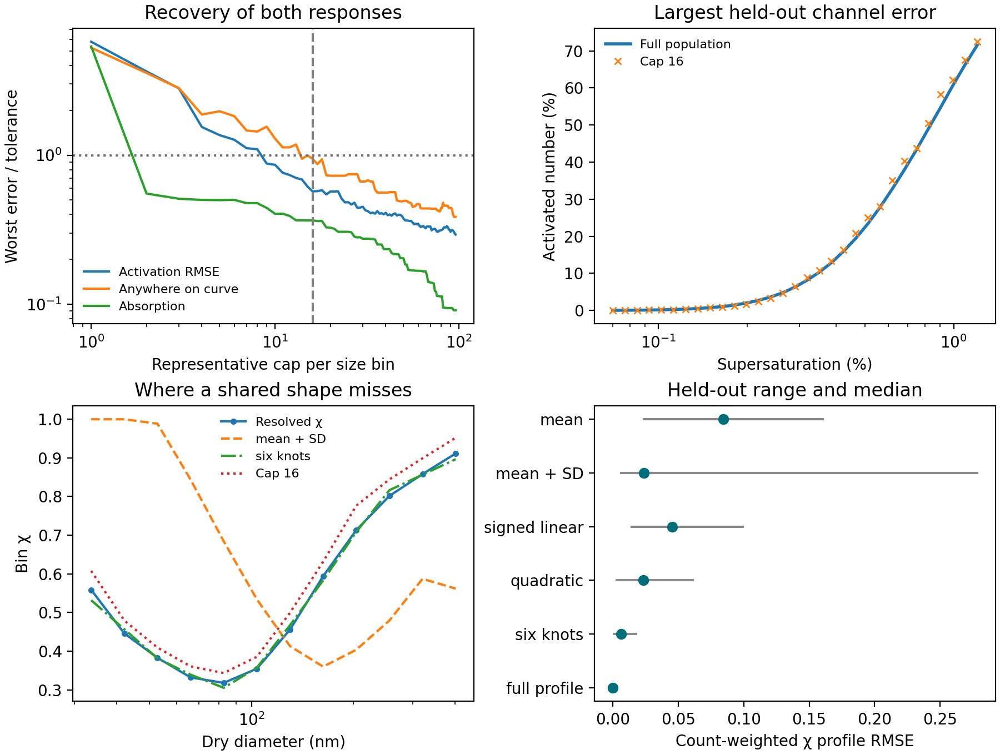
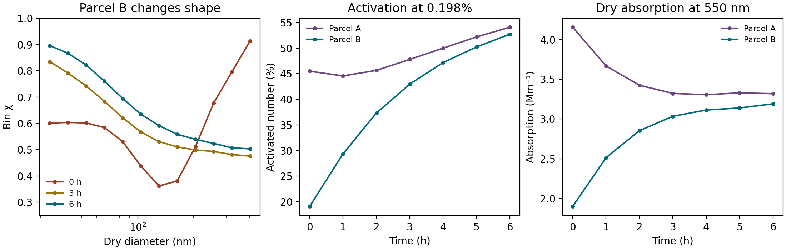

# How many particles preserve activation and absorption after six hours of aging?

**Sixteen representative particles per dry-size interval were enough in this experiment.** The first split within an interval separated particles carrying black carbon from those without it. Across four held-out paired histories, the worst activation-curve RMSE was 1.14 percentage points, the largest discrepancy anywhere on the curve was 4.73 points, and the largest relative error in dry absorption at 550 nm was 1.82%. With 12 intervals, 176–192 weighted rows represented each 100,000-particle snapshot across the full campaign.

A compact description of the mixing index itself takes even less space. Six numbers captured the shape of χ versus log diameter with a worst held-out profile RMSE of 0.018 on the 0–1 index scale. Knowing that shape exactly still allowed other particle populations with the same dry size spectrum and species inventories to have substantially different optical and activation responses.

## Why the black carbon split earns its place

Each of 12 independent histories starts with two equal-volume parcels drawn from different proportions of salt-rich, fresh organic-rich and combustion particles. We evolve 100,000 particles per parcel for six hours. Particles move between parcels, primary organic material converts to an oxidized organic surrogate, and two finite vapor reservoirs add salt and oxidized organic material to particle surfaces. Black carbon remains on its original carriers. These processes change diameter and composition together. The diagnostic reference uses every dry particle at seven hourly checkpoints including hour zero.

A representative carries a count and the mean **species volumes per particle** within its group. Its diameter and composition follow from those volumes. The weighted collection preserves number and the inventory of every dry species. To form groups, we recursively split along the size or composition coordinate with the largest summed squared deviation, at its median. A second rule first separates black-carbon-bearing and black-carbon-free particles wherever both occur, then applies the same splits. Neither rule receives the particle’s activation or absorption as an input. The groups are rebuilt from each snapshot. The experiment measures how much information to **save** at a checkpoint. Evolving the reduced populations forward would be a separate test.

We chose the smallest integer cap that met all three error limits at every checkpoint of eight calibration histories. Four other histories supplied 56 held-out parcel snapshots. The activation score averages squared error equally over 31 logarithmically spaced supersaturations from 0.07% to 1.2%. We also checked the maximum error **throughout** that interval, on both sides of every jump in the reconstructed cumulative activation curve and at the endpoints. Fifteen representatives passed the original 31-channel test, but missed a 5.28-point error between channels on calibration. Sixteen passed the continuous check.

| Allowed activation RMSE / maximum anywhere (percentage points) | Allowed absorption error | Cap with black carbon split | Cap with generic splits | Held-out maximum anywhere / absorption error with black carbon split |
| --- | ---: | ---: | ---: | ---: |
| 3 / 7.5 | 10% | 10 | 44 | 6.46 points / 2.02% |
| **2 / 5** | **5%** | **16** | **80** | **4.73 points / 1.82%** |
| 1 / 2.5 | 2.5% | 82 | 127 | 2.40 points / 0.47% |

The generic split spent many of its earliest representatives resolving variations common to the whole population. In a calibration snapshot dominated by particles without black carbon, even 64 representatives per bin left a 7.6% absorption error. Reserving a group for the carriers made absorption easier to recover, and the activation threshold then set the budget. The caps are empirical minima for these two rules, bins, histories and tolerances.

*Upper left: worst held-out error divided by its tolerance. The horizontal line is the limit and the vertical line marks the calibration-selected cap of 16. Upper right: the held-out snapshot with the largest error at a scored instrument channel. Lower left: resolved and reconstructed χ in the case least well described by a shared shape and a standard deviation. Outer bin markers use the nominal diameter grid and include its tails. Lower right: range and median of the χ profile error across held-out snapshots.*

## How one parcel’s size profile changed

In held-out history 1199, parcel B began with χ near 0.60 at the small-size end, dipped to 0.36 in the middle, and rose to 0.91 in the largest interval. At hour six χ fell almost monotonically with size, from 0.90 to 0.50. Small particles became more internally mixed while the largest size interval acquired a more diverse set of particle compositions. At 0.198% supersaturation, B’s activated fraction rose from 19.1% to 52.7%, while its dry absorption rose from 1.90 to 3.19 Mm⁻¹. These are trajectories of the combined exchange and aging model. Separating the contributions of transport, oxidation and condensation would require process controls.

*The same held-out history is used for the step and particle-count refinements. The left panel shows the full size-resolved reference in parcel B. The two time series follow both resolved parcels for six hours.*

## What do the spread and shape of χ recover?

In each size bin, we compute Riemer–West χ by comparing the dry-mass-weighted mean particle entropy with the entropy of the bin’s bulk species fractions. Each bin has one χ. Here **standard deviation** means the spread *across size bins*, weighting by represented particle number. It is distinct from the spread of individual particle compositions within a bin. We use the same number weights to score profile RMSE, so the error describes the size ranges where most particles occur. A rare large-particle tail can have a larger local error. [Riemer and West](https://doi.org/10.5194/acp-13-11423-2013)

| Encoding of the 12-bin χ profile | Numbers per snapshot | Median held-out profile RMSE | Worst |
| --- | ---: | ---: | ---: |
| Mean | 1 | 0.085 | 0.160 |
| Mean and SD with a shared shape learned on calibration | 2 | 0.024 | 0.278 |
| Signed linear trend in log diameter | 2 | 0.045 | 0.099 |
| Quadratic in log diameter | 3 | 0.023 | 0.061 |
| Piecewise linear through six fixed log-diameter knots | 6 | **0.0065** | **0.0178** |

The SD substantially improved the typical profile, yet its worst case was worse than reporting the mean. It tells us how widely the values spread. The sign of a slope and the position of a minimum require additional information. In the lower-left panel the learned template places high χ among small particles, while the resolved profile reaches a minimum near the middle of the size range and rises at larger sizes. The signed quadratic can move that minimum. Six fitted knot heights capture it more closely. All shape fits use the same fixed diameter grid, number-weighted least squares for the polynomial and knot fits, and predictions bounded to [0, 1]. The two-number mean-and-SD encoding additionally needs the shared calibrated template. The 16-representative populations themselves recovered χ with median profile RMSE 0.022 and worst 0.046, even though χ was excluded from cap selection.

## Can an exact χ profile reproduce the two observables?

We constructed an alternative population for each snapshot. It keeps the full number size spectrum and the dry species totals in **every** bin. At every original diameter in a bin, one part of the ensemble receives the bin’s bulk composition. The remainder consists of pure particles, one class per species, with number shares equal to the bulk volume fractions. Both parts have the same expected dry inventories per unit particle volume. Consequently the internally mixed share by number also equals its share by dry mass. If the bin’s bulk mass entropy is H and the desired index is χ, the internally mixed fraction

$$
f=\frac{\ln[1+\chi(\exp H-1)]}{H}
$$

gives exactly that index. We evaluated these fractional number weights directly, avoiding random reconstruction noise. This creates a second admissible population and measures the ambiguity that survives the supplied information.

Even with the **exact 12 χ values**, this reconstruction met all three original channel-based tolerances on **0 of 56** held-out snapshots. Median activation RMSE was 2.69 points and median absorption error was 8.06%. Worst values were 5.43 points and 14.42%, respectively. The degeneracy survives conditioning on size, fixing species inventories and matching the entire χ profile. It matters which named species share individual particles. For this experiment, recording the six knot heights communicates mixing-state evolution, while saving the weighted particle types lets another reader recalculate both observables.

## Physical assumptions and numerical checks

- **Sources and exchange.** Initial dry diameters follow three lognormal source modes with geometric standard deviation exp(0.35). Their nominal medians are 120, 72 and 105 nm, varied by parcel and history. Compositions vary continuously within each class. Black carbon occurs only in the combustion source. Each parcel represents 1,000 particles/cm³. A common exchange coefficient for each pair is drawn between 0.10 and 0.45 per hour. Every ten minutes paired particles swap parcels with the exact symmetric two-box transition probability for that interval; vapor inventories exchange the corresponding deterministic fraction.
- **Aging.** Within each five-minute substep, a first-order process converts primary to oxidized organic material at equal density. Salt and oxidized organic vapor then condense in proportion to available particle surface area. Each reservoir initially supplies 8–42% of its parcel’s initial dry volume in condensed-volume equivalents. Process rates are drawn independently between 0.08 and 0.45 per hour. This prescribed aging isolates composition and size effects. Coagulation, wet growth and morphology evolution would change the population of absorbing carriers.
- **Response operators.** Dry densities for salt, primary organic, oxidized organic and black carbon are 1,770, 1,300, 1,300 and 1,800 kg/m³. Their respective κ values are 0.60, 0.025, 0.18 and 0. Activation uses analytical κ-Köhler theory at 298.15 K. Dry absorption uses homogeneous-sphere Mie theory, with the complex refractive index linearly mixed by volume between 1.50 for the three nonabsorbing species and 1.95 + 0.79i for black carbon at 550 nm. These are demonstration assumptions. Coated aggregates, brown carbon, humidified optics or a different wavelength can change the required cap. [κ-Köhler formulation](https://doi.org/10.5194/acp-7-1961-2007) · [Optical sensitivity to aerosol mixing state](https://doi.org/10.5194/acp-22-9265-2022)
- **Resolution and conservation.** The 12 bins are evenly spaced in log diameter from nominal edges of 30 to 450 nm, with open tails. Tree features are log diameter in bin-width units and the four dry volume fractions. Checks cover finite nonnegative state, closed system inventories of black carbon, salt plus its reservoir, and combined organics plus their reservoir. Each compression also preserves the species inventories. Halving the aging step to 2.5 minutes on one held-out history changed reference activation by at most 0.019 points and absorption by 0.0009%. A separate 50,000-particle realization of the same source parameters changed reference activation by up to 0.674 points and absorption by 4.27%. Particle sampling matters for absolute absorption even when compression error is small.
- **Optical replay.** A lookup table accelerates Mie evaluation. Its largest relative cross-section error among 1,200 independently sampled sizes and fractions was 0.60%. For the exported held-out snapshot, direct Mie gives 2.3012 Mm⁻¹ on all 100,000 particles and 2.3138 Mm⁻¹ on the 184 saved weighted representatives. The curve can be reconstructed from these rows alone. Reproduction commands, numerical tables and the example particle file are in `studies/parcel-composition/aging/`.

The hardest transfer test would introduce coagulation or fresh absorbing emissions after the representation has been chosen, then rerun it on a different optical morphology. Those cases would test whether protecting black carbon occurrence continues to work when its abundance, coating geometry and relation to size evolve by another mechanism.

The [boreal cloud challenge](boreal-challenge.md) tests the snapshot rule against coated black carbon and follows compressed checkpoints through cloud evaporation and new-particle growth.

[Download the figure data (CSV bundle)](../../../../website/public/study-data/boreal/figure-data.zip) · [Replot or regenerate the simulations](../../../../studies/parcel-composition/README.md)
