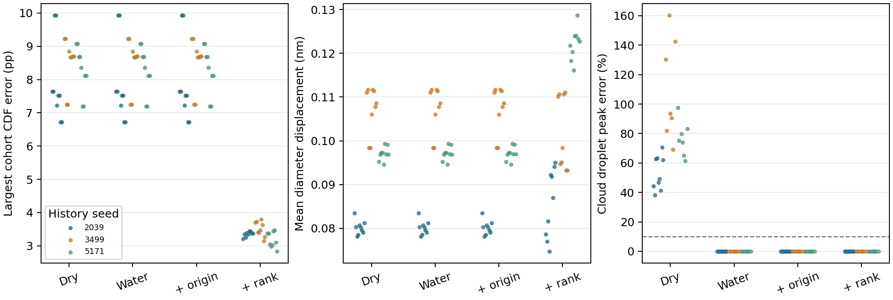

# Which water and new-particle measurements improve a parcel restart?

A dry particle of a given size and composition can sit in haze or carry a growing droplet. A 3 nm particle can be a survivor of a burst in which many more particles were already scavenged. In both cases compression loses information if it averages over the distinction that matters to the next process.

In 27 synthetic boreal outflow histories, preserving the water carried by each growth class reduced the worst hour-three restart error in peak droplet number from **160.37% to 0.034%** among cases with a nonzero reference peak. Ranking newly formed particles by dry diameter improved the saved size distribution in **all 27 histories**. Sixteen representatives per occupied dry bin nevertheless missed the 5% dry-absorption tolerance in **six** histories after restart using the ranked rule. The same rule passed both activation tolerances and the dry-absorption tolerance at all six saved times in all 27 histories. [Earlier boreal challenge](boreal-challenge.md)

## What to keep about a new particle

Two related measurements already appear in new-particle formation studies. The number-size distribution describes the population at an instant. The survival probability from one diameter to another describes its fate. In a growing boreal mode, estimating survival from a size spectrum requires assumptions about growth, continuing formation and losses. Cai and colleagues tested those assumptions with data from Hyytiälä and other environments. Tuovinen and colleagues compared size-dependent survival inferred from formation and loss rates with cluster simulations and observations. Here the simulation supplies particle ancestry directly. [Cai et al. (2022)](https://acp.copernicus.org/articles/22/14571/2022/) · [Tuovinen et al. (2022)](https://acp.copernicus.org/articles/22/15071/2022/)

| Quantity | What a reader can recover |
| --- | --- |
| Dry χ and occupancy in each dry-size bin | Diversity of the eight dry species. The profile keeps water out of the entropy calculation and flags undefined bins. |
| Growing-droplet count and water mass in each growth class, by dry size | How many dry residuals already carry growing droplets and where the condensed water resides. The restart carries water on each representative, retaining its association with that representative's dry composition. |
| New-only count and number-weighted dry-diameter distribution | Where the newly formed particles are now. We report the 10th, 50th and 90th percentiles in each occupied bin and the cumulative fractions at 2, 3, 5 and 10 nm. A merger between two new particles contributes one particle to this distribution. |
| Birth lineages reaching 10 nm before capture by pre-existing aerosol | What fraction of all births reached the target by the reporting time. A particle can carry multiple unresolved lineages. The model credits or debits their multiplicity when it crosses 10 nm or merges with pre-existing aerosol. |

At the center forcing of seed 2039, the 95.6–110.4 nm dry bin in parcel A held 4,588 particles at hour three. Its dry χ was 0.663. Only **1,495 particles (32.6%)** were on the growing branch, yet they held more than 99.99% of the bin’s liquid water. A bin total is enough to recover its liquid mass. Assigning that water evenly would erase the distinction that controls the next growth step.

The new-only size distribution is conditional on belonging to the surviving new population. Its normalization discards how many particles survived, so we publish the count alongside it. The lineage fraction uses every birth in both parcels as its denominator and follows transport between them.

## A paired perturbation experiment

We kept the earlier fully coupled cloud, Brownian coagulation, α-pinene oxidation, sulfuric-acid–ammonia–organic formation and coated-BC optical model. Within each of three fresh seeds we crossed sulfuric acid reservoir and replenishment (±15%), two-way parcel exchange (±35%) and prescribed ascent height (±20%). Eight corners and one center per seed gave 27 histories. Each starts with 25,000 equal-count particles per parcel at 1,000 cm⁻³ and runs six hours at 75 s steps. Formation uses the original chamber-law domain checks and debits the vapor inventory at 1.7 nm. These are controlled model histories. [Formation parameterization](https://pmc.ncbi.nlm.nih.gov/articles/PMC6291317/) · [Cloud, chemistry and optics assumptions](boreal-challenge.md)

Each method has the same cap of 16 rows per occupied bin on the 10-bin-per-decade dry grid. All preserve number, the eight dry inventories, liquid water and the lineage sidecar. **Dry** uses the earlier BC-first tree. **Water** first separates haze from droplets on the growth branch used by the water solver. **Water + origin** also reserves rows within each dry bin for particles made entirely of new lineages. **Water + ranked size** uses the same class quotas as water + origin and groups the new particles by dry-diameter rank, placing boundaries near equal-count quantiles and keeping equal diameters together where possible. Each row stores the mean dry species and water of its members. A comparison of the last two rules isolates the choice of grouping variable.

We reconstructed both parcels at 0.75, 1, 1.5, 3, 4 and 6 hours. Two independent restarts per rule began at hour one during the formation pulse and hour three during the cloud forcing. Each branch restored the gas and water inventories, thermodynamics, original stochastic slots and random-generator state, expanded the representatives to integer counts and ran to hour six. Tables below give the **largest** errors over the indicated histories, parcels and checkpoints. Cloud peaks use every model step from restart through hour six in the ascending parcel. Whole-history maxima keep six correlated checkpoints from counting as six independent tests. Four hour-three histories and two hour-one histories had zero remaining reference droplets. Every reconstruction also gave exactly zero droplets cm⁻³ in those cases.

## What the extra information buys

| Grouping | Saved cohort CDF, maximum error (pp) | Saved cohort at 2, 3, 5 or 10 nm, maximum error (pp) | Saved mean diameter displacement (nm) | Hour-three restart, peak droplets (%) | Worst dry absorption after either restart (%) |
| --- | ---: | ---: | ---: | ---: | ---: |
| Dry | 9.93 | 1.89 | 0.112 | 160.37 | 9.14 |
| Water | 9.93 | 1.89 | 0.112 | 0.034 | 9.14 |
| Water + origin | 9.93 | 1.89 | 0.112 | 0.034 | 9.14 |
| Water + ranked size | **3.80** | **0.65** | 0.129 | 0.034 | 7.83 |

The maximum CDF error compares cumulative number fractions at all distinct diameters after rounding to 10⁻⁸ nm for numerical ties. The displacement is the one-dimensional Wasserstein distance in nm, the mean absolute shift between corresponding diameter quantiles. Ranking reduced the worst fixed-diameter error in every history, yet increased the displacement in 15 of 27. The two scores answer different questions. Wet coated-BC absorption gives an independent water check at the saved times. Its worst error fell from 13.13% with dry grouping to 2.69% with water grouping and was 3.16% with ranked size.

*Each dot represents one entire forcing history. Colors distinguish the three independently initialized parcel pairs. The cloud panel uses nonzero reference peaks. The dashed line is the 10% peak-number tolerance.*

At hour one, the cloud has yet to develop. Even the ranked rule missed its future peak by 12.06% in seed 3499 with high acid, exchange and ascent (144.56 versus 129.00 cm⁻³). A second 12.50% error in seed 5171 was one simulation particle in the 25 cm³ parcel (0.28 versus 0.32 cm⁻³). At hour three, retaining the water branch made the remaining peak much easier to predict. Across the primary histories, the ranked rule's worst remaining peak liquid-water error was 1.77% from hour one and 0.30% from hour three.

For the ranked restarts, the largest error in additional births after hour one was 1.69%, and the largest error in the cumulative fraction reaching 10 nm by hour six was 0.38 percentage points. The water-only values were 3.05% and 0.41 points. Both passed the original 10% birth and 5-point survival tolerances. The median history’s worst survival error was 0.20 points with ranked size and 0.12 with water alone. The ranked rule improved survival error in 14 histories and increased it in 13. After hour three the formation pulse had ended and all methods produced zero additional births. A more faithful saved size distribution mattered for describing the burst, while the survival results give little basis for choosing between the two rules as forecast initializations.

The worst ranked dry-absorption miss was 7.83% in parcel A at hour three, following the hour-one restart of seed 2039 at the center forcing. The maximum activation error anywhere from 0.07% to 1.2% supersaturation stayed within 3.03 points after ranked restarts. Its 31-channel RMSE stayed below 0.99 points. A good cloud count or new-particle spectrum alone would have missed the optical failure.

## Dry mixing state still needs its own profile

We evaluated dry mass-weighted χ on an independent 16-bin-per-decade grid, fitted the earlier spline shapes to each full snapshot and weighted the residuals by particle number. Six fixed, full-span heights exceeded the overall (0.02) or sampled-decade (0.05) RMSE tolerance in **19 of 27** histories. The frozen nine-height allocation with 1, 6 and 1 intervals across successive decades passed all 27. Its worst overall and within-decade RMSEs were 0.0111 and 0.0441; six heights gave 0.0360 and 0.0648. The decade gate requires at least 200 particles with defined χ. [Earlier knot calibration](boreal-challenge.md)

Computing χ directly from the ranked representatives gave errors as high as 0.0502 overall and 0.0767 in a sampled decade, even on bins where both profiles were defined. At least 99.59% of the reference number with defined χ lay on that shared support in each primary snapshot. Saving the nine heights fitted to the resolved population communicates dry diversity that the representative means have already lost. The heights describe the saved state. Predicting a future χ profile requires evolving the particles.

## Which perturbations changed the physics?

Across the 27 references, integrated births ranged from 710 to 1,597 cm⁻³ averaged over both parcels, and 73.0–80.8% of birth lineages reached 10 nm by hour six. Within each seed we averaged the high-minus-low contrast over the other two crossed factors, excluding the center. Increasing acid added **612–728 births cm⁻³** across the three seeds. Increasing exchange reduced the ascending parcel's peak by **64–241 droplets cm⁻³**. Increasing ascent added **65–187 droplets cm⁻³** and left birth count unchanged in these histories, where ascent follows the burst. These ranges report the spread among three independent initializations.

## Which conclusions survived numerical refinement?

We ran 15 additional six-hour histories. For low, center and high forcing together in seed 2039, we independently changed the event stream, quadrupled the starting population to 100,000 per parcel at fixed concentration, or shortened the step from 75 to 30 s. We repeated those three checks at the two hour-one droplet failures identified above. Those last two cells are targeted follow-ups. Water-only and ranked-size restarts were paired with each new reference, giving **276 reduced restarts** across the complete study. Uncompressed restarts at hours one and three in all three center histories reproduced the hour-six particle fields, counters, parcel state and random-stream state exactly. The reference and forecast runs also checked species, water, particle-number and lineage closure.

| Ranked-rule error at the same checkpoint | Nominal | Alternate event stream | 100,000 particles per parcel | 30 s step |
| --- | ---: | ---: | ---: | ---: |
| Dry absorption at hour three, restarted at hour one, center of seed 2039 | 7.83% | 6.04% | 2.54% | 3.24% |
| Future droplet peak, restarted at hour one, high forcing in seed 3499 | 12.06% | 11.21% | 13.87% | 5.06% |
| Future droplet peak, weak-cloud case in seed 5171, predicted / reference (cm⁻³) | 0.28 / 0.32 | 0.36 / 0.32 | 0.33 / 0.30 | 0 / 0 |

The 5% optical and 10% droplet tolerances each fall between results of the refined comparisons. Those two boundaries remain **unresolved**. The step length affects the physical reference itself. Across the five checked forcing cells, the 30 s step produced 7.3–9.4% fewer births. In the strong-cloud example the reference peak increased from 129.00 to 233.36 cm⁻³. In the weak-cloud example no droplets activated at 30 s. On all 15 refinements the nine fitted dry χ heights remained within both tolerances, and the ranked restart's largest six-hour survival error was 0.55 points. These comparisons support the saved water and cohort diagnostics. They leave the minimum budget for forecasting cloud onset and absorption open.

## Why we revised the earlier burst interpretation

At the earlier peak in parcel A of history 1562, 14,204 new particles gave a 53.71-point discrepancy at a diameter near 2.279 nm. Their mean diameter displacement was **1.95 × 10⁻¹⁵ nm**. Rounding at 10⁻⁸ nm removed that discrepancy, and none of the four fixed-diameter fractions changed. Another peak (1199, parcel A) still gave 17.58 points after tie handling, but its mean displacement was only 0.000105 nm. A CDF jump can locate a narrow batch accurately while exaggerating the physical significance of a very small displacement. Reporting counts, specified diameters and displacement together changes how we interpret the original observation.

The [black-carbon restart follow-up](black-carbon-restarts.md) locates the six absorption misses by dry size, core diameter and coating, then tests four and eight additional representatives per parcel.

[Download the figure data (CSV bundle)](../../../../website/public/study-data/boreal/figure-data.zip) · [Replot or regenerate the simulations](../../../../studies/parcel-composition/README.md)
