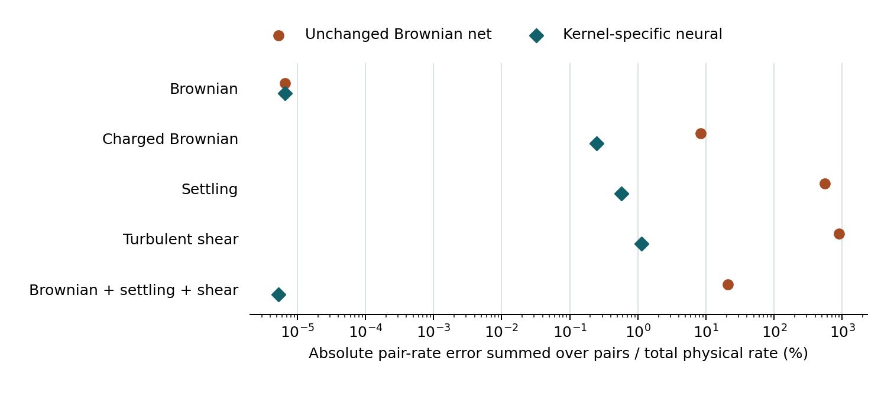
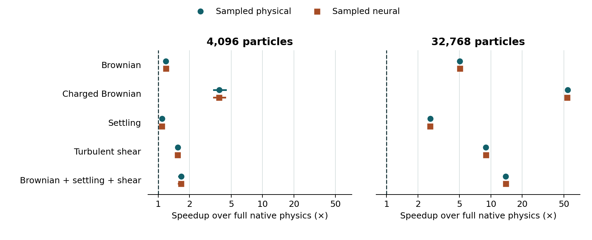

# Which coagulation kernels benefit from sampling particle pairs?

The hybrid forecast of a million neutral particles took 7.11 minutes, compared with 35.5 minutes for full native physics. It sampled collision partners, estimated one Brownian rate term with a neural network and kept the native calculation for vapor exchange. A control that evaluated the physical rate on the same pairs took 7.07 minutes. Could we use that same sampler when charge, gravity or turbulence brought the particles together? Across five kernels the sampler continued to save time, but reusing the neutral Brownian network gave large errors for settling and shear.

## Which parts transfer to another collision kernel?

The sampler shuffles the active particles and pairs adjacent entries. Any two particles have the same chance of becoming candidates, regardless of their sizes, charges or collision rate. The solver first needs the collision law when it decides whether a proposed pair merges. This lets us change the law while holding the candidate pairs fixed.

For *N* unit-weight particles, one shuffle proposes *m* = floor(*N*/2) of the *M* = *N*(*N*−1)/2 possible pairs. A particular pair’s chance of selection is *m/M*. For a selected pair with physical kernel *K* (m³/s) in a well-mixed volume *V* (m³), the code uses the merger probability 1 − exp[−(*M/m*) *K* Δ*t* / *V*], where Δ*t* is the collision interval in seconds. The factor *M/m* restores the expected collision rate to first order in Δ*t*. [Shima et al., stochastic pair selection for cloud droplets](https://doi.org/10.1002/qj.441)

The correction has limits. At finite intervals the probability saturates and each particle can merge only once per shuffle. A kernel with rare, strongly attractive partners may need shorter intervals or more samples. If a future network preferentially selects partners, the correction must use their new selection probabilities.

### What happens if we reuse the neutral Brownian network unchanged?

We fixed the radii and 4,096 candidate pairs and evaluated each collision law using its independent Particula formula. We then compared two estimates on those same pairs. One used the original neutral Brownian network for every mechanism. The other used the rate approximation chosen for that mechanism.

<figure class="scientific-figure">

<figcaption>Changing the law on the same pairs. Error is 100 times the sum of absolute rate differences divided by the sum of physical rates. A value above 100% is possible. A few high-rate pairs can dominate this aggregate error. The horizontal axis is logarithmic. The two Brownian points use the same network. For the combined kernel, the orange point omits settling and shear, while the teal point includes both analytically.</figcaption>
</figure>

Settling illustrates why a rate learned for one mechanism can fail on another. Equal-size particles of equal density fall at the same speed, so differential settling gives them zero collision rate. Brownian motion can still bring them together. The unchanged Brownian fit gave 560% aggregate error for settling. A network trained on settling, with zero rate enforced at equal radii, reduced the error to 0.58%. Training a separate shear network reduced shear error from 901% to 1.13%. Each fit used two symmetric radius features, two 16-unit hidden layers and 32,768 training pairs at fixed environmental conditions.

For particles starting at ±1 elementary charge, the existing charged-particle fit reduced aggregate rate error from 8.43% to 0.25%. In the combined law, we kept the Brownian network and added the physical settling and shear rates. Across all five laws, the sampled physical formulas agreed with the independent Particula formulas to within 10⁻¹⁰% on the aggregate measure. The comparison leaves individual pair errors and transfer to stronger charges open.

### How do the alternatives time against full physics for each kernel?

Each kernel has its own full native GPU baseline. Particula’s collision solver evaluates pair rates in tiles to construct a bound, then samples collision events. We compared it with two solvers that draw uniform disjoint pairs. One evaluates physical rates on those pairs and the other uses the kernel-specific approximation. All three keep native vapor transfer.

To give settling and shear opportunities to act, we mixed smaller particles (80% by number, 40–90 nm radius) with larger collectors (20%, 0.7–1.6 µm radius). The one-second forecasts began at 10⁶ particles/cm³ with 32 finite condensing vapor reservoirs.

| Physical setting | Value or model |
|---|---|
| Gas and particle properties | 293 K, 101,325 Pa, particle density 1,400 kg/m³ |
| Brownian motion | Neutral Fuchs or charged Gopalakrishnan–Hogan (2012). Only the charged case starts with bipolar charge. |
| Differential settling | SP2016 with unit collection efficiency |
| Turbulent shear | Saffman–Turner (1956) with dissipation 1 m²/s³ and air density 1.2 kg/m³ |
| Combined law | Sum of neutral Brownian, settling and shear rates |

<figure class="scientific-figure">

<figcaption>Speedup at fixed chemistry and process clocks. Markers give the median ratio of native to sampled elapsed time across eight seeds. Lines span the middle half of the ratios. The dashed line marks equal time. Colors and shapes distinguish the two sampled rate calculations. Timers include state restoration, four collision opportunities, eight vapor half steps (four substeps each) and host observations on the RTX 5060. Setup, model fitting and warm-up are excluded. In the combined case only the Brownian term becomes neural.</figcaption>
</figure>

| Kernel at 32,768 particles | Full native | Sampled physical | Sampled neural |
|---|---:|---:|---:|
| Brownian | 2.037 s | 0.404 s (5.03×) | 0.405 s (5.02×) |
| Charged Brownian (±1 initially) | 22.047 s | 0.407 s (54.28×) | 0.413 s (53.49×) |
| Settling | 1.051 s | 0.400 s (2.62×) | 0.401 s (2.62×) |
| Turbulent shear | 3.590 s | 0.400 s (8.98×) | 0.402 s (8.93×) |
| Brownian + settling + shear | 5.656 s | 0.407 s (13.90×) | 0.408 s (13.86×) |

Times are medians across eight seeds. Parentheses give the median of the eight within-seed speed ratios. The sampled physical forecasts all took about 0.4 seconds at 32,768 particles. The variation in speedup came mostly from the cost of the native baseline. Replacing the physical rate on sampled pairs had little effect on whole-forecast time. The timers cover the entire forecast, so the share attributable to computing the native pair-rate bound remains unresolved.

### Did the sampled forecasts meet the accuracy targets?

At 32,768 particles, all five kernels met the 1% count and 0.1% phase-mass targets across eight seeds with either sampled method. The largest count discrepancy was 0.107% for charged Brownian motion. The largest phase-mass discrepancy was 0.0669% for the combined kernel. Individual species inventories drifted by less than 2 × 10⁻¹²% across the panel.

Each discrepancy compares a sampled trajectory with native physics at the same observation time and on the same process clocks. Phase-mass percentages use a reference floor of 10⁻¹¹ kg/m³. The two sampled solvers share random draws. The native solver uses a different generator, so a difference from a native run can include stochastic variation. This panel used four vapor substeps per half interval. Accuracy against a time-refined reference remains open.

### Why did the smaller shear box cross the phase-mass target?

At 4,096 particles, the largest shear phase-mass discrepancy was 0.1725% for both sampled methods. We checked whether two independent native runs could also exceed the 0.1% target. With four collision opportunities, that happened in 5 of 16 comparisons. The sampled physical solver crossed the same threshold in 2 of 16 comparisons against native physics.

Doubling the collision opportunities to eight while keeping the total vapor substeps fixed gave 3 exceedances in 16 native–native comparisons and 2 in 16 sampled–native comparisons. Independent collision draws can therefore produce a discrepancy larger than the target in this box. Sixteen comparisons leave the size of any systematic sampling bias uncertain.

## How does this relate to the million-particle Brownian result?

The hybrid completed the one-second forecast in 7.11 minutes, a 4.99× speedup relative to the 35.5-minute full native baseline. Within the hybrid, the network predicted the Brownian jump-distance term for candidate pairs. The remaining rate calculation, merger rules and vapor transfer remained physical. All forecasts used 128 vapor substeps per half interval. The native timing summarizes two trials, and the hybrid timing comes from one trial. [Whole-forecast comparison and figure](index.md#where-did-the-coagulation-speedup-come-from)

## What happens to a candidate pair?

Each particle can appear in only one candidate pair per shuffle. When a pair passes the merger draw, the solver combines its material in the surviving particle, whose new size enters the next vapor step. Starting with a million individual records, each sampled run considered about two million pairs over one simulated second. Both accepted 1,092 mergers on the shared seed. A separate experiment reduced the number of records by giving particles weights. [Weighted-particle scaling](scaling.md)

### What did the sampled-physics control cost?

Keeping the candidate draws fixed lets us ask what changed when the neural term replaced its physical counterpart. Using physical rates on the same sample gave a 7.07-minute forecast, a 5.02× speedup relative to full native physics. Both sampled forecasts met the count and phase-mass targets on their shared seed.

| Measured in one paired trial | Hybrid with neural jump-distance term | Sampled-physics control |
|---|---:|---:|
| Whole forecast including setup | 426.72 s | 424.40 s |
| Time in the collision calculation | 16.45 s | 7.86 s |
| Accepted mergers | 1,092 | 1,092 |
| Largest observed count error vs refined physics | 0.00354% | 0.00354% |
| Largest observed phase-mass error vs refined physics | 0.07501% | 0.07501% |

Sampling with physical rates already captured the whole-forecast speed gain. Evaluating the neural term roughly doubled the collision time, but physical collision work accounted for only 1.85% of the sampled-physics forecast. Across these two runs the difference in total time was 0.55%. Fresh timing trials would be needed to resolve an effect of that size against variation in setup, vapor integration and diagnostics.

## Why did omitting so few mergers change the answer?

Omitting all mergers kept particle-number error within 1%. The limiting observable was a depleted gas species, whose concentration in the refined reference fell to about 4.74 × 10⁻¹¹ kg m⁻³ at one second. Relative to that reference, the native vapor step contributed −0.07597% and dropping coagulation contributed another −0.03434%. Together they took the gas to −0.11031%, past the 0.1% phase-mass limit even though the solver conserved the overall species inventory. Smaller boxes let us check how much of that discrepancy responds to a shorter vapor step. [Vapor-clock refinement and collision omission](process-clocks.md)

## How could we test transfer to stronger charges?

The two full native trials ended with 998,924 and 998,947 particles. Both sampled methods ended with 998,908 on their one shared seed. The paired test shows that switching the rate left this realization’s final count unchanged. How often that agreement persists with fresh draws or stronger charges remains open.

To test stronger charging, compare the physical and neural probabilities on identical candidate pairs outside the ±1 initial-charge range, then repeat whole forecasts on fresh seeds at different ion supplies and particle densities. Count mergers by particle size and charge. A small change in total mergers could still change how many newly formed particles survive to a detectable size. [Survival to 5 and 10 nm](formation.md)

The [source measurements](../../../../studies/weighted-particle-embedding/measurements.zip) include `stage-3/native-vapor-sampled-collisions.csv`. Select the two neutral rows with one million particles for the paired timers above. The public table also contains the full native and collision-off controls.

[Download the figure data (ZIP)](../../../../website/public/study-data/weighted-particle-embedding/figure-data.zip)

Tables for this page include `kernel-rate-transfer.csv`, `kernel-shear-clock.csv`, `kernel-forecast-trials.csv`, `native-collisions.csv`.
