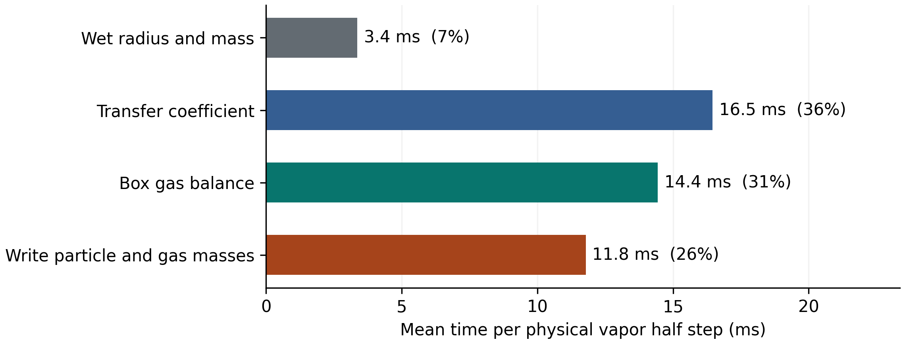
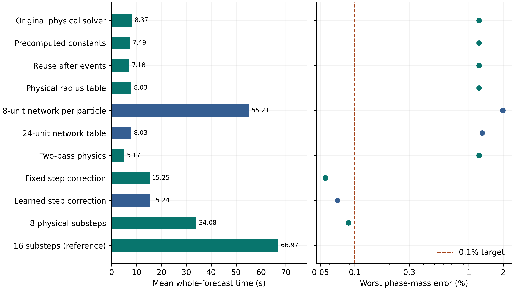

# Which part of condensation is worth approximating?

The fastest way to reproduce the original physical forecast was to keep its transfer law and combine GPU operations. A ten-second forecast fell from 8.37 s to 5.17 s (1.62× speedup). That still left a 1.23% phase-mass difference from a finer clock. For the 0.1% target, correcting the time step worked better. A fixed physical correction took 15.25 s and a fitted correction took 15.24 s. Both passed against the 16-substep reference across three seeds.

All methods used one million initial particles in 1 cm³, 32 vapors and the same collision and nucleation clocks. Sixteen vapors started condensing, eight evaporating and eight near equilibrium. Every 0.125 s interval had two vapor half steps. The main comparison uses three paired event seeds on an RTX 5060. The [coupled forecast comparison](process-comparisons.md) describes the vapor mixture and particle population.

## What does a physical condensation step actually cost?

For particle radius *r* and vapor diffusivity *D*, the physical solver computes a conductance *k = 4πrDβ*, in m³/s. The dimensionless transition factor *β* depends on the ratio of mean free path to radius and on the vapor’s accommodation coefficient. Conductance sets how fast material can move. The difference between the gas concentration and the particle’s equilibrium concentration sets which direction it moves. Every particle exchanging a given species draws on the same gas reservoir.

<figure class="scientific-figure">

<figcaption>One physical vapor half step across all 32 species. Bars show means over nine warmed GPU measurements in a million-particle box. Gas balance includes the particle weights, their sums by species and the implicit gas solve. The write stage applies each particle’s share and updates the gas reservoirs.</figcaption>
</figure>

The gas balance and mass updates together took more time than evaluating the transfer coefficient. The coefficient occupied 16.5 ms of a 46.0 ms vapor half step in the million-particle box. Even removing that work entirely would give only about a 1.56× speedup if the rest of the step took the same time.

The two-pass physical solver instead reduced how much data the calculation moved. With species constants precomputed, one GPU pass accumulated the sums needed for the 32 gas balances, and another used the solved gas concentrations to update every particle. Evaluating the same physical law in each pass avoided storing several large intermediate arrays. A collision solver can sample candidate pairs. Here every exchanging particle still needed a mass update.

## Can precomputation give a network a head start?

A smaller network reduced the cost of estimating conductance, but the physical calculation was still much faster. An eight-unit network took 55.2 s per coupled forecast, down from 276 s for the earlier 128-unit head in the same box. Even the smaller network took 6.6 times the original physical runtime.

The eight- and 24-unit networks had 41 and 121 parameters. Both learned a multiplicative correction to the positive physical approximation *α/(α + Kn)*, where *α* is accommodation and *Kn* is the mean-free-path to radius ratio. After training on 24,000 physical labels, their 99th-percentile coefficient errors on 12,000 independent labels were 3.05% and 0.38%, respectively. These figures describe the rates supplied to the solver. The phase-mass errors below measure what happened when those rates were used throughout a forecast.

Tabulating the network nearly eliminated its extra evaluation cost under fixed temperature and species properties. Only the radius changed, so 257 points spaced evenly in log radius per species sufficed to tabulate the 24-unit network. Construction took 0.19 ms for 32 species. In a separate four-vapor timing with one million particles, direct network evaluation took 56.32 ms, interpolation of log conductance took 1.92 ms, and the physical formula took 1.90 ms (medians of nine calls). Interpolation changed the network output by at most 0.00611% on those inputs. Matching the physical formula's speed still left the network's rate error in the forecast.

We also tabulated the physical law and tried reusing the most recent physical coefficients for one half step. Reuse was allowed only when no birth or merger had changed the particle rows. Gas concentration and particle mass still updated every half step. Reuse cost 7.18 s per forecast and shifted phase masses by up to 0.00128% against the same-clock physical baseline. The physical and neural tables had similar runtimes (8.03 and 8.03 s), while the neural table introduced a larger same-clock phase error (0.475% versus 0.00246%).

## Can the network correct a time step instead?

We advanced the same starting state once with a full vapor half interval and again with two shorter advances. The difference between those predictions estimates integration error. We corrected the two-advance prediction by adding that difference times a weight. The physical control used the standard Richardson weight of 1. A one-weight linear network learned 1.0386 from finer gas trajectories in two separate 2,048-particle training boxes. The same scalar applies to every species and particle. The three physical advances supply the features, so the correction needs no per-particle hidden layer. For either correction, a species falls back to its two-advance prediction if extrapolation would make any gas or particle mass negative. Applying one weight per species to both phases preserves its mass budget.

<figure class="scientific-figure">

<figcaption>Ten seconds of coupled gas and particle evolution. Left, mean whole-forecast wall time over three paired seeds after setup and warm-up. Right, maximum phase-mass discrepancy across the three seeds and 80 observations relative to a physical calculation with 16 vapor substeps per half interval. The dashed line marks the 0.1% target. Blue marks methods that use fitted weights.</figcaption>
</figure>

| Condensation method | Whole forecast (s) | Speed vs original | Phase error vs original clock | Phase error vs 16 substeps | Count error vs 16 substeps |
|---|---:|---:|---:|---:|---:|
| Original physical solver | 8.37 | 1.00× | 0% | 1.23% | 0.0277% |
| Precompute species constants | 7.49 | 1.12× | <10⁻¹⁰% | 1.23% | 0.0277% |
| Reuse one coefficient evaluation | 7.18 | 1.17× | 0.00128% | 1.23% | 0.0353% |
| Tabulate physical coefficient | 8.03 | 1.04× | 0.00246% | 1.23% | 0.0529% |
| Evaluate 8-unit network per particle | 55.21 | 0.15× | 1.15% | 1.99% | 0.0587% |
| Tabulate 24-unit network | 8.03 | 1.04× | 0.475% | 1.31% | 0.0381% |
| Two-pass physical solver | 5.17 | 1.62× | <10⁻¹⁰% | 1.23% | 0.0277% |
| Fixed step correction | 15.25 | 0.55× | 1.26% | 0.0551% | 0.0319% |
| Learned step correction | 15.24 | 0.55× | 1.28% | 0.0705% | 0.0345% |
| Eight physical substeps | 34.08 | 0.25× | 1.15% | 0.0878% | 0.0435% |
| Sixteen physical substeps | 66.97 | 0.12× | 1.24% | Reference | Reference |

Correcting the step met the accuracy targets at less than half the cost of eight ordinary substeps. Against the 16-substep reference, the fixed correction's worst phase error was 0.0551% in 15.25 s. The learned correction gave 0.0705% in 15.24 s. Both passed the mass and count targets over the same three seeds and 80 observations. Eight substeps also passed but took 34.08 s, or 2.23 times the fixed correction's runtime.

Speed is original wall time divided by candidate wall time. The two error columns for phase mass answer different questions. The first measures how closely a method recreates the coarse calculation. The second tests the forecast against a more finely stepped physical model. Count errors include any change to collision or birth outcomes as particle sizes and gas concentrations diverge. The greatest species inventory drift across the three-seed runs was <10⁻¹⁰%.

## Which method is worth developing?

A stricter check repeated one seed through the full ten seconds, with 64 physical vapor substeps per half interval as the reference. The birth and collision clocks kept the same cadence.

| Method | Whole forecast | Worst phase-mass difference vs 64 substeps | Worst particle-count difference |
|---|---:|---:|---:|
| Fixed correction | 15.30 s | 0.0525% | 0.0374% |
| Learned correction | 15.24 s | 0.0325% | 0.0391% |
| Eight substeps | 34.19 s | 0.154% | 0.0246% |
| Sixteen substeps | 67.08 s | 0.0664% | 0.0317% |
| Thirty-two substeps | 132.87 s | 0.0222% | 0.0267% |

The two comparisons ranked the corrections differently. Against 64 substeps the learned correction had the smaller phase error (0.0325% versus 0.0525%), but that check covered only one seed. Against 16 substeps the fixed correction had the smaller worst error across three seeds. Both corrections took about a quarter of the time required for 16 ordinary substeps, the fastest uniform refinement to meet the 0.1% target in the stricter comparison. These trials support using a step correction, while the accuracy advantage of learning its weight remains uncertain.

Use the two-pass physics when the goal is faithful, faster execution at a chosen time step. For greater accuracy, the fixed correction is the first comparison to beat. The learned step correction is a more promising network target than per-particle conductance because one learned coefficient can correct a whole interval. Its next test should hold out chemistry and forcing, including different vapor accommodation, temperature and abrupt vapor pulses, and compare against the fixed correction at equal wall time. This study held those conditions fixed while varying event seeds. The reference checks measure numerical agreement in a synthetic box.

[Download figures, timings, fitted weights, clock checks and reproduction instructions (ZIP)](../../../../website/public/study-data/weighted-particle-embedding/figure-data.zip)

Tables for this page include `condensation-profile.csv`, `condensation-forecasts.csv`.
