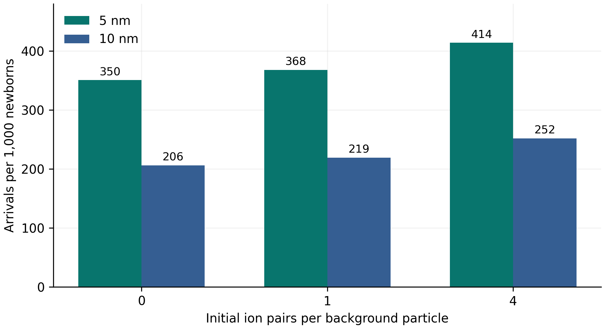

# From vapor to particles at 5 and 10 nm

A box can contain particles larger than 10 nm before a single new particle forms. To measure how many births grow through that threshold, the calculation followed each newborn cohort and recorded its first arrival at 5 or 10 nm diameter. The resulting count distinguishes new particles that grow through the size range from large background particles that collect their material.

## How soon can a newborn reach each size?

With scavenging switched off, vapor uptake carried the first group of newborns through both size thresholds. The source consumed 16 precursor molecules per new particle, giving a birth diameter of 1.491 nm. With 10⁻⁹ kg m⁻³ of precursor and 2 × 10⁻⁹ kg m⁻³ of condensable organic vapor initially available, the first group reached 5 nm at 7.375 s and 10 nm at 23.625 s, measured from the start of the source experiment. To find out how many births survive that long, the next experiment added background particles that could collect them.

## How many survive to the threshold?

A separate calculation supplied 10¹⁰ background particles m⁻³, initially carrying charge opposite to the positive newborns. An encounter with a background particle could remove a newborn before it reached the target diameter. Finite supplies of positive and negative ions changed the charge histories and, with them, the encounter rates.

| Initial positive–negative ion pairs per background particle | Reached 5 nm per 1,000 formed | Reached 10 nm per 1,000 formed |
|---:|---:|---:|
| 0 | 350 | 206 |
| 1 | 368 | 219 |
| 4 | 414 | 252 |

<figure class="scientific-figure">

<figcaption>First arrivals at 5 and 10 nm by 128 seconds. Each bar counts arrivals per 1,000 particles formed in a box with oppositely charged background particles. With four initial ion pairs per background particle, 414 newborns reached 5 nm and 252 of those reached 10 nm per 1,000 formed.</figcaption>
</figure>

More newborns survived to 10 nm when the box contained more free ions. With the background particles initially charged opposite to the newborns, 206 per 1,000 births reached 10 nm by 128 s without free ions. With four ion pairs initially available per background particle, 252 reached that size. The estimated gain was about 46 arrivals per 1,000 births under this charge configuration.

The roughly 46 additional arrivals exceeded the measured numerical variation. At the higher ion supply the sampling margin was 0.43 arrival per 1,000 and the time-step allowance was 0.24, based on 128 batches of 512 paths. A separate calculation worked backward from the target size to estimate arrival probability at each size and charge. Its estimate agreed within the sampling and time-step allowances.

Early threshold counts were especially sensitive to the size grid because a small diameter shift can move an entire young cohort across a counting boundary. The reported times and survival fractions test a numerical model with prescribed source strength, background charge and vapor supply. An atmospheric comparison would require measured formation, growth and loss histories for the same conditions.

The [process-clock study](process-clocks.md) measures how quickly ion attachment can change an existing population. Return to the [study overview](index.md) for the full set of experiments.

[Download the figure data (ZIP)](../../../../website/public/study-data/weighted-particle-embedding/figure-data.zip)

Tables for this page include `newborn-survival.csv`.
