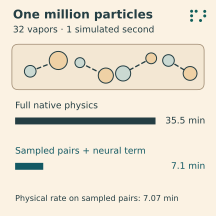
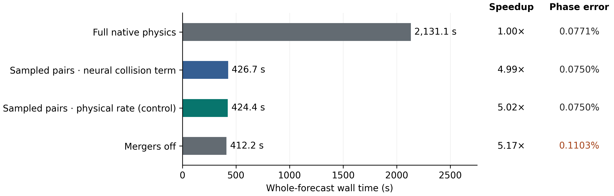
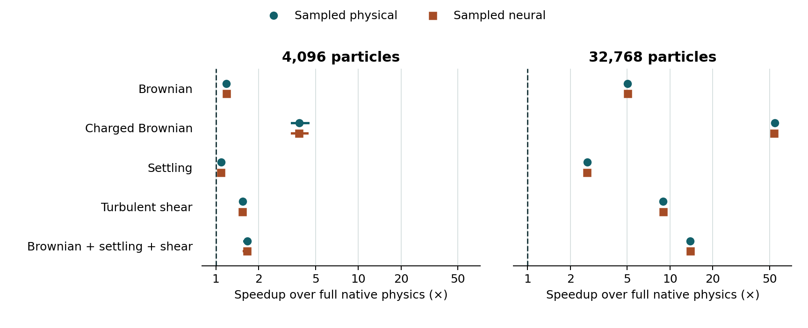

# A hybrid neural forecast for one million aerosol particles

A hybrid model forecast one second of aerosol evolution for one million particles exchanging mass with 32 vapors in 7.11 minutes. Full native physics took 35.5 minutes on the same GPU, a 4.99× difference in whole-forecast time. The hybrid sampled collision partners and used a neural network for the jump-distance term in their Brownian collision rate. Physics still governed vapor transfer and what happened when two particles merged. As a control, we used the same candidate pairs and evaluated the entire rate physically. That run took 7.07 minutes and produced the same 1,092 mergers on the shared seed. Pair sampling accounted for the observed speed gain. Separate tests asked what a network could learn about water uptake. A compact representation distinguished mixtures with identical dry size spectra and bulk composition for part of a vapor-pulse forecast. Retaining composition within each dry size sustained that distinction through the last observation. For vapor transfer, both a fixed and a learned time-step correction met the mass target in the tested boxes. A pulse outside the training conditions would test whether learning gives the better correction.

*Graphical abstract. Times include setup and the complete forecast on an RTX 5060. The native baseline uses two trials. The hybrid and sampled-physics control each ran once on a shared seed.*

## Which details of an aerosol are worth carrying into a forecast?

In a particle-resolved simulation of an aging urban plume, Zaveri and colleagues found that particles with the same dry diameter could activate as cloud droplets at different supersaturations. Their particles carried different mixtures of material after condensation and coagulation. A diameter bin can retain the total mass of every species while losing the association between a material and the particle that carries it. That association matters when estimating which particles will grow in a humid parcel. [Zaveri et al., particle-resolved urban plume](https://doi.org/10.1029/2009JD013616)

Published neural aerosol models suggest two scales at which to learn. Harder and colleagues trained a network on one-step changes from the seven-mode M7 aerosol model and tested ways to enforce species mass balance. Wang and colleagues used particle-resolved simulations to learn how a single-species aerosol size distribution evolves under Brownian coagulation, with a network that treats the two collision partners symmetrically. The first study asks whether a network can advance a population. The second asks whether it can learn the interactions that advance it. [Harder et al., physics-informed aerosol microphysics](https://doi.org/10.1017/eds.2022.22) · [Wang et al., learning coagulation](https://doi.org/10.1029/2022MS003252)

There is also a physical route to lower cost. Shima and colleagues sampled pairs of weighted computational droplets to simulate coalescence in warm clouds. A representative droplet carries the number of physical droplets it stands for. Pair sampling and particle weighting are distinct choices. Our main coagulation comparison sampled partners while retaining one record per particle. Other experiments measured how far we could also reduce the number of records. [Shima et al., the super-droplet method](https://doi.org/10.1002/qj.441) · [Weighted versus explicit particle forecasts](scaling.md)

## What does the network see, and what does physics still do?

We first gave the model a paired test. One aerosol spread its water-attracting material evenly within each dry size. Its partner concentrated the same material on a subset of particles. Both received the same vapor pulse. A learned *embedding* mapped each particle’s properties to a short list of numbers and combined them using the particle counts as weights. The resulting record had the same length for any particle count, and reordering the particles gave the same summary. The question was how long a forecast initialized from that record could recover the difference in water uptake.

The learned record distinguished the two mixtures after the pulse, although its forecast lost their water-uptake contrast sooner than the physical reconstruction did. With eight learned coordinates the forecast met the contrast criteria through 47.5 ms in the test families and 50 ms in the challenge families. Dry size alone gave no qualifying lead. Keeping composition within each dry size extended the lead to the last observation at 80 ms in both cohorts. This gives a compact model a test that matching total mass cannot provide. [Matched populations, forecast criteria and water errors](representation.md)

We then gave individual processes narrower jobs. A water or organic-vapor network can estimate a transfer rate. A joint gas–particle calculation limits evaporation to the material on each particle and uptake to the vapor available. A collision network can estimate one term in a pair’s encounter probability. After a successful draw, the merger rule combines the partners’ masses and charges and updates their number. A birth-rate model can propose new particles, with the solver charging their mass to the precursor supply. In the two-vapor experiments we also tested recurrent memory and attention over other particles. Their value depended on how long the forcing history continued. [Network architectures and repeated-pulse tests](representation.md) · [Process clocks and physical correction intervals](process-clocks.md)

## How fast was the hybrid forecast at one million particles?

The hybrid forecast took 7.11 minutes compared with 35.5 minutes for full native physics, a 4.99× speedup for the whole calculation. One million initially neutral particles occupied 1 cm³ and exchanged material with 32 vapors for one simulated second. The hybrid sampled disjoint pairs and predicted the Brownian jump-distance term used to compute their collision probabilities. The native vapor solver advanced each particle between collision opportunities, and physical merger rules combined the mass and charge of each accepted pair.

<figure class="scientific-figure">

<figcaption>Elapsed time includes setup and the entire one-second forecast on an RTX 5060. Each speedup uses full native physics as its baseline. Phase error is the largest observed discrepancy in a scored gas or particle mass relative to time-refined physics. The full native timing summarizes two trials. Each sampled method ran once at this size on a shared seed.</figcaption>
</figure>

The hybrid stayed within the accuracy targets on this run. Against the time-refined physical reference, its largest observed particle-count discrepancy was 0.00354% and its largest phase-mass discrepancy was 0.07501%.

### What did the sampled-physics control show?

With the same candidate pairs and random draws, evaluating the full physical Brownian rate took 7.07 minutes (5.02× faster than full native physics). The physical control and the hybrid each accepted 1,092 mergers and agreed on particle counts and phase masses at every observation. Sampling alone therefore reproduced the speed gain. Whether changing the rate gives the same merger outcomes on fresh draws remains open.

Skipping collisions altogether saved little more time and pushed a gas species past the error limit. Turning mergers off saved another 12.2 seconds relative to sampled physics, but the largest phase-mass discrepancy rose from 0.0750% to 0.1103%, above the 0.1% target. Particle count stayed within its limit. A merger changes the surface available for subsequent vapor exchange, so the error can appear in the gas before it becomes apparent in the count. [Collision timers and the limiting gas species](coagulation.md)

### How does the speedup vary by coagulation kernel?

Drawing disjoint pairs saved the most time for charged Brownian collisions. At 32,768 particles the full native forecast took about 22 seconds with charged Brownian motion and about one second with differential settling. Sampling pairs with physical rates brought both forecasts to about 0.4 seconds. That difference in baseline cost explains why the same approach yielded a 54.28× speedup for charged Brownian motion and 2.62× for settling. Switching the sampled rates to neural estimates had little effect on either time.

<figure class="scientific-figure">

<figcaption>Whole-forecast speedup relative to the full native physics for each kernel. Circles use physical rates on sampled pairs and squares use neural rates. Each marker gives the median across eight seeds. Lines span the middle half of the speedups, and the dashed line at 1× marks equal time. Both panels cover one simulated second with 32 vapors on the RTX 5060. This comparison used four vapor substeps per half interval and started timing after warm-up. The million-particle comparison above used 128 substeps and included setup.</figcaption>
</figure>

At 32,768 particles both sampled methods stayed within the count and phase-mass targets across the eight seeds when compared with native physics on the same time step. In the smaller shear box, even two native runs could differ by more than the mass target when their random draws differed. [Absolute timings, forecast errors and the shear repeatability check](coagulation.md#how-do-the-alternatives-time-against-full-physics-for-each-kernel)

## Why was the condensation speedup smaller?

Once the solver was already sampling collisions, vapor transfer took most of the time. In a separate ten-second forecast with one million particles, 16 vapors began condensing, eight evaporating and eight near equilibrium. Vapor transfer accounted for 87.4% of the 8.37-second forecast after warm-up. Calculating the transfer coefficient accounted for only 36% of a vapor half step. Even with that coefficient in hand, the solver still had to balance each gas reservoir and update every exchanging particle. [Process timings, mixture and scaling controls](process-comparisons.md)

Combining the physical vapor calculations into two GPU passes cut the ten-second forecast to 5.17 seconds, a 1.62× speedup. The faster calculation reproduced the original coarse step, including its 1.23% phase-mass discrepancy from finer integration. Reaching the 0.1% target required improving the step itself.

At about 15.2 seconds per forecast, both a fixed correction and a learned correction brought the phase discrepancy below the target. The two comparisons ranked the corrections differently. Against 16 physical substeps across three seeds, the worst discrepancy was smaller for the fixed correction (0.0551% versus 0.0705%). Against 64 substeps on one seed, it was smaller for the learned correction (0.0325% versus 0.0525%). A test on an unfamiliar mixture and pulse history would show whether the learned correction offers a repeatable advantage. [Condensation formulas and time-step checks](condensation-options.md)

## Which neural experiment should come next?

A chamber-model ensemble needs many forecasts at different humidities, mixtures and vapor supplies. A particle-resolved calculation can generate training trajectories for those forecasts, including the individual particles that grow or disappear. We propose testing three uses in sequence. Each has a physical control and an observable that can expose a failure.

| Candidate and intended use | Matched comparison | What would justify using the network? |
|---|---|---|
| Correct vapor transfer over one interval in repeated humidity or organic-vapor pulses | Freeze the trained correction. Hold out temperatures, vapor accommodation coefficients and pulse schedules. Compare with the fixed correction and a time-refined physical solve on the same initial particles. | Smaller worst gas- or particle-phase error at equal runtime, or a faster whole forecast at the same accuracy, across the held-out conditions. |
| Estimate a charge-dependent encounter rate in a population gaining and losing ions | Keep the candidate pairs, ion clock and random draws paired. Change only the physical or learned rate. Repeat on fresh seeds and reserve charge distributions outside training. | Recover merger counts and the size and charge distributions of survivors. A faster rate must also lower total forecast time after sampling and vapor transfer. |
| Predict how many newly formed particles survive to 5 and 10 nm | Keep precursor debit and growth physics explicit. Compare a learned survival estimate with tracked newborn cohorts at unseen background concentrations and ion supplies. | At each diameter, bound the error in arrivals per 1,000 births across seeds and compare it with the uncertainty from refining the physical reference. This tests particles born during the forecast, including those lost before detection. |

An accurate forecast has to put each species in the right phase as well as conserve its total mass. At every observation, the particle count must agree with the physical reference to within 1%, and each scored phase mass must differ by less than 0.1%. For reference concentrations at or below 10⁻¹¹ kg m⁻³, the absolute tolerance is 10⁻¹⁴ kg m⁻³. We also check the combined gas and particle inventory against the initial amount plus any imposed vapor pulse. [Physical corrections under changing forcing](process-clocks.md) · [Newborn survival calculations](formation.md)

An experimental test would ask a different question. Laboratory measurements on ammonium sulfate–succinic acid particles found size-dependent water uptake and linked it to how the materials were distributed inside each particle. Our paired boxes vary composition across particles of the same size. For a chamber comparison, we would select dry particles by size, record the humidity history, and measure the distribution of wet diameters through the pulse. If both the learned and physical forecasts reproduce bulk water but miss which particles grow, the next candidate input is the particles’ internal phase structure. [Laboratory measurements of water uptake and particle morphology](https://doi.org/10.1021/jp510268p)

## Explore the experiments

- [Coagulation across kernels](coagulation.md#which-parts-transfer-to-another-collision-kernel) compares Brownian, charged Brownian, settling, shear and combined rates against each kernel’s full native timing and forecast.
- [Particle representation](representation.md) compares matched mixtures after the same pulse.
- [Process timings and errors](process-comparisons.md) compares one neural substitution at a time and calculates how much whole-forecast time each could save.
- [Condensation](condensation-options.md) separates the transfer formula, gas balance and time-step error.
- [Process clocks](process-clocks.md) tests when to update vapor, collisions and charge, and when to insert a full physical step.
- [GPU scaling](scaling.md) varies particle count, number of vapors and number of weighted representatives.
- [New particle formation](formation.md) follows each newborn cohort through growth and loss.

[Recreate the simulations and figures](../../../../studies/weighted-particle-embedding/README.md) · [Download the quantitative figure data, plotting code and source checksums (ZIP)](../../../../website/public/study-data/weighted-particle-embedding/figure-data.zip)
