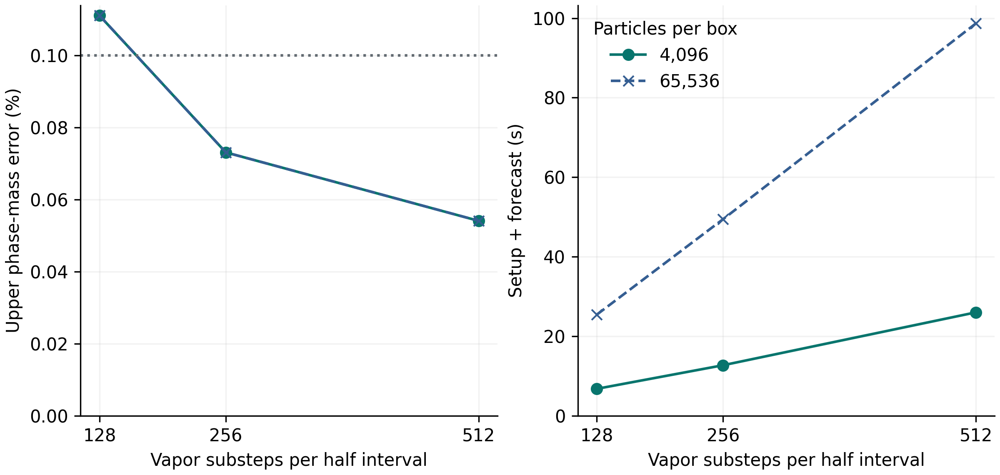
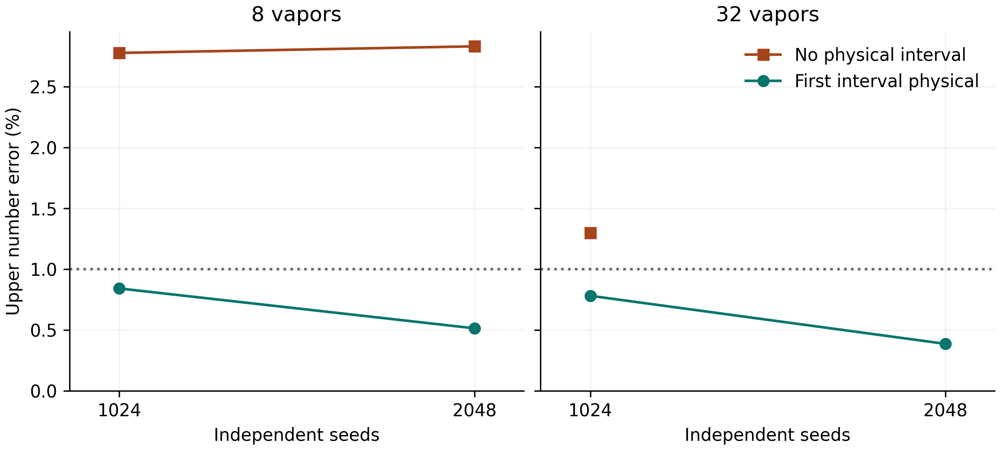

# When can aerosol processes use different time steps?

A vapor pulse can move mass between phases faster than particles collide. Ion attachment can change the collision rate while both processes are running. Splitting the updates lets each process use its own time step. Its accuracy depends on how often the processes exchange information about gas concentration, particle size and charge.

## Can a finer vapor step change a collision decision?

Leaving collisions out first exhausted the gas-mass allowance, even while particle count stayed within its 1% limit. In the million-particle neutral box, the worst phase error was 0.07644% at 0.75 s. At one second the limiting gas had only 4.74 × 10⁻¹¹ kg m⁻³ remaining. Against the same coupled reference, the vapor step contributed −0.07597% error and the missed collisions added −0.03434%. Their combined error of −0.11031% exceeded the 0.1% target.

A finer vapor step recovered enough accuracy to leave collisions off in two smaller boxes. At both 4,096 and 65,536 neutral particles, doubling the substeps per half interval from 128 to 256 lowered the upper phase error from about 0.111% to 0.0731%. At 65,536 particles this raised runtime from 25.4 to 49.4 s. Doubling the substeps again cost 98.7 s and reduced the upper error to 0.0541%. The middle setting already met the target at both tested sizes. Its performance at one million particles remains unknown.

<figure class="scientific-figure">

<figcaption>Refining vapor transfer while leaving mergers off. Left, upper phase-mass error against the coupled physical reference. Right, runtime. The error curves for 4,096 and 65,536 particles nearly overlap. Doubling the substeps from 128 to 256 brought both below 0.1%.</figcaption>
</figure>

## How long can a box omit collisions?

In the fixed-inventory experiments, the first error to cross a limit was a phase mass. At 100 particles cm⁻³ both the neutral and bipolar ±4 populations stayed within the targets for the full hour. At 1,000 cm⁻³ the neutral box reached the phase limit after 54.4 minutes and the charged box after 8.0 minutes. At one million particles cm⁻³ those times fell to 1.97 s and 0.80 s. Charges combined at mergers in this comparison. It included no exchange with free ions.

A screening rule used 1,024 sampled pairs and four short vapor updates to decide whether to omit collisions. On held-out populations it retained collisions in all 100 settings where omission crossed a target. It allowed omission in 71 of the 85 safe settings. Those 71 ran 1.48× faster at the median on the GPU, including the decision cost. A second vapor pulse required carrying forward the error accumulated during the first one.

## Which processes benefited from their own clocks?

Charge changed fast enough to warrant a shorter time step than vapor transfer or coagulation. In a million-particle ±4 box with finite positive and negative ion supplies, holding charge fixed gave a 1.82% phase upper bound. Updating ions 214 times during one simulated second lowered that bound to 0.01477% across 24 seeds. The same forecast used 32 vapor updates and 16 collision opportunities, took 3.89 s at the median, and gave a 0.00732% upper number error. Its reference included ion uptake, recombination and changes to the particles carrying charge.

Water and organics needed a shared reservoir update. In a held-out 32-vapor reversible experiment, advancing the organic block on its own outer clock gave a 0.2045% phase upper bound. Using distinct transfer rates and updating both reservoirs together reduced the bound to 0.0547%, within the 0.1% limit.

A physical correction was most useful just after a pulse in the reversible experiment. In a segregated eight-particle box with 32 vapors, starting the full physical solver from the forecast's current state for the first interval of each eight-interval forcing plateau lowered the number-error bound from 1.298% to 0.781% on 1,024 seeds. The corrected forecast reached 0.385% on 2,048 seeds, with a 0.000282% phase bound. Only the corrected method completed that larger comparison.

The same rationale was less convincing in a separate irreversible 4,096-particle test. Inserting a native interval raised runtime from about 0.1 s to 3.5–6.6 s. Seven paired seeds per charge setting left the gain in accuracy unresolved.

<figure class="scientific-figure">

<figcaption>Using the physical solver immediately after a vapor pulse. Each panel follows an eight-particle box. Each marker gives the upper number-error bound across independent seeds. Integrating the first interval of each plateau physically brought both vapor cases below the dotted 1% target. The uncorrected 32-vapor case completed only the 1,024-seed comparison.</figcaption>
</figure>

The [GPU scaling measurements](scaling.md) compare these choices at larger particle counts. The [study overview](index.md) defines the acceptance criteria.

[Download the figure data (ZIP)](../../../../website/public/study-data/weighted-particle-embedding/figure-data.zip)

Tables for this page include `vapor-clocks.csv`, `physical-correction.csv`.
