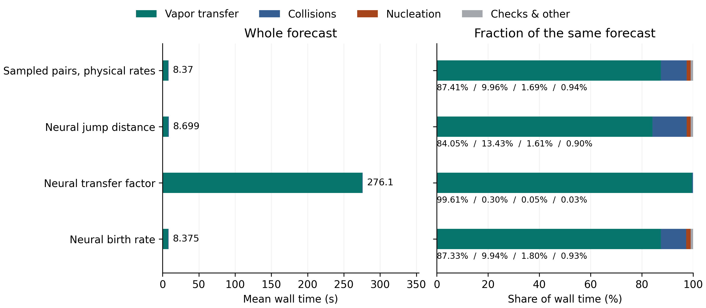
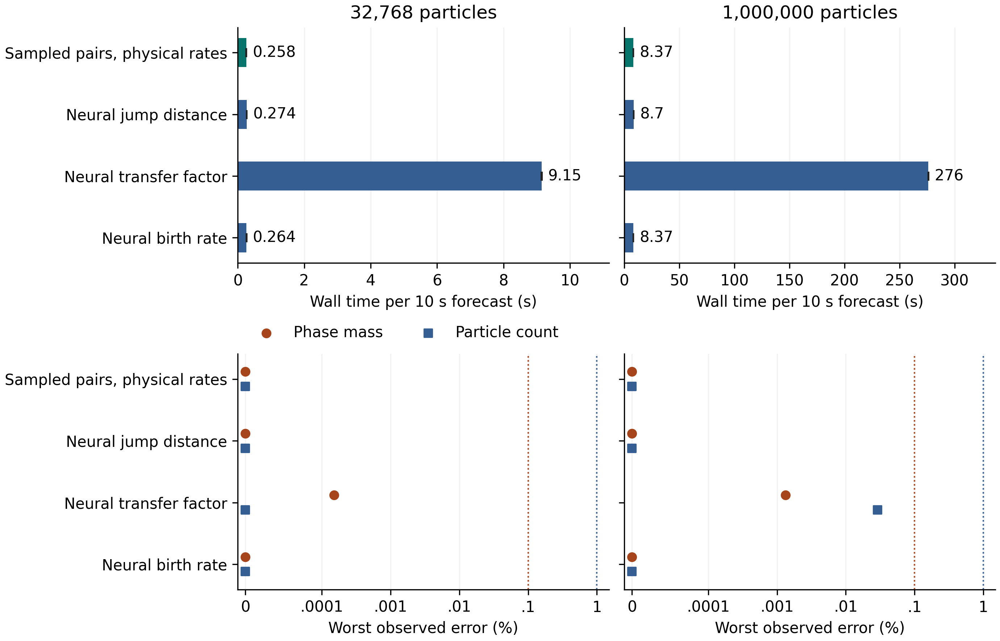
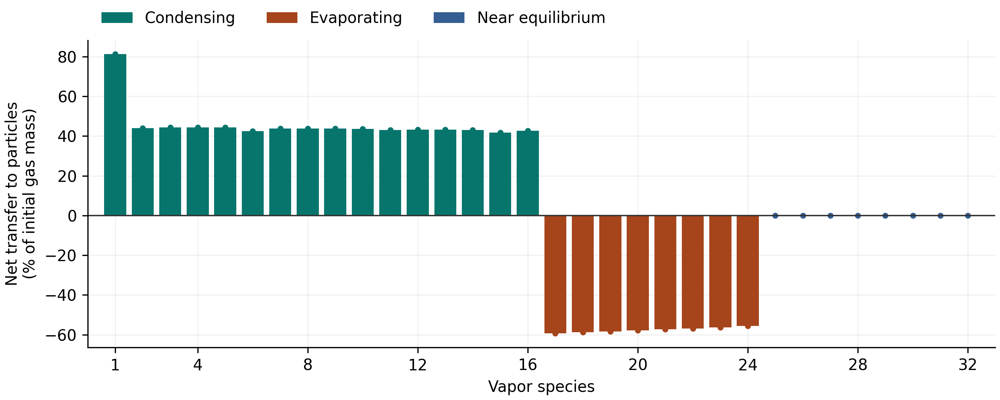
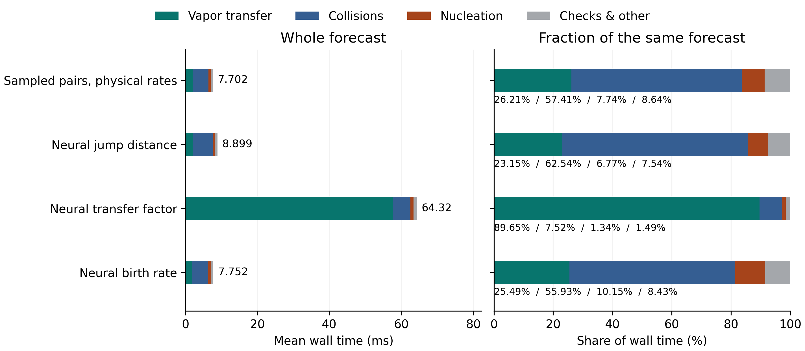

# Process timings and errors in coupled forecasts

The [coagulation benchmark](index.md) measures what happens when the full native collision calculation is replaced by pair sampling. Here every forecast already samples pairs. The comparisons isolate the cost of changing a rate calculation or increasing the box size.

## Ten-second forecasts with sampled pairs

This million-particle test starts with sampled collisions, reversible vapor exchange and new particle formation. In the first row, physical formulas supply all three rates. Each following row replaces one calculation with a network. Times are whole-forecast means over three matched seeds, measured after setup and warm-up.

| Collisions on sampled pairs | Vapor transfer | Nucleation | Whole forecast | Effect vs 8.370 s physical baseline |
|---|---|---|---:|---|
| Physical | Physical | Physical | 8.370 s | 1.00× baseline |
| Neural jump distance | Physical | Physical | 8.699 s | 3.93% more time |
| Physical | Neural transfer factor | Physical | 276.1 s | 33.0× as long |
| Physical | Physical | Neural birth rate | 8.375 s | 0.06% more time, effectively tied |

The 2,131-second full native benchmark measures a different vapor solver, forecast duration and timing interval. A ten-second full native run with the same 32-vapor mixture would be needed to measure speedup over full native physics here. The four timed configurations above also leave the combined, all-neural runtime unknown.

<figure class="scientific-figure">

<figcaption>Where the ten-second forecast spent its time. Each row shows the same three-seed mean twice. On the left, the segments add to the labeled total in seconds. On the right, each bar spans 100%. The four percentages below each bar follow the legend from left to right. Checks and other work include observations and time outside the three process timers. The one-second full native run recorded setup and combined advance time, so its individual process shares are unavailable.</figcaption>
</figure>

## How much faster could a single replacement make this forecast?

Once the solver sampled collision pairs, further accelerating collisions could save little of the whole forecast. In the million-particle physical run, collisions took 0.834 of 8.370 s. Removing that time entirely would leave 7.536 s, a maximum speedup of 1.11× with all other costs held fixed. The corresponding ceiling for nucleation was 1.02× because it took just 0.141 s.

Vapor transfer offered the largest opportunity. It occupied 7.316 s, giving a theoretical ceiling of 7.94× for the whole forecast. Achieving even part of that gain requires producing the rates, moving material and updating each particle's state more cheaply.

The 5.02× result on the overview started with native coagulation. Here the physical baseline *already samples pairs*, so only about one tenth of the remaining forecast time is available to a faster collision treatment. A charge-dependent rate or a more costly birth model could change these fractions. [Native collision comparison](coagulation.md)

## How do speed and accuracy change at one million particles?

One million particles at 10⁶ cm⁻³ fill a 1 cm³ box. We ran four ten-second forecasts on the RTX 5060 and repeated them in a 32,768-particle box at the same density. Both sizes used the same 32 vapors, initial composition, three paired seeds and 0.125-second steps. This smaller control isolates the change in particle count and volume. The one-second, two-vapor comparison below uses different chemistry and a shorter forecast.

<figure class="scientific-figure">

<figcaption>Time and error at two box sizes. Top, each bar averages three forecasts and black marks give the seed timings. The two time axes have different ranges. Bottom, dots and squares give the worst phase-mass and particle-count errors across seeds and times. Dotted lines mark the 0.1% mass and 1% count targets. Each neural row replaces one rate and retains physical updates for the other two processes. Timing includes all 80 observations and synchronization of each process on the GPU. Setup and warm-up precede the timer.</figcaption>
</figure>

Keeping the physical rates made a ten-second forecast feasible at both box sizes. Mean wall time over three paired seeds rose from 0.258 s at 32,768 particles to 8.37 s at one million, or 0.837 wall seconds per simulated second in the larger box. Replacing the vapor transfer factor with the 128-unit network raised that large-box time to 276 s. The network ran for every particle and vapor, even as some vapors evaporated and others remained near equilibrium.

| Forecast | Large-box time ÷ small-box time | Million-particle process time, physical → neural (s) | Worst phase error, 32,768 | Worst phase error, 1,000,000 |
|---|---:|---:|---:|---:|
| Sampled pairs, physical rates | 32.5× | — | 0% | 0% |
| Neural collisions | 31.7× | 0.834 → 1.17 | 0% | 0% |
| Neural vapor transfer | 30.2× | 7.32 → 275 | 0.00015% | 0.00133% |
| Neural nucleation | 31.7× | 0.141 → 0.151 | 0% | 0% |

At 32,768 particles the sampled-pair physical baseline was 0.258 s. Switching jump distance to neural took 6.57% more time, switching the transfer factor took 35.5× as long, and switching the birth rate took 2.55% more time.

Errors compare each forecast with its physical counterpart at the same seed and time step. We scored the gas and particle masses of every species, the phase totals and the particle count at all 80 observations. Across neural substitutions, the largest count difference was 0% in the smaller box and 0.029% in the larger box. The largest relative drift in any species inventory was 1.44e-13%.

The time step affected the answer more than any neural rate substitution. Halving the physical vapor step changed phase masses by up to 0.636% at each box size, with the birth and collision clocks held fixed. In the million-particle case the largest change occurred in gas-phase species 19 at 0.25 s. Every neural substitution met both targets against its same-step physical run, yet the physical step itself moved the answer by more than the 0.1% mass allowance.

### Did the vapors actually condense and evaporate?

Of the 16 condensing vapors, one supplied stable, nonvolatile cluster material and 15 began at twice their equilibrium gas concentration. Eight vapors began at half equilibrium and could evaporate from the particles. The remaining eight began at equilibrium. All 32 could exchange mass as gas concentrations and particle compositions evolved.

<figure class="scientific-figure">

<figcaption>Net vapor transfer in the million-particle physical box. Positive values mean gas condensed onto particles. Negative values mean particle material evaporated into the gas. Each value is the three-seed mean after ten seconds, as a percentage of that species’ initial gas mass. The precursor balance removes material consumed directly by nucleation.</figcaption>
</figure>

The three vapor groups moved in different directions even though all shared the same clock. By ten seconds, the condensing species had lost 41.8–81.2% of their initial gas mass to particles. Material evaporating from the particles increased gas mass by 55.6–59.3% of its initial value for the evaporating species. Gas mass in each of the eight near-equilibrium species stayed within 0.047% of its starting value at every observation. The timing therefore covers substantial transfer in both directions alongside nearly steady gas reservoirs.

## What does each process cost?

In the smaller one-second experiment with 32,768 particles, two condensing vapors and sampled pairs, collisions took 57% of the physical-rate forecast time, condensation took 26%, and nucleation took 8%. To measure the cost of a neural substitution, we ran the same box four ways. One used physical formulas throughout. The other three each replaced one rate calculation with a fitted network. All four retained the same particle updates, vapor budgets and time steps.

<figure class="scientific-figure">

<figcaption>One second of growth, collisions and new particle formation on an RTX 5060. Left, the process times add up to the mean forecast time in milliseconds across 15 paired seeds. Right, the same segments show the percentage of time spent in each process. The four percentages follow the legend order. Each box started with 32,768 neutral particles and two condensing vapors. One vapor also supplied the newborn particles.</figcaption>
</figure>

| Process | What the network supplied | Physical process time | Neural process time | Effect on whole-forecast runtime vs physical rates |
|---|---|---:|---:|---:|
| Collisions | Jump distance in the Brownian collision probability for each sampled pair | 4.42 ms | 5.57 ms | 15.5% more time |
| Condensation | Size-dependent transfer factor for each particle and vapor | 2.02 ms | 57.66 ms | 8.35× as long |
| Nucleation | Birth rate from the current precursor concentration | 0.60 ms | 0.79 ms | 0.65% more time |

How often a network ran mattered for the whole forecast. The 128-unit condensation network ran once per particle and vapor at each half step. In the two-vapor experiment it raised mean forecast time from 7.70 to 64.32 ms over 15 paired seeds. The nucleation network learned a single coefficient in the prescribed linear activation law and evaluated one gas concentration per box. Its whole-forecast timings overlapped the physical trials.

These times start after warm-up and box setup. Each process timer includes applying its update to the particles and waiting for the GPU. Observations and other work took another 0.67 ms in the physical forecast.

All four methods produced the same particle count at every scored step on these seeds. The largest gas- or particle-phase mass difference from the matched physical run was 0.000104% or less. This comparison uses a reduced model with irreversible vapor uptake and sampled collisions. The one-second native collision test uses 32 vapors and includes setup in its timing. Reversible water condensation and chamber formation rates would require separate comparisons.

The simulations used Particula revision `2db6a77323a7` and an RTX 5060. The replay guide gives the software versions, seeds and commands for repeating the comparison. [Simulation and figure replay guide](../../../../studies/weighted-particle-embedding/README.md)

[Download the figure data (ZIP)](../../../../website/public/study-data/weighted-particle-embedding/figure-data.zip)

Tables for this page include `million-process-shares.csv`, `process-scale.csv`, `process-scale-exchange.csv`, `process-cost.csv`.
