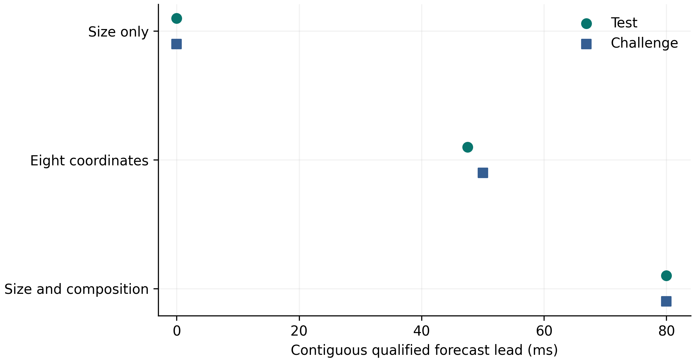

# What particle information survives compression?

Imagine two populations with the same number of particles in each dry size class. One spreads its water-attracting material across the particles. The other concentrates it in a subset. A model that retains the mean composition at each size can assign both populations the same starting state. Their particle surfaces can nevertheless draw different amounts of vapor from a finite gas reservoir.

## A matched water pulse

The initial experiment used eight dry radii, each with two equal-weight representatives. The two dry materials had hygroscopicity parameters of 0.03 and 0.75. The internally mixed and segregated boxes started with equal total inventories and equal initial water per particle, at 293 K, 101,325 Pa and 10¹¹ particles m⁻³. At 40 ms the forcing reset the gas to the water concentration corresponding to 35% relative humidity. Water could then exchange with particles until the next observation. The reset was accounted for as an external addition or removal.

The prediction target was the difference in water response between the paired mixtures. Forecast lead was the length of time over which the predicted contrast met the study's sign and error criteria. Each held-out cohort contained 48 aerosol families.

| Initial representation and forecast | Held-out test | Held-out challenge |
|---|---:|---:|
| Dry size alone | 0 ms | 0 ms |
| Direct learned embedding, eight coordinates | 47.5 ms | 50 ms |
| Physical reconstruction retaining composition within dry size | 80 ms | 80 ms |

<figure class="scientific-figure">

<figcaption>How long the forecast retained the water-uptake difference between two mixtures. Each marker represents a held-out cohort of 48 aerosol families. Size alone gave zero qualified lead. Keeping composition within each dry size recovered the contrast through the full 80 ms experiment.</figcaption>
</figure>

Keeping track of which materials shared a particle extended the water forecast. The eight-coordinate model recovered the difference between mixtures for 47.5 ms on the test families and 50 ms on the challenge families. Reconstructing the composition spread within each dry size carried that difference through the last observation at 80 ms. The reconstruction also predicted the water in each box, with mean absolute errors of 0.340 mg m⁻³ on test and 0.443 mg m⁻³ on challenge.

## What the networks learned

A model with memory followed both vapors through the full 80 ms on the held-out test and challenge families. It combined a physical transfer estimate with a feed-forward correction, a recurrent unit that remembered earlier states, and attention over the other particles. A shared inventory calculation limited condensation to the gas available and evaporation to the material on each particle.

Repeated changes in vapor forcing exposed a limit to that result. Over 96 plateaus the recurrent mixture met the forecast criteria in three of 12 test strata and six of 12 challenge strata. The physical solver met them in all 12 on each cohort. Success through the first pulse gave little assurance about accuracy many pulses later.

A later architecture assigned water and organics separate networks to estimate transfer conductance. A joint gas–particle update transferred equal mass out of one phase and into the other. The collision rate depended symmetrically on the two partners, and a physical merger rule moved their mass and charge into the surviving particle. This division makes a charge-dependent rate replaceable while retaining the same inventories and event accounting.

Keeping fewer fields saved much more storage than runtime in the irreversible uptake test. When uptake depended only on particle geometry, recording the quantities needed for that calculation reduced a million-particle, 32-vapor record from 272,001,032 to 24,001,416 bytes. The median speedup was 1.12× over 20 paired trials. A reversible vapor pulse still required information about which materials shared a particle to recover the difference between the mixtures.

Continue with [the process clocks](process-clocks.md) to see how time resolution altered forecast error, or return to the [study overview](index.md).

[Download the figure data (ZIP)](../../../../website/public/study-data/weighted-particle-embedding/figure-data.zip)

Tables for this page include `mixing-state.csv`.
