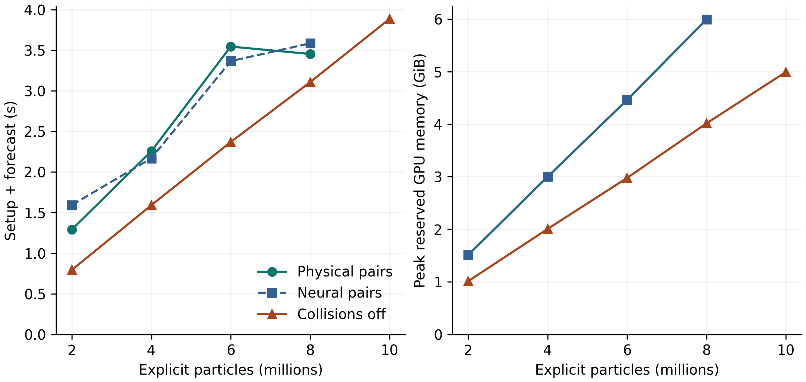
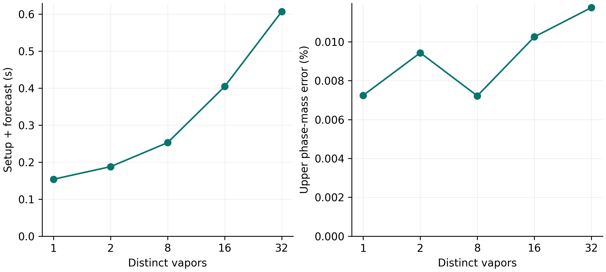

# How many particles and vapors fit in a forecast?

An explicit particle occupies one computational record. A weighted representative can stand for many physical particles. Both numbers matter when interpreting a speedup. The explicit scaling experiments increased box volume at fixed number concentration, keeping the density-dependent collision physics comparable across sizes. At 10¹² particles m⁻³, one million particles occupy 1 cm³.

## One box on an RTX 5060

The reduced solver used a finite vapor reservoir and sampled candidate pairs without constructing a dense matrix of all partners. The table gives median setup and forecast time for one simulated second, 32 vapors and an initially neutral population. Each completed table entry had 9–10 runs.

| Initial explicit particles | Physical rates on sampled pairs | Neural rates on sampled pairs | Collisions omitted |
|---:|---:|---:|---:|
| 2 million | 1.29 s | 1.59 s | 0.79 s |
| 4 million | 2.26 s | 2.17 s | 1.59 s |
| 6 million | 3.55 s | 3.37 s | 2.37 s |
| 8 million | 3.45 s | 3.59 s | 3.11 s |
| 10 million | Skipped by memory preflight | Skipped by memory preflight | 3.89 s |

<figure class="scientific-figure">

<figcaption>Cost of forecasting one neutral box with 32 vapors for one second. Left, median setup and forecast time. Right, peak reserved GPU memory. Both sampled-pair methods reached eight million explicit particles. Only the run with mergers off was attempted at ten million after the memory check.</figcaption>
</figure>

Sampled physical collisions fit at eight million particles. The solver reserved 5.99 GiB of the available 7.62 GiB, and the upper errors stayed below both limits at 0.0021% in number and 0.0096% in phase mass. The eight-million-particle run had a dedicated GPU window. Different device availability at six million particles limits interpretation of the small drop in runtime between the two sizes.

At ten million particles, the memory estimate for sampled pairs and their temporary arrays exceeded the allowance. Omitting collisions let the forecast finish with 4.99 GiB reserved. In this neutral, one-second box its upper errors were 0.1058% in number and 0.0419% in phase mass. The ten-million result therefore establishes capacity for a different physical approximation.

## Widening the chemistry

Increasing the chemistry from one to 32 vapors made a million-particle forecast about four times slower, while all five widths stayed inside both accuracy limits. Median time rose from 0.154 s for one vapor to 0.607 s for 32. The intermediate cases took 0.188 s for two vapors, 0.253 s for eight and 0.404 s for 16.

This second neutral size family used a midpoint vapor update and physical rates on sampled pairs. Across 56–57 trials per width, the largest upper errors were 0.00213% in number and 0.01177% in phase mass. Each width had its own vapor properties, initial gas inventory and physical reference, so the timing curve includes the cost of the changing chemistry.

<figure class="scientific-figure">

<figcaption>Adding vapor species at one million neutral particles. Physical rates were evaluated on sampled pairs throughout. Increasing from one to 32 distinct vapors raised median runtime from 0.154 to 0.607 s. The largest upper phase-mass error across the five configurations was 0.0118%.</figcaption>
</figure>

## When do weighted representatives suffice?

More representatives made the strongly charged box reliable enough to meet the study's single-forecast criterion. With one million physical particles, a broad size spectrum and initial charges of ±16 elementary charges, 65,536 representatives met both targets on 246 of 256 fresh trials. The simultaneous lower bound on success was 91.9%, short of the required 95%.

Doubling the representation to 131,072 gave 128 successes in 128 trials, raising the lower bound to 96.0%. The larger representation still offered a speed advantage. Across 104 separate matched GPU timings it took 0.186 s at the median and was 7.02× faster than keeping every physical particle.

The earlier 131× timing came from a different workload. It compared warm vapor integration across 16 boxes of 16 particles and 64 vapors, where native integration took 303.904 s, reduced physical integration 2.317 s and learned integration 5.999 s. For the one-million-particle comparison that kept native vapor transfer and changed only collisions, the measured speedup was about 5×. The [overview](index.md) shows that comparison. The [process-clock study](process-clocks.md) shows why the neutral omission result changes when particles carry charge.

[Download the figure data (ZIP)](../../../../website/public/study-data/weighted-particle-embedding/figure-data.zip)

Tables for this page include `particle-scaling.csv`, `vapor-width.csv`.
