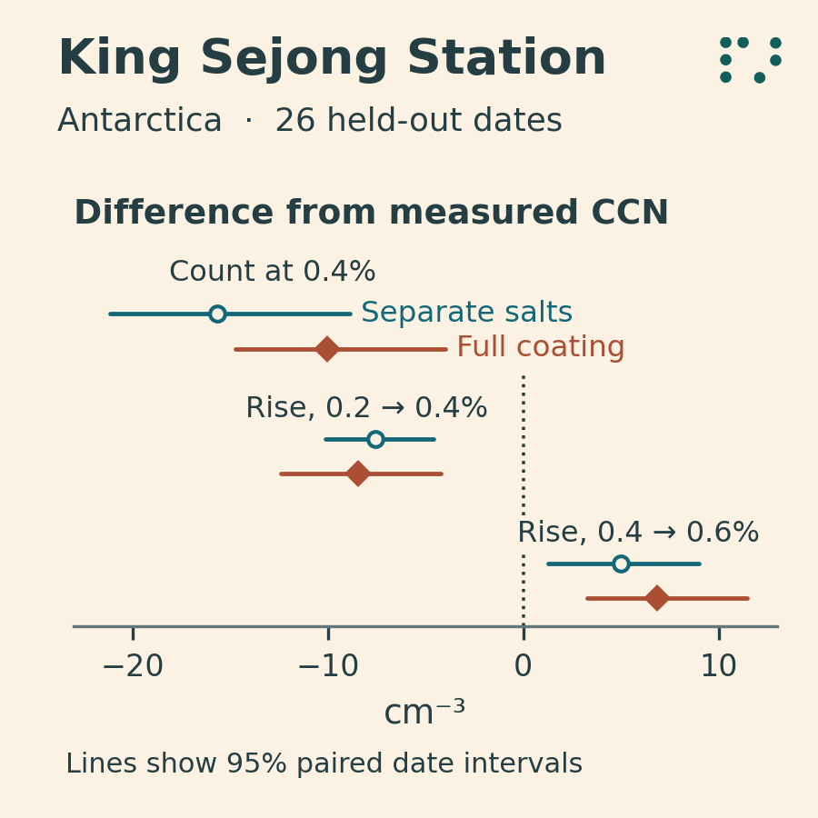
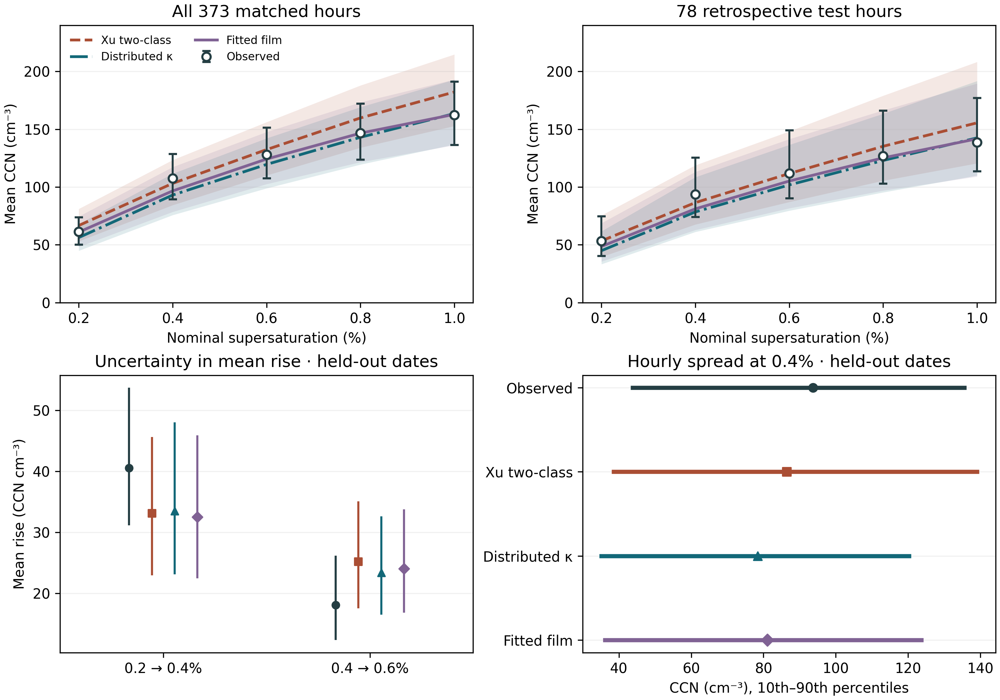
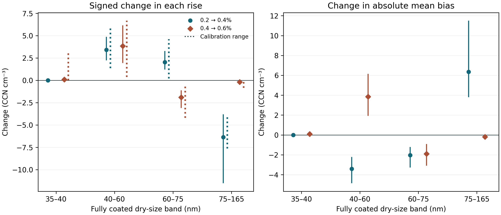
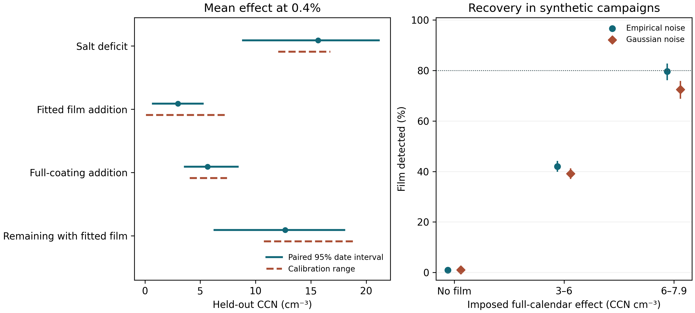

# How an organic film can improve one Antarctic CCN count and worsen the activation spectrum

At King Sejong Station, raising the counter setting from 0.2% to 0.4% supersaturation produced a much larger rise in the measured concentration of cloud condensation nuclei (CCN) than raising it from 0.4% to 0.6%. Could an organic film on marine particles explain that bend? On 26 held-out dates, a salt model underestimated the 0.4% count by **15.65 CCN/cm³**. A film fitted to the other four settings supplied **2.97 CCN/cm³**. Coating every eligible particle supplied **5.65 CCN/cm³**, but pushed the mean errors in both neighboring rises farther from zero. Both nominal changes in the neighboring rises had paired uncertainty intervals that included zero. Which particles carried the film mattered. Coating only particles **60–75 nm** in dry diameter moved both rises toward the measurements, even as the four training channels usually assigned this band zero coating. The activation spectrum identifies a size range where a film could help explain its shape. Its presence and composition remain open questions. [Xu et al.](https://doi.org/10.1029/2026GL125204) · [Archived observations](https://doi.org/10.5281/zenodo.22008294)

## What Xu’s counter measured

Between January 2023 and February 2024, Xu and colleagues measured coastal aerosol on King George Island. One instrument counted particles by dry diameter. A second measured the wet-to-dry diameter ratio at 90% relative humidity for five dry sizes between 35 and 165 nm. A third counted the particles that grew into droplets as it stepped through five supersaturations. Xu’s team used the growth distributions to infer a sea-salt class and assigned it an activation hygroscopicity (κ) of 1.1. They assigned the other class κ = 0.6. From this reconstruction, they estimated that sea salt supplied 43% of summer CCN and 54% of winter CCN at 0.2% supersaturation. The total CCN concentrations came from the counter. The class contributions came from the model. [Xu et al., §§2–3 and Figure 2](https://doi.org/10.1029/2026GL125204)

Across the 373 hours on 104 dates with matched clean-sector observations, the measured mean rises were **46.06** and **20.50 CCN/cm³** on either side of 0.4%. A calculation using the full measured distribution of hygroscopicity at each dry size predicted **36.76** and **26.52**. Xu’s two classes came closer to the absolute 0.4% mean, **103.12** against **107.51 CCN/cm³** observed. Neither benchmark reproduced the full bend. The sequential settings also sampled air at different times within each hour. These increments compare counts across settings, and a changing aerosol population can contribute to them.

*Figure 1.* Each model samples the same dates and size distributions as the observations in its panel. Open circles and capped bars show measured means and their pointwise 95% whole-date bootstrap intervals. Colored lines and shaded bands show the corresponding model means and intervals at the five counter settings. The separate 10th–90th percentile range describes variability across individual hours on the 26 test dates, holding the nominal fit fixed. For the fitted film at 0.4%, the mean was 81.1 CCN/cm³ (95% date interval 62.8–113.1). The middle 80% of individual simulated hours ranged from 36.2 to 123.7 CCN/cm³.

## Which dry particles could change the bend?

Our reference calculation represented salt particles with different water uptake within each size. For the film calculation, we used a finite organic layer tested against laboratory activation data for ammonium sulfate and suberic acid. As a droplet grows, the same organic inventory covers a smaller fraction of its surface. We assigned this material only where its dry composition could reproduce the measured growth. One fitted parameter set the coated fraction across those eligible particles. We fitted to four counter settings on 78 dates, reserving the entire 0.4% channel and scoring its 78 hours on the other 26 dates. These dates had been examined in earlier comparisons, making this a retrospective test. [Davies et al., Tables 1–3](https://doi.org/10.5194/acp-19-2933-2019) · [Köhler activation and κ](https://doi.org/10.5194/acp-7-1961-2007)

| Held-out quantity at nominal calibration | Separate salts | Fitted film | Full coating | Measured |
|---|---:|---:|---:|---:|
| Count at 0.4% (CCN/cm³) | 78.10 | 81.07 | 83.75 | 93.75 |
| Rise, 0.2% to 0.4% (CCN/cm³) | 32.99 | 32.52 | 32.09 | 40.54 |
| Rise, 0.4% to 0.6% (CCN/cm³) | 23.08 | 24.05 | 24.93 | 18.08 |

The 95% paired date interval for the fitted film’s addition at 0.4% was **0.71–5.21 CCN/cm³**. For full coating it was **3.60–8.38**, or **24–58%** of the resampled salt deficit. Full coating increased the absolute bias in the first rise by **0.90 CCN/cm³** (95% interval −1.42 to +3.93) and in the second by **1.84** (−0.02 to +4.07). The direction of the count change persisted across resamples. The size and direction of the penalty to each rise depended more on which dates were represented. For hourly error at 0.4%, Xu’s benchmark retained an advantage at nominal calibration, with mean absolute error of **13.80 CCN/cm³** against **16.23** for the fitted film. The paired interval on that 2.43 difference spanned −0.32 to +5.18.

Coating just the **40–60 nm** band supplied 3.42 CCN/cm³ at 0.4% but increased the already excessive second rise by 3.85. Particles at **75–165 nm** began activating at the lower setting, which reduced the first rise by 6.36. The **60–75 nm** band behaved differently. Its coating increased the first rise by **2.03 CCN/cm³** (1.21–3.28) and reduced the second by **1.91** (1.13–3.10). For that band the film added essentially zero at 0.2%, 2.03 CCN/cm³ at 0.4%, and just 0.13 at 0.6%. It shifted activation into the middle setting for particles that usually activated by the next one. Both rises improved on 13 of the 26 individual test dates. Yet when each band could fit its own prevalence, **959 of 1,000** nominal refits assigned zero coating to 60–75 nm. The counter measured total activated number at each setting. The split by particle size is a prediction of the coating experiment.

*Figure 2.* Each band compares full coating to separate salts on the same hours at the same instrument settings. A signed change tells which rise gains or loses CCN. Its change in absolute bias tells whether that shift moves it closer to the counter. Coating 60–75 nm particles improved both pooled rises in all 217 measurement settings that met the common-film training criterion.

## How large a film effect is distinguishable from instrument error?

We resampled whole training dates and independently resampled whole test dates 1,000 times. Each training sample received a fresh fit. All models and all five counter readings for an hour stayed together when we formed the paired contrasts. We separately tested 729 combinations of shared supersaturation gain and offset, dry diameter and number scales, growth-factor scale, and conditioning humidity. A diameter shift conserved particle number. Changes in measured growth required a fresh composition estimate. We retained grid cases whose training root mean square error was within 1 CCN/cm³ of the grid-wide best across candidate models, giving a cutoff of 21.72 CCN/cm³. The resulting ranges describe tested settings without assigning a probability to a particular calibration. [CCN calibration experiments](https://doi.org/10.5194/acp-8-1153-2008)

Among the 217 retained common-film settings, the fitted film supplied **0.09–7.26 CCN/cm³** and left **10.76–19.03 CCN/cm³** unexplained. The counter, sizing and number perturbations alone changed the salt prediction by **−10.39 to +5.55 CCN/cm³**. The fit also admitted models with water surface tension. The archive supplies hourly growth distributions but has no supersaturation trace for individual scans. Chemical filters integrated over three days. The main methods give no analytical precision that could be propagated as an hourly organic fraction at 60 nm.

*Figure 3.* The residual is the measured 0.4% mean minus the prediction. Compare its date interval with its range across compatible measurement settings. The recovery experiment uses Wilson intervals for the fraction of independent synthetic campaigns assigned to a cause.

In 28,672 synthetic campaigns using the Antarctic sampling calendar, assigning a film when none was present was uncommon, about 1% under either of two correlated noise models. Recognition was harder. At imposed full-calendar effects of 6–7.9 CCN/cm³, the search recovered a film in **462/580** campaigns with empirical noise (79.7%) and **440/607** with Gaussian noise (72.5%). When the generating film law was omitted, the search assigned **328/580** of the strong empirical cases to instrument error. Even with a known film in the synthetic aerosol, its signature can resemble a change in instrument calibration.

## A marine transfer test at 60 nm

A second marine formulation provides an external check on the size prediction. We reproduced the published 50 nm calculation for the finite monolayer of Kleinheins et al., then supplied each Southern Ocean SOAP sample’s organic loading and predicted its growth at 90% relative humidity. Only **1 of 19** samples with source-confirmed loadings came within 2% of the paired observed growth. We also froze predictions before extracting 83 activated fractions from Quinn et al.’s North Atlantic Figure 3b. At 0.4% and **60 nm** the predicted fraction was **0.505**, against **0.827** at Georges Bank and **0.743** in the Sargasso Sea. At **80 nm** the prediction was essentially one, close to the measured 0.991 and 0.976. Kleinheins et al. discussed Quinn’s measurements, and Quinn inferred size-specific organic fractions from activation itself. We used the published model’s loading assumptions for both stations. This tests transfer of the material assumptions and leaves their Antarctic applicability open. [Kleinheins et al.](https://doi.org/10.5194/acp-25-881-2025) · [SOAP measurements](https://doi.org/10.1594/PANGAEA.919801) · [Quinn et al., Figure 3](https://doi.org/10.1038/ngeo2092)

The next simulation should use a marine dataset with independently measured composition, growth and size-selected activation near **60 and 75 nm**. Fix the material on growth, then predict activation on both sides of 0.4% before examining the activation points. If the same material captures both rises at those sizes, it would connect the Antarctic count signature to a testable marine composition.

## Study resources

The CPU integration was checked against a CUDA pilot using three observation hours and eight independent ensembles of 8,192 particles per hour. For the full-coating addition at 0.4%, the particle Monte Carlo standard error was **0.012 CCN/cm³**. The difference from the CPU calculation was **0.019 CCN/cm³**. Date sampling and the range of admissible measurement settings account for much more of the spread. The matched record contains only eight winter hours, limiting seasonal interpretation. [Run the uncertainty analysis](uncertainty.py) · [Data and source-to-figure guide](../../../../scripts/antarctic_ccn/README.md) · [Xu et al. data](https://doi.org/10.5281/zenodo.22008294)

Download the [spectrum and hourly ranges](../../../../website/public/study-data/antarctic-ccn/plot-spreads.csv), [paired biases](../../../../website/public/study-data/antarctic-ccn/paired-bias.csv) and [size-resolved intervals](../../../../website/public/study-data/antarctic-ccn/size-spreads.csv).
