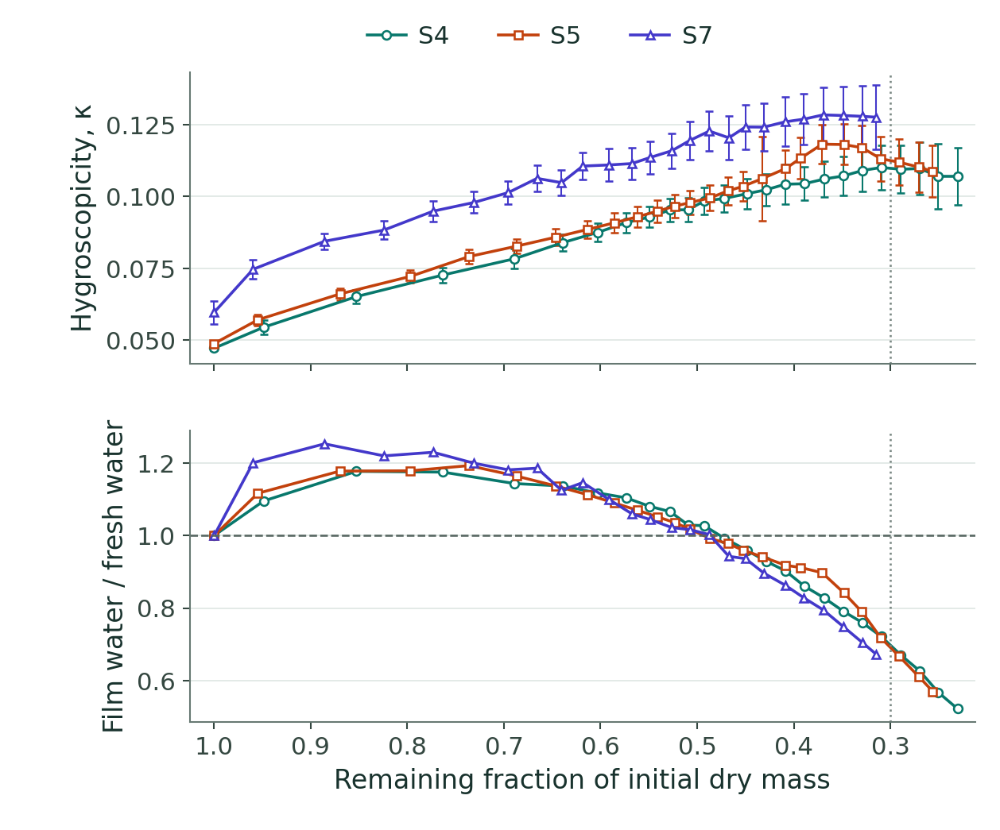

# Which particles retain the light-sensitive material?

A limonene aerosol film can become more hygroscopic while losing the material that would let a particle reach cloud-droplet size. Bai and colleagues measured the changing dry mass and water uptake together. Two independent airborne experiments help interpret those films. Wilson and colleagues measured how suspended particles evaporate, and Liu and colleagues measured how readily fresh particles activate. The missing observation is the chemical response of the suspended residue after evaporation. [Bai et al.](https://doi.org/10.1021/acs.est.5c16671) · [Wilson et al.](https://doi.org/10.1021/es505331d) · [Liu et al.](https://doi.org/10.1038/s41467-018-06622-2)

## A film’s mass and water uptake can move in different directions

Bai et al. oxidized limonene with ozone and collected the resulting aerosol on a quartz crystal microbalance. Alternate dry and humid readings tracked the same film through exposure to 300 nm light. At fixed humidity and density, the aged-to-fresh water ratio is the remaining dry-mass fraction multiplied by the ratio of aged to fresh hygroscopicity, κ. Across trials S4, S5 and S7 near 80% relative humidity, the reconstructed water ratio rose to 1.18–1.25 early in the exposure. At 29–31% dry mass remaining it fell to 0.67–0.72, even though the residue’s κ had roughly doubled. [Bai supporting information, Figure S15](https://doi.org/10.1021/acs.est.5c16671.s001)

*The limonene films gained water affinity as they lost dry mass. The upper panel shows effective hygroscopicity digitized from Bai’s Figure S15 with the published vertical half-bars. The lower panel combines each trial’s hygroscopicity and remaining dry mass to reconstruct the amount of water relative to its fresh film at the same humidity. All three trials reach a late state that holds less total water despite the higher hygroscopicity of the residue.* [Figure data](../../../../website/public/study-data/bai-limonene/film-water.csv) Bai et al. released Figure S15 under CC BY-NC 4.0. This figure redraws the digitized measurements and adds the relative-water calculation. [Original supporting information](https://doi.org/10.1021/acs.est.5c16671.s001) · [Source license](https://creativecommons.org/licenses/by-nc/4.0/) [Full-size figure](../../../images/bai-limonene/film-water.png)

A parcel experiment can isolate the contribution of each change. With 300 seeds/cm³ and an ascent of 1 m/s through 100 m, updating κ while holding the fresh particle sizes fixed gave 45–50 more droplets/cm³ across the three late films. Including the inferred loss of dry volume as uniform shrinkage gave 21–26 fewer droplets/cm³. The film’s bulk response also permits different allocations of the remaining material among sizes. In trial S4 all three allocations below have the same total dry volume, composition and water affinity.

| Allocation of late S4 residue | Modeled cloud-top droplets (cm⁻³) |
| --- | ---: |
| Smaller seeds retain a larger fraction of their initial volume | 168.5 |
| All seeds retain the same fraction | 132.1 |
| Larger seeds retain a larger fraction | 105.2 |

The corresponding fresh parcel reached 153.4 droplets/cm³. In the uniform case, a seed initially 100 nm across shrank to 67.6 nm. Its critical supersaturation rose from 0.560% to 0.669%, beyond the aged parcel's peak of 0.616%. Uncertainty in the wet readings also matters. Shifting the fresh and late humid S4 readings in opposite directions by the reported single-reading uncertainty of 0.75 µg changed that uniform-shrinkage count difference from −21.3 to +9.3 droplets/cm³. This perturbation gives the scale of the sensitivity. The covariance of the two wet readings would be needed to assign a probability to the reversal.

## Independent airborne measurements constrain different model inputs

Wilson et al. followed the evaporation of suspended limonene aerosol. The fit for particles formed and evaporated under humid conditions assigns 52% of their initial dry mass to effective saturation concentrations of 0.1 µg/m³ or lower. We used their distribution to set the initial volatility classes. How much organic vapor remains available for uptake also matters. For an initial 200 nm particle in a model with 100 particles/cm³, the 24-hour remaining-volume fraction rose from 0.25 with rapid gas removal to 0.56 in a closed gas inventory. [Wilson et al., Table S1](https://doi.org/10.1021/es505331d.s001)

Liu et al. measured fresh limonene aerosol in a cloud condensation nucleus counter. At a dry diameter of 106.6 nm, the measured critical supersaturation was 0.357%. The fresh film’s κ of 0.0465 gives 0.481% at the same size and temperature. This comparison supplies a scale for the error introduced by transferring water uptake below saturation directly to cloud activation. The composition and preparation histories differed between experiments. Activation measurements on co-aged particles would constrain how this difference evolves. [Liu et al., Figure 1 and methods](https://doi.org/10.1038/s41467-018-06622-2)

## Dark preconditioning tests which compounds react fastest

Bai et al. removed 17% of the film’s dry mass in darkness before illuminating it. Its normalized initial photolytic mass-loss rate fell from 0.84 to 0.52 × 10⁻⁴ s⁻¹. At equivalent depletion in the 100 nm particle simulation, the modeled 330 nm chemical response per unit remaining organic mass fell 14% when the most volatile compounds reacted fastest. It was unchanged when rates were independent of volatility and rose 13% when the fastest reaction was assigned to the least volatile material. The film measures net mass loss, including vapor escaping from photoproducts. Its observed direction favors the first assignment. The proposed airborne test measures parent loss at a matched remaining mass and tracks products in both phases. [Bai supporting information, Table S8](https://doi.org/10.1021/acs.est.5c16671.s001) · [Airborne assay and cloud uncertainties](uncertainty.md) · [Main study](index.md)
