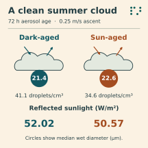
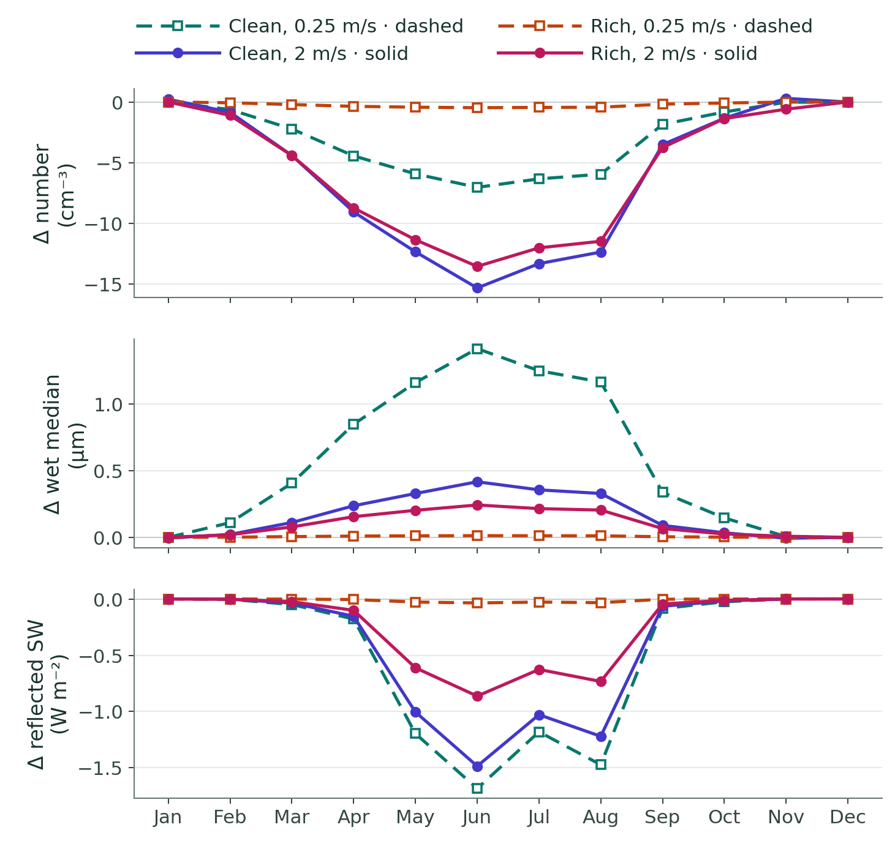
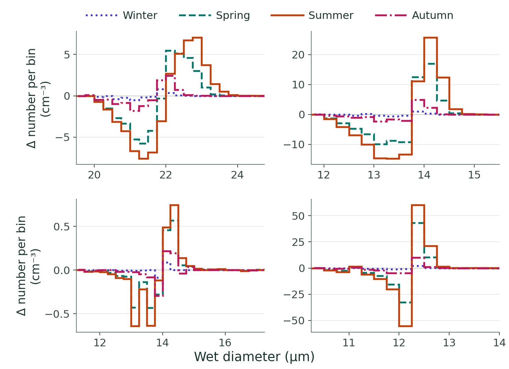
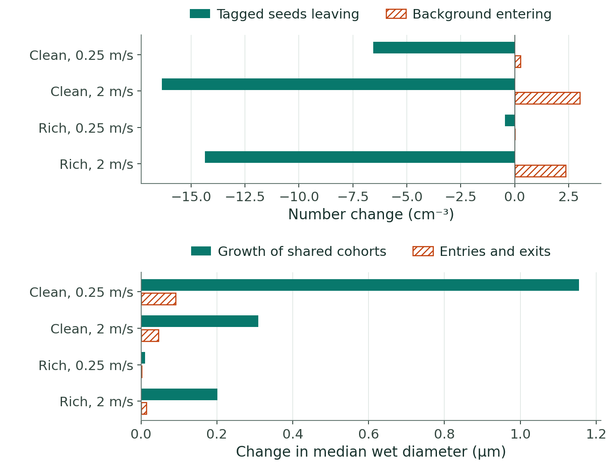

# Sun-aged limonene aerosol yields fewer droplets and less reflected sunlight in modeled summer clouds

Sunlight can make the residue of limonene aerosol more hygroscopic even as it removes material that could seed cloud droplets. Bai and colleagues measured both effects in films. We asked which one carries through to the light reflected by a cloud. After three days of summer sunlight, a clean, slowly rising parcel formed 34.6 droplets/cm³, compared with 41.1 when its aerosol had evaporated for the same time in darkness. The surviving droplets shared the available water and grew larger. Their median wet diameter rose from 21.35 to 22.63 µm. Averaged over all hours of three sampled summer weeks, the cloud and underlying surface reflected **1.45 W/m² less sunlight**. With the accumulation-rich Pallas background, the summer median shifted only 0.012 µm. The atmospheric consequence of aging depends on whether the affected particles would have formed droplets in the first place. [Bai et al.](https://doi.org/10.1021/acs.est.5c16671)

*The graphical abstract pairs two modeled summer clouds rising at 0.25 m/s. Both receive the same sunlight during the radiative-transfer calculation. “Dark-aged” and “sun-aged” describe the preceding aerosol exposure. The circles are scaled to the median wet droplet diameters.* [Values plotted](../../../../website/public/study-data/bai-limonene/summer-pair.csv)

## What survives illumination long enough to form a droplet?

Bai et al. irradiated films made by oxidizing limonene and followed their dry mass and water uptake. In three trials near 80% relative humidity, the films initially held 18–25% more water than when fresh. Late in the exposure, about 30% of the dry mass remained. Its hygroscopicity had roughly doubled, yet the film held only 67–72% of its initial water. Giving each simulated particle the aged material’s water affinity at its original size predicted 45–50 **more** droplets/cm³ than fresh aerosol at 1 m/s ascent. Allowing every particle to shrink with the film’s measured mass loss instead predicted 21–26 **fewer**. Even with identical total residual mass, moving more of it to smaller or larger seeds could change the sign. [Film measurements, uncertainty and transfer to particles](film-and-airborne.md)

Wilson et al.’s suspended-particle evaporation data constrained how much low-volatility material could remain. Liu et al.’s activation measurements provided an independent check on how readily fresh particles could seed cloud. Our central calculation assigned the fastest photochemistry to the more volatile material. Bai’s pre-evaporated film lost mass more slowly under illumination, which supports that ordering. Whether the same ordering holds in individual airborne particles remains an experimental question. [Wilson et al.](https://doi.org/10.1021/es505331d) · [Liu et al.](https://doi.org/10.1038/s41467-018-06622-2) · [Airborne chemistry tests](uncertainty.md)

## One week per month under northern Finnish sunlight

We chose northern Finland because it had the sunlight record and aerosol measurements needed for the comparison. We used the 12th–18th of every month of 2022 at Sodankylä and the actual preceding days for each exposure. We added the same 300 limonene-derived particles/cm³ to either of two measured Pallas background size distributions. The clean and accumulation-rich backgrounds contained 13.3 and 141.5 particles/cm³ between 100 and 400 nm, respectively. Each modeled liquid parcel started at 285 K and 90 kPa and rose 100 m. Holding the source and cloud conditions fixed across months isolates what the change in sunlight can do. [Solar observations and seasonal design](seasonal-light.md)

*Figure 1. Cloud response to one week of northern Finnish sunlight in each month. Each value is the sun-aged minus dark-aged difference for aerosol of the same age. The top and middle panels show cloud-top droplet number and median wet diameter. The third includes light reflected by the cloud and local surface and averages over nighttime too. Open squares on dashed lines indicate 0.25 m/s ascent and filled circles on solid lines indicate 2 m/s.* [Full-size figure](../../../images/bai-limonene/monthly-response.png) · [Monthly plot data](../../../../website/public/study-data/bai-limonene/monthly.csv)

In the clean, slowly rising cloud, summer aging shifted the median by 1.22–1.34 µm across the 24 local solar hours. The preceding three days of exposure sustained that size difference through low-sun hours. The reflected flux responded to the sun overhead and its largest mean loss, 3.19 W/m², came between 13:00 and 14:00 local solar time. The winter effect was small enough that numerical refinement changed its sign at individual hours. The three sampled summer weeks describe specified liquid clouds. A regional annual estimate would also need the frequency of those clouds, their updrafts and the local organic emissions. [Seasonal diurnal profiles and shorter exposure histories](seasonal-light.md)

## Which droplet sizes gained or lost number?

*Figure 2. Gains and losses in droplet number by wet diameter after sunlight exposure. The top row shows clean air and the bottom row shows accumulation-rich air. Ascent is 0.25 m/s on the left and 2 m/s on the right. Each bin shows sun-aged minus dark-aged droplet concentration within the same 3.5–40 µm window. In the clean, slowly rising summer cloud, the 21.25–21.50 µm bin lost 7.6 droplets/cm³ and the 22.75–23.00 µm bin gained 7.1. Summing changes across bins gives the change in the total within that window. Each panel has its own scales.* [Full-size figure](../../../images/bai-limonene/size-resolved-number.png) · [Size-bin plot data](../../../../website/public/study-data/bai-limonene/size-spectra.csv.gz)

The summer median shift in clean, slowly rising air was about as large as the entire middle 80% of the dark control’s diameter distribution (1.20 µm wide). The distribution’s width changed by only 0.04 µm. Faster clean ascent removed more droplets, 13.7/cm³, but shifted the median by only 0.37 µm. A field probe’s size channels also matter. In a synthetic measurement, a 20–25 µm channel swallowed most of the shift in the narrow cloud-top distribution. Sampling through the full depth broadened the spectrum and recovered a 0.92 µm shift with that same probe. [Probe and numerical checks](uncertainty.md)

*Figure 3. How July sunlight changes droplet number and median wet diameter. The upper panel counts droplets on tagged source particles that leave the 3.5–40 µm window and droplets on background particles that enter it. The lower panel separates growth of droplets present in both runs from the shift in the median caused by entries and exits. Each row compares sun-aged and dark-aged aerosol at the same background and updraft.* [Full-size figure](../../../images/bai-limonene/cohort-mechanism.png) · [July cohort data](../../../../website/public/study-data/bai-limonene/july-cohorts.csv)

Tracking the same starting particles explains the larger droplets. In the clean, slow July ascent, 6.56 fewer source particles/cm³ and 0.26 more background particles/cm³ ended in the probe window. Growth of droplets present in both cases added **1.15 µm** to the median, while entries and exits added **0.09 µm**. In a second test we exchanged the temperature, pressure and humidity histories of the two modeled clouds. At three July hours, changing the growth environment added 1.13 µm to the shared droplets’ median. Changing only the seed properties at a fixed history contributed −0.04 µm. Fewer activating seeds left more water available for the droplets that remained. [How the paired tests work](uncertainty.md)

## Why did the cloud reflect less light?

We calculated wavelength-dependent scattering and absorption from the wet size distribution at each height, then followed direct and diffuse light through the cloud and back from the underlying surface. In the clean, fast July cloud, 550 nm scattering optical depth fell by 0.106 and broadband cloud-only albedo fell from 25.3% to 24.5%. Over a black lower boundary, reflected flux fell 1.27 W/m², transmitted flux rose 1.29 W/m² and cloud absorption changed by about −0.02 W/m². Over the local July surface the reflected loss was 1.03 W/m². The increased effective radius accounted for about 61% of the logarithmic decline in 550 nm extinction optical depth. Lower liquid water path accounted for most of the balance. [Radiation boundaries and refinement](seasonal-light.md)

The size of this effect depends on which material remains light-sensitive in air. In the same fast July cloud, assigning the fastest reaction to the **least** volatile material gave 79 droplets/cm³ and a reflected loss of 7.64 W/m². The ordering favored by the films gave 146 droplets/cm³ and a loss of 1.03 W/m². Allowing first-generation products to react again at the tested slow rate moved the favored result only to 145 droplets/cm³ and 1.08 W/m². A discriminating experiment would remove half the dry mass from suspended 100 nm particles, measure the remaining material’s response to 330 nm light, and collect labeled products from both particle and gas phases. Comparing locations and seasonal emissions is a separate next step toward an atmospheric estimate. [Airborne assay and competing predictions](uncertainty.md)

The [reproduction guide](reproduction.md) connects the original observations, simulation code and compact figure data. A [runnable energy calculation](reflected_energy.py) converts the modeled flux differences into reflected energy over a sampled day.
