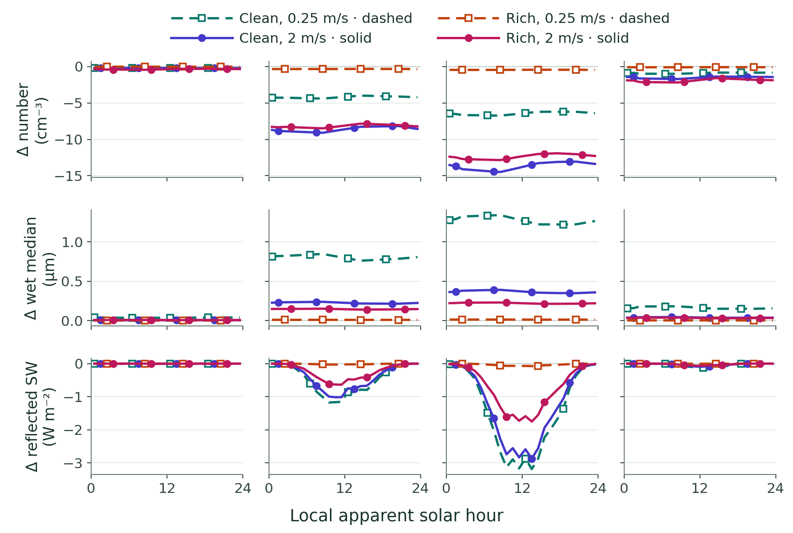

# How aerosol exposure and reflected sunlight change through the day

A cloud reflects the light reaching it at that hour. The sizes and numbers of its droplets also carry the effects of sunlight received by the incoming aerosol over preceding days. For the clean, slowly rising summer parcel, the simulated median remained 1.22–1.34 µm larger throughout the daily cycle after three days of sunlight. The reduction in reflected flux varied from 0.024 to 3.19 W/m². Its maximum occurred between 13:00 and 14:00 local solar time.

*Daily cycles of cloud-top droplet number, median wet diameter and reflected sunlight appear from top to bottom. Columns show winter, spring, summer and autumn from left to right. Each point averages the same local apparent solar hour across 21 sampled dates. Differences are sun-aged minus dark-aged. Open squares on dashed lines indicate 0.25 m/s ascent and filled circles on solid lines indicate 2 m/s. Wet diameter and number refer to cloud top. Reflected shortwave includes the cloud and local surface. The paired clouds at each hour receive the same incoming sunlight.* [Figure data](../../../../website/public/study-data/bai-limonene/diurnal.csv) [Full-size figure](../../../images/bai-limonene/seasonal-diurnal.png)

## Why use this sunlight record?

Northern Finland had the year-round sunlight record and aerosol observations needed for the comparison. The Finnish Meteorological Institute measured direct, diffuse and reflected shortwave irradiance and UV index at Sodankylä. The PaCE campaign at Pallas, 126 km away, supplied the observed particle size distributions. We sampled the 12th–18th of each month in 2022 and used the preceding 72 hours to initialize the aerosol history. This gives 2,016 outcome hours, including nights. The sampled August week received 19% more mean ultraviolet irradiance than the full month and the September week 29% less. A seasonal composite represents those three weeks under the prescribed cloud conditions. Comparing other locations and emissions would require their own inputs. [FMI observation definitions](https://en.ilmatieteenlaitos.fi/guidance-to-observations) · [PaCE aerosol data](https://doi.org/10.5281/zenodo.23309964)

Hourly UVA and UVB irradiances from the satellite-constrained CERES product set the energy available in each band. Within each band we used a measured Jülich spectral shape and applied Bai’s wavelength-dependent reaction efficiencies. The direct and diffuse fractions affect how many photons reach a particle from all directions. As an independent check, the station UV index averaged 0.314 over the sampled hours and the spectral reconstruction gave 0.475 using the UV index’s biological weighting. Two alternative histories adjusted to the station record reduced the July clean, slow parcel's median shift from 1.25 µm to 0.87 or 1.08 µm. The biological weighting differs from the organic reaction’s action spectrum, leaving uncertainty in the aerosol dose. [NASA POWER radiation sources](https://power.larc.nasa.gov/docs/methodology/data/sources_fluxes/) · [Jülich spectral measurement](https://amt.copernicus.org/articles/10/3151/2017/) · [Bai et al.](https://doi.org/10.1021/acs.est.5c16671)

## Recently emitted particles show a smaller July signal

Shortening the aerosol history tests whether the day-to-night size signal would survive a shorter journey from source to cloud. On a common grid of 432 dry sizes, the weak, clean July cloud reflected 0.0075, 0.35 and 1.01 W/m² less after 6, 24 and 72 hours of aging, respectively. Each history had its own equally old, dark-evaporated control. At six hours the median differed from its control by at most 0.14 µm across local solar hours. The main seasonal comparison uses a finer grid. An observed air-mass age and solar history would let a field study distinguish recently formed aerosol from material exposed over several days.

## Surface brightness and cloud illumination affect the flux

The radiative calculation treats four layers of each liquid cloud separately. The wet size distributions supply water-sphere scattering and absorption at each wavelength. An adding–doubling calculation propagates direct and diffuse light through the layers and includes repeated reflections from the local surface. The station's measured surface irradiance is imposed above the modeled cloud. It represents the light available to an additional cloud under those conditions. An observed above-cloud spectrum would be needed to reconstruct an actual cloud’s flux. [Water optical constants](https://doi.org/10.1364/AO.12.000555) · [Adding–doubling method](https://www.giss.nasa.gov/pubs/abs/ha09500o.html)

In the clean July cloud rising at 2 m/s, cloud-only albedo over a black surface fell by 0.80 percentage points from 25.3%. Upward shortwave fell by 1.27 W/m², transmitted shortwave rose by 1.29 W/m² and absorption changed by about −0.02 W/m². Placing that cloud above the local reflecting surface gave 1.03 W/m² less upward sunlight. With the same cloud properties and an independent clear-sky estimate of the incoming energy and its angular distribution, the reduction grew to 2.11 W/m². In spring, a bright snow surface can reduce the contrast in upward flux while also increasing the UV dose received by the particle before cloud formation. Both pathways matter when transferring the result across seasons. [CERES surface radiation methodology](https://power.larc.nasa.gov/docs/methodology/data/derived/syn1deg/) · [Observed snow spectral albedo at Sodankylä](https://acp.copernicus.org/articles/13/3793/2013/) · [Main study](index.md)
