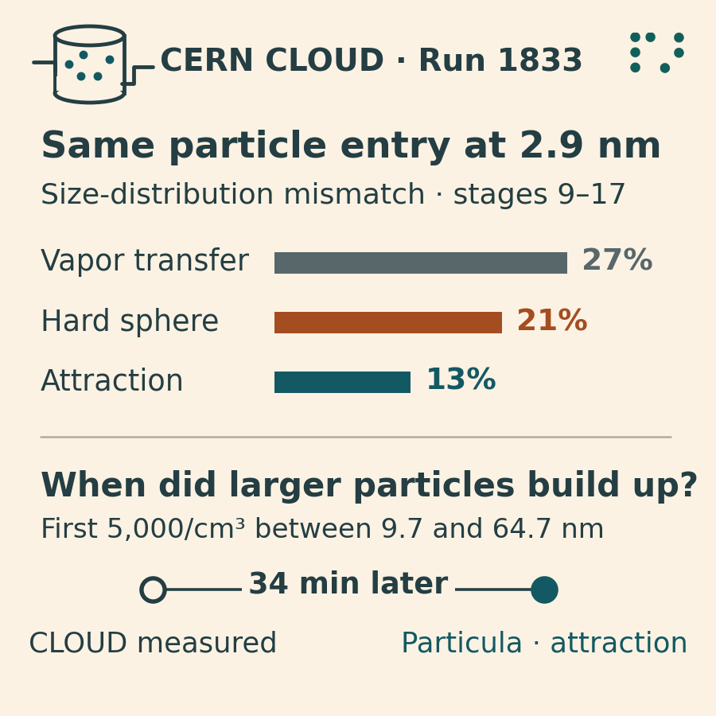
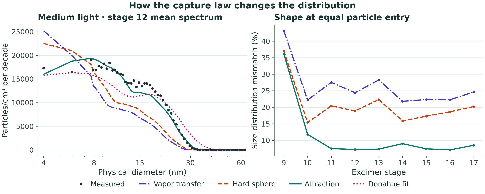
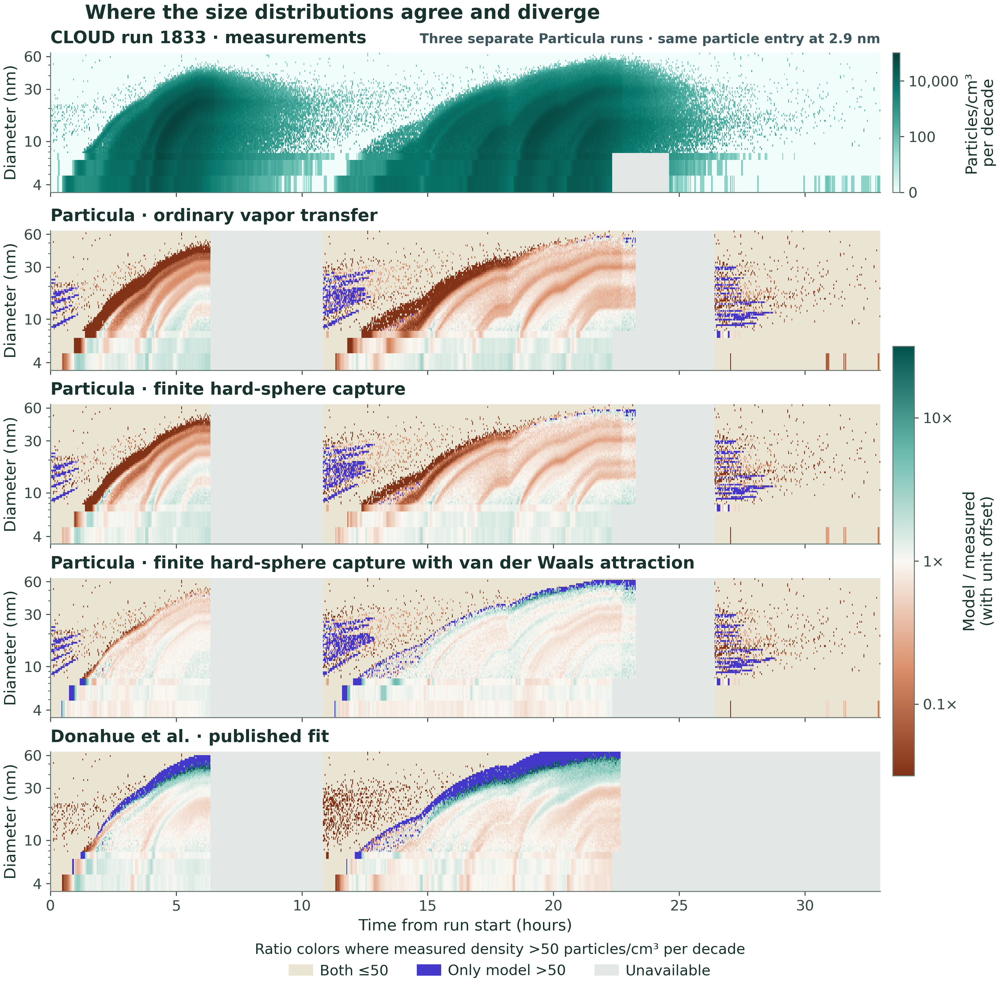
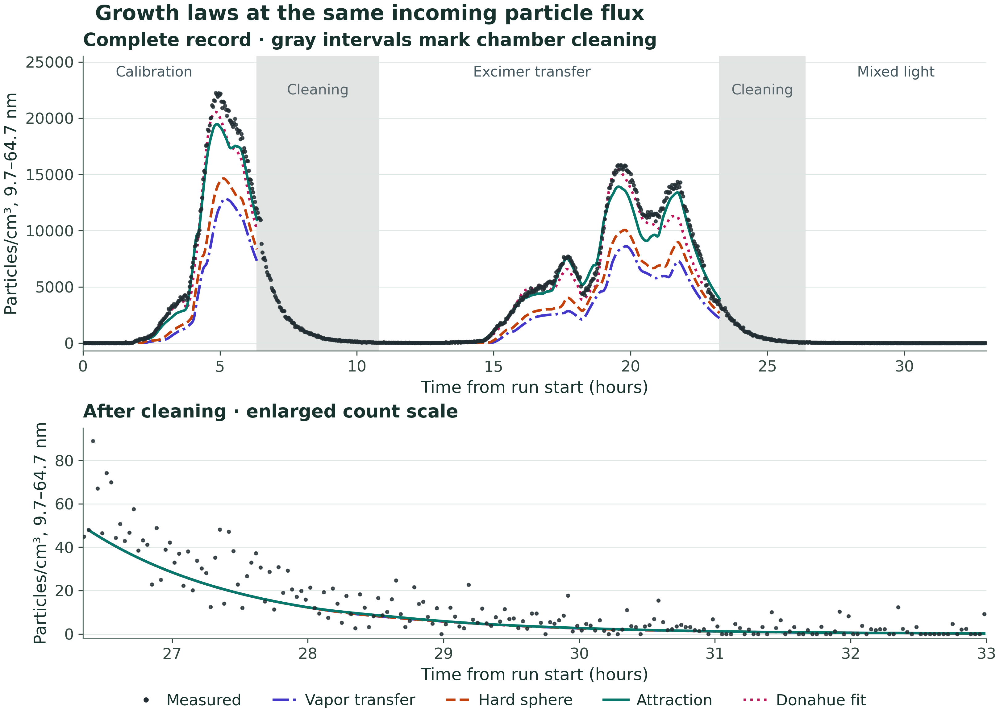

# How sulfuric acid capture shapes particle growth in CLOUD run 1833

During run 1833 in the CLOUD chamber at CERN, changing the lamps changed how much sulfuric acid vapor was available for particles to grow. Donahue and colleagues found that accounting for attraction between acid molecules and particles helped reproduce the measured sizes. We used Particula to ask how much that result depends on the supply of new particles. We selected growth and wall-loss settings under the mercury–xenon lamp, then gave three growth laws the same incoming particles under the excimer lamp. Across nine excimer stages, the fraction of particles that would have to move between size bins to reproduce the observed distribution fell from **27% with ordinary vapor transfer to 21% with finite hard-sphere capture and 13% with attraction**. After chamber cleaning, all three laws predicted nearly the same number of particles above 9.7 nm. During the earlier excimer buildup, the model with attraction came close to the measured peak size but took too long to reach 5,000 particles/cm³ above 9.7 nm. We used a second set of simulations of that same buildup to ask whether water uptake, the arrival of newly formed particles, or losses to the chamber walls could explain the delay. [Original study](https://doi.org/10.5194/amt-19-3363-2026) · [Matched stage results](../../../../studies/cloud-1833/full-transfer/stage-scores.csv)

## What each model learned from the chamber

Donahue et al. stepped the lamp intensity in sulfuric-acid–ammonia air at 297.8 K and 58% relative humidity. They adjusted nucleation coefficients across stages using particle counts and constrained the sulfuric acid calibration using growth and the condensation sink, the rate at which particles remove acid vapor. Their optimized spectra in Figures 9a and 10b provide a demanding published benchmark. In particular, they calibrated particle counts using a counter sensitive to particles smaller than the 9.7 nm cutoff used here. [Donahue et al., §7.3 and Figs. 9–10](https://amt.copernicus.org/articles/19/3363/2026/#section7)

In the Particula comparison, the attractive law fit the earlier mercury–xenon stages 01–07 best at a growth multiplier of 1.1 and a wall-loss multiplier of 0.5 within the calibration grid. A control that fitted each law separately still favored attraction under the second lamp. We froze both settings. Measured sulfuric acid drove growth, and the 2.9 nm channel supplied a common entry flux estimated with the attractive reference law. The post-cleaning segments each began with their measured spectrum. The subsequent bins centered at 4.0–63.5 nm tested how those incoming particles grew and survived. The measured acid series uses Donahue’s calibration, which the authors constrained partly with growth in this run. Both model comparisons therefore share acid calibration information from the excimer period. Particula also uses the estimated inlet and assumed hydrated composition. [Original calibration and alternative fits](../../../../studies/cloud-1833/README.md) · [Frozen comparison design](../../../../studies/cloud-1833/full-transfer/design.md)

## The same particle supply produced three different size distributions

Each Particula run uses one rate for sulfuric acid uptake. Up to 9.7 nm, the collision models use either finite hard-sphere capture or the same collision geometry with van der Waals attraction. Between 9.7 and 19.5 nm, each collision rate blends smoothly into the ordinary vapor-transfer rate. All three use that rate at larger diameters. [Capture calculation](../../../../studies/cloud-1833/source/study.py)

At medium light in stage 12, the median peak across individual spectra was **9.17 nm** in CLOUD. Ordinary vapor transfer placed it at **4.00 nm**, the lowest scored bin. Accounting for the physical size of colliding molecules moved the peak to **7.70 nm**. Adding van der Waals attraction moved it to **9.52 nm**. The left panel shows mean spectra, whereas these peak diameters summarize the individual two-minute samples. The right panel divides each spectrum by its own total number before comparing the size fractions. Attraction improved the shape in every one of the nine stages, even when the three calculations admitted the same flux. [Size and shape controls](../../../../studies/cloud-1833/mechanism.csv)

| Excimer stages 09–17, 327 spectra | Typical spectral error factor | Mean absolute count error, 9.7–64.7 nm |
|---|---:|---:|
| Ordinary vapor transfer | 3.11 | 2,657 particles/cm³ |
| Finite hard-sphere capture | 2.61 | 2,108 particles/cm³ |
| Capture with attraction | 2.16 | 554 particles/cm³ |
| Donahue et al., optimized Figure 10b | 2.35 | 485 particles/cm³ |

An error factor of two means a typical twofold discrepancy in the scored size densities, with a small offset for unresolved signals. Particula with attraction gave the smaller spectral error, while Donahue’s fit followed the integrated larger-particle count more closely. Its 1,000 and 5,000 particles/cm³ crossings were respectively four minutes late and four minutes early. The equal-entry attractive replay was two minutes early and 34 minutes late. A model can grow particles to the right sizes yet place too few of them there at a given time. [Time series and diagnostics](../../../../studies/cloud-1833/full-transfer/matched-series.csv.gz) · [Separate entry comparison](particle-entry.md)

## Where the two lamp sequences expose model error

In the measured panel, dark teal bands track successive growing populations against the light background of lower concentrations. The four model/measured panels show ratios where measured density exceeds 50 particles/cm³ per decade. Teal indicates excess particles, rust a deficit and the neutral midpoint agreement. Sand marks bins where both densities are at or below 50. Indigo flags bins where only the model crosses 50. This display cutoff retains 57% of the excimer size–time bins and over 99.99% of their measured particle number. The full spectra enter the scientific scores. The plotted ratios retain the unit offset. [Unmasked comparison](../../../images/cloud-1833/spectrum-comparison-unmasked.png) · [Cutoff sensitivity](../../../../studies/cloud-1833/full-transfer/threshold-check.csv) Gray marks unavailable comparisons, including chamber cleaning, small-channel outages and times outside the published model output. Each model is matched to the same observed diameter bins. The paper's clock puts the start of the first observed spectrum at 0.02 hours. [Author figure data](https://zenodo.org/records/19695085) · [Spectrum matching](../../../../studies/cloud-1833/full-transfer/compare.py)

The excimer result survived refinement from 192 to 288 size cells with the time-step cap reduced from 12 to 6 seconds. The attractive model’s shape mismatch changed from **12.43% to 12.55%**. Resampling whole stages gave a central 95% range of **1.22–1.66** for the ratio of the ordinary to attractive spectral error factors. This measures sensitivity to which stages of run 1833 are represented. All nine stages share instruments, calibration and the evolving chamber population. [Stage scores](../../../../studies/cloud-1833/full-transfer/stage-scores.csv) · [Stage resampling](../../../../studies/cloud-1833/full-transfer/stage-resampling.json)

## After cleaning, larger-particle counts scarcely distinguish the growth laws

Does the preference for attractive capture persist when few particles are growing? The final lamp sequence offered a test within the same run. During stage 20 the chamber was cleaned. We restarted each model from the first spectrum measured after cleaning and applied the same three growth laws, with their settings fixed. The upper panel places this period in the full 33-hour record. The lower panel enlarges the count scale so that the final hours are visible.

Just before cleaning, during LED stage 19, the small-particle instrument was unavailable, but the instrument covering 9.7–64.7 nm still measured an average of **4,255 particles/cm³**. Ordinary, hard-sphere and attractive capture predicted **2,786, 3,365 and 4,971 particles/cm³**, respectively. Holding the last observed inlet instead of setting missing entry to zero changed the attractive stage mean by less than one particle/cm³. The missing inlet still prevents a complete size-distribution comparison. [Stage 19 results](../../../../studies/cloud-1833/full-transfer/stage-scores.csv)

In the 198 scored mixed-light samples of stages 21–25, the measured tail averaged only **12.5 particles/cm³**. The three models averaged **8.59–8.68 particles/cm³**, with mean absolute errors of **5.16–5.19 particles/cm³**. Their spectral error factors were **2.72, 2.73 and 2.81** in order of increasing collision enhancement. On the 177 samples with a measurable nonzero distribution, attraction still gave the smallest shape mismatch (74% versus 78% for ordinary transfer), but all three missed much of the shape. Raising the offset for small signals from 1 to 10 reduced the three factors to **1.48–1.49**. That narrow spread in predicted counts makes the quiet period a weak test of sulfuric acid capture. Donahue’s archived fitted particle spectra end in stage 18, so the late comparison uses CLOUD measurements and the three Particula runs. [Full late-window comparison](../../../../studies/cloud-1833/full-transfer/stage-scores.csv)

## Why did Particula take too long to build up larger particles?

The earlier excimer buildup offers a sharper test. CLOUD took **98 minutes** to rise from 1,000 to 5,000 particles/cm³ in the 9.7–64.7 nm range. With attraction, Particula reached the first count two minutes early and the second 34 minutes late. In the growth-law comparison we had prescribed the supply at 2.9 nm and held water uptake and wall loss fixed. We varied those assumptions in follow-up simulations to see which could change the buildup while preserving the measured sizes. [Observed and modeled crossings](../../../../studies/cloud-1833/checks.json)

**Water affects the diameter the instrument sees.** A sulfate particle can grow larger by taking up water in the chamber and shrink again if it dries during sizing. We used AIOMFAC to calculate equilibrium water uptake and tested how much water the particles retained during measurement. With wet sizing, hard-sphere capture reached 5,000 particles/cm³ **126 minutes late** and attractive capture reached it **32 minutes late**. Partial drying improved the overall spectrum but delayed that crossing further. [Water uptake and instrument sizing](water-and-sizing.md)

**The arrival of new particles changes the pace of the rise.** In a separate pair of simulations we held the growth physics fixed and supplied the same cumulative number of particles at 2.9 nm through the observed 5,000 crossing. Using entry times inferred from the small-particle measurements gave a **134-minute** rise. Using entry times predicted from cluster formation gave **36 minutes**. Tracking individual simulated clusters showed why their supply could change with the lamp. In the model, 55.5% of stage 11 births reached 2.9 nm, compared with 20.4% under the preceding lower light. Including charge and evaporation improved some small charged-particle counts while leaving a discrepancy in the larger-particle timing. [Particle entry, survival and charge](particle-entry.md)

**Wall losses change how many particles survive long enough to count.** We used the decline in particle counts after the light went out to constrain those losses. Two fits that described the small-particle dark counts nearly equally well placed a later illuminated crossing **26 minutes apart**. Together, these tests support faster acid capture above 2.9 nm and identify the arrival of particles at that size as a consequential uncertainty. An independent measurement of that arrival rate would help distinguish slow growth from a late supply of particles. [Dark decay and wall-loss fits](wall-loss.md) · [Combined mechanism studies](../../../../studies/cloud-1833/FOLLOWUPS.md)

A test of forecast accuracy across experiments would freeze both models before a second run, give them the same initial spectrum and independently constrained acid and inlet, and reserve the later size spectra for scoring. The Donahue public release supplies run 1833 figure data and a reaction list. A second matched chamber record and an executable version of the authors’ calibrated particle model are still needed for that test. [Public release](https://zenodo.org/records/19695085)

## Study resources

The three growth-law simulations used Particula at revision `af0dc67bf7` and the packet’s existing sectional CUDA solver. One calculation comprised a short transport pilot and 24 chamber replays covering three growth laws, two resolutions, both main lamp sequences, the mixed-light sequence and the missing-inlet sensitivity. A clean rebuild repeated all 25 GPU runs and reproduced the eight saved arrays exactly. The largest relative open-chamber number-budget residual was 1.1 × 10⁻¹⁴ or smaller. The independent CPU pilot agreed with the GPU within 2.3 × 10⁻¹³ particles/cm³ per decade. Both executions together took 15.5 seconds in the simulation driver on an NVIDIA GeForce RTX 5060, excluding compilation. [Run record](../../../../studies/cloud-1833/full-transfer/execution.json) · [Verification](../../../../studies/cloud-1833/full-transfer/verification.json) · [Replay and replot instructions](../../../../studies/cloud-1833/README.md)

The [worked comparison](growth_law_comparison.py) shows how to read a saved stage result and reproduce the nine-stage shape comparison. The [simulation and figure guide](../../../../studies/cloud-1833/README.md) traces the results from the authors’ figure archive to the Particula runs, and the [follow-up guide](../../../../studies/cloud-1833/FOLLOWUPS.md) covers the additional experiments.
