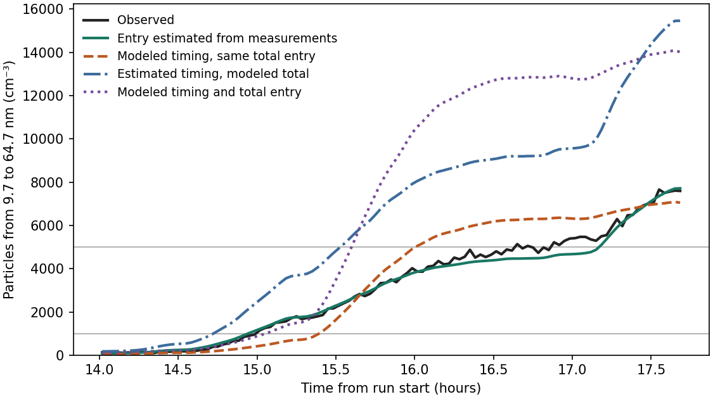

# Changing particle entry timing shortens the simulated rise from 134 to 36 minutes

CERN CLOUD run 1833 took **98 minutes** to rise from 1,000 to 5,000 particles/cm³ between 9.7 and 64.7 nm. The corresponding Particula replay took **134 minutes** with a 2.9 nm entry flux inferred from measurements. Substituting a flux with the time dependence predicted from cluster formation shortened the rise to **36 minutes**, even after scaling it to supply the same total number through the observed 5,000 crossing. The time profile of particle entry can therefore change both crossings while larger particles experience the same growth and loss physics. [Main CLOUD analysis](index.md) · [CLOUD paper](https://doi.org/10.5194/amt-19-3363-2026)

## Exchange the timing and amount of particle supply

The measurement-based entry estimate multiplies measured particle density at 2.9 nm by a reference growth speed calculated from measured sulfuric acid. The alternative model forms molecular clusters, then calculates which survive to 2.9 nm. By the second observed crossing, this alternative supplied 2.13 times as many particles. We exchanged the total and the time profile between the two flux estimates, holding the initial spectrum, wet sizing, sulfuric acid, attractive capture and wall loss fixed. The normalization window ends at an observed threshold, making this a retrospective diagnostic within one run. [Matched simulations](https://github.com/uncscode/particula/blob/main/studies/cloud-1833/entry-timing/comparisons.csv) · [Author data](https://zenodo.org/records/19695085)

The horizontal lines mark 1,000 and 5,000 particles/cm³. CLOUD first reached these levels about 15.02 and 16.65 hours after the start of run 1833.

| Timing of 2.9 nm arrivals | Supply through the observed second crossing | First 1,000 | First 5,000 | Rise time |
|---|---|---:|---:|---:|
| Inferred from measurements | Measurement estimate | 4 min early | 32 min late | 134 min |
| Predicted from formation | Measurement estimate | 24 min late | 38 min early | 36 min |
| Inferred from measurements | Formation estimate | 16 min early | 66 min early | 48 min |
| Predicted from formation | Formation estimate | 4 min late | 62 min early | 32 min |

Increasing supply at the original times moved both crossings earlier. Redistributing the original supply in time delayed the first crossing and advanced the second. Two alternative prescribed acid histories also gave a 36-minute rise with predicted entry timing at equal supply. The data constrain the combination of birth rate, sub-2.9 nm growth and loss that creates this influx. [All gas histories and both grids](https://github.com/uncscode/particula/blob/main/studies/cloud-1833/entry-timing/comparisons.csv)

## Follow a simulated cluster from birth to 2.9 nm

In a separate particle-resolved experiment, 64 independent boxes followed individual clusters born near 0.8 nm. Of the simulated stage 10 births under low light, **20.4%** reached 2.9 nm. The median transit among survivors was **17.5 minutes**. Under medium light in stage 11, **55.5%** survived and the median transit was **6.5 minutes**. Both the acid concentration and active birth pathways differed between the stages. These are modeled cohort histories; the observed larger-particle spectra test their combined consequence. Holding both formation and early growth at the preceding acid concentration reproduced a 98-minute rise, but both crossings then came 132 minutes late. [Cohort survival and transit](https://github.com/uncscode/particula/blob/main/studies/cloud-1833/particle-resolved/cohorts.csv)

Additional simulations tracked charge, acid loss and ammonia exchange. Starting exchange from one sulfate left too few survivors to reach 5,000 particles/cm³. Assigning the same neutral births to clusters initially containing four sulfates and four ammonias reproduced the observed peak count within 1%, yet gave a 200-minute rise. Other charge and source choices improved the small signed counts and still gave rises of only 48–54 minutes under refinement. An independent flux measurement at 2.9 nm would separate arrival timing from the subsequent growth and loss of those particles. [Charge and exchange comparisons](https://github.com/uncscode/particula/blob/main/studies/cloud-1833/ammonia-sequence/comparison.csv) · [Wall-loss experiment](wall-loss.md)
