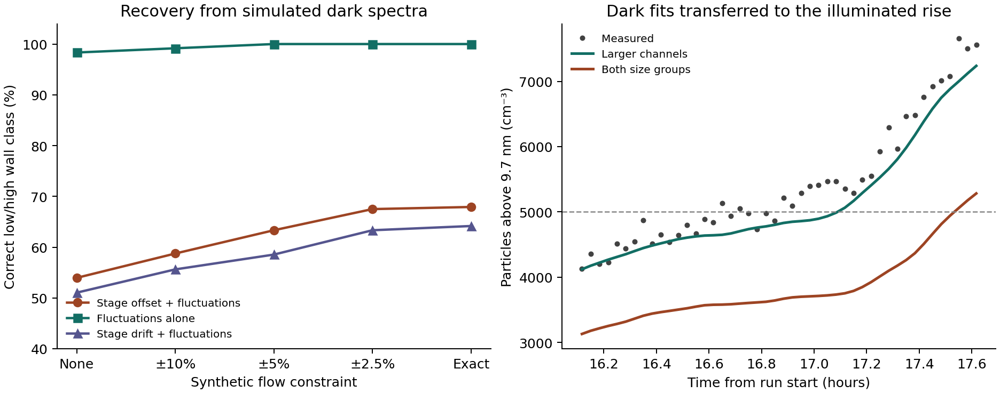

# Similar dark particle counts admit different wall-loss rates

When a CLOUD chamber lamp goes dark, particles continue to grow, collide, leave with the outflow and deposit on the walls. During the final dark stage of run 1833, **48.8%** of the initial population between 9.7 and 64.7 nm remained. Two Particula fits that reproduced the small-particle dark spectra almost equally well placed the 5,000 particles/cm³ crossing **26 minutes apart** when replayed under illumination. The decay constrains total disappearance more tightly than it separates deposition from growth and dilution. [Main CLOUD analysis](index.md) · [CLOUD experiment](https://doi.org/10.5194/amt-19-3363-2026)

## Fit the size dependence using four dark periods

The model followed particles above 5 nm with an inlet inferred from the neighboring measured size channels. We used Particula’s wall-loss law, in which Brownian diffusivity depends on particle diameter and the fitted near-wall eddy parameter controls transport strength. This parameter is expressed in s⁻¹. The resulting deposition rate also depends on diameter and chamber geometry. A square cross section with the cylinder’s diameter and effective height matched the sidewall and floor areas per unit volume of the idealized CLOUD chamber. The nominal dilution rate in the authors’ gas budget corresponds to a residence time of about 95 minutes. [CLOUD chamber geometry](https://doi.org/10.5194/acp-12-2205-2012) · [Run 1833 figure archive](https://zenodo.org/records/19695085)

We withheld one of four dark stages at a time, fitted the other three, and scored the withheld stage from its measured first spectrum. The timing columns below come from a separate uninterrupted illuminated replay using settings fitted on all four dark stages. Both fits kept dilution at the authors’ nominal value and allowed growth below 9.7 nm to vary. The two-minute observations define the crossing times. [Held-stage and transfer results](https://github.com/uncscode/particula/blob/main/studies/cloud-1833/recovery-four/04-held-transfer.csv)

| Channels used in fit | Dark error factor, 7.7–9.52 nm | Fitted eddy parameter | Growth below 9.7 nm | First 1,000 / 5,000 particles/cm³ |
|---|---:|---:|---:|---|
| Larger channels, 9.9–63.5 nm | 1.181 | 0.065 s⁻¹ | Nominal | On time / 28 min late |
| Equal weight to smaller and larger channels | 1.180 | 0.150 s⁻¹ | 15% slower | 12 / 54 min late |

The fits predicted final dark retention of 48.2% and 45.1%, respectively. Increasing the influence of the smaller channels barely changed their average dark error but increased the inferred wall transport and delayed the illuminated rise. Both the diameter range and the assumed growth rate matter when estimating wall loss from particle disappearance. [Fitted rates and illuminated predictions](https://github.com/uncscode/particula/blob/main/studies/cloud-1833/recovery-four/04-held-transfer.csv)

The left panel shows simulated recovery tests. The right panel compares two fitted models with CLOUD’s measured counts. The time axis gives hours from the start of run 1833.

## Test whether a known wall rate can be recovered

We generated synthetic records with weak or strong wall transport (0.05 or 0.15 s⁻¹), three dilution rates, the original sampling times and the small-channel outages. A finer grid generated the records than the one used to fit them. With short-term correlated fluctuations alone, the fits identified the correct wall regime in 99% and 98% of records, respectively. Adding a stage-wide discrepancy of the size seen in the chamber comparison reduced recovery to **53% and 55%**, across 240 realizations per wall rate. Even when the synthetic dilution was known exactly, recovery reached only **71% and 65%**. These percentages quantify sensitivity to the imposed error pattern. The actual run provides one chamber history and no independent flow-precision estimate. [Recovery results by error structure](https://github.com/uncscode/particula/blob/main/studies/cloud-1833/recovery-four/classification-summary.csv)

An independent constraint on arrival near 5 nm or on growth between 5 and 10 nm would reduce the freedom to trade slower growth against stronger deposition. Under the two dark-compatible fits, the clearest test is whether the illuminated particles arrive at the larger sizes on time. [Particle entry and survival](particle-entry.md)
