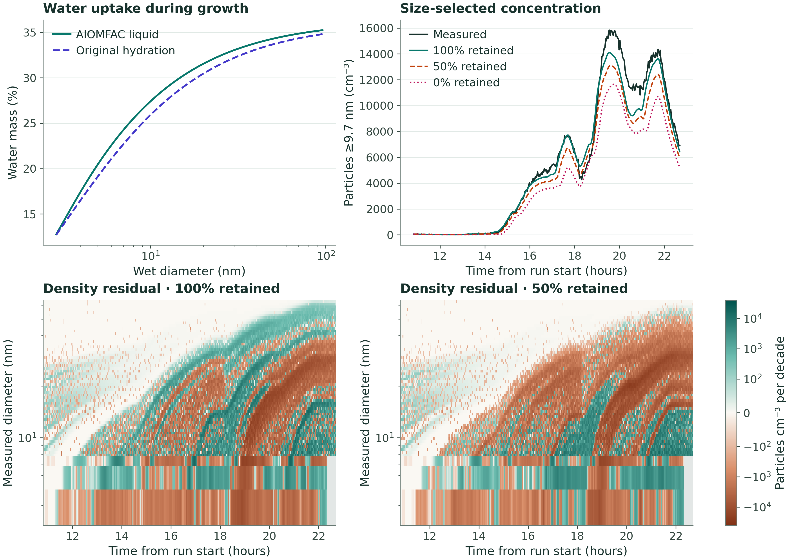

# Water uptake changes the measured diameter, but the larger particles still accumulate late

A particle can cross an instrument’s size threshold by taking up water in the chamber, then fall below that threshold if it dries during sampling. In CERN CLOUD run 1833, Particula with attractive sulfuric acid capture and equilibrium water uptake reached 5,000 particles/cm³ in the 9.7–64.7 nm interval **32 minutes late** when sized wet. Retaining half the excess wet volume during sizing improved the overall spectrum but delayed the same crossing to **42 minutes late**. The measured size distribution constrains where the particles appear across sizes. The crossing time constrains how quickly the larger population accumulates. [Main CLOUD analysis](index.md) · [Donahue et al., run 1833](https://doi.org/10.5194/amt-19-3363-2026)

## What does each particle carry into the instrument?

Donahue et al. measured the experiment at 297.8 K and 58% relative humidity. For each size class we used AIOMFAC to calculate water uptake by neutral ammonium sulfate as more acid and ammonia condensed. Curvature lowers the equilibrium water content most strongly at small sizes. Wet diameter governed acid capture, particle collisions and wall loss. When mapping the same chamber population into measurement bins, we retained all, half or none of the excess volume supplied by water. The mapping conserved dry solute and particle number. For example, a simulated 9.7 nm wet particle shrank to 7.97 nm under fully dried sizing. The actual water retained during measurement is uncertain. [Author measurements](https://zenodo.org/records/19695085) · [AIOMFAC comparison](https://github.com/uncscode/particula/blob/main/studies/cloud-1833/activity/scores.csv)

The upper right panel applies three sizing treatments to the attractive-capture replay. The lower panels show excess predicted particles in teal and deficits in rust. The time axes show hours from the start of run 1833.

## Wet sizing and partially dried sizing favor different diagnostics

Each row uses the same measured acid history and inferred 2.9 nm particle entry. The spectral factor summarizes the typical discrepancy across 327 two-minute spectra in nine excimer stages. A factor of one is exact agreement. Crossing times are relative to the first measured sample at each concentration. [Simulation scores](https://github.com/uncscode/particula/blob/main/studies/cloud-1833/activity/scores.csv)

| Capture and measurement | Spectral error factor | 1,000 particles/cm³ | 5,000 particles/cm³ |
|---|---:|---:|---:|
| Hard sphere, wet | 2.53 | 22 min late | 126 min late |
| Attractive, wet | 2.23 | 4 min early | 32 min late |
| Attractive, half retained | 2.08 | 4 min late | 42 min late |
| Attractive, fully dried | 2.69 | 14 min late | 58 min late |

The wet attractive model reproduced a stage 12 median peak diameter of 9.90 nm against 9.17 nm measured. Half retention shifted the peak to 8.84 nm, closer to the measurement, while reducing the count above 9.7 nm to **4,596 particles/cm³** against **5,583 measured**. An acid-rich sensitivity with 1.5 ammonia molecules per sulfate placed the peak at 9.17 nm but reached 5,000 particles/cm³ **38 minutes late**. A close match to the peak alone leaves both composition and instrument drying unresolved. [Acid-rich simulations](https://github.com/uncscode/particula/blob/main/studies/cloud-1833/activity/acidic-scores.csv)

Independent droplet data constrain the water calculation over part of the simulated range. For 24 Tang measurements the mean absolute water-activity error was 0.0055 using the originally reported molalities. The available levitated-droplet measurements extend down to a water activity of 0.371, whereas the calculated value at 2.9 nm was 0.262. This extrapolation affects the earliest growth. Across the scored sizes, increasing resolution from 192 to 288 cells preserved the ordering of the three attractive sizing scenarios. The remaining timing error motivates testing the supply of particles at 2.9 nm. [Droplet comparison](https://github.com/uncscode/particula/blob/main/studies/cloud-1833/activity/reference/comparison.json) · [Cheng et al., water activity](https://doi.org/10.1038/ncomms6923) · [Particle entry and survival](particle-entry.md)
