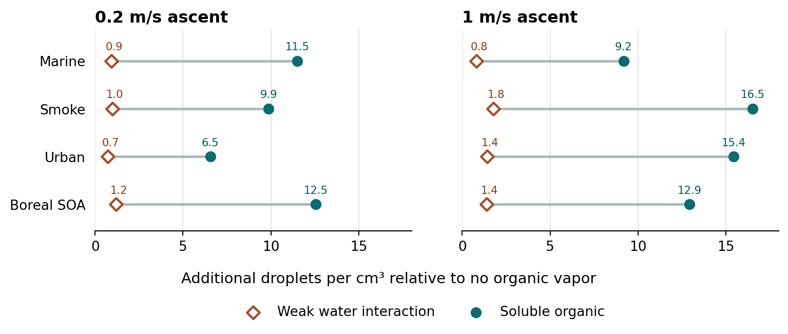

# How do competing particles and condensable organics change the droplet count?

At +100 m in eight rising-parcel scenarios, replacing pure citric-acid seeds with the two surfactant recipes changed the estimated total by less than 0.31 droplets/cm³. Adding 1 µg/m³ of a soluble organic vapor to the same particle populations increased it by 6.5–16.5 droplets/cm³. Both effects involve the same water supply, but the added vapor can alter water uptake across the entire population.

## Which particles share the vapor?

Each row gives the model inputs for a background aerosol. Published marine, smoke, urban and boreal size spectra motivated these choices. The background label describes a population competing for vapor in the parcel. For example, the marine case tests onshore aerosol, while sea-breeze circulation and coarse sea spray would require additional inputs.

| Background | Number in each mode (cm⁻³) | Median dry diameter (nm) | Geometric standard deviation | Assumed hygroscopicity κ |
|---|---|---|---|---|
| Marine | 180 / 120 | 45 / 150 | 1.50 / 1.50 | 0.60 / 0.60 |
| Diluted smoke | 1,500 | 150 | 1.65 | 0.12 |
| Urban | 6,000 / 1,000 | 45 / 150 | 1.60 / 1.60 | 0.20 / 0.30 |
| Boreal, rich in secondary organic aerosol | 1,160 / 830 | 44 / 154 | 1.50 / 1.50 | 0.10 / 0.15 |

Smoke supplies fewer, larger particles than the urban mixture. Integrating the lognormal dry spectra gives nearly the same surface area per volume of air for the two populations, 175 and 169 µm²/cm³ respectively. Their water demands differ as particles grow. The simulations use the same 300 target seeds/cm³ in both environments. [Marine size distributions](https://doi.org/10.1029/2002JD002533) · [Amazon smoke](https://doi.org/10.5194/acp-18-10289-2018) · [Helsinki urban distributions](https://doi.org/10.5194/acp-4-391-2004) · [BIOFOR boreal observations](https://doi.org/10.3402/tellusb.v53i4.17127)

## How much does the condensed organic help particles activate?

We compared each parcel with a matching run that had no added organic vapor. The two surrogate organics had the same supplied mass, reference saturation concentration (10 µg/m³ at 298.15 K) and mass accommodation coefficient (0.5). The soluble surrogate could partition into all the liquid water and contributed one osmole per mole dissolved. The weakly water-interacting surrogate could access 0.1% of the water and contributed one tenth as many osmoles per condensed mole. Both added volume as they condensed. Neither was assigned an additional surfactant effect.

*Change in activated droplets per cm³ at +100 m relative to the same seeds and background without the added organic. Each parcel exchanged 5% of its dry-air mass with 90%-RH air at +50 m. With the weakly water-interacting surrogate, more than 99.7% of the organic mass condensed by this height, yet it added only 0.7–1.8 droplets/cm³. Both surrogates gave their smallest count gain in weak urban ascent and their largest in smoke at 1 m/s. Because water access and osmotic contribution changed together, the comparison gives their combined effect.*

The common vapor supply lets a soluble organic change the water activity of many particles at once. In field-constrained boreal parcel simulations, Heikkinen and colleagues also found that the vapor available for uptake before cloud base mattered. Our perturbation starts at cloud base with a specified vapor inventory. A field application would need gas concentrations, volatility, solubility and the time available before saturation. [Heikkinen et al., boreal co-condensation](https://acp.copernicus.org/articles/24/5117/2024/)

## What happens when smoke particles of the same size differ in composition?

In a separate particle-resolved comparison, a closed parcel rose at 1 m/s with the two target recipes, smoke and 1 µg/m³ of soluble organic vapor. We paired smoke particles at each sampled diameter. In the control they had identical κ. In the perturbation one became more hygroscopic and the other less hygroscopic by the same amount. The mean κ at each size, particle number and dry volume stayed fixed.

Across 32 paired realizations at the refined resolution, this imposed composition spread reduced the total by about **48 droplets/cm³**. Droplets on smoke particles decreased by 51.64/cm³. Droplets on octyl and dodecyl seeds increased by 1.97 and 1.93/cm³, respectively, giving a net loss of 47.73/cm³. This comparison suggests why measurements of droplet residual composition and of the incoming size distribution would help distinguish competition from a true increase in cloud droplet number. [Main study](index.md) · [Reproduction](reproduction.md)
