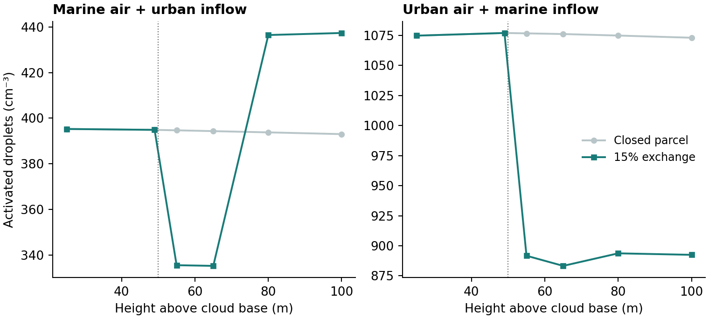
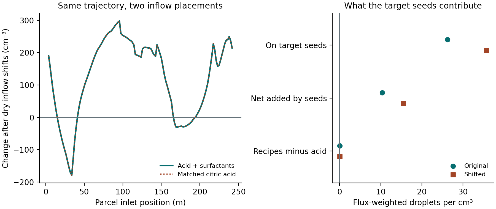

# Which particles account for the 89 extra droplets at the smoke-cloud edge?

Moving an intrusion of dry air across a simulated smoke-cloud edge increased the mean droplet count by 89.0/cm³ at 100 m above cloud base. The increase occurred chiefly on smoke particles already in the cloud. Replacing the surfactant-bearing particles with equally numerous citric-acid particles of the same dry sizes preserved the increase to the reported precision. Counting droplets by seed identity and repeating the trajectories with altered chemistry reveal what the surfactant-bearing seeds actually contributed.

## A sampler near the mixing level can miss later activation

In one coastal scenario, a marine parcel rising at 1 m/s exchanged 15% of its dry-air mass with urban-influenced air at 50 m above cloud base. The count fell from 395 droplets/cm³ at +49 m to 335.5 at +55 m. Most of this early decline followed from dilution. At +55 m, none of the incoming urban particles qualified as cloud droplets under the five-second critical-radius criterion. By +100 m, 103 droplets/cm³ had formed on those particles. The total reached 437/cm³, exceeding the closed marine parcel's 393/cm³ even though fewer of the original particles remained activated.

*The dots are concentrations of activated droplets per physical cm³ of parcel air. The vertical line marks the single 15% exchange. In the reverse case, urban air receiving marine particles reached 892.5 droplets/cm³ at +100 m, below its closed control of 1,073/cm³. An observation taken immediately after mixing would mainly record the initial loss.*

## Which part of the eddy encounters the driest air?

For the smoke calculation we released parcels at 128 positions across a prescribed two-dimensional velocity field. Each parcel began with 1,500 resident smoke particles/cm³, 150 seeds/cm³ of each surfactant recipe and 1 µg/m³ of available condensable organic vapor. At +50 m it entrained outside air carrying fresh smoke. Along the mixing layer, the exchange fraction varied from 4% to 16% of the parcel dry-air mass and the environmental RH from 84% to 96%. The strongest exchange coincided with the driest air.

We shifted that humidity and exchange pattern by half a wavelength while preserving the flow, incoming aerosol and horizontal means. Faster-rising parcels and slower-rising parcels then sampled different drying histories. The fraction of entrained air encountered by the incoming air flux averaged 9.3% in one placement and 10.7% in the other. Each entry in the table weights the parcels by their upward air flux at cloud base and counts droplets at their first crossing of +100 m. These two placements are controlled scenarios within a prescribed flow. Field concentrations along a real cloud edge depend on its measured inflow and air motion.

| Target particles carried with the resident smoke | Original dry inflow (cm⁻³) | Shifted dry inflow (cm⁻³) | Change (cm⁻³) |
|---|---:|---:|---:|
| No target particles | 342.04 | 425.88 | +83.84 |
| Pure citric acid, size and number matched | 352.34 | 441.34 | +89.01 |
| Octyl and dodecyl recipes with dilution and finite adsorption | 352.38 | 441.39 | +89.01 |
| Same recipes with their 70%-RH tensions held fixed | 327.34 | 394.06 | +66.72 |

With finite adsorption the count rose on 99 trajectories and fell on 29. Of the 89.0/cm³ mean gain, 66.2 formed on resident smoke, 13.4 on incoming smoke and 9.4 on the two surfactant-bearing populations. Removing the target population showed that its presence contributed a net 10.3 droplets/cm³ at the original inflow and 15.5/cm³ after the shift. The 9.4 counts surplus droplets formed on target seeds after the shift. The 10.3 and 15.5 include the response of the smoke population to adding the seeds at each inflow position.

*Left, the matched acid and finite-surfactant responses nearly overlap as the inlet position varies. Right, the number activating on target seeds exceeds their net addition to the parcel because some background particles lose droplets. The residual change from replacing pure acid with the surfactant recipes is close to zero at both placements.*

## What does the numerical comparison resolve?

We estimated the contribution of surfactant chemistry to the *response to moving the inflow* by subtracting the matched-acid response from the finite-surfactant response. The estimated difference was **+0.0033 droplets/cm³** across all 128 positions. To test the numerical precision of this subtraction, we selected the same 16 positions in both placements, halved the time step and refined both the dry-size and thermodynamic grids. The estimate changed from −0.0065 to +0.0216/cm³. The combined full widths of the activation cutoffs were 0.65/cm³ for the primary comparison and 0.32/cm³ for the finer subset. The sign of this chemistry contribution is unresolved.

Holding the 70%-RH laboratory tensions fixed through cloud growth had a larger consequence. It assigned about 154–156 additional droplets/cm³ to the target seeds compared with finite adsorption, suppressed activation on smoke, and reduced the flux-weighted response to moving the intrusion by **22.3/cm³**. On the 16 matched trajectories, that reduction remained 17.4/cm³ at the original resolution and 17.3/cm³ after refinement. Measuring which chemicals remain when activated droplets evaporate, together with aerosol size, humidity and vertical velocity at several heights, could test such a redistribution even where the total number changed little. The original measurements constrain recipe tensions below saturation. Cloud-edge droplet counts and seed identities on these trajectories are model predictions. [Shahabadi et al.](https://doi.org/10.5194/acp-25-14301-2025)

[Return to the study](index.md) · [Surfactant supply and activation thresholds](molecule-budget.md) · [Data, numerical checks and reproduction](reproduction.md)
