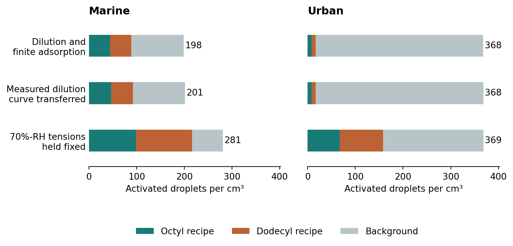

# Two surfactants lower surface tension yet scarcely change droplet counts at a simulated smoke-cloud edge

A tenfold smaller molar dose of sodium dodecyl sulfate lowered the surface tension of a micrometre citric-acid droplet more than sodium octyl sulfate did. Would the stronger surfactant also produce more cloud droplets? We followed both recipes into simulated rising air, where condensing water diluted their contents and neighboring particles competed for the same vapor. In weak marine ascent, 89 droplets/cm³ formed on the added seeds. The seeds raised total droplet number by 80/cm³, and the surfactants accounted for an estimated 0.20/cm³ relative to the same number of pure citric-acid seeds. At a simulated smoke-cloud edge, shifting the position of a dry-air intrusion increased droplet number by **89.0/cm³** with either the surfactant recipes or matched acid. Holding surface tension at the values measured in concentrated droplets throughout growth gave **66.7/cm³**. The treatment of dilution changed the predicted response to dry air and the identities of the seeds that activated. [Shahabadi et al., original measurements](https://doi.org/10.5194/acp-25-14301-2025)

*The symbols show surfactant molecules schematically, with the sulfate heads in the droplet and the alkyl tails pointing into the air. The same symbol marks both surfactant treatments below. The bars show the change in droplet number 100 m above cloud base when the dry inflow moves. The two seed recipes compete in the same parcel. Each response is the difference between inlet-flux-weighted means for the two placements.*

## Why a better surfactant can lose its advantage as a seed grows

At 70% relative humidity (RH), Shahabadi and colleagues measured surface tensions of **64.4 ± 0.6 mN/m** for citric acid alone, **41.8 ± 0.7 mN/m** for one octyl sulfate per 100 acid molecules, and **36.5 ± 0.5 mN/m** for one dodecyl sulfate per 1,000. The trapped drops were 5–10 µm across. Despite their different tensions, the two mixtures grew by nearly the same factor as humidity increased. The authors suggested that interactions with citric acid could favor adsorption. The measurements leave open how many surfactant molecules occupied the interface at each tension. [Figures 5–6 and experimental methods](https://acp.copernicus.org/articles/25/14301/2025/)

At a given composition, halving the diameter halves the available surfactant per unit surface area. A 100 nm **wet** droplet at the estimated 70%-RH composition contains only about 1,640 dodecyl sulfate formula units. Condensation during ascent spreads that inventory over an expanding surface. We used the measured tension and growth curves to calculate how a finite supply could affect activation across dry sizes. Several adsorption assumptions reproduced the micrometre measurements and predicted different rankings in smaller seeds. [Can a small seed sustain the measured surface tension?](molecule-budget.md)

## How many extra droplets did the seeds produce?

In the rising-parcel experiments, 150 particles/cm³ of each recipe shared the same air with a background aerosol. The two target populations had the same dry-size distribution, centered on a median diameter of 100 nm. All particles exchanged water and a soluble organic vapor with their surroundings. At 100 m above cloud base, we counted particles whose wet radii exceeded their composition-dependent critical radii at every half-second sample over the preceding five seconds. The background, airflow and organic vapor supply were specified scenarios.

In marine air rising at 0.2 m/s, three comparisons answer different questions about the same endpoint.

| Comparison | Estimated droplets/cm³ | What the count measures |
|---|---:|---|
| Count droplets formed on the two surfactant-bearing seed populations | 89 | Activated droplets with those seed identities |
| Add these seeds to the background aerosol | +80 | Net gain after about nine fewer background particles activated |
| Replace 300 size-matched citric-acid seeds with the two surfactant recipes | +0.20 | Effect of changing seed chemistry at fixed particle supply |

Across marine, diluted smoke, urban and boreal organic aerosol backgrounds at 0.2 and 1 m/s, the estimated differences from matched acid were all below 0.31 droplets/cm³. Several approached the numerical uncertainty in the activation cutoff. In the central calculations, octyl seeds produced slightly more droplets than dodecyl seeds. Other adsorption assumptions compatible with the source data reversed that ranking. In the same four backgrounds, a soluble organic vapor increased the total by 6.5–16.5 droplets/cm³. [Competing particles and organic co-condensation](backgrounds.md)

*Simulated counts at 100 m in a 0.2 m/s ascent with 1 µg/m³ of available organic vapor and a 5% exchange with 90%-RH air. In urban air, the finite-adsorption calculation produced 16.5 droplets/cm³ on surfactant-bearing seeds. Transferring the measured dilution curve directly gave 17.0. Holding the 70%-RH tensions fixed gave 158.2. The total changed from 368.0 with finite adsorption to 368.5 with fixed tensions because nearly as many background particles lost their opportunity to activate.*

Six fluctuating updrafts carried the same urban aerosol through a net ascent of 100 m at a mean of 0.2 m/s. The total ranged from **277 to 402 droplets/cm³**. In all six trajectories the central model still produced slightly fewer droplets on dodecyl than on octyl seeds, by 0.044–0.087/cm³. Across all four backgrounds each tested adsorption relation retained its own ranking as the updraft varied. Measuring adsorption in the actual mixtures would help establish which ranking applies.

## Where dry air enters changes which droplets survive

Along 128 trajectories in a prescribed smoke-cloud flow, shifting the dry inflow raised the flux-weighted mean from 352.4 to 441.4 droplets/cm³. Replacing the surfactant recipes with matched acid preserved the 89.0/cm³ increase to the reported precision. With the target seeds removed entirely, the shift still added 83.8/cm³. Holding the concentrated tensions fixed reduced the response by 22.3/cm³ and assigned roughly 154–156 extra droplets/cm³ to target seeds, depending on the inflow position. The estimated contribution of surfactant chemistry to the response to moving the inflow changed sign under numerical refinement. The simulations resolve the effect of carrying low tension through dilution much more clearly. [Which particles account for the 89 extra droplets at the smoke-cloud edge?](cloud-edge.md)

## What would distinguish the two recipes in air?

Other aerosols can sustain a larger surface-tension effect. Ovadnevaite and colleagues found marine observations consistent with enhanced activation and proposed an organic-rich surface phase on hygroscopic cores. Lowe and colleagues found that the response to surface-active organics also depends on the background size spectrum and updraft. Here the surfactant begins as a trace constituent of a soluble acid seed. When the model supplied just three target seeds/cm³ in the broad size distributions, the central count difference between recipes stayed below 0.004/cm³. Their ambient abundance, adsorption during dilution, and share of particles near the local activation cutoff would all need independent constraints before estimating a real cloud response. [Ovadnevaite et al.](https://doi.org/10.1038/nature22806) · [Lowe et al.](https://doi.org/10.1038/s41467-019-12982-0)

A direct test would expose size-selected acid, octyl and dodecyl particles to the same supersaturation history. Measuring the activated fraction by recipe alongside the total would reveal whether one population gained droplets at the expense of another. In a cloud-edge transect, the corresponding observations would be the incoming size distribution, the chemical composition of dried droplet residuals, humidity and vertical velocity at successive heights. These calculations address activation and survival through the first 100 m. Radiative effects also depend on droplet sizes, liquid-water distribution, cloud depth and how often such particles reach cloud base.
