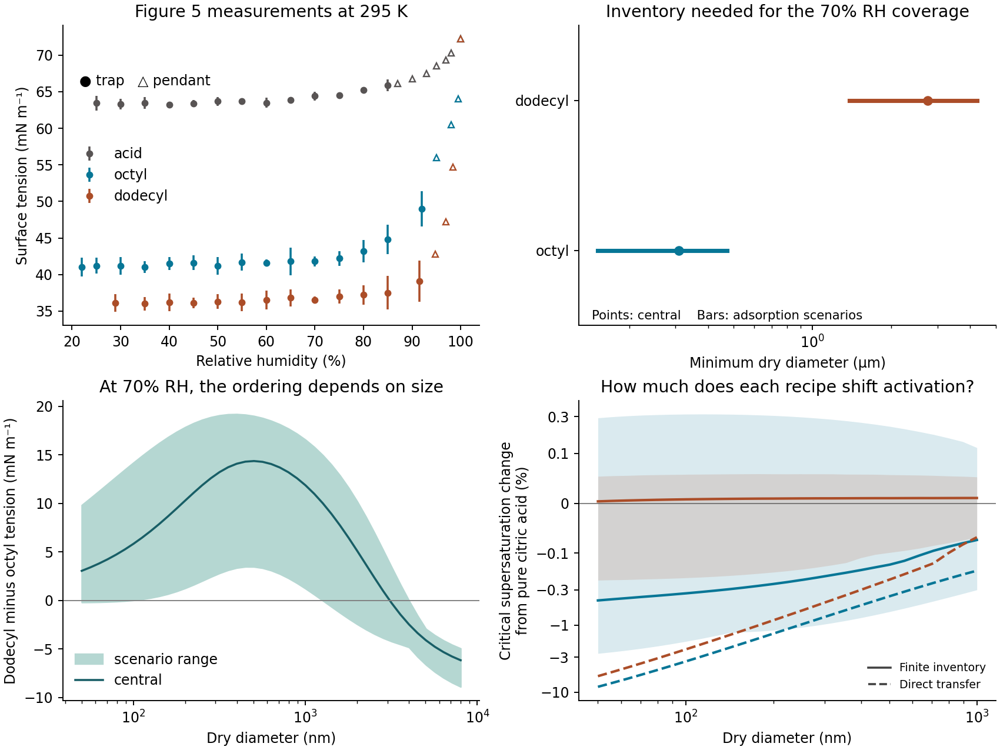

# Can a small seed sustain the measured surface tension?

A drop can run short of surfactant even when its recipe has exactly the same molar ratio as a larger drop. In Shahabadi and colleagues’ trapped droplets, the dodecyl recipe gave a surface tension 5.3 mN/m below the octyl recipe at 70% RH. Reproducing that difference on a much smaller particle requires both enough surfactant to populate the interface and a relation between surface coverage and tension that remains applicable as the drop dilutes. The data constrain those requirements to different degrees. [Original measurements](https://doi.org/10.5194/acp-25-14301-2025)

## How many molecules can reach the surface?

For a spherical wet drop of diameter $D_w$, the ratio of volume to area is $D_w/6$. If its total surfactant concentration is $C_s$ in mol/m³, the upper limit on surface excess is $C_sD_w/6$ in mol/m². This limit assigns every surfactant molecule to the interface. Any surfactant remaining dissolved lowers the available coverage.

The source paper’s Figure 5 gives an approximate citric-acid concentration of 5.2 mol/L at 70% RH. At that composition, a 100 nm **wet** droplet contains about 1,640 dodecyl sulfate formula units for the 1,000:1 acid-to-surfactant recipe. Its maximum coverage is **0.086 µmol/m²**. At the 100:1 octyl ratio, the same drop contains about 16,400 formula units and could supply **0.86 µmol/m²**. A 5 µm wet dodecyl drop could supply 4.3 µmol/m². The geometric ceilings depend only on molecule supply, diameter and the assumed solution concentration. Connecting an observed tension to a particular coverage requires information on adsorption in that mixture. [Shahabadi et al., Figure 5 and concentration axis](https://acp.copernicus.org/articles/25/14301/2025/)

*The upper-left panel reproduces the reported trapped- and bulk-drop tensions and distinguishes the measurement methods. The lower-right panel gives the percentage change in critical supersaturation relative to pure acid at the same dry size. Solid curves account for finite adsorption. Dashed curves transfer the measured dilution relationship directly. The shaded ranges span the tested finite-inventory assumptions. They describe model sensitivity.*

## Where does an adsorption model put the size limit?

For each recipe we conserved the total surfactant as dissolved molecules plus adsorbed molecules. We used a saturating relation between dissolved concentration and adsorbed amount, and adjusted the relation between coverage and tension along the measured recipe curve. The growth data constrain how much water enters the solution. Shahabadi et al. referenced growth to the size near 10% RH, so we tested how the result changed with the assumed residual water there. Independent experiments have found finite-volume effects for dodecyl sulfate with glutaric acid and salts. The relevant adsorption relation for octyl and dodecyl sulfate across this citric-acid dilution series remains unknown. [Shahabadi et al., Figures 5–6](https://doi.org/10.5194/acp-25-14301-2025) · [Bain et al., ionic surfactant partitioning](https://doi.org/10.5194/acp-25-5633-2025)

At 70% RH, our central model assigned the micrometre droplets surface excesses of 3.16 µmol/m² for octyl and 2.84 µmol/m² for dodecyl. Sustaining those **specific coverages** would require dry diameters of at least **0.31 µm for octyl** and **2.75 µm for dodecyl**, even if all the surfactant adsorbed. Varying the adsorption parameters moved those limits to 0.15–0.47 µm and 1.38–4.24 µm, respectively. The sizes refer to the dry seed at the specified hydration. At 100 nm dry diameter the central model predicted 57.4 mN/m for octyl and 63.3 mN/m for dodecyl at 70% ambient RH, reversing the micrometre ordering. The central model put the tension crossover at **3.10 µm dry diameter**. Varying adsorption alone moved it to 2.19–3.91 µm. Changing the relation between coverage and surface pressure could also change which recipe had lower tension at 50 nm.

## What the dilute endpoint permits

The last pendant-drop datum before pure water occurs at a different humidity for each recipe. At 98.41% RH, dodecyl measured 54.71 mN/m. The adjacent octyl measurements bracket it from above at 60.5–64.0 mN/m, assuming tension increases monotonically with dilution. At 99.5% RH, octyl measured 64.0 mN/m. Dodecyl could lie anywhere between 54.71 and the 72.2 mN/m water endpoint under the same monotonicity assumption. Thus the sign of the difference is already unresolved by the measured dilution curves at 99.5% RH. These brackets use tabulated values and exclude measurement uncertainty that the workbook did not report for pendant drops. [Publisher’s numerical supplement, Figure 5 worksheet](https://acp.copernicus.org/articles/25/14301/2025/acp-25-14301-2025-supplement.zip)

At 295 K the central critical supersaturation for a 100 nm dry seed was 0.23972% for pure acid, 0.23891% for octyl and 0.23974% for dodecyl. Other adsorption assumptions that reproduced the laboratory measurements changed the dodecyl-minus-octyl difference from +0.00435 to −0.00126 percentage points. A size-selected activation measurement could distinguish the recipes where they diverge most. In weak marine ascent, centering a narrow seed population (geometric standard deviation 1.08) on 130 nm dry diameter gave 1.31 fewer dodecyl droplets/cm³ than octyl droplets/cm³ in the refined central calculation. Two alternative adsorption relations gave 6.00 fewer or 1.98 more. In the urban sweep the largest central difference occurred at the 220 nm end of the tested range, where stronger vapor competition had shifted the activation cutoff.

[Return to the study](index.md) · [Activation at a mixing cloud edge](cloud-edge.md) · [Data, numerical checks and reproduction](reproduction.md)
