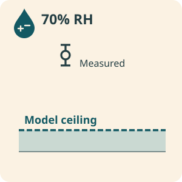
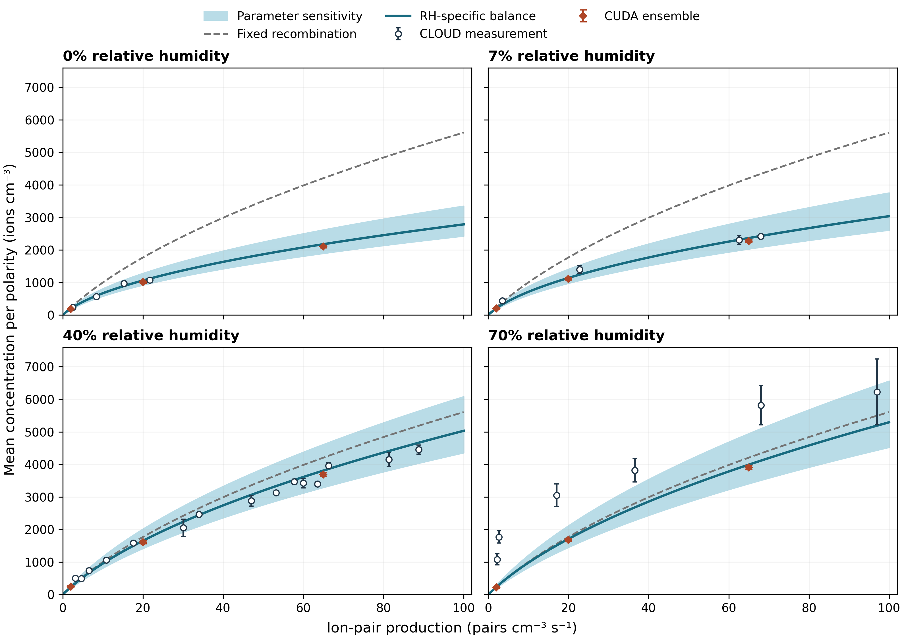
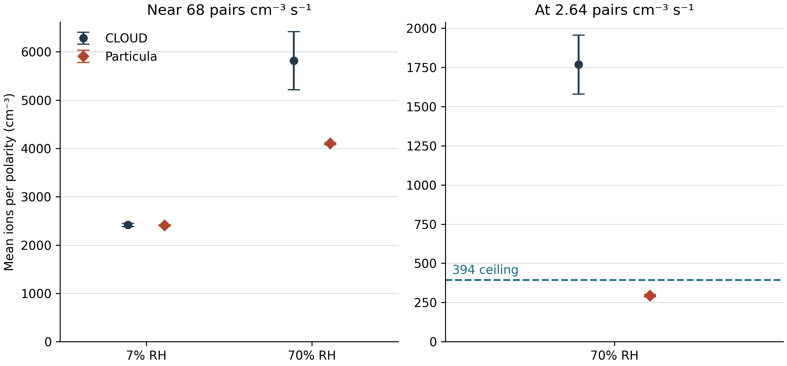
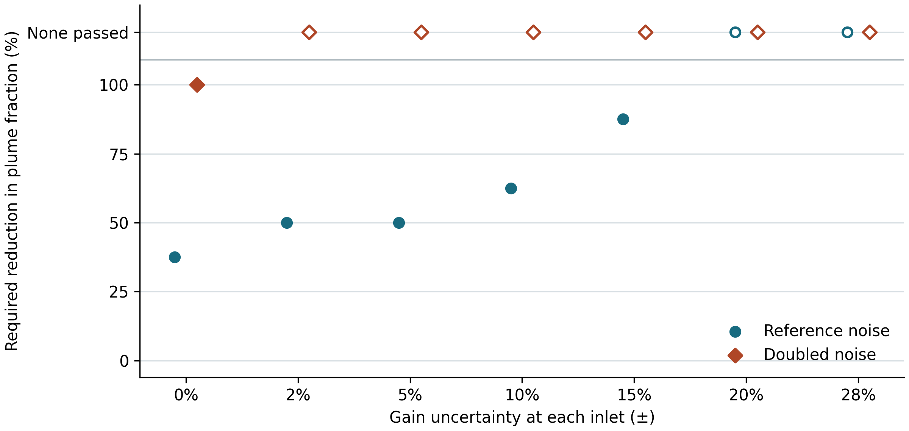

# What can CLOUD measurements tell us about ion loss in humid air?

At 20 °C in the CERN CLOUD chamber, raising relative humidity (RH) from 7% to 70% at nearly the same ion production rate increased the measured concentration by **3,399 ions cm⁻³ per polarity**. A particle-resolved Particula simulation using the published recombination coefficients and a shared wall loss reproduced **1,691 ± 25 ions cm⁻³** of that increase. The strongest constraint comes from a second, low-production measurement. Even if recombination stopped entirely, the humid chamber reading would exceed the modeled ceiling by more than a factor of four. [Franchin et al. (2015), Figure 5d and Table A2](https://acp.copernicus.org/articles/15/7203/2015/acp-15-7203-2015.pdf)



## Where does the ion balance reproduce the humidity series?

Franchin and colleagues varied ion production with a particle beam in a 26.1 m³ chamber. Their spectrometer sampled positive and negative cluster ions. Figure 5d gives the mean concentration of the two signs, averaged over the final 10–15 minutes of each setting. The dry and humid measurements came from separate runs. [Experimental method and Figure 5d](https://acp.copernicus.org/articles/15/7203/2015/)


*Mean ion concentration per polarity at 20 °C. Open circles and vertical bars are the measurements and scatter digitized from Franchin et al., Figure 5d. The dashed curve uses a fixed recombination coefficient of 1.7 × 10⁻⁶ cm³ s⁻¹. Each solid curve uses the coefficient fitted for that humidity in Table A2. Shading spans the reported ranges of recombination and first-order loss. Diamonds show Particula CUDA ensemble means at 2, 20 and 65 ion pairs cm⁻³ s⁻¹, with 95% Monte Carlo intervals.* [Franchin et al., Figure 5d](https://acp.copernicus.org/articles/15/7203/2015/acp-15-7203-2015.pdf#page=6) · [Table A2](https://acp.copernicus.org/articles/15/7203/2015/acp-15-7203-2015.pdf#page=10)

Using the humidity-specific coefficients puts **21 of 23 measured concentrations** inside the shaded range across 0%, 7% and 40% RH. At **70% RH, only one of six** falls inside. The other five remain above the band even at the lower ends of their plotted bars. The 0% series ends near 22 ion pairs cm⁻³ s⁻¹, so the curves at higher production in that panel are extrapolations.

## Comparing dry and humid air at the same production rate

| RH | Measured source (ion pairs cm⁻³ s⁻¹) | Measured concentration and plotted bar (ions cm⁻³) | Particula ten-minute mean and 95% Monte Carlo interval (ions cm⁻³) |
| --- | ---: | ---: | ---: |
| 7% | 67.97 | 2,416 (2,382–2,451) | 2,409 ± 12 |
| 70% | 68.05 | 5,815 (5,215–6,417) | 4,100 ± 22 |
| 70% | 2.64 | 1,768 (1,579–1,956) | 293 ± 7 |



The measured bars describe scatter in the steady readings. The simulation intervals describe sampling across independent boxes at fixed physical inputs. The two high-source simulations use 68 ion pairs cm⁻³ s⁻¹. Their independent standard errors add in quadrature for the humidity contrast. [Runnable matched-condition and clearing comparisons](cloud_ion_humidity.py)

## The low-source point sets a bound on losses

Let $q$ be the rate of ion-pair production, $n$ the concentration of each polarity, $\alpha$ the opposite-ion recombination coefficient and $\beta$ the first-order loss rate. In well-mixed air with equal mean concentrations of both signs, the balance is

$$
\frac{dn}{dt}=q-\alpha n^2-\beta n.
$$

The authors inferred $\beta=0.0083\pm0.0016$ s⁻¹ near 38% RH and used a common value across runs. Their fitted $\alpha$ falls from $8.1\times10^{-6}$ at 7% RH to $2.0\times10^{-6}$ cm³ s⁻¹ at 70% RH. This weaker recombination in humid air explains the direction of the change. A humidity-independent coefficient would give the same steady concentration at either humidity for the same source and linear loss. [Table A2](https://acp.copernicus.org/articles/15/7203/2015/acp-15-7203-2015.pdf#page=10) · [Authors’ response on the shared loss rate](https://acp.copernicus.org/preprints/15/3667/2015/acpd-15-3667-2015-AR1.pdf)

At steady state every recombination removes ions, so $n\le q/\beta$. At $q=2.64$ and the weakest reported loss, $\beta=0.0067$ s⁻¹, this gives **394 ions cm⁻³**. The lower experimental bar is **1,579**. The same upper bound holds for the mean of unequal polarity concentrations when both share the linear sink. The bound depends on the source, wall loss and whether the inlet represents the chamber mean.

Two further checks narrow the interpretation. Tracing the published humid model curve gives an *effective* $\beta$ of 0.00169 s⁻¹ and $\alpha$ of $1.98\times10^{-6}$ cm³ s⁻¹. Those coefficients predict 804 ions cm⁻³ at the low setting, still below the measured bar. In a fitted two-region model with 3.16% of the volume in the beam, the illuminated region could reach 1,731 while the volume mean was 282. Reaching even the lower observed bar would require about 90% of sampled air to come from the enriched region. The authors placed the spectrometer outside the beam trajectory. How much enriched air reached it at each plateau remains unknown. [Franchin et al., apparatus and beam conditions](https://acp.copernicus.org/articles/15/7203/2015/)

## A verified humid zero would distinguish an offset from a source

An ordinary beam-off trace can be identical for two physically different explanations. At unit gain write the reading as $Y=n+d$, with a constant offset $d$. Substitution into the balance yields a model for $Y$ with an extra constant source $\beta d-\alpha d^2$ and a weaker linear loss $\beta-2\alpha d$. We fit the six humid plateaus by minimizing log-concentration error with CUDA derivatives, unit gain and the authors’ coefficient ranges. The fitted offset case reaches the lower limit on linear loss. The second row follows algebraically when humid loss is allowed below that range. These are alternative descriptions of the same signal. The historical data leave their physical origin open. With rates fixed at the published central values and the two lowest sources withheld together, an offset gave a prediction error of 416 ions cm⁻³ (root mean square), compared with 1,008 for extra production. This predictive advantage depends on the loss assumption.

| Fitted explanation | Linear loss (s⁻¹) | Extra production (pairs cm⁻³ s⁻¹) | Readout offset (ions cm⁻³) |
| --- | ---: | ---: | ---: |
| Offset | 0.00670 | 0 | 1,065 |
| Extra source and weaker loss | 0.00257 | 4.94 | 0 |

Both use $\alpha=1.938\times10^{-6}$ cm³ s⁻¹. The useful intervention is to establish the physical zero independently through the humid sampling path. Repeat the 2.28 and 2.64 ion-pair settings, switch off the beam, hold the clearing field for **120 s**, then release to a background of 1.84 ion pairs cm⁻³ s⁻¹. Record both polarities at 5, 10, 30, 60 and 120 s. With a starting reading of 1,407 ions cm⁻³, residual concentrations from 0–100 ions cm⁻³, detector time constants from 0–60 s and unit gain, the predicted reading **30 s after release** is **1,086–1,196** for the offset and **82–286 ions cm⁻³** for the extra source. The ranges describe synthetic trajectories.



In a blinded recovery test, one inlet distinguished these two fitted cases in 512 of 512 trials in each direction (pointwise 95% Wilson lower bound 99.3%). Separating localized production from nonuniform wall loss also requires a spatial measurement. With the reference noise and inlet gains known to ±5%, the second inlet needed to sample **at most half the plume fraction** of the first. At ±10% gain the smallest passing reduction tested rose to 62.5%, and at ±15% to 87.5%. At double the noise, only exactly known gains and complete exposure contrast passed. These thresholds apply to the four fitted hypotheses and tested grid. Co-locate the counters to measure humid gain and noise, then independently establish the contrast with a beam profile and a transport or tracer measurement.



## Data, methods and reproduction

**Observations.** We digitized the 29 markers and vertical bar caps from the vector version of Figure 5d, calibrating both axes against printed ticks and excluding the imposed origin. A 0.02-point coordinate shift corresponds to about 3 ions cm⁻³. The CSV preserves the plotted sources and both bar endpoints. Systematic errors in the applied dilution correction and uncertainty in the original beam footprint remain outside those bars. Derived coordinates are attributed to Franchin et al. (2015) under CC BY 3.0. [Download the example ZIP containing figure5d.csv](cloud_ion_humidity.py) · [Original figure](https://acp.copernicus.org/articles/15/7203/2015/acp-15-7203-2015.pdf#page=6) · [Reuse license](https://creativecommons.org/licenses/by/3.0/)

**Native simulation.** Paired production, opposite-ion recombination, neutral cleanup and spherical wall loss run in sequence on CUDA. Each active ion represents one physical ion. The sphere has the chamber volume. Its loss parameter is set so both polarities match the shared linear sink within 0.01%. RH selects the empirical coefficient. The model assumes a well-mixed, aerosol-free gas at 293.15 K and 101,325 Pa. It approximates humidity through the measured rates. Hydration chemistry and spatial transport would require further inputs. [Native atmospheric ion balance](../../validation/coagulation/charged-aerosols/gpu_ion_balance.py)

The original 29 ensembles comprised 2,208 boxes on an NVIDIA GeForce RTX 5060. At a source of 65 pairs cm⁻³ s⁻¹, halving the step changed the means by at most 65 ions cm⁻³ across the three RH values tested. Doubling volume at the finer step changed them by at most 74. The published example reruns the three final ensembles. Each high-source case uses 96 boxes of 0.02 cm³ at a 0.25 s step. The low-source case uses 128 boxes of 0.04 cm³ at a 0.5 s step. After a 400 s burn-in, 30 samples span 600 s. The calculation checks ion inventories, charge and integer wall losses.

**Measurement design.** The example computes the clearing envelopes from the fitted rates and a first-order detector response. Its third figure redraws the archived blinded comparison. At each gain and inlet contrast we retained the lowest pairwise Wilson bound across two seeds and two fitting grids with 512 trials per generating case. Passing requires every bound to exceed 90%. The spatial cases were matched at the original inlet plateaus. Fit and evaluation drew separate runs of field-blank noise in 60 s blocks from a later CLOUD Cluster Ion Counter. Those blanks supply a reference noise scale for the proposed test. The 2015 spectrometer's humid gain, noise and sampling footprint still require measurement. [Download the example ZIP containing two-inlet-design.csv](cloud_ion_humidity.py) · [Mirme et al. (2025)](https://amt.copernicus.org/articles/18/5717/2025/) · [Counter data](https://doi.org/10.5281/zenodo.17357061)

From a Particula development environment with CUDA, refresh the study to rerun the three native cases and produce the figures. The second command redraws the same figures from verified saved numbers on CPU.

```bash
python scripts/docs_examples.py refresh cloud-ion-humidity
python scripts/docs_examples.py replot cloud-ion-humidity
```

The [worked example](cloud_ion_humidity.py) includes the saved figures, source, device record and downloadable inputs. From the extracted ZIP run `python example.py`.
