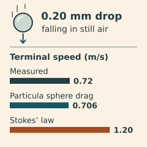
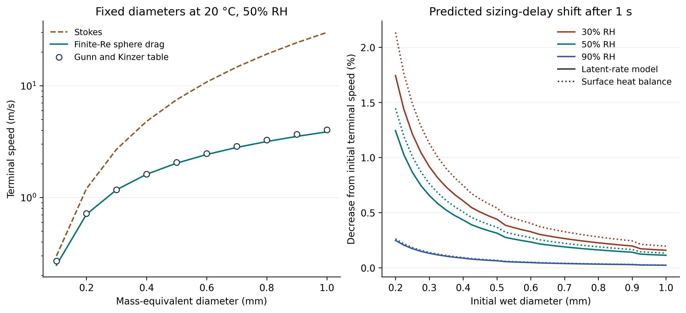

# Particula predicts water-drop fall speeds within 4.2% at nine diameters from 0.20 to 1.00 mm

Gunn and Kinzer measured the terminal speed of distilled-water drops in still air. At 20 °C and 50% relative humidity, Particula’s sphere drag calculation comes within **4.2% of the tabulated speed at each of nine diameters from 0.20 to 1.00 mm**. At 0.30 mm it gives 1.171 m/s against the tabulated 1.17 m/s. Stokes’ law gives 2.696 m/s. At the smallest diameter we compared, 0.10 mm, the discrepancy is larger. The sphere model predicts 0.247 m/s against 0.27 m/s, 8.3% low. For a new experiment, matching the diameter at which speed is measured also matters. In a simulated one-second exposure at 50% humidity, a 0.20 mm drop shrank enough to lower the terminal speed assigned from the experimental curve by **1.24%**. Measuring both size and local speed on the same drop would distinguish that shift from an error in the drag calculation. [Gunn and Kinzer (1949)](https://journals.ametsoc.org/abstract/journals/atsc/6/4/1520-0469_1949_006_0243_ttvoff_2_0_co_2.xml)

## Gunn and Kinzer measured speed against drop mass

Gunn and Kinzer timed more than 1,500 drops and related their terminal speeds to mass. The equivalent diameter is the diameter of a sphere of water with the same mass. We transcribed ten values at 20 °C, 760 mmHg and 50% relative humidity from the Smithsonian table that credits their experiment. The authors estimated overall accuracy better than 0.7%. The printed velocities have an increment of 0.01 m/s. Half an increment is 0.69% of the speed at 0.20 mm and 1.85% at 0.10 mm. Individual measurement uncertainties cannot be recovered from the rounded table. [Original experiment](https://journals.ametsoc.org/abstract/journals/atsc/6/4/1520-0469_1949_006_0243_ttvoff_2_0_co_2.xml) · [Smithsonian Meteorological Tables, Table 114, p. 396](https://unidata.github.io/MetPy/latest/_static/Smithsonian1951.pdf) · [Transcribed values in the example download](drizzle_settling.py)

## Drag that varies with Reynolds number captures the rise in fall speed

We used two native Particula CPU calculations at each measured diameter. Both balance weight and buoyancy against air resistance, using the same water density, moist-air density and air viscosity. Stokes’ law assumes that viscous resistance dominates, so the resulting speed grows with the square of diameter. The second calculation lets the sphere’s drag coefficient vary with Reynolds number, which measures the importance of fluid inertia relative to viscosity. Neither calculation was fitted to the ten velocities.

| Diameter (mm) | Gunn–Kinzer reference (m/s) | Particula Stokes (m/s) | Particula sphere drag (m/s) | Sphere difference from reference |
| ---: | ---: | ---: | ---: | ---: |
| 0.10 | 0.27 | 0.300 | 0.247 | −8.34% |
| 0.20 | 0.72 | 1.198 | 0.706 | −1.89% |
| 0.30 | 1.17 | 2.696 | 1.171 | +0.10% |
| 0.40 | 1.62 | 4.793 | 1.611 | −0.55% |
| 0.50 | 2.06 | 7.489 | 2.027 | −1.62% |
| 0.60 | 2.47 | 10.784 | 2.422 | −1.95% |
| 0.70 | 2.87 | 14.678 | 2.801 | −2.42% |
| 0.80 | 3.27 | 19.171 | 3.165 | −3.20% |
| 0.90 | 3.67 | 24.264 | 3.519 | −4.13% |
| 1.00 | 4.03 | 29.955 | 3.862 | −4.18% |

At 0.20 mm, Stokes’ law exceeds the reference by 66%. At 1.00 mm it gives more than seven times the reference speed. Finite-Reynolds-number drag brings both sizes much closer. The apparent agreement at 0.30 mm is limited by the printed precision. The model differs from the table by 0.0012 m/s, well below the table’s 0.01 m/s reporting increment. At 0.10 mm the discrepancy of 0.023 m/s exceeds two increments. The available data do not identify its cause. [Table 114, p. 396](https://unidata.github.io/MetPy/latest/_static/Smithsonian1951.pdf)

### A one-second separation between sizing and timing matters most for small drops

We asked how much the terminal speed associated with a drop could change if the instrument measured its diameter upstream. Each CUDA box initially held one pure-water drop and a finite water-vapor reservoir. Particula’s native `CondensationLatentHeat` process calculated the loss of liquid mass, accounting for the heat needed to evaporate water. We converted each saved liquid mass to a wet diameter. To estimate the effect of airflow past a falling drop, we then applied a published ventilation relationship during CPU analysis, using a common enhancement for heat and vapor transport. Finally, we interpolated the historical speed table at the smaller diameter. This is a proposed sizing-delay experiment. The historical observations supply the speed curve and the model supplies the diameter change. [Particula’s latent-heat rate, equation 5](../../../theory/dynamics/condensation-equations.md#condensation-with-latent-heat) · [Ventilation relationship, Loftus and Wordsworth, equations 10–14](https://par.nsf.gov/servlets/purl/10221557)

| Initial diameter | Speed assigned initially | Predicted diameter after 1 s | Speed assigned after 1 s | Decrease |
| ---: | ---: | ---: | ---: | ---: |
| 0.20 mm | 0.72 m/s | 0.1980 mm | 0.7110 m/s | 1.24% |
| 0.30 mm | 1.17 m/s | 0.2983 mm | 1.1623 m/s | 0.65% |
| 0.50 mm | 2.06 m/s | 0.4985 mm | 2.0535 m/s | 0.31% |
| 1.00 mm | 4.03 m/s | 0.9987 mm | 4.0255 m/s | 0.11% |

*Predictions at 20 °C and 50% initial relative humidity using CUDA evaporation with ventilation applied during analysis. Percentages give the decrease relative to the speed assigned at the initial diameter. The additional digits show the outcome of interpolation between rounded observations.*

For a drop starting at 0.20 mm, the predicted shrinkage of about 2 µm changes the assigned speed by 0.009 m/s, close to one printed increment. The 1.00 mm drop loses a smaller fraction of its diameter, and its 0.11% speed shift is small beside the 4.18% fixed-size drag discrepancy. At 90% humidity the smaller drop’s predicted speed shift falls to 0.25%. We held the tabulated speed–diameter relation fixed across humidities to isolate the contribution of shrinkage.

*Left, the symbols give historical terminal speeds at 20 °C and 50% relative humidity. The curves are fixed-diameter CPU drag calculations. Right, the percentage decrease in speed assigned after one second uses the historical curve at each predicted diameter. Solid curves use Particula’s CUDA mass calculation and our ventilation adjustment. Dotted curves use the separate CPU surface heat balance.*

### Surface cooling and ventilation affect the inferred shift

At 0.20 mm and 50% humidity, the native CUDA evaporation trajectory without ventilation gives a **0.79%** decrease in assigned speed. Our offline ventilation adjustment raises it to **1.24%**. A separate CPU model solves for a steady drop-surface temperature by balancing conductive heat supply against evaporative heat demand. It uses distinct heat and vapor ventilation factors and gives **1.45%**. At 1.00 mm the two ventilated estimates are **0.11% and 0.13%**. Their spread describes sensitivity to the thermal assumptions, which changed together. Neither calculation measures how quickly a moving drop adjusts to its new terminal speed. [Heat and mass transport equations](https://par.nsf.gov/servlets/purl/10221557)

## Measure diameter and speed at both stations

To test the small-drop result, track individual 0.20 mm drops through two optical stations and record diameter and local velocity at each. Compare near-saturated air with 50% humidity at matched transit times, with 1.00 mm drops as a weaker-response control. For a one-second transit the smaller-drop test calls for resolution appreciably finer than 2 µm and 0.009 m/s. A shift that tracks the local diameter would support evaporation as its source. A residual at matched local diameter would motivate checking acceleration history, air motion and the drag law. The predictions alone cannot establish a timing bias in the 1949 apparatus.

## Reproduce the comparison

This comparison used Particula 0.3.3 at revision `75ea3a3aff` with an NVIDIA GeForce RTX 5060. A one-box pilot preceded a grid of 33 starting diameters from 0.20 to 1.00 mm and five initial relative humidities from 30% to 99%. Each 1 m³ box held one drop, with temperature fixed at 293.15 K and pressure at 101325 Pa. We ran all 165 cases at outer steps of 0.025 and 0.0125 s with observations every 0.10 and 0.05 s, respectively. Six seconds of native evaporation bracketed the endpoints after the ventilation adjustment. The largest relative change in total liquid plus vapor mass was 1.3 × 10⁻¹³.

Halving the native step and observation interval changed the calculated speed decrease by at most 0.000027 percentage points across 990 paired endpoints. Replacing linear interpolation with a shape-preserving cubic changed the one-second ventilated result by at most 0.015 percentage points. The CPU drag solver changed by less than 0.0000002 m/s when its tolerance tightened from 10⁻⁶ to 10⁻¹⁰. The runnable study provides the reference data, calculations and saved figure. From a checkout, use `python scripts/docs_examples.py refresh drizzle-settling` for a new CUDA run or `python scripts/docs_examples.py replot drizzle-settling` to redraw the saved results on CPU.
