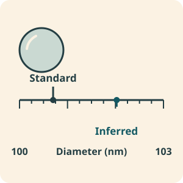

# Particula sizes a 100.7 nm PSL standard at about 102 nm near atmospheric pressure



A mobility analyzer sorts charged particles by how fast they drift in an electric field. How much does the choice of gas-slip law change the diameter assigned to a given mobility? Using the gas properties reported by Kim et al., Particula assigns **102.02 and 102.03 nm** to the two near-atmospheric observations of their 100.7 nm polystyrene latex (PSL) standard. Both are about 1.3 nm above the reference diameter. A separate test calibrates the Particula scale to the authors’ fitted slip law at 100 nm and transfers that calibration to other sizes. The remaining diameter errors in that synthetic test are **−0.46% at 20 nm** and **+0.25% at 300 nm**. A one-point match can therefore hide a size dependence. [Kim et al., Tables 7a–c](https://doi.org/10.6028/jres.110.005) · [Saved inversions and calibration scan](psl_mobility.py)

## Why pressure matters for sizing the PSL standards

Kim and colleagues used a differential mobility analyzer at several pressures to determine how gas slip changes drag on nanometer spheres. Lowering the pressure increases the mean free path of the gas and allows the same sphere to sample a different slip regime. Their three PSL sizes probe whether a single slip law describes particles across that range. The 49 published rows preserve the size assignment, slip correction and Knudsen number needed to reconstruct electrical mobility. [Original paper, Tables 7a–c, pp. 42–43](https://nvlpubs.nist.gov/nistpubs/jres/110/1/j110-1kim.pdf) · [Experimental interpretation](../../../guide/processes/psl-mobility.md)

## How far does a mobility calibration transfer across sizes?

<a id="published-mobility-and-inferred-diameter"></a>

### Matching the measured mobility gives a larger diameter near 100 nm

The CSV records pressure in kPa, temperature in K, sheath and aerosol flows in L/min, peak voltage in V, and the dimensionless Kn, slip factor C and slip parameter A. The source identifiers are the printed table and one-based row. The diameter assignments and charge magnitudes are 100.7 nm and one elementary charge for Table 7a, 269.0 nm and two for Table 7b, and 19.90 nm and one for Table 7c. The source PDF used for extraction had SHA-256 `5a44701000cb8ec2252461829c403e0c17cf6c890b6af93d00a281aa862ad696`. [Kim et al., Tables 7a–c](https://doi.org/10.6028/jres.110.005)

For each row we reconstruct the electrical mobility magnitude as $Z=|q|C/(3\pi\mu D)$. Use the paper’s viscosity and set the mean free path to $\lambda=\mathrm{Kn}D/2$. With the gas state fixed, solve for the diameter that gives the same mobility with Particula’s slip law. The full study used Brent and bisection on a 1–2,000 nm bracket. The maximum difference between the roots was below 7 × 10⁻¹¹ nm, and the largest forward mobility round-trip error was below 2 × 10⁻¹⁰% relative. Relative slip differences use the measured C as denominator.

<a id="two-pressure-entries-change-the-269-nm-comparison"></a>

### Two inconsistent pressure entries limit the 269 nm comparison

The final two rows of Table 7b print 84.26 kPa and Kn = 6.014 for 269 nm spheres. The paper's Eq. 11 at the printed conditions gives Kn ≈ 0.602, about a factor of ten smaller. The first of those rows also lists A = 1.436, while (C − 1)/Kn = 1.576. We checked the printed PDF, retained its values and used the tabulated Kn and C in the primary comparison. Both rows are flagged in the downloadable results and excluded from all pressure-derived summaries. The remaining 47 rows reproduce tabulated Kn to within 0.14% from pressure, temperature and size. Dropping the two flagged rows moves the overall mean slip difference from +1.01% to +1.03% and the 269 nm mean from +1.38% to +2.15% (two near-atmospheric measurements). The actual pressure of the flagged measurements remains unresolved. [Table 7b and Eq. 11](https://nvlpubs.nist.gov/nistpubs/jres/110/1/j110-1kim.pdf)

The example records a null diameter in the native-gas calculation for a row whose pressure-derived mean free path differs from its Kn-derived value by more than 1%. Both rows remain in the matched-gas calculation. At 19.90 nm the diameter assignment depends on the authors’ mobility calibration. Repeated pressure settings and shared calibration errors limit the interpretation of a pooled mean.

<a id="reproduce-the-calibration-transfer"></a>

### A one-point calibration tests how the mobility scale transfers across sizes

The synthetic scan uses the published fit $C=1+\mathrm{Kn}[1.165+0.483\exp(-0.997/\mathrm{Kn})]$ at 296.15 K and 101.3 kPa. A multiplier of 0.98237 on the Particula mobility scale matches the synthetic reference at 100 nm. All other sizes test transfer. With that multiplier, the inferred diameter is 0.46% low at 20 nm and 0.25% high at 300 nm. These are residuals against the fitted reference law at fixed pressure. [Saved calibration scan](psl_mobility.py)

## A second standard can test the size dependence

The two near-atmospheric observations constrain the inversion at one size. The synthetic scan shows why an instrument calibrated there can still return a size-dependent offset elsewhere. A measurement on a second independently sized standard, at the same pressure and with the mobility scale held fixed, would test the transfer directly. Resolving the pressure entries in Table 7b would also extend the conditions under which the 269 nm measurements can test that transfer.

## Reproduce the diameter inversions

The study used Particula source 0.3.2 at revision `2303121c905aabdd99da6ec7e398bba89633891c` on CPU, Python 3.12.12, NumPy 2.3.4, SciPy 1.16.2 and Matplotlib 3.10.7. From a checkout with the Particula environment active, use the following command.

```bash
python docs/studies/literature/dry-psl-mobility/psl_mobility.py
```

From the extracted example bundle run `python example.py`. The two near-atmospheric 100.7 nm rows should yield 102.02 and 102.03 nm. The figure and row-level numerical results are also saved on the [example page](psl_mobility.py).
