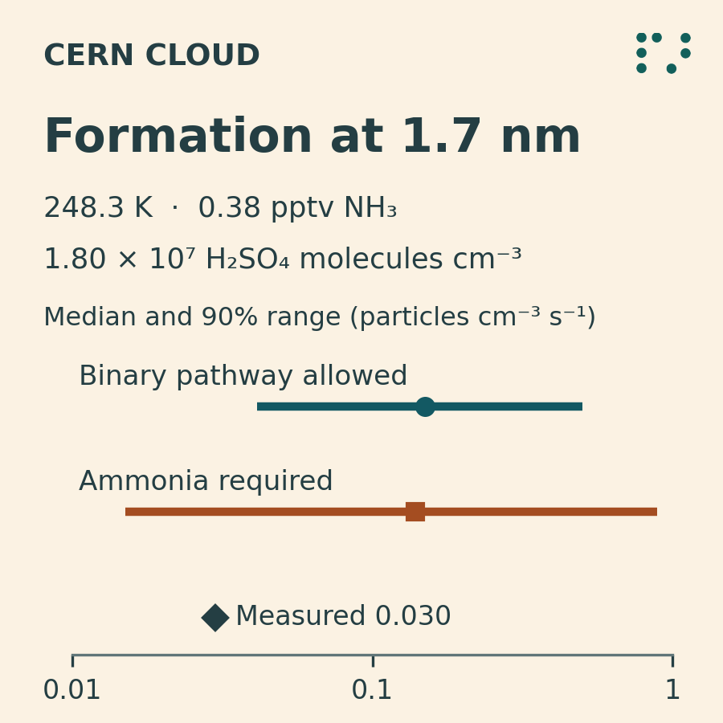
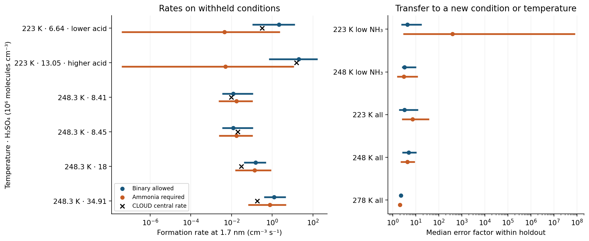
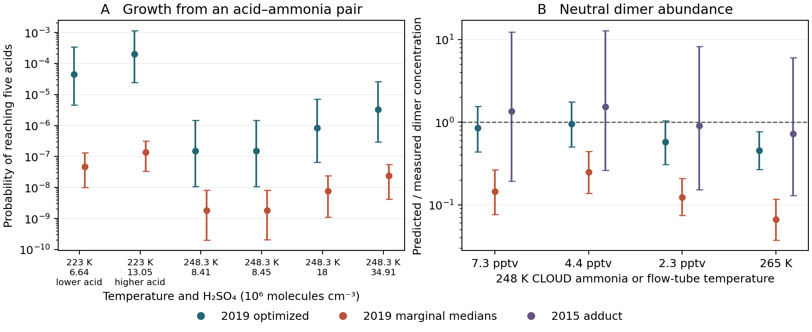
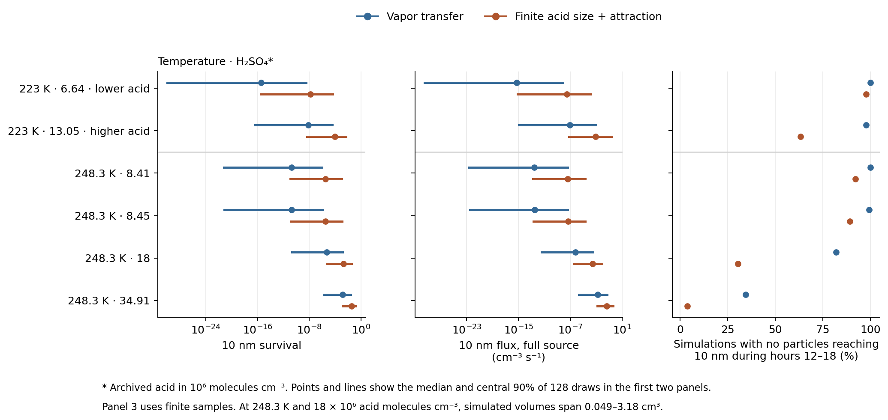
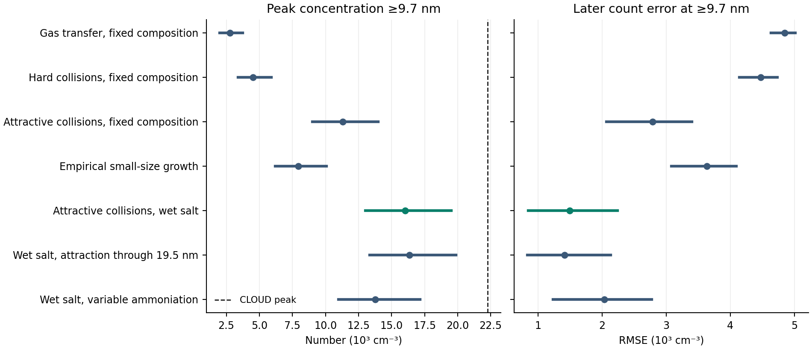
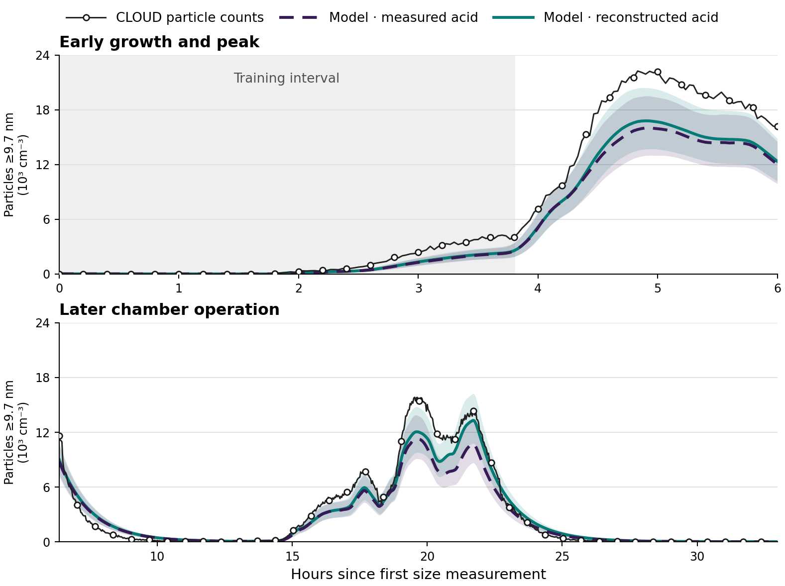
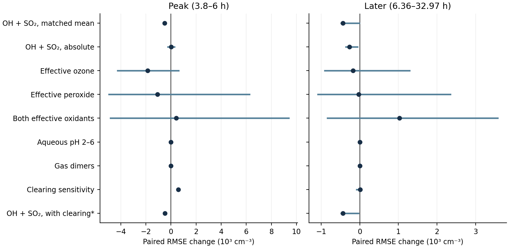
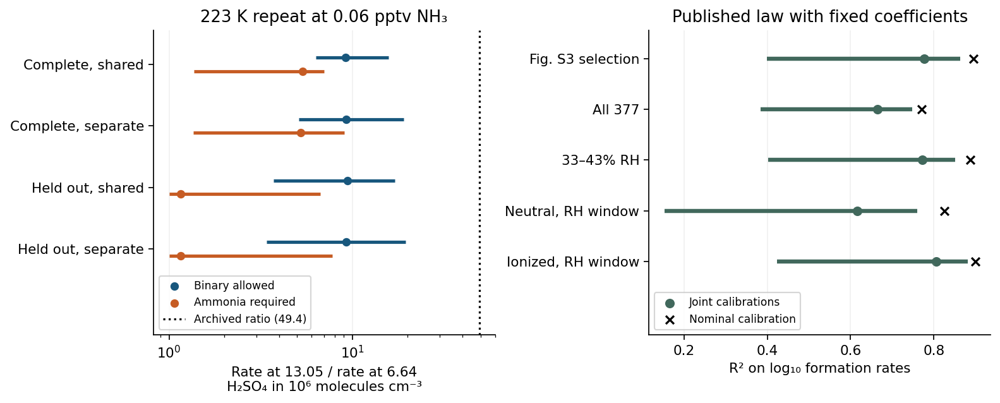

# At 248 K, similar CLOUD formation rates admit different chemical pathways



At 248.3 K and 0.38 pptv ammonia, Dunne et al.’s CLOUD formation rates leave open how many particles formed through sulfuric acid and water alone. The model allowing this pathway missed four withheld rates by a typical factor of 3.17. The model requiring ammonia missed them by a factor of 3.04. In a second test, we fixed the ammonia-independent share at one of those conditions (1.80 × 10⁷ sulfuric acid molecules cm⁻³) and refitted the other neutral measurements. Shares of 0.01%, 50% and 99.99% gave median training error factors of 2.64, 2.62 and 2.70, respectively. Three companion dimer measurements at higher ammonia tested a different part of the chemistry and favored Kürten’s optimized cluster evaporation parameters. In a separate warm CLOUD run, the acid history reconstructed from OH + SO₂ and scaled to the early measured mean improved predicted counts above 9.7 nm during the peak in 511 of 512 paired simulations, yet the median peak remained 24% below the measurement. Together these results motivate measuring cluster composition, formation rate and size-resolved growth during the same run. [Formation-rate overview (CSV)](../../../../website/public/study-data/dunne-cloud/formation-overview.csv)

## What Dunne and CLOUD measured at 1.7 nm

Dunne et al. measured inorganic particle formation across chamber temperatures, sulfuric acid and ammonia concentrations, and ion production rates. Their atmospheric model combined neutral and ion-induced contributions with and without ammonia. Removing the neutral binary term and refitting the remaining channels still explained much of the observed variation. Of 377 archived chamber records, 267 fall within 33–43% RH, including 82 neutral observations and seven neutral observations below 1 pptv ammonia. At the coldest temperatures the authors inferred the background ammonia and described uncertainties reaching a factor of ten. [Dunne et al., 2016](https://doi.org/10.1126/science.aaf2649) · [Original data](https://zenodo.org/records/13981565) · [Dunne et al., supplementary materials](https://authors.library.caltech.edu/records/gtyc9-ykr88)

J₁.₇ is the number of particles crossing 1.7 nm mobility diameter per cubic centimetre per second. CLOUD usually inferred it from a counter with a 3.2 nm cutoff, correcting for growth, dilution, coagulation and wall loss. The authors estimated an overall factor-of-2.5 systematic rate uncertainty. A simulation that propagates the published rate back to 3.2 nm consequently shares some of the assumptions used to derive it. The cold archive lacks simultaneous counter histories keyed to individual rows. The warm comparison uses another campaign with measured size distributions and very different ammonia and temperature. [Counter correction](https://doi.org/10.5194/acp-15-4063-2015) · [Kürten et al., chamber instrumentation](https://doi.org/10.1002/2015JD023908)

We use Particula to ask which chemical pathways can explain the cold formation rates and how many newly formed particles survive to a detectable size. We test competing descriptions of ammonia’s role against withheld CLOUD rates and compare predicted neutral dimer concentrations with companion measurements. We then follow particles from 1.7 to 3.2 and 10 nm as they grow, coagulate and deposit on chamber walls. In the warm run, we test whether sulfur chemistry and water uptake can account for the measured rise in particle counts above 9.7 nm. Joint Monte Carlo simulations show which conclusions persist as gas calibrations and model parameters vary, and guide our choice of measurements for a 223 K repeat.

## What changes when the uncertainties vary together?

For the cold study we used 128 sets of jointly varied parameters, in four independent blocks. Each draw shares calibration shifts across affected observations, refits the model after removing the entire designated holdout, and supplies the corresponding gases and source to the downstream simulations. We used separate calibrations for the companion experiments. The warm ensemble pairs 16 model variants at each of 512 combinations of gas, wall, coagulation and boundary conditions. Throughout, **5th–95th percentile bands describe the range of simulations under the stated inputs**. Statistical confidence in a chemical pathway would require an observational error model and information about parameter correlations that these archives do not provide.

The cold draws used four independently scrambled Sobol sequences of 32 draws each. Within each draw we varied sulfuric acid by a factor of up to 1.5 in either direction and corrected formation rates by up to 2.5. For ammonia we used factors of 10 below 1 pptv, 2 at 1–10 pptv, 1.5 above 10 and below 100 pptv, and 1.2 at 100 pptv and above. We sampled these multipliers uniformly in log space and shared them across rows in each concentration bracket. We also varied the weight of each training condition and used the same weights for both competing models. The choice of brackets and their correlations affects the width of the reported simulation ranges. [Dunne et al., supplementary materials, §§6–8 and 19](https://authors.library.caltech.edu/records/gtyc9-ykr88)

### The published fit reproduces its figure and is sensitive to calibration

We recovered 355 plotted rate pairs from Dunne’s Fig. S3. Their log-rate R² is 0.898, and the higher-precision Table S1 law gives 0.895–0.896 on the two compatible archive selections. Printed coefficient rounding alone changes the median error on the 82 neutral rows from a factor of 1.84 to 11. With the higher-precision coefficients held fixed, the joint calibration draws give a median R² of 0.777 and a 0.399–0.864 interval for one figure selection. Across all 377 rows the corresponding values are 0.664 and 0.383–0.747 (nominal 0.770). These numbers measure sensitivity to using the published coefficients after a calibration shift. Dunne also refitted the coefficients when testing ammonia uncertainty. [Dunne et al., supplementary materials](https://authors.library.caltech.edu/records/gtyc9-ykr88) · [Higher-precision S1 coefficients](https://github.com/CliMA/ClimaParams.jl/blob/3c1f8be835c43e467ac2d963bd48cc4150a3df01/src/parameters.toml)

The digitized collision ceiling covers only part of the archive’s acid range. Across the draws, 81–102 records fall inside its measured graphical support. Adjusted observations exceed the interpolated ceiling at one or two records in 17 of 128 draws, compared with none at nominal calibration. The changing membership and the calibration of both axes matter for interpreting a point above the curve. [Kürten et al., kinetic limit in Fig. 7](https://doi.org/10.5194/acp-15-4063-2015)

### At 248 K the total rate leaves the binary share unresolved

After inspecting the archive, we selected two low-ammonia groups for retrospective tests. We withheld each group in turn. In separate temperature-transfer tests, we withheld all neutral observations at each of three temperatures. Each draw refitted two structures under linear and curved temperature laws. The binary-allowed model adds a neutral acid–water pathway to the ammonia-assisted term. The ammonia-required model assigns zero to the binary pathway by construction. For the linear-temperature neutral-only fits, we summarize the typical fold difference between predicted and observed formation rates within each withheld group. This error factor is dimensionless. A factor of 1 means exact agreement, and predictions twice or half the observed rate both give a factor of 2. The table reports the median factor across Monte Carlo draws, with the 5th–95th percentiles in parentheses.

| Withheld neutral condition (temperature, NH₃ mixing ratio) | Binary allowed, error factor (×) | Ammonia required, error factor (×) |
| --- | ---: | ---: |
| 248.3 K, 0.38 pptv | 3.17 (2.50–10.2) | 3.04 (1.50–12.2) |
| 223 K, 0.06 pptv | 4.34 (2.33–17.9) | 392 (2.85–8.3 × 10⁷) |
| All 223 K | 3.15 (1.83–12.4) | 7.21 (2.50–37.6) |
| All 248 K | 4.85 (2.53–10.7) | 4.27 (2.18–9.12) |
| All 278 K | 2.22 (1.88–2.64) | 2.03 (1.80–2.44) |

The six withheld neutral measurements are identified below by temperature and sulfuric acid concentration. The last column gives the line in Dunne’s data file, counting the header as line 1. The archive supplies no experimental run IDs. [Dunne et al., chamber data (Data S1)](https://zenodo.org/records/13981565)

| Temperature (K) | H₂SO₄ (10⁶ molecules cm⁻³) | NH₃ (pptv) | RH (%) | Observed J₁.₇ (cm⁻³ s⁻¹) | CSV line |
| ---: | ---: | ---: | ---: | ---: | ---: |
| 223 | 6.64 | 0.06 | 38.69 | 0.32 | 366 |
| 223 | 13.05 | 0.06 | 40.67 | 15.81 | 332 |
| 248.3 | 8.41 | 0.38 | 36.71 | 0.00989 | 334 |
| 248.3 | 8.45 | 0.38 | 37.23 | 0.02 | 344 |
| 248.3 | 18 | 0.38 | 36.58 | 0.03 | 336 |
| 248.3 | 34.91 | 0.38 | 36.27 | 0.18 | 338 |

At 248.3 K, two records at similar acid concentrations give rates of 0.030 and 16.02 cm⁻³ s⁻¹ at 0.38 and 4.96 pptv ammonia, respectively. Which pathway supplied the first 0.030 is harder to determine. At the lower ammonia level, the binary-allowed rate is 0.150 (0.041–0.501) and the ammonia-required rate is 0.139 (0.015–0.890) cm⁻³ s⁻¹. The allowed model’s median binary share exceeds 99.99%, but its 5th percentile is 15%. Across individual sampling blocks that lower endpoint ranges from 16% to 48%. When we force the share to 0.01%, 50% or 99.99%, the median training error factors are 2.64, 2.62 and 2.70. Nearly the same training error therefore supports markedly different chemistry.



*Dots and horizontal intervals show model medians and 5th–95th percentiles. Crosses show the original corrected CLOUD rates. Error factors compare each simulation with the observation on that draw’s common rate calibration. The very long 223 K ammonia-required interval reflects rates approaching zero at the low end of the uncertain ammonia range.* [Withheld rates and error factors (CSV)](../../../../website/public/study-data/dunne-cloud/formation-bounds.csv)

At 223 K, the binary-allowed model has the smaller error on the low-ammonia pair in 109 of 128 draws. Adding ionized training rows and refitting the ion balance gives it the smaller error on the neutral pair in 117 draws. On the withheld **ionized** 223 K rows, however, the median error factor favors the ammonia-required neutral structure, 1.84 versus 5.46. Even a pooled quadratic acid-only law gives a median error of 1.42 on the 248 K low-ammonia rows and 189 on the 223 K pair. A model ranking from one temperature or ion setting transfers poorly to the others.

Kürten (2019) fitted SANTIAGO, the Sulfuric Acid Ammonia Nucleation and Growth model, to 125 neutral CLOUD formation-rate measurements. The model follows how small clusters grow by collisions and lose molecules by evaporation. We use two results from that study. Its published measurement intervals let us check our 248 K rate predictions, and its fitted cluster thermochemistry supplies inputs for the dimer comparison below. [Kürten, Figs. 3–4 and Table 1](https://acp.copernicus.org/articles/19/5033/2019/)

For the 248.3 K measurements at 18.00 and 34.91 × 10⁶ sulfuric acid molecules cm⁻³, the only counterparts matching the chamber conditions have measured central rates of 0.0348 and 0.1884 cm⁻³ s⁻¹ in Kürten’s data. The 128 binary-allowed predictions fall within the respective native measurement intervals in 21 and one draw. The corresponding ammonia-required counts are 25 and ten. We matched neutral records within 0.055 K, a factor of 1.05 in acid, and either a factor of 1.25 or 0.005 pptv in ammonia. We used the later study’s asymmetric rate intervals. Shared data origins and missing run IDs limit their independence. [Kürten, original figure tables](https://doi.org/10.5281/zenodo.2634985)

### Dimer measurements distinguish two thermochemical parameter sets

At three 248 K CLOUD conditions, neutral dimer measurements let us compare two fixed sets of evaporation parameters within the same cluster model. One set comes from Kürten’s optimization. The other uses the published marginal median for each parameter. For each thermochemical parameter set, we calculated how often neutral molecules and clusters collide using two versions of Particula’s collision kernel. The first treats them as hard spheres (Hamaker constant 0 J). The second includes van der Waals attraction (Hamaker constant 6.4 × 10⁻²⁰ J). With attraction included, the median modeled concentrations using Kürten’s optimized thermochemistry were 0.85, 0.96 and 0.57 times the measured values at approximately 7.3, 4.4 and 2.3 pptv ammonia. Combining the three measurements, this gives a median error factor of 1.50, against 6.25 using the published marginal median parameters. Under each collision kernel, the optimized set gave the smaller combined error in all 128 paired draws. Each draw reused the same three observations while varying the assumed gas concentrations, instrument calibration and chamber losses. At 265 K in an independent flow tube, the optimized model gave only 0.46 times the reported dimer abundance, with a 5th–95th percentile range of 0.27–0.78 under an assumed factor-of-1.5 gas range. Transfer to that higher-concentration experiment remains incomplete. [Kürten et al., Fig. 9 and Table 3](https://acp.copernicus.org/articles/15/10701/2015/) · [Hanson and Eisele, flow-tube measurements](https://doi.org/10.1029/2001JD001100)

The molecular calculation across all 82 neutral rows in the 33–43% RH window follows a single acid–ammonia pair until it reaches five acids, loses its last base, dissociates or leaves the chamber. At 248.3 K, 0.38 pptv ammonia and 1.80 × 10⁷ acid molecules cm⁻³, changing from the marginal medians to the optimized energies increased the attractive-kernel probability of reaching five acids by a median factor of 93 (5th–95th percentiles 59–300) at identical gas and wall settings. The respective probability medians were 7.8 × 10⁻⁹ and 8.3 × 10⁻⁷. Which cluster energies one uses therefore changes the predicted molecular fate even when the modeled total particle rates are close. The companion measurements sampled 11–28% RH at appreciably higher ammonia than the 248.3 K holdout. Measuring both monomer and dimer concentrations at the 0.38 pptv holdout condition would test whether the thermochemical ranking carries over. [Kürten, Table 1](https://acp.copernicus.org/articles/19/5033/2019/)



*Points are medians and bars are the 5th and 95th percentiles within each thermochemical model using attractive collisions. The lower- and higher-acid measurements at 223 K have 6.64 and 13.05 × 10⁶ H₂SO₄ molecules cm⁻³, respectively, both at 0.06 pptv ammonia. The four 248.3 K measurements have 0.38 pptv ammonia. The dashed line in the dimer panel marks agreement. The 2015 adduct variant also varies the published range of adduct thermochemistry. At 2.3 pptv the optimized model’s upper percentile is 1.05 and varies from 0.99 to 1.10 across four scrambles. The measured dimers are graphic-derived concentrations. Sampling losses and fragmentation introduce additional uncertainties.* [Five-acid growth and dimer abundances (CSV)](../../../../website/public/study-data/dunne-cloud/cluster-bounds.csv)

### The cold growth law changes how much of the 1.7 nm source reaches a counter

Treating sulfuric acid as a finite molecule attracted to the growing particle increased modeled 10 nm survival in all 768 paired comparisons across the six cold holdouts. At 248.3 K and 1.80 × 10⁷ acid molecules cm⁻³ with 0.38 pptv ammonia, median survival was 0.000478% for vapor transfer and 0.205% with finite molecular size and attraction. The median within-draw gain was 449-fold. Across the 128 joint draws, the central 90% of survival probabilities spanned 2.1 × 10⁻¹¹ to 1.43 × 10⁻³ for vapor transfer and 5.85 × 10⁻⁶ to 3.46 × 10⁻² for attraction. Both calculations started with the same seed composition under the same sampled acid, ammonia, wall deposition, hydration, sticking and background aerosol. We used Particula’s size-dependent spherical-chamber deposition in every draw, anchored at 3 nm to the historical cold chamber approximation. Cold wall and growth histories have no row-specific calibration. For this condition, the 5th percentile for vapor transfer varied from 4.5 × 10⁻¹³ to 7.2 × 10⁻¹⁰ across four independent 32-draw blocks.



*Panel 3 shows the percentage of simulations with no particles reaching 10 nm during hours 12–18. Each dot represents 128 simulations at one cold chamber condition with one growth law and the binary-allowed formation rate. A simulation counts once if zero particles cross 10 nm mobility diameter during those six hours. At 248.3 K, 0.38 pptv ammonia and 1.80 × 10⁷ acid molecules cm⁻³, each pair shared a simulated volume, ranging from 0.049 to 3.18 cm³ across draws. Each volume was chosen to give 256 expected births per hour. A zero therefore describes crossings in that volume and time window. Particles could still grow below 10 nm or have crossed earlier. The cold archive supplies a corrected rate at 1.7 nm and lacks a corresponding six-hour crossing record at 10 nm.* [Dunne data release](https://zenodo.org/records/13981565) · [Cold survival, flux and finite-volume crossings (CSV)](../../../../website/public/study-data/dunne-cloud/transport-bounds.csv)

Propagating each fitted formation rate with the same draw’s survival gave median 10 nm fluxes at this 248.3 K condition of 2.65 × 10⁻⁴ and 2.82 × 10⁻⁴ cm⁻³ s⁻¹ for the full and ammonia-required sources under attractive capture. With vapor transfer the medians fell to 6.15 × 10⁻⁷ and 5.28 × 10⁻⁷ cm⁻³ s⁻¹. At this condition, no particles reached 10 nm during hours 12–18 in **82% of vapor-transfer simulations (105 of 128)** and **30% of simulations with attractive capture (39 of 128)**. At two reference conditions, we repeated 64 simulations with twice the volume, half the time step and a different random seed. Seven pairs recorded a 10 nm crossing in only one replay. A chamber test of the zero-crossing fractions would need the counter’s sampling volume and a crossing record over the same interval. Across 192 independent path-set checks, the two 10 nm survival estimates differed by a median factor of 1.013 and a 95th-percentile factor of 1.64, with a maximum factor of 14.

### Reconstructing the acid history improves warm particle counts but leaves the peak 24% low

In Donahue’s 297.8 K companion run, CLOUD measured a peak of 22,252 particles cm⁻³ at physical diameters ≥9.7 nm. Across 512 joint parameter draws, gas transfer with fixed particle composition gave a median peak of 2,770 cm⁻³ (5th–95th percentiles 2,003–3,736). Attractive acid collisions raised the median to 11,307 (9,014–13,987). Using equilibrium salt hydration at 58% RH and changing particle density from 1,500 to 1,350 kg m⁻³ raised it to 16,031 (13,013–19,516). These comparisons use the same measured acid series, particle entry density, size-dependent wall deposition and evolving coagulation in each draw. Changing the acid calibration or the 2.9 nm entry density had the strongest associations with peak error. [Donahue et al.](https://doi.org/10.5194/amt-19-3363-2026) · [Peak counts and later count errors (CSV)](../../../../website/public/study-data/dunne-cloud/warm-growth-controls.csv)



We scaled the acid history reconstructed from OH + SO₂ to match the mean measured sulfuric acid over the first 3.8 h. During the subsequent peak window (3.8–6 h), the reconstructed input averaged 2.3% more acid than the measured-acid input. Each paired draw applied the same calibration factor to both histories. The model uses the observed number density at 2.9 nm as its lower boundary. Changing the acid history changes how fast particles grow across that boundary, hence how many enter the calculation, as well as how fast they grow inside it. This comparison tests the combined effect of those changes. [Donahue et al., run 1833 data](https://doi.org/10.5281/zenodo.19695085)

Relative to the model driven by measured acid, the early-normalized reconstruction reduced peak-window root-mean-square error in 511 of 512 paired draws, by a median 502 particles cm⁻³ (5th–95th percentiles 429–571). Later error fell in 487 draws. Using the reconstruction on its original absolute concentration scale improved peak-window error in 47% of draws. The early-normalized median peak was 16,811 particles cm⁻³ (13,713–20,416) against 22,252 measured. Only 5 of 67 observed peak-window counts lay inside the pointwise simulation band.



*Particle counts at physical diameters ≥9.7 nm in CLOUD run 1833.* Open circles mark selected CLOUD observations. The black line connects all two-minute samples. The purple dashed line uses measured sulfuric acid to drive the growth model. The teal solid line uses acid reconstructed from OH + SO₂, scaled to the same mean acid concentration during the gray training interval (0–3.8 h). Each model line is the median of 512 simulations, with shading from the 5th to the 95th percentile at each time. [Measured counts and simulated time series (CSV)](../../../../website/public/study-data/dunne-cloud/warm-ensemble.csv)

Effective ozone uptake covered the observed peak, with a 5th–95th percentile range of 14,851–24,179 cm⁻³. Among the 128 draws fitting measured-acid counts best during the first 3.8 h, it reduced peak-window RMSE in 74% but later RMSE in only 20%. Allowing peroxide and ozone uptake together generally overshot the peak in that subset. Dilute aqueous kinetics and modeled acid dimers had much smaller effects, with 90% of paired peak-error changes within 1 and 12 cm⁻³, respectively. In a separate gas-phase test using the second LED pulse, delayed wall-sulfur return outperformed a constant background source in only 6% of draws. The size-selected counts favor the hydrated growth model and show sensitivity to the prescribed acid history. A sulfate composition or tracer flux measurement would test the proposed additional sulfur source.



*Change in count error for particles ≥9.7 nm.* Each dot is the median paired change in root-mean-square error over 512 simulations. Bars span the 5th–95th percentiles. Values left of zero improve agreement relative to the wet-growth model driven by measured acid. The asterisk marks the comparison with clearing-field removal applied to both models. All test periods use the observed smaller-size boundary during the same run. The wall calibration uses the intervening dark decay, and earlier analyses of this run informed the mechanism choices. These comparisons assess transfer across time within a single experiment. [Paired changes in count error (CSV)](../../../../website/public/study-data/dunne-cloud/warm-paired-errors.csv)

### How strongly should the formation rate respond to acid at 223 K?

At 223 K and 0.06 pptv ammonia, the lower-acid measurement (6.64 × 10⁶ molecules cm⁻³) gave a formation rate of 0.32 cm⁻³ s⁻¹. The higher-acid measurement (13.05 × 10⁶ molecules cm⁻³) gave 15.81 cm⁻³ s⁻¹. That 49.4-fold ratio comes from records with different RH (38.69% and 40.67%) and no common run ID. Removing those records leaves only three neutral 223 K measurements in the humidity window. They span 1.56–6.14 × 10⁶ acid molecules cm⁻³ at ammonia levels of 0.63 or 7.7 pptv. Predicting the withheld pair therefore requires extrapolation to higher acid and lower ammonia at this temperature. [Dunne et al., chamber data (Data S1)](https://zenodo.org/records/13981565)

After withholding both records and allowing shared ±10% errors in the proposed gas settings, the linear-temperature fits predict a median increase of **9.39-fold (3.71–17.1)** with the binary pathway and **1.16-fold (1.00–6.71)** when ammonia is required. Independent ±10% acid errors at the two steps widen those ranges to 3.41–19.5 and 1.00–7.75. The ranges overlap. A common formation-rate calibration cancels in the ratio, but the correction for growth and loss can differ between the two acid settings. As a sensitivity check, reducing the observed ratio by a factor of 2.9 would bring it to 17.1, the upper bound for the binary-allowed model under shared acid errors. The archive does not give the relative correction uncertainty for the pair.



*Left, paired prospective predictions under the linear temperature law. “Shared” and “separate” refer to the acid errors at the two steps. Right, the published higher-precision S1 coefficients stay fixed while the gases and observed rates vary together. Intervals on both panels span the 5th–95th percentiles.* [Paired-scan predictions and calibration sensitivity (CSV)](../../../../website/public/study-data/dunne-cloud/design-and-reference.csv)

The original fixed-calibration screen suggested a single high-acid measurement could separate the two pathways. Refitting over the joint uncertainties changes that conclusion. With ±10% precision in the proposed measurements, both topology bands overlap at **all 635 eligible settings** across 223, 248.3 and 278.5 K. At the original 223 K candidate near 13.05 × 10⁶ acid molecules cm⁻³ and 0.0604 pptv ammonia the intervals are 1.14–102 and 0.018–21.6 cm⁻³ s⁻¹. The upper end exceeds the screen’s assumed 100 cm⁻³ s⁻¹ working range. Each interval takes the outer bounds across the two temperature laws.

## What published follow-on work adds to the Particula study

**Which molecules stabilized the cold clusters?** Kürten (2019) used 125 neutral CLOUD formation rates to infer how readily small sulfuric acid–ammonia clusters evaporate. Yu et al. (2020) compared mechanistic rate tables with all 377 Dunne observations, classifying conditions below 0.1 pptv ammonia as binary. That rule places both of our 223 K measurements in the binary group. Our refits ask whether their *measured rates* can distinguish the pathways when the ammonia background is uncertain. Because these papers draw on overlapping CLOUD records, the most informative additional comparison here is the measured abundance of neutral dimers. At three higher-ammonia companion conditions, the dimers favored Kürten’s optimized evaporation parameters over the set assembled from marginal medians. This tests the predicted cluster abundance. The binary share at the original low-ammonia condition remains open. [Kürten (2019), Table 1 and Figs. 3–4](https://acp.copernicus.org/articles/19/5033/2019/) · [Yu et al. (2020), §3](https://gmd.copernicus.org/articles/13/2663/2020/)

**What determines whether a particle reaches a counter?** Stolzenburg et al. (2020) measured how quickly uncharged sulfuric acid particles grew from 1.8 to 10 nm in CLOUD. At 278 and 293 K, the smallest particles grew faster than a hard-sphere collision model predicted, consistent with van der Waals attraction. That finding motivates our attractive-capture calculation. In Particula, combining finite molecular size and attraction gave a median 449-fold increase in 10 nm survival across paired simulations relative to vapor transfer at 248.3 K and 0.38 pptv ammonia. That survival estimate extrapolates beyond the temperatures and ammonia concentrations they measured. Marten et al. (2022) showed how to test survival experimentally. They compared formation rates at 6 and 2.5 nm while varying the loss to pre-existing aerosol. Rapid ammonium nitrate growth helped particles survive in their haze experiments. Their two-threshold measurement offers a design for testing our cold replay under Dunne’s sulfuric acid conditions. [Stolzenburg et al. (2020), Figs. 1 and 4](https://acp.copernicus.org/articles/20/7359/2020/) · [Marten et al. (2022), Fig. 3](https://doi.org/10.1039/D2EA00007E)

**How much of the warm growth can sulfur chemistry explain?** Donahue et al. (2026) published the acid and size-distribution histories from CLOUD run 1833, conducted in 2016 to calibrate the chamber lights. They used particle growth to constrain the absolute sulfuric acid calibration. Our Particula replay uses those same spectra to supply particles at 2.9 nm and evaluate counts above 9.7 nm. After scaling the reconstructed acid history to the early measured mean, it improved peak-window counts in 511 of 512 paired simulations. Both the acid exposure during the peak and the modeled particle influx at 2.9 nm can change in this comparison. The shared growth calibration and particle measurements limit what that agreement can establish about an additional sulfur reaction. [Donahue et al. (2026), Figs. 6 and 10](https://amt.copernicus.org/articles/19/3363/2026/)

**Why does survival matter beyond the chamber?** Gordon et al. (2017) carried Dunne’s inorganic formation rates into a global aerosol model alongside other formation pathways. They estimated that new particle formation from all pathways supplied 54% of present-day cloud condensation nuclei at low-cloud altitude and 0.2% supersaturation. Our analysis examines how many newly formed particles survive their first few nanometres of growth. Extending the chamber results to cloud condensation nuclei would also require atmospheric vapour histories, aerosol losses and growth to activation size. [Gordon et al. (2017)](https://doi.org/10.1002/2017JD026844)

## Conclusions

**Cold formation.** At 248.3 K and 0.38 pptv ammonia, two models gave roughly threefold errors on the four withheld formation rates. One model required ammonia for every particle. The other allowed sulfuric acid and water to form particles on their own. The total rate therefore leaves the contribution of each pathway unresolved. The dimer measurements constrain a different quantity. At three higher-ammonia companion conditions, Kürten’s optimized evaporation parameters predicted dimer abundance more closely than the marginal-median set in all 128 paired comparisons under each collision model. Measuring dimers at 0.38 pptv ammonia would test whether that result carries over to the original cold conditions.

**Growth after formation.** In the cold simulations, including both the finite size of a sulfuric acid molecule and its attraction to a particle increased survival to 10 nm relative to vapor transfer. Testing that prediction requires size-resolved counts during the same cold run. The warm CLOUD experiment supplied such a size distribution. In that run, the OH + SO₂ acid history scaled to the first 3.8 h of measurements reduced the subsequent peak-window error in 511 of 512 simulations. The improvement includes changes in acid exposure and in particle entry at 2.9 nm. The median predicted peak above 9.7 nm was still about 24% below the measured peak. Additional sulfur chemistry could bring the peak closer, but the later counts did not consistently favor it. A sulfur tracer measured alongside gas-phase acid and particle sulfate would test that explanation.

**Priority experiment.** Repeat the two 223 K acid settings in one controlled scan, with intermediate acid steps, fixed relative humidity, and an independent measurement of the ammonia background. Measure the size-resolved growth and loss at each step to bound their relative effect on the inferred formation-rate ratio. The archived rates differ by a factor of 49 as sulfuric acid nearly doubles. Models fitted without those two observations predict median increases of about 9-fold with the binary pathway allowed and 1.2-fold when ammonia is required. Their simulation ranges overlap, so a modest increase could fit either explanation. A reproducible 49-fold increase with a tightly constrained relative correction would challenge both models’ central prediction ranges. Measuring neutral monomers and dimers during the scan would show how cluster abundance changes alongside the formation rate.

## Evidence and reproducibility

The study source traces each figure from the authors’ measurements through the Particula calculation to the plotted values. For example, in warm CLOUD run 1833 we integrated the measured size spectra, fitted wall deposition during the dark interval, ran the size model for each sampled acid and chemistry history, and calculated peak errors within each simulation pair. The source guide maps all eight figures to the scripts and gives the run order, software versions, input URLs and checksums. [Simulation source and figure-by-figure guide](https://github.com/uncscode/particula/tree/41371efa56187bc096994d6d92efb39214ee9e44/studies/dunne-cloud)

The author archives document the chamber conditions and measurement methods. Dunne et al. archived corrected formation rates, and Kürten’s SANTIAGO release supplies the companion rate intervals. The measured dimer concentrations come from Kürten et al.’s Fig. 9 and their comparison with Hanson and Eisele in Table 3. Donahue et al. archived the acid and size spectra for warm run 1833. The cold 10 nm fluxes, pathway shares and Monte Carlo ranges are Particula study results. [Dunne data](https://zenodo.org/records/13981565) · [SANTIAGO figure data](https://doi.org/10.5281/zenodo.2634985) · [Dimer measurements](https://acp.copernicus.org/articles/15/10701/2015/) · [Warm CLOUD figure data](https://doi.org/10.5281/zenodo.19695085)

Each figure has a linked CSV containing the values shown, including observed reference values and model summaries. The warm time series includes measured counts integrated over the plotted diameter range and pointwise model percentiles. These summaries reproduce the plots. Repeating a fit or recomputing uncertainty under different assumptions requires the underlying observations and a new simulation. The ensembles reported here used Particula 0.3.4 at revision `d84209ef685eee9c7d1b3fc9ed813469fa6137a3`. From the repository root, redraw the eight data figures with the following command. The [study-card renderer](../../../../studies/dunne-cloud/monte-carlo/toc.py) uses the same formation-rate CSV for the square illustration. [Replot script](../../../../website/public/study-data/dunne-cloud/replot.py)

```bash
python website/public/study-data/dunne-cloud/replot.py --output /tmp/dunne-figures
```
