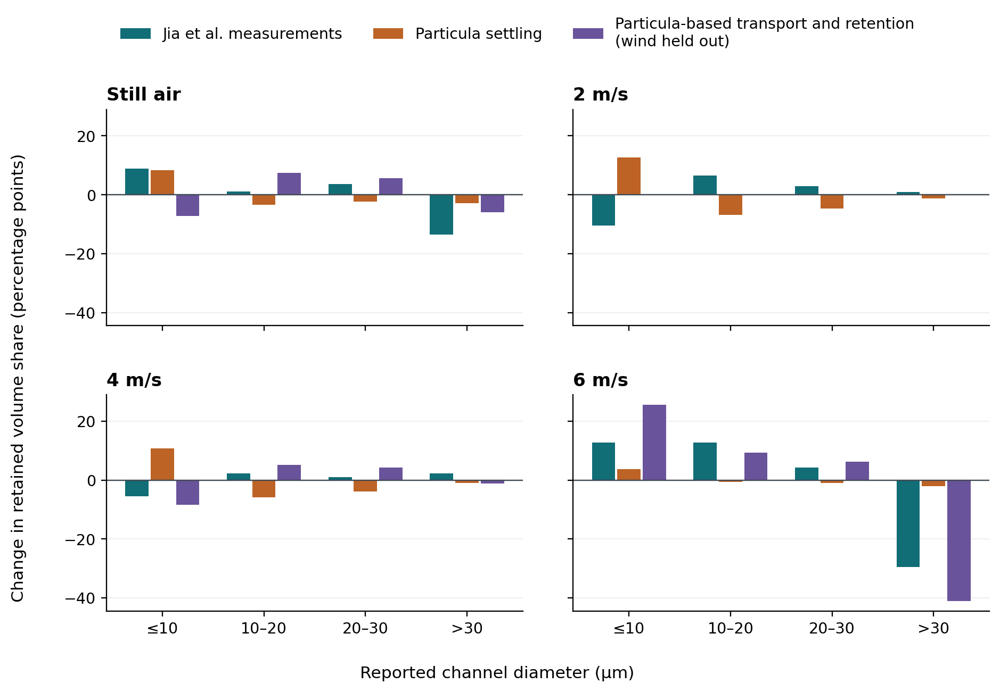
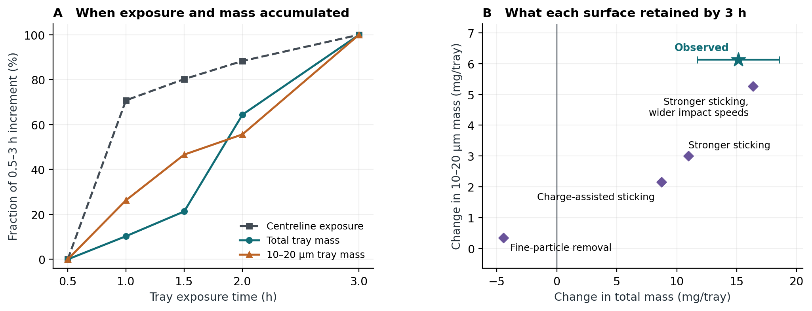

# A Particula-based model reduces mean error in three-hour dust median diameter by 37%

How much can a 30-minute dust sample tell us about the deposit after three hours? We tested a model that combines Particula settling speeds with size-dependent capture and removal against Jia et al.’s wind-tunnel trays. At each of four wind speeds, we fitted the model on the other three and supplied the early tray and the recorded airborne concentration history for the omitted wind. Half the retained dust volume lies in particles smaller than the volume median diameter. We compared each predicted three-hour median with its measured value and counted misses in either direction equally. The average miss across the four winds fell from 4.48 µm when the early median was carried forward to 2.84 µm with the model. Most of the gain came at 6 m/s, where the error fell from 11.45 to 3.70 µm. In still air the fitted model did worse than carrying the early median forward, and at 2 m/s it missed the observed coarsening. The 6 m/s fit also underestimated the retained mass. Size and mass together therefore provide a stricter test of how well a model represents dust delivery and retention.

**Contents**

1. [The wind-tunnel experiment and the 30-minute forecast](#the-wind-tunnel-experiment-and-the-30-minute-forecast)
2. [Settling in still air and at 2–6 m/s](#settling-in-still-air-and-at-26-ms)
3. [When the middle size band accumulated](#when-the-middle-size-band-accumulated)
4. [Airborne supply, collisions and tray retention](#airborne-supply-collisions-and-tray-retention)
5. [What one parameter set predicts across winds](#what-one-parameter-set-predicts-across-winds)
6. [How optical sizing affects the interpretation](#how-optical-sizing-affects-the-interpretation)
7. [A paired collector test for arrival and retention](#a-paired-collector-test-for-arrival-and-retention)
8. [Data and reproducibility](#data-and-reproducibility)

## The wind-tunnel experiment and the 30-minute forecast

Jia et al. used a brief 14 m/s loading phase to suspend sieved cropland dust, then covered the source bed and exposed untreated acrylic trays at 0, 2, 4 or 6 m/s. Separate groups of trays collected continuously until each retrieval. A grain could arrive, rebound or leave later. Their first-order fits described how quickly net retained mass approached its asymptote at each wind and size cutoff. Here we use their early size distribution to predict the later one. The workbook reports volume-equivalent size distributions at 30 minutes and three hours, together with retained mass below six cumulative diameter thresholds at five times. Normalizing the 41 channels and interpolating cumulative volume on log diameter reproduced all eight published medians within 0.05 µm. [Jia et al., methods and Figure 4](https://acp.copernicus.org/articles/26/14245/2026/) · [Versioned observations](https://zenodo.org/records/22962214)

For each diameter we calculated the settling speed of a spherical mineral grain of density 2650 kg/m³. In a well-mixed column of height H with an absorbing floor, the cumulative deposited fraction is F(t) = 1 − exp(−vₛt/H). Multiplying each observed early channel by F(3 h)/F(0.5 h) and renormalizing accounts for the material already deposited at 30 minutes. We fixed H at the 2 m test-section height and carried the same calculation across winds without fitting a late measurement. The input at each wind was its own early deposit. [Channel data and forecasts (`channels.csv`)](../../../../studies/dust-tray-retention/study-results.zip)

## Settling in still air and at 2–6 m/s

The volume median divides the deposited volume in half. In still air it fell from 13.43 to 10.77 µm. The forecast of 11.06 µm captured that decline, but the channel with the most volume stayed at 40.67 µm while the measured peak moved to 15.56 µm. At 2 m/s the calculation predicted 4.00 µm at three hours, against 9.80 µm measured. At 4 m/s it predicted 4.35 µm where the median rose from 6.32 to 7.46 µm. At 6 m/s the median fell from 29.33 to 17.89 µm, a much larger decline than the forecast to 28.36 µm. Changing density or mixing height could change the magnitude of the shift. For this model the late-to-early multiplier always decreases with settling speed, so it cannot reproduce coarsening at 2 or 4 m/s. [Four-wind results (`scores.csv`)](../../../../studies/dust-tray-retention/study-results.zip) · [Sensitivity to mixing and density (`sensitivity.csv`)](../../../../studies/dust-tray-retention/study-results.zip)

*Figure 1. Change in each band’s share between 30 minutes and three hours. Each panel uses that wind’s early spectrum. Teal bars show the changes measured by Jia et al. Orange bars use Particula settling speeds in the untuned column calculation. Purple bars use those same speeds in our transport and retention model, fitted on the other three winds, using the omitted wind’s early tray and measured airborne concentration history. At 2 m/s its changes are close to zero. Bands sum whole channels by reported diameter, with the upper edge included. The 6 m/s observations here come from the optical spectrum.* [Archived channels (`channels.csv`)](../../../../studies/dust-tray-retention/study-results.zip) · [Fits and predicted channel masses (`global-core.json`)](../../../../studies/dust-tray-retention/study-results.zip)

At 2 m/s the channels labeled above 10 through 20 µm gained 6.57 percentage points of volume share. Settling predicted a loss of 6.90 points. Even allowing a fit to the three-hour data to choose *any* size multiplier that decreases or stays constant with diameter could do no better than copying the early spectrum. In either case 12.17% of the volume would have to move between channels to recover the observed distribution. [Size-band changes (`bands.csv`)](../../../../studies/dust-tray-retention/study-results.zip) · [Best attainable whole-spectrum fit (`monotone-limit.csv`)](../../../../studies/dust-tray-retention/study-results.zip)

## When the middle size band accumulated

At 2 m/s the mass between the exact 10 and 20 µm thresholds rose from 6.35 to 12.48 mg per tray. The workbook derives threshold masses from tray weights and optical fractions, so this absolute gain and the spectral shift share measurement information. Missing tray identifiers across cutoffs also matter. For the 6.13 mg band gain, the standard error ranges from 0.95 to 4.35 mg/tray over admissible pairings within the two independent retrieval groups. A closed 2 m settling column initialized from the early band mass predicts at most 6.36 mg/tray present in this band at three hours under the reference assumptions. Most 10–20 µm grains would have settled within the first half-hour. [Closed-column mass bounds (`middle-band-growth.csv`)](../../../../studies/dust-tray-retention/study-results.zip) · [Band-mass uncertainty (`middle-band-spread.csv`)](../../../../studies/dust-tray-retention/study-results.zip)

The intermediate retrievals test the timing. By one hour the centreline monitor had recorded 71% of the airborne exposure remaining after 30 minutes, yet the trays had acquired only 10% of their eventual additional total mass. Distributing the measured increment in proportion to that exposure predicts 36.55 mg at one hour, against 27.40 mg observed. The excess was 9.15 mg, with an approximate 95% interval of 3.21–15.09 mg from the distinct tray groups. A fixed conversion from centreline exposure to retained mass put the gain too early. [Time course (`rebound-timing.csv`)](../../../../studies/dust-tray-retention/study-results.zip) · [Timing contrast (`rebound-timing-intervals.csv`)](../../../../studies/dust-tray-retention/study-results.zip)

## Airborne supply, collisions and tray retention

We divided the test section into twelve vertical parcels with settling, turbulent exchange, sidewall capture and collisions. At 2 m/s the early-tray reconstruction left 84.95 mg/m³ airborne at 30 minutes, compared with 16.35 mg/m³ at the centreline monitor. Scaling the remaining dust to the monitor moved the predicted median from 4.15 to 6.27 µm. With that constraint, sidewall capture shifted the median by 0.12 µm. Brownian, shear and differential-settling collisions together changed it by less than 0.01 µm, as did raising relative humidity from 0% to 85% at assumed hygroscopicity κ = 0.05. Varying friction velocity by ±25% gave medians of 6.24–6.29 µm. Strong persistent contact charging increased modeled number loss to collisions from 2.9% to 25.2%, yet moved the tray volume median down to 6.12 µm. These sensitivities depend on the inferred airborne sizes. [Transport comparisons](../../../../studies/dust-tray-retention/transport.md) · [Contact charging](../../../../studies/dust-tray-retention/tribocharging.md)

A model tuned to remove fine grains from the surface reproduced the 9.80 µm median exactly while predicting a 4.45 mg net loss. An alternative with an abrupt strengthening of mechanical adhesion after 30 minutes predicted a 9.14 µm median and gains of 16.37 mg total and 5.26 mg at 10–20 µm. Observed gains were 15.12 and 6.13 mg. That scenario required near-tray dust concentration 1.94 times the monitor reading when calibrated to the early sample using the paper’s tray dimensions. Gradual strengthening over a 15-minute time constant reduced the respective gains to 10.07 and 3.07 mg. With the reference impact-speed spread, switching on electrical image attraction gave gains of 8.73 and 2.16 mg (Figure 2B). Charge, near-tray loading and adhesion history were unmeasured. [Rebound, re-impact and removal](../../../../studies/dust-tray-retention/rebound.md)

*Figure 2. Timing and size-selective retention at 2 m/s. Panel A scales each series to its own gain from 0.5 to 3 h. Markers identify retrieval times, and successive tray means come from different groups. Panel B shows the observed gains and four simulated surface responses. The 10–20 µm mass uses exact cumulative cutoffs. The charge-assisted and stronger-sticking examples use the same reference impact-speed spread. The wider-spread case doubles it. Fine removal assumes incoming sizes follow the early tray. The three sticking scenarios instead infer incoming sizes from the early deposit and calibrate local loading to its mass. The horizontal bar on the observation is one standard error of the total mass gain across the two tray groups.* [Timing data (`rebound-timing.csv`)](../../../../studies/dust-tray-retention/study-results.zip) · [Surface-change scenarios (`rebound-changing-surface.csv`)](../../../../studies/dust-tray-retention/study-results.zip) · [Selective-removal scenario (`rebound-results.csv`)](../../../../studies/dust-tray-retention/study-results.zip)

## What one parameter set predicts across winds

We used automatic differentiation and multiple starting points to fit one parameter vector across wind speeds. The model combined settling, normal impact speeds, size-dependent capture, a possible lag in local dust delivery, and post-deposition removal. The joint objective scored the six cumulative masses and the 41-channel spectra. The cutoffs overlap and share optical information, so the objective ranks fits without supplying a statistical likelihood. Including 2 m/s in calibration gave a three-hour median of 9.62 µm. Training on the other winds and supplying the test wind’s early tray and its recorded concentration through three hours gave 7.15 µm and 6.27 mg at 10–20 µm.

The same model’s absolute three-hour median error averaged 2.84 µm across omitted winds, compared with 4.48 µm when the early spectrum was carried forward. Its mean absolute total-mass error over the later retrievals was 9.95 mg, compared with 3.02 mg for a common power law. An exploratory model using that law for total mass and physical transport for size gave 39.33 mg and 8.19 µm at 2 m/s, against 40.96 mg and 9.80 µm measured. It overpredicted the still-air median by 11.06 µm. [Predictions and withheld observations (`global-comparisons.csv`)](../../../../studies/dust-tray-retention/study-results.zip)

The shared transport and retention model showed its largest median improvement over copying the early spectrum at 6 m/s. Even there it predicted only 5.10 mg per tray against 40.38 mg measured. Substituting deposition velocities measured in another tunnel over a different collector modestly reduced the four-wind median error to 2.63 µm and increased the total-mass error to 11.30 mg/tray. None of these comparisons establishes a unique adhesion or removal law. All splits reuse wind settings from one previously examined experiment. [Blocked refits and parameter sensitivity](../../../../studies/dust-tray-retention/global-fit.md) · [External velocity data, Zhang et al., Appendix B](https://doi.org/10.5194/acp-14-8869-2014)

## How optical sizing affects the interpretation

At 6 m/s two summaries of the three-hour trays disagree under the authors’ volume-to-mass conversion. The laser spectrum puts 56.21% of the below-63 µm volume below 20 µm. The threshold masses give 19.82%. Every possible assignment of individual below-20 to below-63 tray masses gives a mean ratio between 19.64% and 20.73%. The archive lacks the paired spectra and raw optical signals needed to resolve that difference. Jia et al. describe laser diffraction, while the EyeTech manufacturer describes sizing individual particles by how long they obscure a scanning beam. [EyeTech measurement principle](https://www.ankersmid.com/AutoFiles/doc/922_eyetech%20technologies.pdf)

At 2 m/s, applying the same scanning-beam response to randomly oriented grains at both times gave median increases of 2.26–3.12 µm across the tested shapes. Changing grain alignment between samples could reverse the shift. Under a hypothetical broad-angle diffraction response, a 1.22% maximum weighted signal discrepancy could erase the increase. Making the specific held-out model’s full three-hour spectrum fit the synthetic detector signal required a much larger 17.18% maximum weighted discrepancy. Restricting the simulated detector to angles between 1° and 65° admitted equal medians even with exact synthetic signals. The archive contains processed spectra without the raw signals or individual tray spectra needed for an experimental confidence interval. [Tray pairings (`optical-tray-pairing.csv`)](../../../../studies/dust-tray-retention/study-results.zip) · [Optical assumptions and tests](../../../../studies/dust-tray-retention/optical-study.md)

## A paired collector test for arrival and retention

For this dust, the early tray provides a useful still-air median. Under wind, a forecast must also recover the redistribution among sizes and the mass that accumulated in each band. The 2 m/s timing mismatch makes the first hour especially informative. Measure the incoming size-resolved flux and normal impact speeds just above adjacent adhesive and untreated trays during 0.5–1 h and 1–3 h. A late rise in incident 10–20 µm flux that appears on both collectors, with a stable acrylic-to-adhesive capture ratio, would favor delayed delivery. An unchanged incoming fraction accompanied by a rise in acrylic retention relative to adhesive capture would favor changing surface retention. Linking each tray’s gross mass, size distribution and raw optical record would make that distinction testable at the level of individual samples.

## Data and reproducibility

[Download the Particula simulation results and analysis tables (ZIP)](../../../../studies/dust-tray-retention/study-results.zip). The table names in the links identify files inside this archive.

The original benchmark is Figure 4 of Jia et al. (2026), *Non-monotonic response of net dust deposition kinetics to low wind speeds*. All calculations use the version 2 workbook. We used Particula 0.3.6 at revision `3435f653`, Python 3.12.12, and CPU calculations. Refining the 2 m/s transport calculation from 12 to 24 parcels and from 48 to 95 size pivots while halving the maximum time step changed its median by less than 0.001 µm. The optical reconstruction ranges and physical sensitivity tests describe specified model assumptions. The timing interval also conditions on the recorded centreline exposure. [Source paper](https://doi.org/10.5194/acp-26-14245-2026) · [Archived data](https://doi.org/10.5281/zenodo.22962214) · [Run environment (`run.json`)](../../../../studies/dust-tray-retention/study-results.zip) · [Measurement uncertainty](../../../../studies/dust-tray-retention/uncertainty.md)

The graphical abstract takes the absolute difference between forecast and archived three-hour volume median for each omitted wind and weights the four winds equally. The percentage reduction uses carrying the early median forward as its reference. From the repository root, run `python -m scripts.render_literature_tocs dust-tray-retention` in the study environment to regenerate it. [Experiment icon (SVG)](../../../images/dust-tray-retention/wind-tunnel-icon.svg) · [Graphical abstract source](../../../../studies/dust-tray-retention/analysis_toc.py) · [Held-out forecasts and archived endpoints (`global-comparisons.csv`)](../../../../studies/dust-tray-retention/study-results.zip)

Figures 1 and 2 are drawn directly from saved channel masses, model predictions, and tray summaries. Run `python studies/dust-tray-retention/analysis_figures.py` from the repository root with NumPy and Matplotlib to regenerate them. [Figure source](../../../../studies/dust-tray-retention/analysis_figures.py) · [Full simulation replay](../../../../studies/dust-tray-retention/README.md) · [Detailed study review](../../../../studies/dust-tray-retention/review.md)
