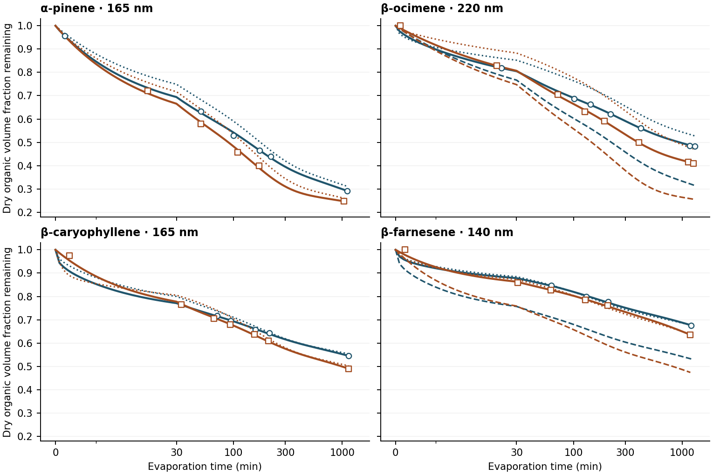
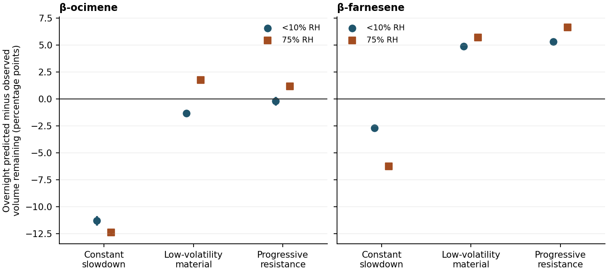

# Both acyclic aerosols retain more volume in the common-size reconstruction

Aerosol from both acyclic terpenes retained more material than its cyclic partner in the common-size reconstruction. When all four aerosols began at 165 nm, the fitted difference was 14.5–16.8 percentage points of initial dry volume at 200 minutes. The starting-size explanation is especially weak for β-farnesene, whose particles were initially smaller than the cyclic comparison. The interpretation of particle volume depends on what happened to the effective density as the particles evaporated. [Experimental sizes and volume retrieval](sources.md)

## Reconstructing the measured evaporation curves

Liu et al. report that about 46%, 63%, 64% and 78% of the initial volume remained after 200 minutes of dry aging for pinene, ocimene, caryophyllene and farnesene, respectively. We used their seven reported volatility-bin fractions, starting sizes and densities with gas-transfer settings from Wilson et al. The reconstruction gave 48%, 70%, 65% and 77%. The ordering survived. Dry ocimene showed the largest discrepancy at the experimental geometry. The published fractions are rounded and the full original fitted trajectories and transport settings were unavailable. [Liu et al.](https://doi.org/10.1021/acsestair.5c00226) · [Wilson et al.](https://doi.org/10.1021/es505331d)

**Figure 1.** Circles show dry measurements and squares show measurements after aging at 75% RH. Dotted lines reconstruct the authors' fitted fractions. Solid lines fit each precursor independently. Dashed lines in the right panels use the partner's cyclic fit at the measured acyclic starting size and density. Time is linear through 30 minutes and logarithmic thereafter.

The reference calculation uses Particula gas-side transfer coefficients, including the transition between free molecular and continuum transport and the Kelvin curvature term. It assumes an ideal organic mixture, a common molar mass of 200 g mol⁻¹, 297.15 K, unit accommodation, gas diffusivity of 6 × 10⁻⁶ m² s⁻¹ and surface tension of 0.03 N m⁻¹. Each independent fit constrained the seven nonnegative fractions to sum to one, with a weak penalty for departing from the paper’s fractions. A good fit to a short time series leaves several possible volatility distributions.

## Can the cyclic model predict its acyclic partner?

The independently fitted cyclic inventories lost too much volume when transferred to the acyclic particles' original geometry. At 200 minutes the dry pinene fit gave 51.5% for 220 nm ocimene, and the dry caryophyllene fit gave 63.0% for 140 nm farnesene. Fits to the acyclic series themselves gave 63.1% and 77.6%. Equalizing starting size and varying gas transport, curvature, density, water uptake and reading assumptions preserved the differences in the table. The ranges span nine chamber configurations with efficient organic vapor removal.

| Acyclic minus cyclic volume at 165 nm and 200 min | Dry | After 75% RH aging |
| --- | ---: | ---: |
| Ocimene minus pinene | +14.5 pp (12.6–16.7) | +16.8 pp (14.9–18.6) |
| Farnesene minus caryophyllene | +14.6 pp (12.5–16.8) | +16.3 pp (14.5–18.2) |

A comparison based only on the order of the measurements reached a similar conclusion for farnesene. For this test we let the cyclic evaporation curve decrease at any rate between observed points and scaled its time for the different initial densities and sizes. At the actual 209-minute dry farnesene observation, 77.6% remained, while the size-adjusted cyclic curve allowed at most 64.7%. Sampling limits the corresponding ocimene comparison. Its 218-minute dry marker exceeded the size-only bound by at least 8.4 percentage points, while interpolation at exactly 200 minutes permitted zero difference.

## Vapor and density change what can be inferred

Accumulated organic vapor can slow further evaporation. We refitted the cyclic reference at each vapor-removal lifetime (10 minutes, one hour or one day) and cyclic number concentration (100 or 200 particles cm⁻³), then transferred it at both acyclic number concentrations. Slow removal brought some 200-minute ocimene predictions into the observed range. Even with this freedom the highest farnesene predictions were 67.9% dry and 65.4% humid. The one-day lifetime tests an inefficient sink. Assigning that lifetime to the actual vessel would require a gas-phase measurement.

Density affects how a measured residue translates into true volume. For a sphere, a change by a factor η in density multiplies the apparent volume fraction by η³ at fixed geometric volume. Increases of 7.0–9.5% could account for the aerodynamic-diameter excess at 200 minutes if the acyclic geometric volumes followed their cyclic predictions. These calculations isolate the measurement conversion by holding the evaporation trajectories fixed. Paired outlet measurements of dry mobility diameter and mass or effective density could test it directly. [Consequences for cloud activation](cloud.md)

## Why the overnight observations matter

A single slowdown of the cyclic evaporation clock fitted to ocimene observations through 300 minutes left too little volume overnight. The mean absolute error was 11.3 percentage points in dry air and 12.4 points after humid aging. Replacing 21.5% and 22.9% of the cyclic mixture by its least volatile bin reduced those errors to 1.3 and 1.7 points. Alternatively, reducing the release coefficient progressively as volume decreased gave errors of 0.3 and 1.2 points. This empirical release law represents growing resistance. Its fitted exponent cannot be converted directly into a measured diffusivity.

**Figure 2.** Predicted minus observed residue after 900 minutes, in percentage points of initial volume. Model changes were fitted only through 300 minutes for the acyclic precursors. Points show mean signed errors and the vertical segments span the two ocimene observations at each humidity. Each farnesene series contains one overnight observation. The cyclic reference used its full record.

A monotone time-rescaling check also found a conflict for ocimene at native plotting precision. The conflict disappeared when individual markers could move by 0.6 percentage points dry or 0.9 points humid. Adding a slowly evaporating pool can fit the overnight measurements within the available reading precision, but the same measurements admit evolving internal resistance. A second starting size changes the distance the organics must traverse and provides a way to test that ambiguity. [Prediction for the proposed 60 nm cohort](size-test.md) · [Main study](index.md) · [Replay instructions and source](https://github.com/uncscode/particula/tree/main/studies/liu-terpene)
