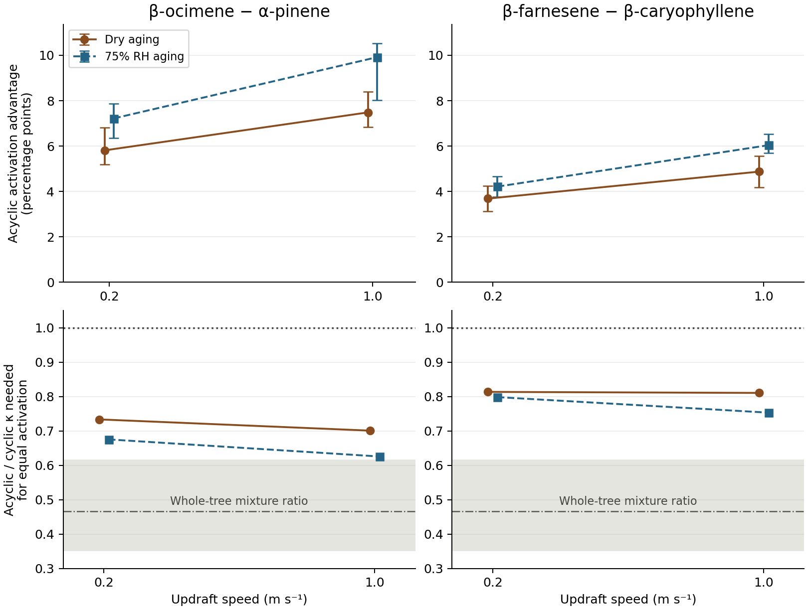

# Larger residues can activate more particles, but lower water affinity can reverse the effect

The chamber fits predict how much dry size survives 200 minutes of evaporation. In model cloud parcels, more of the larger acyclic residues activated when the two aerosols had the same water affinity. After dry aging, 39.25% of the α-pinene particles and 45.94% of the β-ocimene particles activated in a weak updraft at hygroscopicity κ = 0.15. Reducing ocimene κ to 0.07 lowered its activated fraction to 31.13%. This comparison tests one possible consequence of evaporation. The water affinity of Liu’s aged material remains unmeasured. [Chamber-size reconstruction](chamber.md) · [Independent whole-tree aerosol measurements](https://doi.org/10.1038/ncomms14067)

## Which particles enter the cloud?

Each precursor began with the same particle number and initial size distribution. For each dry size class we multiplied the original diameter by the cube root of its fitted 200-minute volume fraction. The reference distribution had 300 particles cm⁻³ and spanned 65–300 nm in diameter, with a geometric median of 140 nm before truncation and geometric standard deviation of 1.4. Survival was interpolated in log initial diameter. Incoming number, sizes and updrafts are scenarios. The chamber measurements constrain the evaporation fits.

Each population rose in its own closed parcel at 0.2 or 1.0 m s⁻¹, starting at 285 K and 90 kPa with the same total water. The model coupled condensational water uptake to vapor, temperature and supersaturation. We counted particles that crossed their critical wet radius and remained above it 100 m above cloud base. The primary equal-affinity calculation used κ = 0.10 within the monoterpene pair and 0.05 within the sesquiterpene pair, matching the hydration assumptions in Liu’s supplement. [Chamber conditions](https://doi.org/10.1021/acsestair.5c00226)

## How water consumption and affinity change the count

At the same water affinity the acyclic particles activated more readily across the broad seed distribution. The primary gains ranged from 3.69 to 9.92 percentage points across two precursor pairs, two evaporation humidities and two updrafts. More condensation also consumed more vapor. In the weak dry-monoterpene comparison at κ = 0.10, the acyclic size advantage would have raised activation by 10.27 points if both populations followed the cyclic parcel’s air history. Independently coupling each population to its own parcel reduced that gain to 5.90 points at the same resolution. The peak supersaturation was lower in the ocimene parcel.

**Figure 1.** The upper panels show acyclic gains in activated number fraction at the same κ. Bars span nine choices in the chamber fits. The lower panels show the ratios of acyclic to cyclic κ giving equal activation. Shading spans the ratios formed from one-standard-deviation endpoints in Zhao et al.’s independent whole-tree experiments. The dash-dot line is the ratio of their means. Each marker compares two closed parcel simulations at the same sampling height.

Water affinity need change only enough to offset the dry-size advantage near the activation threshold. Equal activation occurred when the acyclic κ was 63–73% of cyclic κ for the monoterpenes and 75–81% for the sesquiterpenes. Zhao et al. measured κ = 0.15 ± 0.02 for aerosol from unstressed pine emissions and 0.07 ± 0.01 for aerosol from aphid-stressed, sesquiterpene-rich emissions. Transferring the two means reversed all eight parcel comparisons. At the closest one-standard-deviation endpoints, seven reversed. The humid monoterpene difference in a 1 m s⁻¹ updraft was −0.09 percentage points, within the numerical cutoff bracket of 0.16 points. These independent measurements establish the size of a plausible change for a mixture. They leave open whether that change occurs for Liu's individual precursors. [Zhao et al., Figure 2](https://doi.org/10.1038/ncomms14067)

The incoming population determines whether any particles are near the critical size. Restricting the initial distribution to 140–220 nm erased the difference at 1 m s⁻¹ because every particle activated. In the broad reference distribution, particles starting around 108–123 nm determined the change at that updraft. Using a single survival fraction at all starting sizes still produced gains at equal κ, so the sign in this case survived the simpler evaporation assumption.

## How a change in density would affect the inference

A chamber-size retrieval that overestimates geometric size could also overstate the activation gain. We reduced each acyclic dry radius by the relative density increase that could explain the apparent chamber excess, then repeated the ascents at unchanged κ. Applying the same correction at every seed size reduced the farnesene gain from 3.70–6.03 percentage points to −0.16 to +0.36 points. Ocimene retained a positive gain of 1.94–4.26 points. A density change at those levels is an unmeasured scenario. It would be possible for farnesene to leave a strong aerodynamic-diameter signal in the chamber and little additional cloud droplet number.

For the weak dry-monoterpene case, initially 150–170 nm particles span the activation threshold. Comparable 200-minute cohorts with paired dry diameter, density, and size-resolved cloud condensation nucleus measurements would test whether the downstream κ contrast crosses the modeled break-even ratio. The [60 nm overnight evaporation test](size-test.md) asks a different question about internal transport and volatility. An atmospheric droplet prediction would additionally require aerosol formation yields, an ambient seed spectrum and a measured updraft history. [Main study](index.md) · [Replay instructions and source](https://github.com/uncscode/particula/tree/main/studies/liu-terpene)
