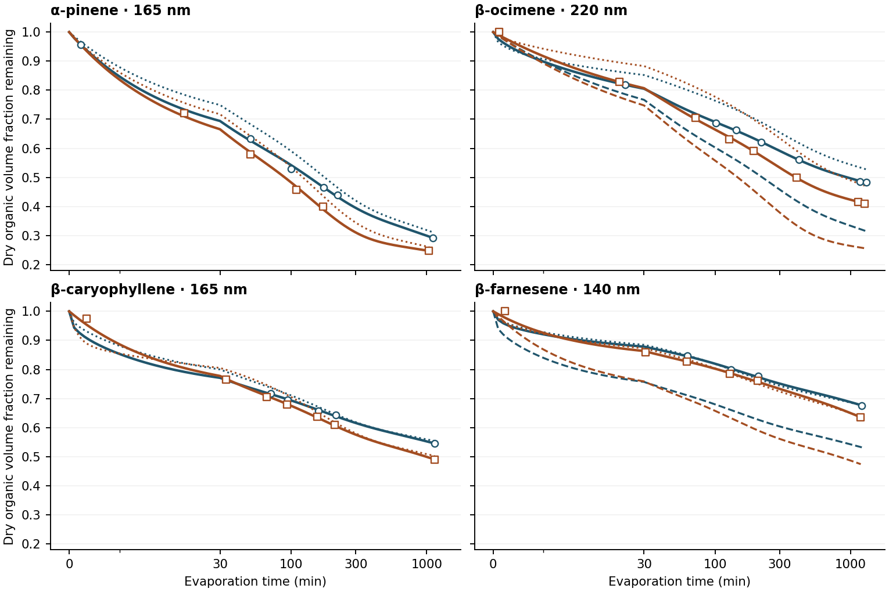
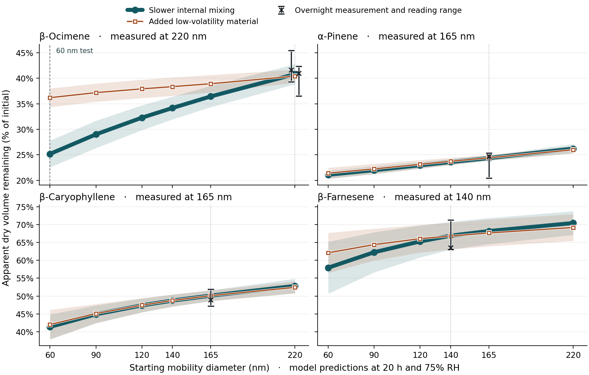
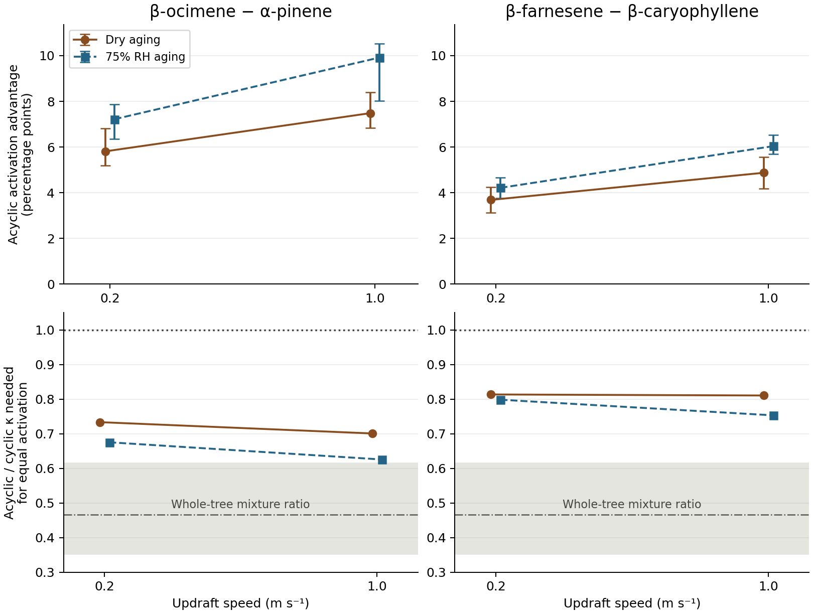

# Two mechanisms fit the 220 nm β-ocimene residue and predict different losses at 60 nm

Why did aerosol formed from β-ocimene leave more residue in Liu and colleagues’ chamber than aerosol from its cyclic relative, α-pinene? In our reconstruction the difference persisted when both aerosols started at the same diameter. For β-ocimene aerosol aged at 75% relative humidity, two explanations fit the measurements. The particles could contain more low-volatility material, or organics could reach the evaporating surface more slowly as the particles shrink. At the measured starting diameter of 220 nm, Liu measured 41.6% and 41.0% of the apparent initial dry volume remaining at roughly 19 and 21 hours in the same chamber fill. A smaller particle gives organics a shorter path to the surface. For a 60 nm sample of the same composition, the models predict 22.6–27.8% remaining after 20 hours with slower mixing and 34.4–38.0% with more low-volatility material. The forecasts assume efficient vapor removal. Widening the allowance for reading the published diameter spectra narrows the gap between them from 6.6 to 1.2 percentage points. [Liu et al.](https://doi.org/10.1021/acsestair.5c00226) · [Measurements and predictions behind the graphic](size-test.md)

## How Liu’s chamber measured the residue

Plants can change the mixture of terpenes they emit under stress. Liu et al. asked whether the better-studied cyclic terpenes could represent aerosol formed from their acyclic relatives. They oxidized each precursor separately with OH under low-NOₓ conditions, selected particles by mobility diameter, and allowed them to evaporate in dry air or at 75% relative humidity (RH). After drying the outlet sample they measured its peak vacuum aerodynamic diameter. Cubing the final-to-initial diameter ratio gives the apparent fraction of dry particle volume remaining. Interpreting it as geometric volume assumes that effective density remains stable. [Experiment and source measurements](sources.md)

The β-ocimene particles started larger than α-pinene particles (220 versus 165 nm), which could slow fractional loss. β-Farnesene particles started smaller than β-caryophyllene particles (140 versus 165 nm), which should favor faster loss. Molecular spectra suggested a compositional difference as well. The share of formula signal classified as low or extremely low volatility was 62% for ocimene versus 25% for pinene, and 56% for farnesene versus 37% for caryophyllene. Translating ion signal into condensed mass would require the response of each compound. [Paper, Figures 1–6](https://aerosol.chem.uci.edu/publications/Irvine/2026_Liu_EST_Air_SOA_evaporation.pdf)

## What size and composition can explain about evaporation

### The acyclic residue persists at a common starting size

Reconstructing evaporation with the authors’ seven volatility-bin fractions reproduced the ordering of the dry residues. Liu et al. report about 46%, 63%, 64% and 78% remaining at 200 minutes for pinene, ocimene, caryophyllene and farnesene, respectively. Our reconstruction gave 48%, 70%, 65% and 77%. The largest discrepancy was seven percentage points for dry ocimene. Figure 1 shows the 48 recoverable markers, the reconstruction and our independent fits. [Reference calculation and fit assumptions](chamber.md)

**Figure 1.** Circles show dry measurements and squares show measurements after aging at 75% RH. Solid curves fit each precursor’s observations. Dotted curves reconstruct the authors’ seven-bin fractions. Dashed curves transfer each cyclic fit to its acyclic partner’s starting size and density. The authors’ plotted lines connect measured points. [Extracted observations](https://raw.githubusercontent.com/uncscode/particula/main/docs/data/liu-terpene/digitized.zip) · [Computed curves](chamber.md)

Matching the starting diameter reduced the ocimene–pinene difference and increased the farnesene–caryophyllene difference. Both acyclic aerosols still retained more volume in the reconstruction. At 165 nm, the four fitted comparisons gave the acyclic aerosol 14.5–16.8 percentage points more of its initial dry volume after 200 minutes. The common-size estimates assume efficient vapor removal and stable effective density. The table gives sensitivity to nine transport and reading assumptions. [Matched-size results](chamber.md)

| Acyclic minus cyclic residue at 200 min | At original diameters | At a common 165 nm | Common-size sensitivity range |
| --- | ---: | ---: | ---: |
| Ocimene minus pinene, dry | 18.5 pp | 14.5 pp | 12.6–16.7 pp |
| Ocimene minus pinene, 75% RH | 22.0 pp | 16.8 pp | 14.9–18.6 pp |
| Farnesene minus caryophyllene, dry | 13.2 pp | 14.6 pp | 12.5–16.8 pp |
| Farnesene minus caryophyllene, 75% RH | 14.8 pp | 16.3 pp | 14.5–18.2 pp |

Dry farnesene gives the clearest evidence against starting size alone. It retained 77.6% at 209 minutes, while the size- and density-adjusted cyclic curve allowed at most 64.7% at that time. Retaining vapor in the chamber could account for more of the ocimene difference. Density limits the interpretation for both pairs. An increase of about 7–9.5% relative to initial density could produce the same aerodynamic-diameter excess at 200 minutes even if the true volume followed the cyclic prediction. [Observation-only comparison](chamber.md)

### At 220 nm the overnight ocimene observations admit two explanations

The two 220 nm measurements sampled the same humid ocimene chamber run. Apparent dry volume remaining was 41.6% at 1,138 minutes and 41.0% at 1,265 minutes. We compared the plotted markers with the initial and late diameter spectra. Allowing half a diameter bin plus one image pixel to locate each spectral peak gives reading ranges of 39.3–45.4% and 36.5–42.3%, respectively. Both readings share an initial diameter. Independent chamber fills would be needed to estimate run-to-run variation. [Liu’s Figure 4 and supporting spectra](sources.md) · [Reading ranges](sources.md)

A uniform slowdown of the pinene evaporation rates fitted to the daytime ocimene data left the humid overnight residue 12.4 percentage points too low on average. Either of two physical changes improved the forecast. Moving more initial mass into the lowest-volatility bin leaves material with little tendency to evaporate. Keeping the pinene volatility distribution and letting internal diffusivity decline as organics evaporate slows their supply to the surface. Both mechanisms fit the paired 220 nm readings used to select the parameters. An additional 193-minute marker without a matching readable peak gives 59.2% remaining, above the 57.7% maximum forecast by the selected lower-volatility models. [Daytime fits and withheld overnight forecasts](chamber.md) · [Shared-diameter calibration](size-test.md)

### At 60 nm the models predict different amounts of ocimene residue

A shorter path to the surface lets a smaller particle lose more material when internal mixing limits evaporation. For a 60 nm cohort with the same starting composition and efficient vapor removal, the slower-mixing model predicts 22.6–27.8% remaining after 20 hours. Putting extra material in the lowest-volatility bin gives 34.4–38.0%. The nearest ends of those ranges differ by 6.6 percentage points, equivalent to about 2.9 nm in final dry diameter. Liu’s overnight measurements constrain the models at 220 nm. The 60 nm values are forecasts for a new experiment. [Plotted model ranges](https://github.com/uncscode/particula/blob/main/docs/data/liu-terpene/figure2.csv)

**Figure 2.** Apparent dry volume remaining after humid evaporation. Black crosses mark the overnight observations at their actual ages. Whiskers span the plotted markers and our readings of the initial and late diameter spectra. Both ocimene observations were made at 220 nm and are offset horizontally for visibility. Colored bands span 20-hour predictions consistent with the paired daytime and overnight readings at the original size (dotted line). Teal circles and orange squares mark the band midpoints for slower mixing and extra low-volatility material. The dashed line at 60 nm marks the proposed ocimene test. [How the whiskers were read](sources.md) · [Selection and model ranges](size-test.md)

The precision of the original diameter readings determines how well the 60 nm forecasts separate. Allowing a full diameter bin instead of half a bin widens the two ranges to 21.5–30.6% and 31.8–41.7%, leaving only 1.2 percentage points between them. Vapor removal matters too. With a ten-minute vapor-removal lifetime and matched particle counts, the half-bin analysis gives 23.6–29.1% and 35.5–38.8%. At a day-long vapor lifetime, the extra-low-volatility model fails the original-size constraints. The humid chamber’s vapor sink was unmeasured. [Resolution and vapor sensitivity](size-test.md)

Farnesene illustrates why slow evaporation by itself cannot identify slow mixing. Its 140 nm overnight marker gives 63.5% remaining. The corresponding spectra give 68.0%, with a range spanning both readings of 63.1–71.3%. Both mechanisms fit farnesene in all five chamber configurations and overlap at every tested size and age. The two cyclic controls also give overlapping ranges. A separate viscosity check for humid ocimene predicts about 26% at 220 nm using a fixed viscosity inferred from composition. Liu’s direct shape-relaxation estimate comes from the coalescence of dry farnesene particles. [Farnesene reconstruction](sources.md) · [Viscosity and diffusivity](viscosity.md)

### Residue size alone leaves cloud activation uncertain

The 200-minute evaporation fits also let us ask how much the larger residues might change cloud droplet number. In a modeled weak updraft, 39% of the dry-aged pinene particles and 46% of the dry-aged ocimene particles activated at the same water affinity (κ = 0.15). Lowering ocimene κ to 0.07 reduced its activation to 31%. That contrast in water affinity comes from independent measurements on whole-tree emission mixtures. Liu’s aged particles have no corresponding κ measurement. [Chamber-to-cloud calculation](cloud.md) · [Zhao et al.](https://doi.org/10.1038/ncomms14067)

**Figure 3.** Upper panels show gains in activated fraction at the same residual κ across nine chamber model choices. Lower panels show the acyclic-to-cyclic κ ratio that gives equal activation. The shaded band spans ratios formed from the one-standard-deviation endpoints of the tree-mixture measurements. Each comparison uses two separately coupled parcels 100 m above cloud base. [Parcel controls and data](cloud.md)

## A paired 60 and 220 nm test could distinguish the mechanisms

Split each low-NOₓ β-ocimene formation batch into 60 and 220 nm cohorts, check that their initial compositions match, and age both at 75% RH for 20 hours. Match particle number, measure vapor removal, and measure dry mobility size with mass or effective density. If the 220 nm cohort again retains about 41%, a 60 nm residue near one-quarter of the initial volume would favor slower mixing under efficient vapor removal. A residue near 36% would favor more low-volatility material. Independent paired fills would establish whether the difference exceeds experimental variability. An outcome outside both ranges would prompt a test of the assumed vapor sink, composition and the possibility that both processes contribute. [Experimental assumptions and competing forecasts](size-test.md)

## Reproducibility

The CPU example reads the digitized chamber observations, reconstructs the humid measurement bounds and compares the two 60 nm forecasts. The full replay includes gas transfer, finite vapor removal, viscosity-constrained diffusion and cloud activation. We ran the original simulations with Particula 0.3.6 at revision `2db6a77323` and an NVIDIA GeForce RTX 5060. The download preserves the readings taken from the published plots, including the pixel coordinates used to recover them. The original paper and supporting spectra are available from the publisher. [Runnable example](compare_residues.py) · [Download the digitized data](https://raw.githubusercontent.com/uncscode/particula/main/docs/data/liu-terpene/digitized.zip) · [Replay instructions and source-to-figure guide](https://github.com/uncscode/particula/tree/main/studies/liu-terpene)
