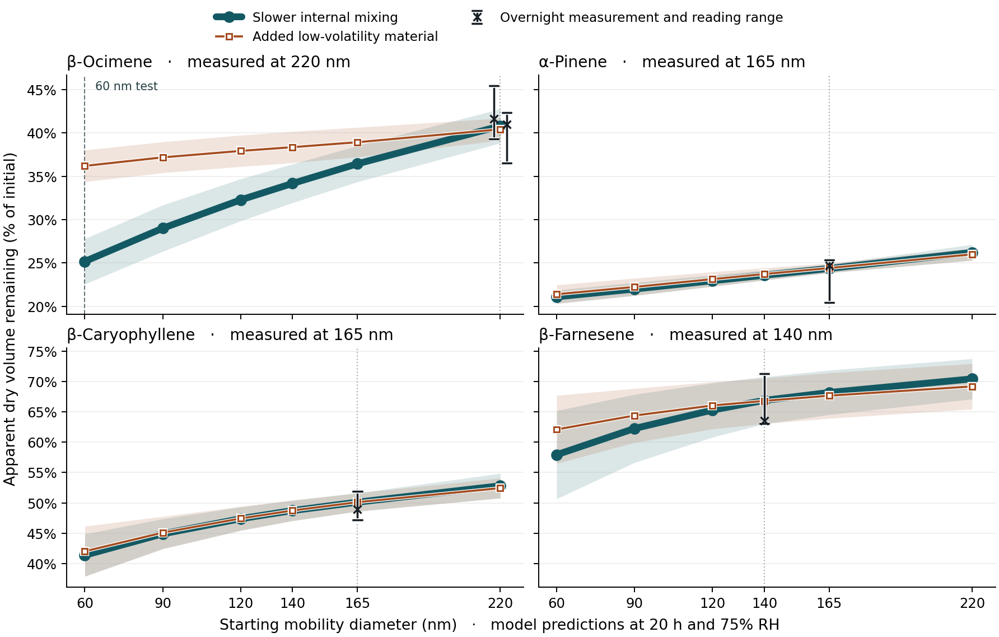

# A 60 nm ocimene cohort could separate internal mixing from lower volatility

Two physical models can fit the daytime and overnight readings of humid β-ocimene aerosol at its measured starting diameter of 220 nm. Moving the same composition to a 60 nm particle shortens the path from the interior to the evaporating surface. Under efficient vapor removal, the slower-mixing model then leaves 22.6–27.8% of the initial dry volume at 20 hours. The model with extra low-volatility material leaves 34.4–38.0%. The gap corresponds to only about 2.9 nm in final dry diameter at the nearest edges. [Measured points and shared-diameter uncertainty](sources.md)

## What changes between the model runs?

Both models start from the seven volatility-bin fractions fitted to α-pinene at 75% relative humidity (RH). For β-farnesene the cyclic reference is β-caryophyllene. The reference fractions were recalibrated for each of five chamber configurations covering accommodation, curvature, and particle water.

In the mixing model, each bin’s effective loss time includes the time for organics to reach the surface. We added the first spherical diffusion relaxation time, *r*²/(π²*D*), to the gas-transfer depletion time, with *r* the current radius. Diffusivity *D* decreases from its initial value *D*₀ with the fractional volume lost according to log₁₀(*D*/*D*₀) = −*g*(1 − *V*), where *V* is the remaining volume fraction. The grid spans initial diffusivities from 10⁻²² to 10⁻¹⁵ m² s⁻¹ and *g* from zero to 16. Constant diffusivity and rapid mixing provide controls. This approximation represents the time for internal supply. A separate calculation resolves the composition of individual radial shells. [Viscosity and radial transport](viscosity.md)

In the lower-volatility model, particles stay well mixed. A fraction of the starting mass moves from the cyclic mixture into the 10⁻⁴ µg m⁻³ saturation-concentration bin, preserving total mass. The enriched fraction spans zero to 0.8. For each model we retained parameter sets consistent with all paired daytime observations through 300 minutes and all paired observations after 900 minutes using one admissible starting aerodynamic diameter. We transferred those parameter sets to six starting mobility diameters without changing composition. The forecast at 60 nm uses no 60 nm observations.

**Figure 1.** Crosses and whiskers give overnight measurements and reading ranges at the experimental starting mobility diameter. The two 220 nm ocimene markers are offset for visibility. Colored bands span 20-hour forecasts consistent with the native-size data. Teal circles mark the midranges for slower mixing and orange squares those for extra low-volatility material. The dashed vertical line marks the proposed 60 nm ocimene cohort. [Compact figure data](https://github.com/uncscode/particula/blob/main/docs/data/liu-terpene/figure2.csv)

## How much separation would a new experiment have to resolve?

| 60 nm ocimene, 20 hours at 75% RH | Slower internal mixing | Extra low-volatility material |
| --- | ---: | ---: |
| Efficient vapor removal, half-bin reading allowance | 22.6–27.8% | 34.4–38.0% |
| Efficient vapor removal, full-bin allowance | 21.5–30.6% | 31.8–41.7% |
| Half-bin allowance with additional daytime constraints | 22.6–27.8% | 34.6–38.0% |
| Ten-minute vapor-removal lifetime, matched number concentrations | 23.6–29.1% | 35.5–38.8% |

The precision assigned to the published spectra changes how far apart the predictions lie. A full-bin allowance for locating each peak reduces the gap from 6.6 to 1.2 percentage points. The interval widths reflect reading and model assumptions. Replicate chamber fills would be needed to determine whether a real 60 nm experiment could resolve either gap.

One recovered humid ocimene marker at 193 minutes has no uniquely matched spectral peak. The marker gives 59.2%, while the lower-volatility models selected on the paired points predict at most 57.7%. In the additional daytime check we included the intermediate paired observation and, for unmatched readings after 5 minutes, transferred the widest relative daytime reading margins for the same precursor. The two 60 nm bands remained separate under that assumption. It also leaves the discrepancy with the 193-minute marker center visible.

Vapor control matters because gas escaping from one particle can return to another. The finite-vapor cases refitted the pinene reference at each gas-to-wall lifetime and number concentration, then transferred it to ocimene. With a day-long vapor-removal lifetime, none of the extra-low-volatility cases satisfied the original-size constraints. The rate in the humid chamber was unmeasured. Tripling the time resolution changed the 20-hour endpoints in the transport refinement by less than 0.001 percentage points. Numerical refinement cannot determine the vapor sink.

## Where another starting size helps less

Both mechanisms fit humid β-farnesene in all five chamber configurations. At 140 nm and 20 hours the slower-mixing range is 63.0–70.8%, and the extra-low-volatility range is 63.0–70.5%. Their ranges overlap at every tested size and age. An earlier sensitivity screen discarded the lower-volatility model because its best daytime-compatible fit missed the overnight point by 2.55 percentage points against a chosen 2.5-point cutoff. Reconstructing the actual overnight reading gives a range of 63.1–71.3%, sufficient for both mechanisms. The two cyclic controls also give overlapping forecasts.

For ocimene, split each formation batch into 60 and 220 nm cohorts, verify their initial compositions, and match particle number, temperature, humidity and vapor removal. Pair outlet dry mobility diameter with mass or effective density. Repeat the split across independent fills. If the large cohort again retains about 41%, a small-cohort residue near one-quarter of its starting volume would favor slower transport under an efficient sink. A residue near 36% would favor more low-volatility material. An intermediate or inconsistent outcome would motivate testing both mechanisms together and measuring the vapor history directly. [Main study](index.md) · [Replay instructions and source](https://github.com/uncscode/particula/tree/main/studies/liu-terpene)
