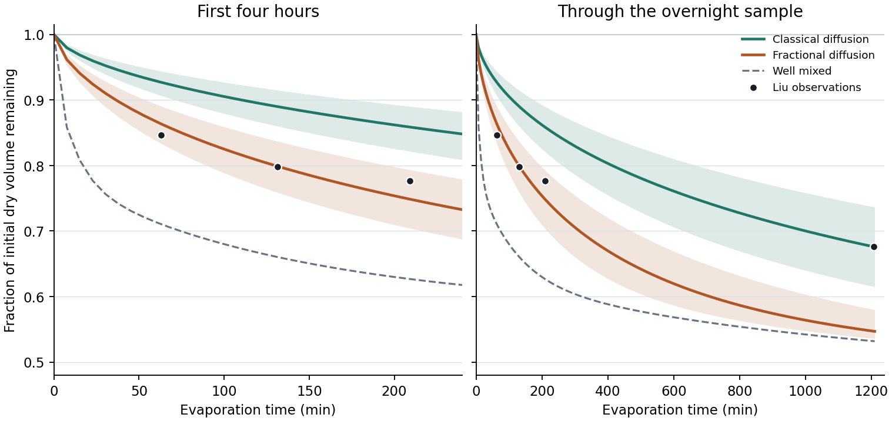
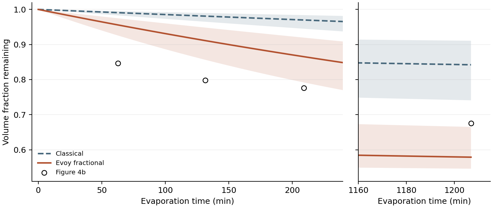
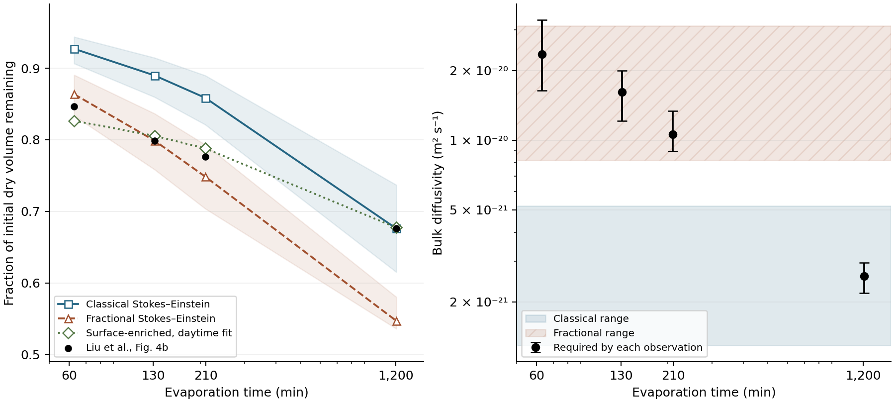

# Dry farnesene viscosity constrains overnight loss more closely than early loss

The paper offers two distinct viscosity constraints. Liu et al. observed dry β-farnesene particles relaxing toward a spherical shape. For all four precursors and both humidity conditions they estimated viscosity from molecular formulas and hydration. Applying the humid ocimene estimate as a single viscosity gives 26.0% and 25.6% apparent dry volume remaining at the two 220 nm overnight times, versus 41.6% and 41.0% measured. Allowing internal supply to change as organics leave gives the separate 60 nm prediction in the main study. [Liu et al., Figures 3 and 7](https://doi.org/10.1021/acsestair.5c00226) · [Size-dependent forecasts](size-test.md)

## How fast can material reach the surface?

The roughly 15-minute shape relaxation of dry farnesene aerosol implied a viscosity of 1.4–2.8 × 10⁸ Pa s given the assumed surface tension. For organic tracers with radii of 0.3–0.6 nm at 297.15 K, classical Stokes–Einstein diffusion gives *D* = *kT*/(6πη*a*) = 1.30–5.18 × 10⁻²¹ m² s⁻¹. Here η is the viscosity and *a* the tracer radius. These diffusivities correspond to a first-mode diffusion time of 27–106 hours across a particle of 70 nm radius. Bulk shape relaxation and the motion of an individual molecule sample different processes.

We froze the initial volatility inventory at the dry β-caryophyllene fit, then applied each viscosity relation to 140 nm farnesene particles. In an initially homogeneous sphere the classical radial model left too much volume early and reached the overnight measurement. A fractional tracer law accelerated early loss but depleted too much by the next day.

| Elapsed minutes | Measured dry volume | Well-mixed model | Radial, classical | Radial, fractional |
| ---: | ---: | ---: | ---: | ---: |
| 63 | 84.7% | 71.1% | 92.7% | 86.4% |
| 131 | 79.8% | 66.0% | 89.0% | 79.9% |
| 209 | 77.6% | 62.7% | 85.9% | 74.9% |
| 1,207 | 67.6% | 53.2% | 67.6% | 54.7% |

**Figure 1.** Measured dry farnesene volumes and predictions for the same seven-bin inventory. Central radial curves use 2.1 × 10⁸ Pa s and a 0.4 nm tracer. Shading spans viscosity and tracer-size endpoints. Both panels show the same trajectories over different time windows.

The fractional relation uses the tracer calibration of Evoy et al., with exponent 0.93 and a crossover viscosity of 10⁻³ Pa s. Across the tested tracer sizes it gives *D* = 0.82–3.12 × 10⁻²⁰ m² s⁻¹. The farnesene viscosity lies 35–70 times above the highest central viscosity in the calibration. The extrapolation tests how faster molecular mobility would change evaporation. Direct tracer motion in these farnesene particles remains unmeasured. [Evoy et al., tracer data and parameterization](https://acp.copernicus.org/articles/19/10073/2019/)

**Figure 2.** The reduced model adds a diffusion timescale to each bin’s gas-transfer time. Open circles show the four dry farnesene markers. Shading spans the viscosity and tracer-radius endpoints around a central 0.4 nm tracer. Faster supply improves early loss but leaves too little volume overnight in the central fractional case.

## Surface accessibility changes early evaporation

The radial calculation divides a shrinking sphere into mass-conserving shells. Material at the surface can evaporate immediately, while deeper material must diffuse to replenish it. The gas sink, initial bin totals, initial diameter and density stay fixed. Even after freeing the homogeneous diffusivity over four decades, the best constant value missed at least one dry farnesene marker by 6.1 percentage points. Inverting each observation separately with ±1 percentage point and ±2 minutes of reading allowance gives disjoint ranges. The first sample requires 1.64–3.31 × 10⁻²⁰ m² s⁻¹ and the last 2.19–2.96 × 10⁻²¹ m² s⁻¹. Each estimate represents cumulative loss to its own sampling time.

A different initial arrangement of the same mass could account for fast early loss. At the slow end of the classical diffusivity range, fitting a volatile-enriched surface layer to the three daytime points gave a thickness of 3.54 nm. The resulting 480-shell calculation predicted 67.7% remaining overnight versus 67.6% measured. We examined multiple diffusivities, so this agreement is conditional on the chosen endpoint. Alternatively, raising the volatile fraction throughout a homogeneous particle left 15–17 percentage points too little material overnight.

**Figure 3.** The green diamonds show a surface layer fitted to three daytime measurements and then carried to the overnight time. The other markers use the two independent viscosity relations. The right panel gives the effective diffusivities that each measured volume separately requires for a homogeneous initial composition. Its bars include the reading allowance and adjacent diffusion-grid endpoints.

The dry farnesene fractions that Liu et al. fitted to the evaporation record already reproduce much of the persistence under rapid mixing. Adding a classical whole-particle resistance to those same fractions leaves 82–94% overnight. An independent constraint on the initial composition is therefore essential when asking how much additional resistance the curves support.

## How far can a composition-derived viscosity transfer?

The authors’ estimated dry farnesene viscosity in Figure 7 reaches the graph’s 10¹³ Pa s ceiling. Using that value for the whole-particle resistance suppresses nearly all dry loss, even though the farnesene residue was about 68% overnight. At 75% RH the composition-based results depend strongly on precursor. With the transferred cyclic inventory, the humid farnesene prediction was 95.8–97.7% versus 63.5% measured. The humid ocimene estimate was much smaller, 6.78 × 10⁴ Pa s, and the radial calculation at 220 nm lost too much volume even when initialized with a volatile-rich outer layer.

A decisive test would measure the mobility of an organic tracer early and late in the same formation batch, along with dry mass or mobility diameter. A second pair of particles with the same total composition but reversed layer order could test accessibility directly. Detecting preferential loss of a surface-labeled constituent before the interiors had time to mix would distinguish that pathway from a change in bulk tracer mobility. [Digitized source measurements](sources.md) · [Main study](index.md) · [Replay instructions and source](https://github.com/uncscode/particula/tree/main/studies/liu-terpene)
