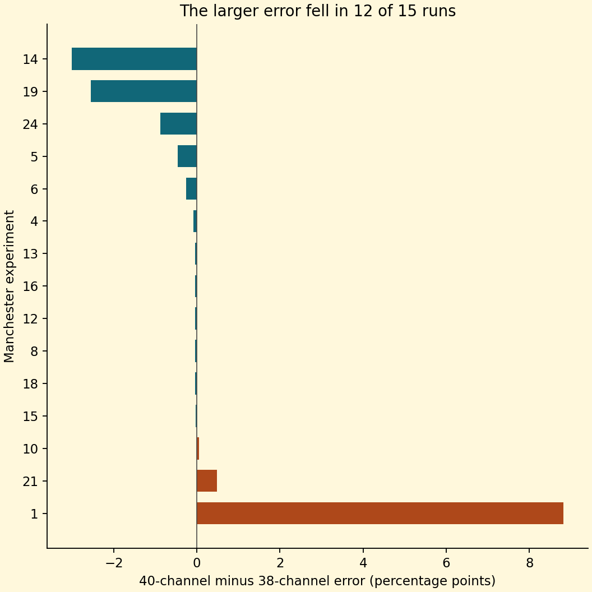

# Twelve of 15 Manchester runs improved, yet the average joint error rose

Did the larger Particula reaction network give a better account of aerosol formation across the Manchester chamber campaign? Across 15 experiments, the 40-channel calibration reduced the median error in suspended organic mass from 17.64% to 14.74%. Mean particle-count error stayed close to 12.55%. To ask how well each fit reproduced *both* measurements, we took the larger of its mass and count errors in each run. That joint error fell in 12 experiments. In run 1, however, the mass error more than doubled and became the limiting measurement. That single change was large enough to raise the campaign mean joint error from 16.35% to 16.47%, even as the worst individual score declined. The benefit is clearest for mass in a typical fitted experiment.

## Two instruments measured different consequences of aerosol formation

Voliotis and colleagues illuminated α-pinene, o-cresol and isoprene, alone and in mixtures, with ammonium sulfate seed in the Manchester Aerosol Chamber. Suspended organic mass records the material present in airborne particles. Particle number can fall as particles coagulate or deposit, even while oxidation products condense and add mass. A mechanism can therefore fit the mass history more closely while leaving a substantial count discrepancy. [Manchester chamber experiment](https://acp.copernicus.org/articles/22/14147/2022/) · [Original Particula analysis](../manchester-soa/index.md)

The preceding study fitted both histories over five hours in the 15 experiments with matched records, encompassing 1,258 mass readings and 682 count readings. Its search ranked networks by the largest normalized error in any observable in any run. Here the comparison uses the archived 38-channel fit and the selected 40-channel fit, including their respective shared rates and run-specific doses. The preceding study's matched refits attributed about 0.00495 percentage points of the 0.05057-point decrease in worst error to the two added transfers. This campaign comparison describes the full calibration change. [Reaction-growth study and attribution](../manchester-network-growth/index.md)

## Median mass error fell by 2.91 percentage points

| Five-hour normalized error | Archived 38 channels | Selected 40 channels |
|---|---:|---:|
| Mean mass error | 13.98% | 13.66% |
| Median mass error | 17.64% | 14.74% |
| Mean count error | 12.54% | 12.55% |
| Median count error | 13.08% | 13.56% |
| Mean joint error across runs | 16.35% | 16.47% |
| Median joint error across runs | 17.73% | 17.31% |
| Worst joint error across runs | 17.75% | 17.70% |

Each run contributes one mass score and one count score. Each score is a root mean square error over that instrument's sampling times. Mass uses the measured peak concentration as its denominator, with a 1 µg m⁻³ floor. Counts use the initial particle number. We compute the joint score inside each run before averaging, so an improvement in the better-fitting observable alone can leave that run’s joint score unchanged. Each run has equal weight regardless of how frequently an instrument sampled it. [Instrument-time predictions](../../../../../studies/voliotis-2022/joint/milestone2/instrument_fits.csv.gz)

Mass error fell in 11 runs, increased in two and remained effectively zero in the two isoprene-only runs with zero recorded organic mass. Count error fell in nine runs and increased in six. Run 24 illustrates how the limiting observable can switch. Its mass error fell from 17.74% to 12.62%, but a count error of 16.86% limited the selected fit. The 5.12-point mass gain therefore reduced its joint score by only 0.88 points. [All 15 run scores](../../../../../studies/voliotis-2022/joint/milestone2/scorecard.csv)

## Run 1 reversed the direction of the campaign mean

The archived fit reproduced run 1 mass and count with errors of 8.66% and 8.87%. With the selected fit the count error was still 8.88%, while mass error reached 17.69%. Its joint score rose by 8.82 points. The largest improvements occurred in runs 14 and 19, where the joint score fell by 3.01 and 2.56 points. Although run 1 contributed the largest *change*, run 8 mass set the largest *final error* at 17.70%.

We recalculated the mean paired change 15 times, omitting one experiment from the summary each time and keeping both calibrations fixed. Omitting run 1 changed a mean increase of 0.124 points into a mean decrease of 0.497 points across the other 14. Omitting run 14 instead raised the mean increase to 0.348 points. Run 1 was the only omission that reversed the sign. Reversing the reaction order or halving the time step preserved the 12 improvements and the small increase in the full-campaign mean. Across the four fine-grid and reaction-order combinations that increase ranged from 0.121 to 0.124 points.

## An independent run would test whether the mass gain transfers

For a typical Manchester experiment, median mass error captures an improvement that the worst-run objective barely registers. For an application that needs both mass and count, run 1 shows the cost of that redistribution. All 15 experiments contributed to calibration, including each run omitted in the influence calculation. Testing the same shared chemistry on a separately measured experiment, with dose fixed from independent precursor information, would test whether the mass gain carries over to a new case.

## Reproducibility

The [study-card renderer](../../../../../studies/voliotis-2022/joint/campaign_performance/toc.py) redraws the graphical abstract from the archived fits.

The table and per-run examples use the archived 0.9375 s forward replay. The numerical sensitivity check uses that step and 0.46875 s, each with both reaction orders. All summaries use unrounded scores before converting them to percent. Paired differences are selected minus archived, in percentage points. From the repository root, run `python studies/voliotis-2022/joint/campaign_performance/study.py` in the Particula environment to regenerate the campaign comparison from the saved scores. [Analysis script](../../../../../studies/voliotis-2022/joint/campaign_performance/study.py) · [Frozen calibrations](../../../../../studies/voliotis-2022/joint/milestone2/size_inputs.json) · [Paired run changes and omission results](../../../../../studies/voliotis-2022/joint/campaign_performance/paired_changes.csv) · [Campaign scores by numerical setting](../../../../../studies/voliotis-2022/joint/campaign_performance/campaign_scores.csv)
