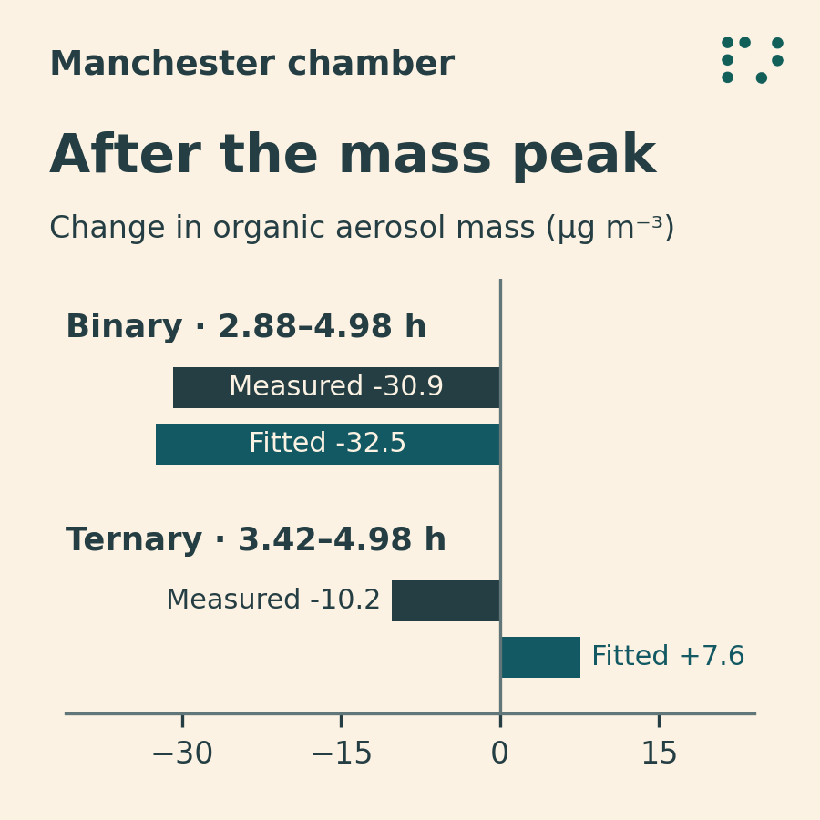
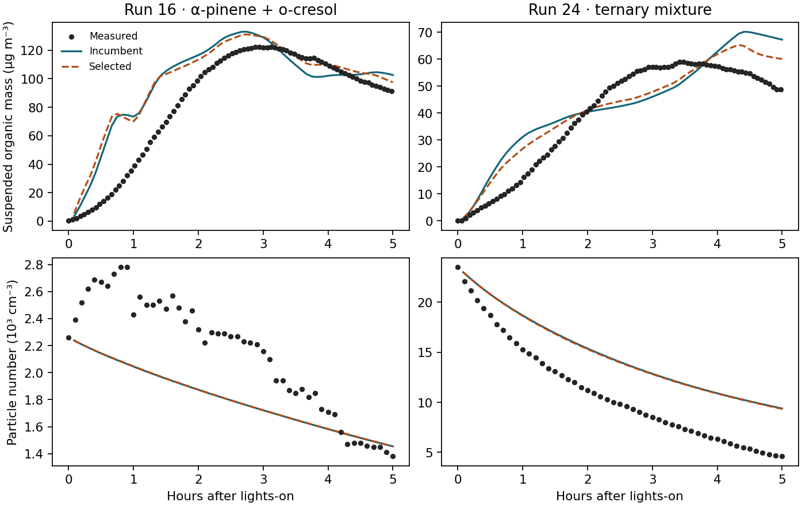
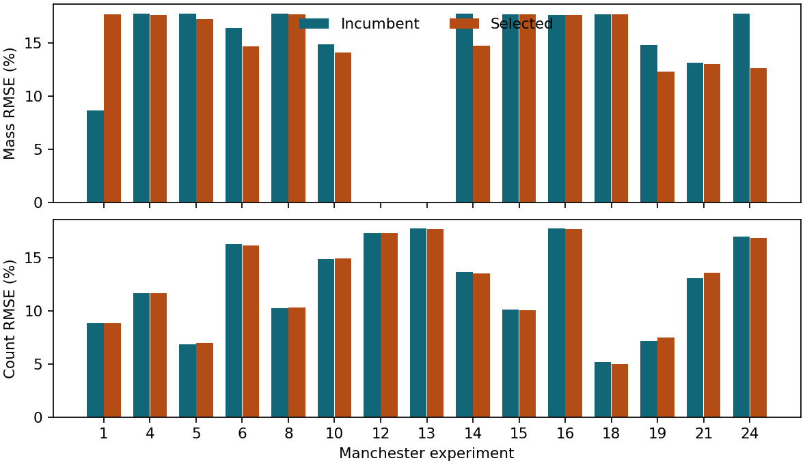
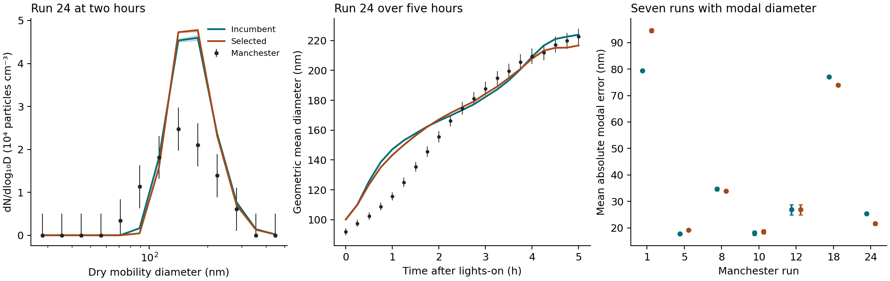
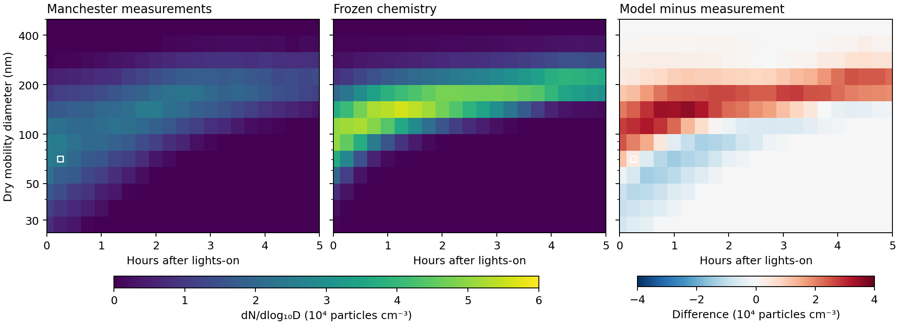

# Manchester’s ternary aerosol declined while the fitted reaction network still predicted growth

The ternary Manchester chamber experiment provides a test that a single overall error can hide. After its organic aerosol concentration peaked at 3.42 hours, the instrument recorded a 10.23 µg m⁻³ decline. Over that same interval the selected network predicted a rise of 7.6 µg m⁻³. We tested whether additional reactions could resolve this discrepancy while fitting suspended mass and particle counts across all 15 experiments. Two additional vapor-to-particle transfers brought the network from 38 to 40 channels. The worst normalized trajectory error moved from 17.751% to 17.701%. With size measurements reserved from fitting, the model predicted a five-hour ternary geometric mean diameter of 216.6–216.8 nm against 222.5 nm measured, yet its spectrum showed too many particles near the two-hour peak. Similar final mean diameters can follow different histories of organic mass and particle growth.

## What the Manchester instruments can distinguish

Voliotis and colleagues illuminated α-pinene, o-cresol and isoprene, alone or in mixtures, in an 18 m³ chamber containing nitrogen oxides and ammonium sulfate seed. Fifteen experiments had overlapping records of precursor decay, suspended organic aerosol and particle number. We used all 1,258 organic-mass readings and 682 count readings in their first five hours. The source histories combine measured relative precursor disappearance with nominal injection amounts. The time-dependent inventories of reaction intermediates are model predictions. Run 24 also has a published number-size distribution, and seven experiments have archived modal diameters. Those additional measurements let us test how the fitted chemistry distributes suspended material among growing particles. [Chamber experiment and instrumentation](https://acp.copernicus.org/articles/22/14147/2022/) · [Previous Manchester analysis](../manchester-soa/index.md)

## Replaying the archived joint fits

| Available channels | Worst joint error at 15 s | Worst joint error at 1.875 s, across both reaction orders |
|---|---:|---:|
| Original 20 channels | 17.804% | 17.861% |
| 20 inherited plus 18 family-supported channels | 17.751% | 17.751% |
| All 70 channels | 17.745% | 18.148% |

Each table entry profiles the 61 admissible doses again at that step and channel order, following the archive. The network comparisons below also keep fitted doses fixed across resolutions. The 70-channel fit edged ahead at the original step and fell behind both alternatives when the same chemistry was replayed at finer resolution. That reversal set the starting point for discovery. We selected the 38-channel parent. Its rates are shared among all experiments. Each run can scale its nominal injection by ±15%. Mass RMSE is normalized by the observed run peak with a 1 µg m⁻³ floor, and number RMSE by the initial count. The score is the largest of the 30 run-by-observable errors. The two fitted isoprene-only AMS records, runs 12 and 13, reported zero throughout this interval. Run 11 also reported zero organic mass, but lacked the matched precursor record needed for this analysis. [Archived observations and instrument caveats](../../../../../studies/voliotis-2022/joint/data/CAMPAIGN_SERIES.md)

For all three starting networks the reproduced per-run mass and count errors agreed with the archived records within 9 × 10⁻¹⁷ in normalized RMSE. The reproduced peak-to-last mass changes differed by at most 1.8 × 10⁻¹⁵ µg m⁻³. [Per-run archived-network replays](../../../../../studies/voliotis-2022/joint/milestone2/baselines_by_run.csv)

## Which reactions were given a fair test?

The parent contained 38 available channels. We offered 66 further channels. Of these, 32 came from the archived 70-channel network and nine from the earlier candidate catalog. The 25 new transfers comprised ten source-balanced accretion reactions and fifteen routes for secondary vapor release or recapture. The available bank contained 104 distinct channels against a study limit of 1,000. SiMBA generated gas and particle accretion rows by balancing α-pinene, o-cresol and isoprene **source equivalents**. The earlier chamber solver then transported their effective organic mass. Bimolecular rates use air-volume concentrations and have units m³ air µmol⁻¹ h⁻¹, including for particle reactions. First-order rates are in h⁻¹. Area-dependent coefficients refer to 0.001 m² particle surface per m³ air. The forcing supplies oxidation products; the calculation closes their mass ledger across vapor, suspended material, wall deposits and terminal products. Oxygen incorporation, elementary radical kinetics and compound-specific saturation concentrations remain unresolved. New dimers could retain AA, AC, CC or II precursor labels, where A denotes α-pinene, C denotes o-cresol and I denotes isoprene. The archived solver lacks dedicated mixed A–I and C–I dimer reservoirs. Four common starting rates for a linked sequence and the shortlist for full refitting further limit the search. A route with negligible flux at the parent calibration can still become active when its upstream rates change.

The first screen compared 64 additions or connected motifs at four positive rates and profiled 61 possible injection scales per experiment. At 15 s the dose-grid evaluation of one 38-channel campaign took 0.65 s on the RTX 5060, rising to about 5.0 s at 1.875 s. A zero-rate replay provided a nested control. To avoid dismissing a downstream reaction merely because its substrate was absent at the archived rates, we also traced candidate sources and compared 37 connected routes with their upstream formation steps activated. Across the screens these gave 75 distinct sets of new channels. In the direct comparison we refitted the eight best joint challengers and the best mean-mass challenger. A separate matched fit tested the three largest apparent gains from activating upstream routes. In each comparison the parent could refit its shared chemistry and each run’s dose using the same numerical settings and evaluation budget as the child. Additions had to clear both the change with resolution and the spread between parent restarts. [Candidate catalog generator](../../../../../studies/voliotis-2022/joint/milestone2/catalog.py) · [Connected-route screening method](../../../../../studies/voliotis-2022/joint/milestone2/activation.py)

## Differentiating precursor dose through to the chamber measurements

De Carvalho Servia and colleagues built SiMBA to propose balanced reaction mechanisms, fit rate laws and compare candidate models. Here Particula’s implementation supplied the balance and reachability rules. The Manchester comparison used the campaign’s worst mass-or-count error as its selection criterion. A study-specific CUDA implementation differentiated the original Manchester bulk calculation so that coagulation, changing radius, deposition, precursor competition, and the instrument sampling times remained in the fit. The discrete network was fixed during each derivative calculation. The derivative covered the path from a run’s precursor dose scale and the shared rates to its predicted mass and count errors. The later stochastic size replay was evaluated separately. [Original SiMBA method](https://doi.org/10.1039/D5SC01473E)

Across all 30 run-by-observable errors, the differentiated calculation reproduced the original forward solver within 3 × 10⁻¹⁵ in normalized RMSE at the qualification points. We compared 20 directions against finite differences at zero and positive rates using three increments. A simultaneous perturbation of 64 shared coordinates and 15 local dose scales agreed within 7.0 × 10⁻⁹ at the smallest tested increment. A synchronized fixed-dose campaign evaluation and a 20-direction Jacobian each took about 0.28 s during this run on a shared RTX 5060. Ten shortlisted networks and a matched parent received two starts and up to 100 evaluations per start. The two strongest challengers then competed against the parent in fits to both reaction orders at 3.75 s, with validation at 1.875 s. [CUDA qualification procedure](../../../../../studies/voliotis-2022/joint/milestone2/ad_shortlist.py) · [Paired fit decision procedure](../../../../../studies/voliotis-2022/joint/milestone2/ad_decisions.py)

For the final fitted network we also exported the derivative at each of the 1,940 instrument readings. Each row gives the predicted response to its experiment’s dose multiplier and each added rate, in the original mass or count units. Combining these derivatives at the instrument times reproduced the 30 normalized RMSE gradients to within 3.6 × 10⁻¹³. Independent finite differences at the minute endpoints had maximum absolute deviations of 7.8 × 10⁻⁶ per unit dose and 2.7 × 10⁻⁹ per unit added rate after the corresponding mass or count normalization. For example, in run 18 a 0.01 h⁻¹ increase in the o-cresol return coefficient predicts a local increase of 0.243 µg m⁻³ at the last mass sample. That moves the predicted 54.96 µg m⁻³ toward the measured 91.58. At five hours it also adds about 1.31 particles cm⁻³ to a predicted count of 4,893 cm⁻³, already above the measured 3,920. All other rates and doses are held fixed in this derivative. These local sensitivities cover the deterministic bulk trajectory. The measured precursor-decay shape is supplied as forcing, and the particle-resolved spectrum is evaluated separately. [Observation-time Jacobian](../../../../../studies/voliotis-2022/joint/milestone2/ad_observation_jacobian.csv.gz) · [Finite-difference checks and input provenance](../../../../../studies/voliotis-2022/joint/milestone2/ad_observation_jacobian.json)

## What the first new channel changed

The first qualifying addition let α-pinene-derived vapor return to labile suspended material. The archived parent already allowed the same vapor to enter a more stable particle reservoir. An initial 3.75 s comparison provisionally favored this channel and supplied the starting rates for the next screen. When the later, stronger deletion-parent fit was also compared at 3.75 s, the provisional gain disappeared. The final admission rests on fitting both networks at 1.875 s. In those paired fits the return coefficient was 0.273 h⁻¹ at the reference particle surface area. The 39-channel fit beat the refitted 38-channel parent at 0.9375 s in both reaction orders. Across training, validation and all simpler controls the smallest gain was 0.00304 percentage points. The largest shift with time step was 0.00131 points. Restart spreads were 0.00005 points for the parent and 0.00022 for the child. At 0.46875 s the worst scores were 17.7066% for the paired parent and 17.7031% for the child. [First-round result](../../../../../studies/voliotis-2022/joint/milestone2/search_summary.json)

Freezing the other rates and deleting the return channel raised the refined error to 55.8975%, with mass in run 19 setting the maximum. Reoptimizing the remaining rates, shared chamber parameters and doses brought the reduced network back to 17.7059%. In run 19 the intact fit cycled 234 µg m⁻³ through vapor return and sent 30 µg m⁻³ through the older stabilization route. The refitted parent sent 101 µg m⁻³ through stabilization. Large gross transfers can therefore coexist with a very small difference in measured suspended mass and particle number. The gain supports an effective phase transfer within this model. The underlying compounds and their saturation concentrations remain undetermined. [Deletion and refit procedure](../../../../../studies/voliotis-2022/joint/milestone2/ad_ablate.py)

## Recapture of secondary o-cresol vapor

The second round screened 65 available additions in 63 direct proposals and 31 upstream-activated routes. The strongest challenger after finer comparison allowed secondary vapor from the o-cresol dimer family to return to a retained particle reservoir. This effective coefficient was 0.262 h⁻¹ at the reference surface area. The model transferred 22.9 µg m⁻³ through it in run 18 and up to 29.4 µg m⁻³ in the campaign. Freezing the other parameters and deleting the route raised the refined forward error to 24.604%, with run 18 mass setting the maximum. The refitted 39-channel parent recovered 17.703%. The 40-channel fit reached 17.701%. Its minimum gain across the matched controls was 0.00143 percentage points, just above the 0.00115-point numerical threshold. [Second-round result](../../../../../studies/voliotis-2022/joint/milestone2/search_summary.json) · [Omission and flux calculation](../../../../../studies/voliotis-2022/joint/milestone2/ad_ablate.py)

The apparent gain from o-cresol evaporation alone illustrates why the comparison used two time steps. Evaporation improved the training score by about 0.008 percentage points at 3.75 s. The advantage reversed in both reaction orders at 1.875 s. A reaction could move appreciable material and still fail to improve prediction at the validation resolution.

## Where network growth stopped

| Round | Channels offered | Distinct additions or sequences screened | Distinct challengers refitted | Channels retained | Best refitted parent (%) | Selected (%) |
|---|---:|---:|---:|---:|---:|---:|
| 1 | 66 | 75 | 12 | 39 | 17.70592 | 17.70260 |
| 2 | 65 | 74 | 12 | 40 | 17.70250 | 17.70087 |
| 3 | 64 | 72 | 5 | 40 | 17.70087 | 17.70087 |

Each score is the worse of the forward and reversed 0.9375 s replays at fixed rates and doses. A connected sequence counts once as a challenger and can introduce several channels. Repeated tests of the same channel under different parents appear in successive rows. All 66 distinct additions in the original bank were screened. Two were admitted. In the third round the two-step cleavage route and three other direct finalists each received two gradient-based starts, with 40 objective evaluations allowed per start at 1.875 s. None qualified. The last round also compared the best connected route after seeding its upstream reactions. The third-round decision was frozen about 2 h 15 min into the four-hour study budget. A complete round had produced no qualifying addition, so the search ended before its 2 h 35 min growth deadline. The network used 40 of the 1,000 allowed channels. [Round decisions and scores](../../../../../studies/voliotis-2022/joint/milestone2/search_summary.json) · [Frozen channel definitions and fitted rates](../../../../../studies/voliotis-2022/joint/milestone2/size_inputs.json)

Of the 0.05057 percentage-point improvement from the archive, 0.04563 points came from refitting existing networks at the three stages. About 0.00495 points came from allowing the two additional transfers in fair comparisons with their refitted parents. Thus most of the campaign improvement arose from different rates, shared chamber parameters and injection scales within the existing model. The admission thresholds compare numerical and optimization effects. Experimental uncertainty and prediction in a new chamber run remain separate questions.

Deleting each addition in turn from the final 40-channel network gave a larger loss for α-pinene vapor return. The worst frozen score rose from 17.70087% to 59.1884% when it was removed, versus 24.6044% when o-cresol vapor recapture was removed. We then kept the o-cresol route and refitted the other 39 channels. Two matched starts, each capped at 100 objective evaluations, restored the worst 0.9375 s error to 17.70289–17.70328%. The reaction with the largest frozen deletion effect therefore accounted for only about 0.0020–0.0024 percentage points after compensation. [Final one-at-a-time deletions and matched refits](../../../../../studies/voliotis-2022/joint/milestone2/final_omission.json)

## Suspended mass and particle counts across the 15 runs

The worst error across the two fine reaction orders moved from run 4 mass (17.751%) to run 8 mass (17.701%). With a threshold of 1 µg m⁻³ cumulative transfer in at least one run, 19 selected channels carried appreciable flux, compared with 20 before refitting. Gross transfer counts material again whenever it reacts a second time. The frozen runs had a largest absolute closure residual of approximately 1.02e-09 µg m⁻³. [Channel-resolved transfers](../../../../../studies/voliotis-2022/joint/milestone2/channel_flux.csv.gz)

The model lost 33.26 µg m⁻³ after its own sampled peak in binary run 16, where Manchester measured 30.89 µg m⁻³. The corresponding losses for ternary run 24 were 5.09 and 10.23 µg m⁻³. Peak timing changes the interpretation. In run 24 the modeled concentration peaked at 4.38 h, compared with 3.42 h measured. From that measured peak to 4.98 h the model deposited 12.9 µg m⁻³ of organics while suspended mass increased by 7.6 µg m⁻³. The run 24 dose multiplier was 0.850 out of the allowed 0.85–1.15. The forcing supplied another 147 µg m⁻³ of precursor consumption over this interval. Its conversion to suspended aerosol remains uncertain. [Peak-aligned mass changes](../../../../../studies/voliotis-2022/joint/milestone2/peak_timing.csv)

The campaign panels show every instrument reading and both frozen trajectories on the five-hour clock. [Suspended mass for all 15 runs](../../../../images/manchester-soa/milestone2-all-mass.png) · [Particle count for all 15 runs](../../../../images/manchester-soa/milestone2-all-number.png)

Individual experiments traded places as the fit changed. Run 24 mass error dropped from 17.74% to 12.62%, while run 1 mass error rose from 8.66% to 17.69%. Across all 15 experiments mean count error changed from 12.538% to 12.550%. The minimax improvement concentrates on the largest errors.

The table uses the 0.9375 s forward replay with each fit’s doses frozen. Each entry is a normalized RMSE across a run’s five-hour window. The rank above also considers reversed order. [Observed and modeled values at every instrument time](../../../../../studies/voliotis-2022/joint/milestone2/instrument_fits.csv.gz)

| Run | Mass before (%) | Mass after (%) | Count before (%) | Count after (%) |
|---:|---:|---:|---:|---:|
| 1 | 8.66 | 17.69 | 8.87 | 8.88 |
| 4 | 17.75 | 17.67 | 11.70 | 11.68 |
| 5 | 17.75 | 17.28 | 6.88 | 6.97 |
| 6 | 16.41 | 14.71 | 16.29 | 16.15 |
| 8 | 17.74 | 17.70 | 10.28 | 10.30 |
| 10 | 14.88 | 14.10 | 14.91 | 14.96 |
| 12 | 0.00 | 0.00 | 17.35 | 17.31 |
| 13 | 0.00 | 0.00 | 17.75 | 17.70 |
| 14 | 17.74 | 14.74 | 13.65 | 13.56 |
| 15 | 17.73 | 17.69 | 10.14 | 10.06 |
| 16 | 17.64 | 17.65 | 17.75 | 17.70 |
| 18 | 17.72 | 17.69 | 5.20 | 4.98 |
| 19 | 14.84 | 12.28 | 7.18 | 7.51 |
| 21 | 13.13 | 13.01 | 13.08 | 13.62 |
| 24 | 17.74 | 12.62 | 17.03 | 16.86 |

The selected parameters gave 17.70147% worst error at the finer 0.46875 s audit, with run 8 mass setting the maximum. Reusing the original 15 s integration step gave 17.90614% and moved the limiting error to run 18 mass. The fine-step rates are therefore specific to the resolved integration used for selection. [All frozen resolution and reaction-order replays](../../../../../studies/voliotis-2022/joint/milestone2/scorecard.csv)

## Particle sizes challenge the frozen chemistry

Across 212 modal diameter observations in seven experiments, the selected network’s mean absolute error was 41.4 nm across the two fine particle realizations. The archived parent gave 40.0–40.1 nm. In run 24 the selected spectrum RMSE was 10,985–11,162 particles cm⁻³ per decade over the full five hours. At two hours, the measured peak lay in the 126–158 nm bin and reached 24,706 particles cm⁻³ per decade. The simulated peaks occupied 158–200 nm and reached 47,362–48,118 particles cm⁻³ per decade. The measured two leading bins differ by less than one color increment, while the excess peak height exceeds that reading scale. At five hours the selected fit underestimated the measured 222.5 nm geometric mean diameter by 5.7–5.9 nm. The archived 38-channel calibration was closer, at 223.6–224.2 nm. [Modal errors by run and realization](../../../../../studies/voliotis-2022/joint/milestone2/size_results/mode_by_run.csv)

Each range spans two 2,048-particle realizations using the same seed in each pair of calibrations.

| Run | Modal readings | Archived MAE (nm) | Selected MAE (nm) |
|---:|---:|---:|---:|
| 1 | 30 | 79.2–79.7 | 93.9–95.3 |
| 5 | 30 | 17.6–17.9 | 19.1–19.4 |
| 8 | 31 | 34.1–35.4 | 33.7–34.3 |
| 10 | 30 | 17.2–18.9 | 17.8–19.4 |
| 12 | 30 | 25.0–28.9 | 25.0–28.9 |
| 18 | 31 | 77.0–77.0 | 73.5–74.4 |
| 24 | 30 | 25.2–25.5 | 21.1–22.1 |

Across the full ternary experiment, the simulation concentrates too many particles near the growing peak and underpredicts smaller particles early in the run. The first two panels share a concentration scale. The third shows the mean prediction from two particle realizations minus the measured spectrum, with red indicating excess counts. Each column represents one quarter-hour sample. The white square marks the single digitized cell excluded from scoring because fewer than half its source pixels were usable. [Wang et al., supplement Figure S1a](https://acp.copernicus.org/articles/22/4149/2022/acp-22-4149-2022-supplement.pdf#page=5)

Size took no part in channel selection or parameter fitting here. The particle-resolved replay introduced no nucleation and used a fixed seed geometric standard deviation of 1.5 and area-weighted allocation of condensing organics. It evaluated both frozen calibrations with matched random seeds. Wang and colleagues’ run 24 spectrum was digitized in 0.1-decade diameter bins covering approximately 25–501 nm. The analysis scores 272 of 273 cells after applying the original pixel-quality mask and saves the all-cell score separately. Field colors give a reading scale of about 5,000 particles cm⁻³ per decade. That uncertainty concerns digitization. The bands in the comparison figure show the range from two simulation seeds. [Wang et al., supplement Figure S1](https://acp.copernicus.org/articles/22/4149/2022/acp-22-4149-2022-supplement.pdf#page=5) · [Digitization and measurement provenance](../../../../../studies/voliotis-2022/joint/resolved/size_data/README.md)

We also varied time step and particle count independently. With the same random seed and 2,048 particles, halving the step from 30 to 15 s moved the predicted two-hour peak upward by one bin. At 4,096 particles the 15 and 10 s runs both placed it in 158–200 nm. The finest run gave a 40.5 nm modal error across the seven experiments, a run 24 spectrum RMSE of 11,210 particles cm⁻³ per decade, and a five-hour geometric mean of 216.0 nm. The excess near the spectrum peak persists across those settings, while the precise peak bin is sensitive to numerical and digitization resolution. [Size-resolution controls](../../../../../studies/voliotis-2022/joint/milestone2/size_results/resolution_check.csv)

## What the volatility measurements add

The Manchester companion experiments found less volatile ternary aerosol than a prediction based on single-precursor contributions. The o-cresol/isoprene experiment could instead give more volatile aerosol. For the ternary mixture, the thermodenuder retrieval assigned 29% of organic particle mass to the low-volatility class. FIGAERO-CIMS assigned 6% of its particle-phase signal to that class. The different denominators and instrument responses matter. A fitted gas-to-particle transfer is consistent with stabilization, and a particle-to-gas transfer can accommodate fragmentation. Quantitatively distinguishing them with these data would require a saturation concentration for each modeled pool and a prediction of each instrument’s response. Time-resolved labeled gas and particle products would also help separate cross-accretion from renewed condensation of products of a single precursor. [Volatility measurements, Figure 3](https://acp.copernicus.org/articles/22/13677/2022/#section3)

The retained o-cresol route returns secondary vapor from the modeled CC family to a retained particle pool. O-cresol/isoprene showed higher volatility than the expectation from its precursors, whereas the ternary system showed a larger low-volatility fraction. These observations establish that mixing can shift partitioning in either direction. The assignment of this particular vapor to two o-cresol-derived parents is qualitative. Manchester did not measure the CC reservoir or its return coefficient directly. [Voliotis et al., mixture comparisons](https://acp.copernicus.org/articles/22/13677/2022/#section4) · [Evidence by candidate](../../../../../studies/voliotis-2022/joint/milestone2/ad_evidence.md)

## What the larger network explains

The 40-channel network reproduced most of the binary late loss. From the measured peak in run 16 it lost 32.46 µg m⁻³ against 30.89 observed. In the ternary run the archived model gained 16.6 µg m⁻³ over the observed decline. The selected fit cut that gain to 7.60 µg m⁻³, still opposite to the measured 10.23 µg m⁻³ loss. This difference combines changes in rates, doses and available channels. Its two-hour spectrum concentrated nearly twice as many particles near the peak as the instrument recorded. These discrepancies persist in distinct observables even after fitting every available mass and count history. The chamber data support a small predictive benefit from vapor recapture in the tested model. They leave open how much late material evaporated, reacted further, or reached the chamber walls. Simultaneous product-resolved vapor measurements over the declining interval would distinguish those possibilities more directly.

The [campaign-wide follow-on study](../manchester-campaign-performance/index.md) measures how much each experiment contributed to the change in average mass and count error.

## Reproducibility

The [study-card renderer](../../../../../studies/voliotis-2022/joint/milestone2/toc.py) reads the archived peak-to-last changes for runs 16 and 24.

All campaign calculations used double precision on an NVIDIA GeForce RTX 5060. Numerical checks retain the five-hour duration and observed sampling times while reducing the integration step and reversing channel order. The frozen replay records suspended and deposited organic mass separately. Wall-corrected yield uses their sum divided by modeled precursor consumption and is a separate diagnostic. The companion size replay includes a 1,024-particle, 30 s calculation and two 2,048-particle, 15 s realizations. A compact-channel control checks the particle solver against the original padded representation. [Study scripts and execution order](../../../../../studies/voliotis-2022/joint/milestone2/README.md) · [Per-run campaign scores](../../../../../studies/voliotis-2022/joint/milestone2/scorecard.csv) · [Size results and numerical settings](../../../../../studies/voliotis-2022/joint/milestone2/size_results/summary.csv)
