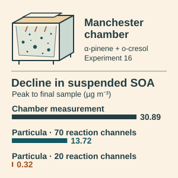
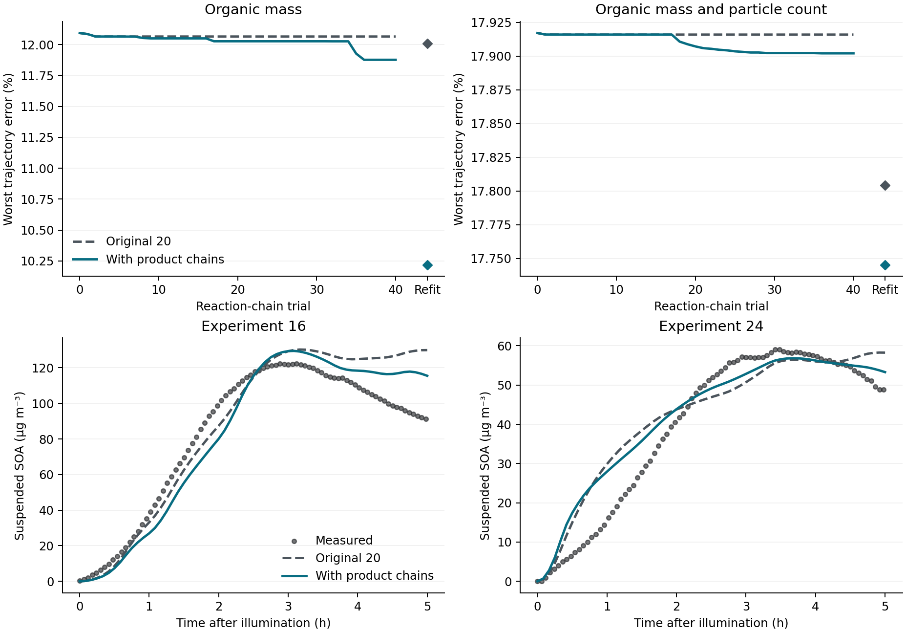
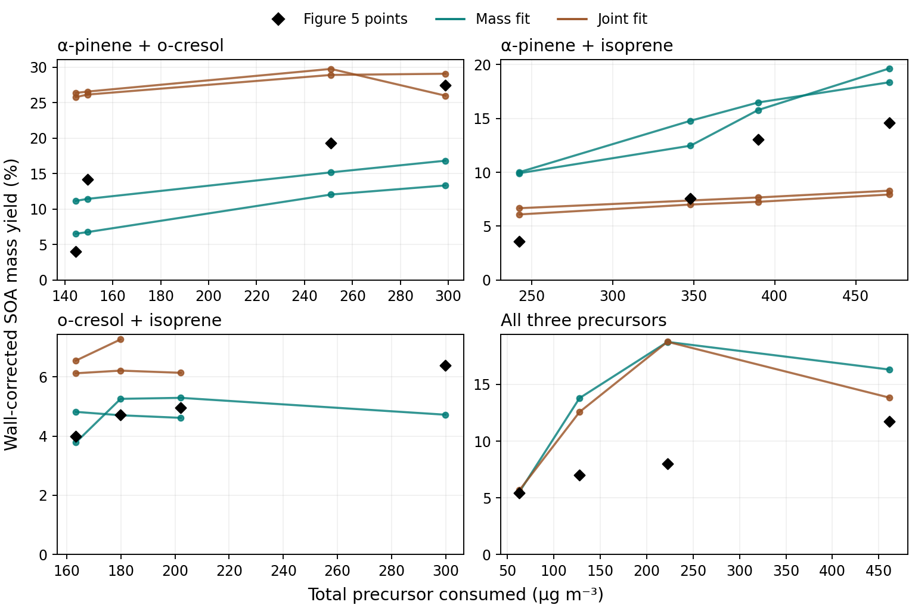
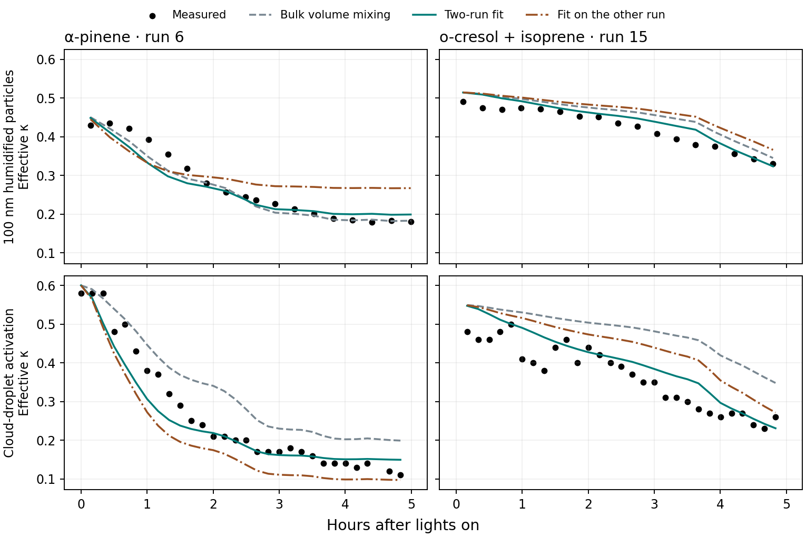
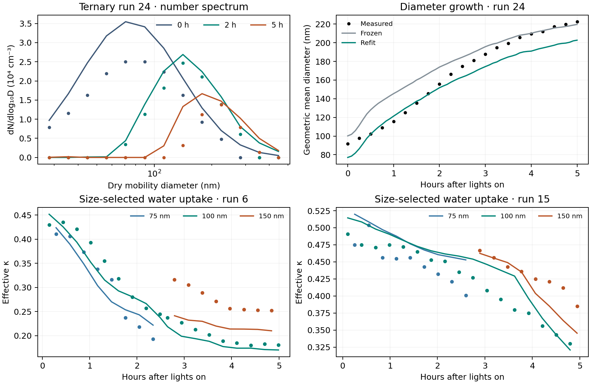
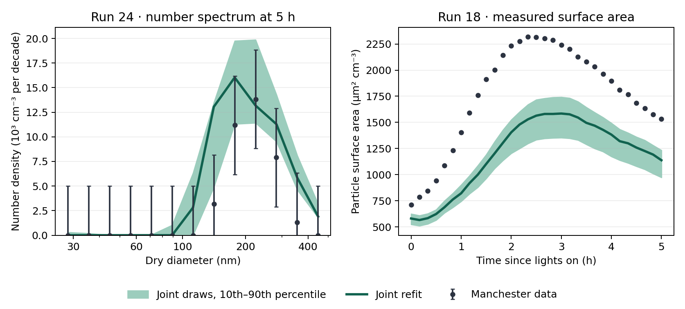
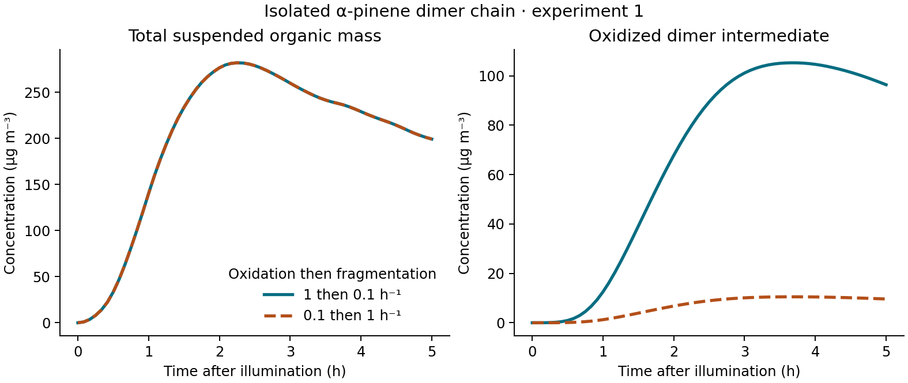

# How well does Particula reproduce organic aerosol formation in the Manchester chamber?



We used an agentic search with Particula to ask whether shared chemistry could reproduce the secondary organic aerosol (SOA) that Voliotis and colleagues measured in 15 Manchester chamber experiments. They found that α-pinene and o-cresol produced more aerosol together than expected from their individual yields. Particula lets us replay each precursor separately at its mixture consumption and test which reaction networks reproduce that enhancement. At about 299 µg m⁻³ of total precursor consumed, Manchester measured a wall-corrected mass yield of 27.4%. A model calibrated to suspended organic mass gave 15.1%. A second mechanism calibrated to mass and particle number gave 27.5%, but overpredicted the other three sampled points for this mixture. The search also identified product-aging pathways that reproduced part of the observed post-peak mass loss. Mechanisms with different dimer histories could fit the same bulk decay, making a time-resolved measurement of the dimer and its daughter a way to distinguish them.

## What Manchester’s precursor mixtures revealed

Voliotis and colleagues asked whether yields measured for individual precursors could explain the aerosol produced by their mixtures. They illuminated α-pinene, o-cresol and isoprene with nitrogen oxides and ammonium sulfate seed in an 18 m³ chamber. At matched precursor consumption, the α-pinene/o-cresol pair produced more SOA than expected from the single-precursor yields. Isoprene suppressed the α-pinene yield. A possible enhancement with o-cresol and isoprene was too small to resolve, and the ternary yield was close to the single-precursor expectation. The authors noted that even at matched consumption, different amounts of aerosol remain available for vapors to partition into. [Voliotis et al., Figure 5 and conclusions](https://acp.copernicus.org/articles/22/14147/2022/#section5)

Of 24 experiments, 15 had overlapping precursor decay, suspended organic mass and particle counts. Their first five hours supplied 1,258 mass and 682 number readings. We modeled deposition explicitly when comparing suspended mass and added deposited mass back when comparing the authors’ wall-corrected yields. [Voliotis et al., experimental design and Figure 3](https://acp.copernicus.org/articles/22/14147/2022/) · [Instrument records, coverage and source DOIs](https://github.com/uncscode/particula/blob/5217db718619e0daff74bd2031143bfc586a2dd1/studies/voliotis-2022/joint/data/CAMPAIGN_SERIES.md)

Companion measurements also distinguish mechanisms with similar yields. Online gas and particle measurements and offline filter analyses identified o-cresol-derived nitroaromatics in both o-cresol binary mixtures. A formula found only in a mixture leaves its structure and carbon sources unresolved. Thermal-denuder and mass-spectrometer measurements also found more low-volatility material in the ternary aerosol than single-precursor contributions predicted. [Du et al., online and offline composition](https://amt.copernicus.org/articles/15/4385/2022/) · [Shao et al., filter composition](https://acp.copernicus.org/articles/22/9799/2022/) · [Shao et al., carbon oxidation state](https://ar.copernicus.org/articles/3/619/2025/) · [Binary-mixture measurements](https://acp.copernicus.org/articles/21/14251/2021/) · [Isoprene and ternary-mixture measurements](https://acp.copernicus.org/articles/22/13677/2022/)

Wang and colleagues measured water uptake below and above saturation. In an α-pinene experiment, humidified growth factors fell from 1.65–1.72 to about 1.15 within an hour as organics accumulated. Independent particle-rebound experiments showed strong humidity and composition dependence. We used measured water uptake in the fits below. Composition, volatility and rebound informed the interpretation of the chemistry. [Wang et al., water uptake, Figures 3–4](https://acp.copernicus.org/articles/22/4149/2022/) · [Wang et al., particle rebound, Figures 1–2](https://acp.copernicus.org/articles/21/11303/2021/)

## Fitting shared chemistry to 15 chamber histories

Two runs with nominally 155 ppb α-pinene illustrate why a single mass discrepancy tells us little about missing chemistry. The first reached 68.47 µg m⁻³ and the second 109.46 µg m⁻³. Applying the first run’s fit to the second run’s measured precursor decay and seed conditions gave 76.88 µg m⁻³, rising to 104.23 µg m⁻³ at the favorable bound of the injection uncertainty. The experiments also used different instruments for their initial counts. [Transfer experiment](https://github.com/uncscode/particula/blob/5217db718619e0daff74bd2031143bfc586a2dd1/studies/voliotis-2022/REPORT.md) · [Injection and wall-loss sensitivity](https://github.com/uncscode/particula/blob/5217db718619e0daff74bd2031143bfc586a2dd1/studies/voliotis-2022/results/injection_and_walls.csv)

For the campaign-wide fit, all 15 runs shared chemical parameters. Each supplied its measured parent-precursor decay and could adjust its injection dose by ±15%. We fitted two objectives separately. One minimized the worst mass-trajectory error across runs. The other minimized the worst error over both mass and number. Mass error was the root-mean-square error (RMSE) divided by the observed run peak, with a 1 µg m⁻³ normalization floor. Count error was normalized by initial particle number. The resulting scores measure reproduction of the fitted experiments. [Model and scoring details](https://github.com/uncscode/particula/blob/5217db718619e0daff74bd2031143bfc586a2dd1/studies/voliotis-2022/joint/chains/METHODS.md)

### Wall deposition and precursor competition

With the early chemistry and coagulation model, replacing constant deposition with size-dependent wall loss reduced worst joint error from 24.93% to 21.41%. In a sweep of 4,096 chemistry and wall-mixing combinations, chemistry accounted for 86.3% of peak-mass variance in the median experiment and wall mixing for 99.3% of five-hour count variance. Those shares depend on the chosen ranges. A wall coefficient fitted to dark seed decay transferred poorly to the illuminated chamber. [Wall and chemistry assessment](https://github.com/uncscode/particula/blob/5217db718619e0daff74bd2031143bfc586a2dd1/studies/voliotis-2022/ASSESSMENT.md) · [Per-experiment variance shares](https://github.com/uncscode/particula/blob/5217db718619e0daff74bd2031143bfc586a2dd1/studies/voliotis-2022/joint/results/uncertainty/sensitivity_by_run.csv)

At the same wall eddy coefficient of 5.11 s⁻¹, adding a promptly condensing product barely affected worst mass error (20.98% to 20.97%). Gas-phase competition reduced it to 17.65%. Allowing isoprene disappearance to divert some α-pinene and o-cresol products toward volatile material gave 16.00%. Manchester’s α-pinene/isoprene suppression is consistent with such diversion, although the o-cresol/isoprene measurements provided no clear evidence of suppression. [Chemical pathway comparisons](https://github.com/uncscode/particula/blob/5217db718619e0daff74bd2031143bfc586a2dd1/studies/voliotis-2022/CHEMICAL_PATHWAYS.md) · [Matched fits](https://github.com/uncscode/particula/blob/5217db718619e0daff74bd2031143bfc586a2dd1/studies/voliotis-2022/joint/results/pathways/comparison.csv)

### How the agentic search arrived at 70 channels

In each of the first 20 rounds, the agent selected a precursor-compatible equation, fitted its effective rate with CUDA simulations, and recorded the proposal before seeking an experimental analogue. Twelve proposals had direct evidence for a corresponding process and eight had broader reaction-family support. For instance, irradiation can deplete particle-bound peroxides in α-pinene-derived SOA. This supports a loss pathway while leaving its fitted rate in Manchester undetermined. In 15 s replays the 20-channel search reduced worst mass error from 15.87% to 12.09% and worst joint error from 18.04% to 17.92%. [Equations and primary evidence for all 20 rounds](https://github.com/uncscode/particula/blob/5217db718619e0daff74bd2031143bfc586a2dd1/studies/voliotis-2022/joint/results/discovery/REACTION_EVIDENCE.md) · [Search history and controls](https://github.com/uncscode/particula/blob/5217db718619e0daff74bd2031143bfc586a2dd1/studies/voliotis-2022/joint/discovery/METHODS.md) · [Direct photolysis experiment](https://doi.org/10.1021/es502350u) · [First-stage results and evaporation controls](https://github.com/uncscode/particula/blob/5217db718619e0daff74bd2031143bfc586a2dd1/studies/voliotis-2022/REACTION_DISCOVERY.md)

The first network could form an α-pinene dimer but pooled its downstream products. A second search tested 40 predeclared sequences spanning five product families. Oxidation, fragmentation and further reaction of released vapor added 50 distinct transfers because some sequences share steps. The full network offered 70 channels whose fitted rates could return to zero. Fifteen sequences had a published reaction-family analogue. For the other 25, the literature supported only individual steps or more distant substrates. [All 40 proposals and evidence grades](https://github.com/uncscode/particula/blob/5217db718619e0daff74bd2031143bfc586a2dd1/studies/voliotis-2022/joint/chains/evidence.csv) · [Experimental evidence for α-pinene dimer oxidation](https://doi.org/10.1021/acs.est.2c07630)

Each addition competed with a fresh fit of its predecessor. A separate control spent all 40 rounds refitting the original network. In round 35, refitting the predecessor alone reproduced the apparent improvement from adding fragmentation of isoprene-derived vapor. Most final optimizations reached their iteration limit, so the table reports the best fits found. Each entry uses the larger error for forward and reversed reaction order at a 1.875 s step, with parameters fitted at 15 s. [Round-by-round controls](https://github.com/uncscode/particula/blob/5217db718619e0daff74bd2031143bfc586a2dd1/studies/voliotis-2022/joint/results/chains/rounds.csv) · [Calibrated parameter sets](https://github.com/uncscode/particula/blob/5217db718619e0daff74bd2031143bfc586a2dd1/studies/voliotis-2022/joint/results/chains/continued.json)

| Chemistry available | Worst mass trajectory error | Worst joint mass or number error |
|---|---:|---:|
| Original 20 channels, refitted | 12.08% | 17.86% |
| Original channels plus α-pinene dimer pathways | 11.58% | 17.75% |
| Original channels plus steps from literature-family-supported proposals | 11.59% | 17.75% |
| Full 70 channels | 10.25% | 18.15% |

In α-pinene/o-cresol run 16, measured suspended mass fell 30.89 µg m⁻³ from its sampled peak to the final observation. The 20-channel model lost only 0.32 µg m⁻³ and the 70-channel model lost 13.72 µg m⁻³ at the 15 s fitting step. Run 24 showed a similar partial recovery of the decline (0.01 and 3.43 µg m⁻³ modeled, 10.23 µg m⁻³ measured). The added channels improved 12 of 15 mass trajectories. [Per-run scores, peaks and final measurements](https://github.com/uncscode/particula/blob/5217db718619e0daff74bd2031143bfc586a2dd1/studies/voliotis-2022/joint/results/chains/per_run.csv)



The unrestricted network gave the smallest worst mass error. For mass and number together, the literature-family-supported network gave 17.75% and remained stable under reaction-order reversal. Fragment retention also mattered. At 15 s the full network’s worst mass error was 10.22% when half the fragmented mass stayed suspended. Retaining one-quarter raised it to 12.74%, and retaining three-quarters gave 11.90%, with rates held fixed and doses reselected. [Phase-split and numerical sensitivities](https://github.com/uncscode/particula/blob/5217db718619e0daff74bd2031143bfc586a2dd1/studies/voliotis-2022/joint/results/chains/sensitivity.csv) · [Resolution-checked mechanism](https://github.com/uncscode/particula/blob/5217db718619e0daff74bd2031143bfc586a2dd1/studies/voliotis-2022/joint/results/chains/resolution_checked_mechanism.json)

## The fitted chemistry against mixture yields and water uptake

### Matching one α-pinene/o-cresol yield leaves the rest of the curve unresolved

We kept the parameters fixed in two bulk calibrations, the 70-channel mass fit and the mass-and-number fit restricted to literature-supported reaction families. We compared each with four digitized points per mixture from Manchester’s Figure 5. For each point, we matched the total precursor mass consumed and compared wall-corrected yields. Separate-parent simulations retained the mixture run’s initial seed conditions and consumption histories to estimate the yield expected from independent precursors. The published points do not specify individual runs or precursor consumption vectors. [Published mixture yields](https://acp.copernicus.org/articles/22/14147/2022/#section3) · [Digitization, additive references and run coverage](https://github.com/uncscode/particula/blob/46aed574d785983c70d2c5fb1969034a0bca830b/studies/voliotis-2022/joint/companions/README.md)

At about 299 µg m⁻³ consumed in α-pinene/o-cresol, Manchester measured a **27.4%** yield. The mass fit gave **15.1%**, up from 9.8% in separate-precursor replays, and the mass-and-number fit gave **27.5%**, up from 11.3%. Each modeled yield averages the two eligible simulations, runs 16 and 18. The mass-and-number fit overpredicted the three other sampled yields for this mixture. Its mean absolute error over all four was 11.1 percentage points, compared with 7.0 for the mass fit. The two calibrations also differed in available reaction pathways. For the other mixtures, the mass fit’s mean absolute yield errors were 5.0 percentage points for α-pinene/isoprene, 0.6 for o-cresol/isoprene and 5.5 for the ternary mixture. For o-cresol/isoprene, the two calibrations even gave different signs for the interaction, with one fewer observation in reach of the joint fit. [Per-run yields and separate-parent controls](https://github.com/uncscode/particula/blob/46aed574d785983c70d2c5fb1969034a0bca830b/studies/voliotis-2022/joint/companions/yield_points.csv)



### Water uptake transferred differently between instruments

With the bulk chemistry and deposition fixed, we fitted organic hygroscopicity (κ) to run 6 (α-pinene) and predicted run 15 (o-cresol/isoprene), then reversed the test. Each prediction used the target run’s pre-light seed κ. Allowing a fitted factor to scale the contribution of organic volume to the sampled particles reduced cross-run cloud-activation κ RMSE from 0.100 to 0.076. For humidified 100 nm particles, cross-run error rose from 0.036 to 0.052. Both chemistry calibrations gave this pattern. Only the post-light water records were held out in each direction, since the bulk chemistry had used both experiments. [Run 6 data](https://doi.org/10.25326/59RG-Y252) · [Run 15 data](https://doi.org/10.25326/E0EP-QR41) · [Water model and reproduction commands](https://github.com/uncscode/particula/blob/46aed574d785983c70d2c5fb1969034a0bca830b/studies/voliotis-2022/joint/companions/README.md) · [Fitted parameters](https://github.com/uncscode/particula/blob/46aed574d785983c70d2c5fb1969034a0bca830b/studies/voliotis-2022/joint/companions/water_parameters.csv) · [Water scores by run and size](https://github.com/uncscode/particula/blob/46aed574d785983c70d2c5fb1969034a0bca830b/studies/voliotis-2022/joint/companions/water_scores.csv)



## What changes when each particle carries its own composition?

We repeated all 15 experiments with individual particles carrying sulfate and 19 organic inventories. A particle could acquire vapor, undergo aging reactions, merge with a Brownian collision partner or deposit at a rate that depended on its size. A concentration-dependent source could form 3 nm organic particles. The frozen control used the earlier mass-calibrated chemistry and starting particle parameters. The refit used automatic differentiation to propose continuous parameter changes and stochastic CUDA simulations to score them. Both comparisons below use the same particle-resolved model. [Methods and fit bounds](https://github.com/uncscode/particula/blob/b234c0806d4c3cab58587ce96d5bfc04762f47dd/studies/voliotis-2022/joint/resolved/METHODS.md)

Wang and colleagues’ five-hour number-size distribution for ternary run 24 supplied 272 usable time–diameter cells. Archived mobility measurements supplied 212 modal diameters in seven runs and 31 surface-area readings in run 18. Modal diameter is the dry diameter at the peak of the particle number distribution per logarithmic diameter interval. We fitted these size measurements alongside suspended organic mass, instrument-visible counts and water uptake. The geometric-mean diameter curve from run 24 was reserved for comparison and comes from the same underlying size scans. [Wang et al., supplementary Figure S1(a)](https://acp.copernicus.org/articles/22/4149/2022/acp-22-4149-2022-supplement.pdf#page=5) · [Size measurements and extraction](https://github.com/uncscode/particula/blob/b234c0806d4c3cab58587ce96d5bfc04762f47dd/studies/voliotis-2022/joint/resolved/size_data/README.md)

With 2,048 initial particles per run and 15 s chemistry steps, mean absolute modal-diameter error fell from **46.2 to 19.1 nm**. Run 24 spectrum RMSE fell from 9,682 to 3,899 particles cm⁻³ per decade of diameter. The refit nevertheless ended run 24 at a geometric mean of 203 nm against 223 nm measured (220 nm in the frozen control), and run 18 surface-area error rose from 19.5% to 29.4%. Using size-selected composition to calculate water uptake improved agreement at 100 nm and worsened it at 150 nm. [Comparison and water-uptake controls](https://github.com/uncscode/particula/blob/b234c0806d4c3cab58587ce96d5bfc04762f47dd/studies/voliotis-2022/joint/resolved/README.md)



With the other refitted parameters held fixed, removing wall deposition raised the combined score from 0.108 to 0.202. Removing coagulation or nucleation individually gave 0.109, within the variation across numerical replays. Manchester reported that the sulfate seed suppressed observable new-particle formation. [Process comparisons](https://github.com/uncscode/particula/blob/b234c0806d4c3cab58587ce96d5bfc04762f47dd/studies/voliotis-2022/joint/resolved/results/checks.csv) · [Voliotis et al., experimental conditions](https://acp.copernicus.org/articles/22/14147/2022/#section2)

### Size and mass respond differently to joint parameter changes

We sampled 48 combinations of all 101 active parameters within bounded ranges around the refit. The combinations varied the 70 reaction rates, precursor conversion and doses, seed width, condensation, wall loss, nucleation and organic κ. We replayed each combination in every experiment with two particle random seeds. For each observable, we first calculated the error between the simulation and the Manchester measurements. The table averages that error over the two seeds. The last column counts how many parameter sets had lower error than the earlier frozen parameters. Frozen and refitted controls used the same numerical settings (768 initial particles per run and 30 s chemistry steps). [Per-observable comparisons and ranges](https://github.com/uncscode/particula/blob/932cb05eb0a88ee3e6e569b00cdf690cfa86a090/studies/voliotis-2022/joint/resolved/results/perturbations/paired_seed_summary.csv) · [Finer replays](https://github.com/uncscode/particula/blob/932cb05eb0a88ee3e6e569b00cdf690cfa86a090/studies/voliotis-2022/joint/resolved/results/perturbations/summary.csv)

| Error relative to chamber measurements | Frozen control | Central refit | Median of 48 draws (10th–90th percentile) | Draws improving on frozen |
|---|---:|---:|---:|---:|
| Modal diameter, seven runs (mean absolute error, nm) | 46.2 | 20.5 | 22.1 (17.7–29.6) | 48/48 |
| Number spectrum, run 24 (RMSE, particles cm⁻³ per decade) | 9,840 | 4,029 | 4,151 (3,359–5,352) | 48/48 |
| Mean normalized organic-mass error, 15 runs | 9.5% | 9.2% | 18.2% (13.4–24.2%) | 0/48 |
| Mean normalized particle-count error, 15 runs | 6.9% | 6.7% | 7.3% (6.5–9.0%) | 13/48 |
| Water-uptake error, runs 6 and 15 (κ score) | 0.091 | 0.046 | 0.052 (0.039–0.063) | 48/48 |
| Normalized surface-area error, run 18 | 19.3% | 27.1% | 29.7% (22.7–34.4%) | 1/48 |

The combined score improved in 47 draws. The spectrum, modal diameter and water improvements also persisted in all 12 prespecified finer replays with a new random seed. Restoring one parameter group at a time in 12 matched draws changed mass error most for precursor conversion and the first 20 rates (median absolute changes of 4.7 and 4.0 percentage points). Restoring the wall coefficient changed it by 0.54 points. Seed width had the largest median effect on modal-diameter error, 2.3 nm. These sensitivities apply to the sampled ranges. [Parameter-group comparisons](https://github.com/uncscode/particula/blob/932cb05eb0a88ee3e6e569b00cdf690cfa86a090/studies/voliotis-2022/joint/resolved/results/perturbations/group_effects.csv) · [Sensitivity design](https://github.com/uncscode/particula/blob/932cb05eb0a88ee3e6e569b00cdf690cfa86a090/studies/voliotis-2022/joint/resolved/METHODS.md)



At every one of the 31 run 18 sample times, the measured surface area exceeded the pointwise 90th percentile of the 48 draws for the random seed shown. At the measured peak, the 10th–90th percentile span was 1,298–1,671 µm² cm⁻³ against 2,317 µm² cm⁻³ measured. The shaded band shows the spread induced by the chosen perturbations. The bars on the run 24 spectrum show the allowance for reading the published heatmap. [Run 18 measured and simulated surface area](https://github.com/uncscode/particula/blob/932cb05eb0a88ee3e6e569b00cdf690cfa86a090/studies/voliotis-2022/joint/resolved/results/perturbations/surface_envelope_nm2_cm3.csv)

## What the simulations add to the Manchester measurements

The separate-precursor replays support Manchester’s finding of enhanced yield for α-pinene mixed with o-cresol. They also show how two mechanisms can reproduce the direction of that effect and disagree about its magnitude. The size and chemical records offer two ways to narrow those explanations.

The offset in run 18 was already present at lights-on. Recovering its original dry-size scans is the first priority. Integrating particle number and surface area over the same measured diameter window would test how much of the discrepancy arose when we reconstructed the seed distribution, before asking any added reaction to explain its evolution.

For chemistry, the missing observable is the time history of an identified product. In an isolated α-pinene dimer chain we exchanged the oxidation and fragmentation rates of 0.1 and 1 h⁻¹. Predicted dimer inventories differed by up to 94.75 µg m⁻³ across the mass-calibrated runs. Total suspended mass differed by less than 10⁻¹² µg m⁻³, and the particle counts were identical. Measuring a structurally identified dimer and its oxidized daughter through the aerosol peak would test which step was slower under this mechanism. Coincident gas-phase fragments would further constrain how much material left the particles. [Rate-swap results](https://github.com/uncscode/particula/blob/5217db718619e0daff74bd2031143bfc586a2dd1/studies/voliotis-2022/joint/results/chains/rate_swap.csv)



## Reproduce the search and particle-resolved comparisons

The calculations used Particula 0.3.3, Python 3.12 and Warp 1.11.1 on an NVIDIA GeForce RTX 5060. The precursor and aerosol time series are reformatted AERIS/EUROCHAMP records deposited by Gordon McFiggans, Aristeidis Voliotis and the Manchester team under CC BY 4.0. The archive supplies the data-source DOIs, checksums, reaction evidence and fitted parameters. [CC BY 4.0](https://creativecommons.org/licenses/by/4.0/) · [Instrument data and attribution](https://github.com/uncscode/particula/blob/5217db718619e0daff74bd2031143bfc586a2dd1/studies/voliotis-2022/data/README.md) · [Study archive](https://github.com/uncscode/particula/tree/5217db718619e0daff74bd2031143bfc586a2dd1/studies/voliotis-2022) · [Complete fitting and replay instructions](https://github.com/uncscode/particula/blob/5217db718619e0daff74bd2031143bfc586a2dd1/studies/voliotis-2022/joint/chains/METHODS.md)

From a checkout containing the study, the following command replays the archived bulk calibrations and checks the finer-step scores. The particle-resolved instructions give the separate commands and dependencies for refitting the chemistry, checking particle conservation and reproducing all 222 perturbation and control replays. [Particle-resolved fitting and CUDA replay instructions](https://github.com/uncscode/particula/blob/932cb05eb0a88ee3e6e569b00cdf690cfa86a090/studies/voliotis-2022/joint/resolved/METHODS.md) · [Saved scores for every perturbation and control](https://github.com/uncscode/particula/blob/932cb05eb0a88ee3e6e569b00cdf690cfa86a090/studies/voliotis-2022/joint/resolved/results/perturbations/scores.csv)

```bash
python -m pip install -e . pandas matplotlib "warp-lang==1.11.1"
export PYTHONPATH="$PWD"
python studies/voliotis-2022/joint/chains/replay_chain.py \
  studies/voliotis-2022/joint/results/chains/resolution_checked_mechanism.json
```
